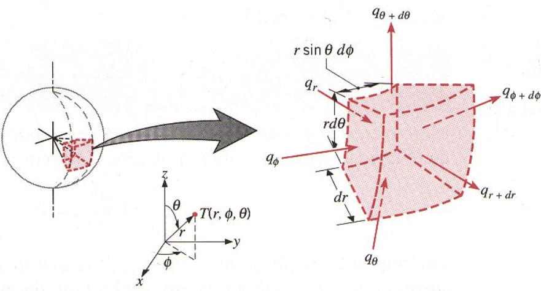
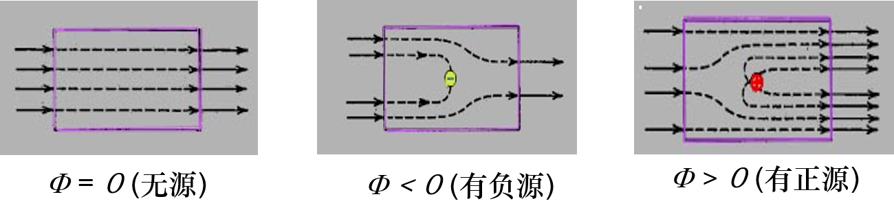
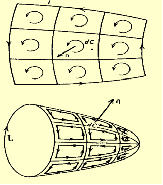
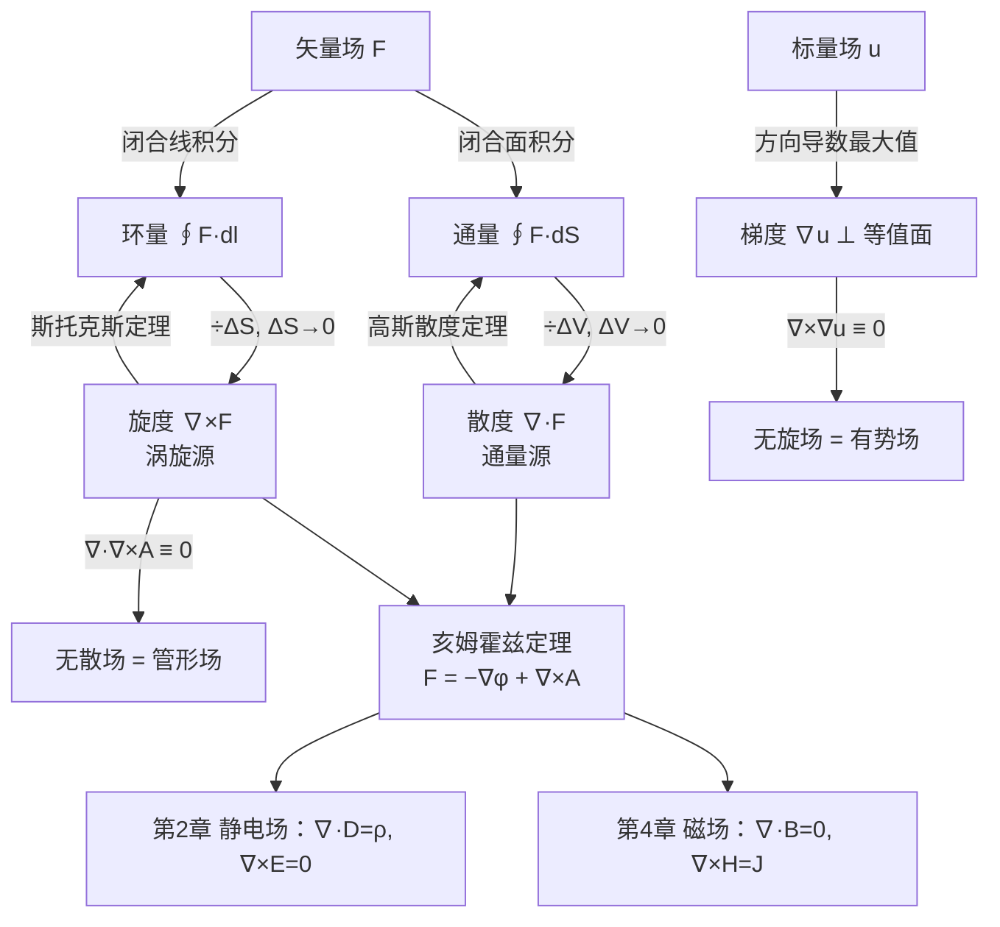

# 第 1 章 矢量分析与场论

!!! tip "本章目标"

    1. 熟练进行矢量的点积、叉积和混合积运算，理解它们的几何意义。
    2. 掌握直角、圆柱、球三种坐标系的坐标、单位矢量、度量系数和线元、面元、体元，会在坐标系之间转换。
    3. 理解**三量**（通量、环量、方向导数）和**三度**（散度、旋度、梯度）的定义和物理意义，并会在三种坐标系中计算。
    4. 掌握**三定理**：高斯散度定理、斯托克斯定理、亥姆霍兹定理。
    5. 能按“有散 / 无散、有旋 / 无旋”给矢量场分类，说出每类场的源。

**本章在全书中的位置。** 电磁场就是矢量场。后面每一章的基本方程都写成“某个场的散度 = 某种源”“某个场的旋度 = 另一种源”的形式，所以本章的散度、旋度、梯度和三个积分定理，是读懂后面所有章节的语言。

---

## 1.1 矢量及其代数运算

### 1.1.1 标量和矢量

!!! definition "定义 1.1（标量、矢量、单位矢量）"

    只用大小就能完整描述的量叫**标量**，例如电荷 $q$、电位 $\phi$、能量 $W$。既有大小又有方向的量叫**矢量**，例如电场强度 $\vv E$、力 $\vv F$。矢量记作粗斜体 $\vv A$，它的大小（模）记作 $A=\lvert\vv A\rvert$。

    模为 1 的矢量叫**单位矢量**。矢量 $\vv A$ 方向上的单位矢量为 $\vv a_A=\vv A/A$，于是 $\vv A=\vv a_A A$。

直角坐标系中，三个坐标轴方向的单位矢量记作 $\ax,\ay,\az$，任一矢量可以写成

$$\vv A=\ax A_x+\ay A_y+\az A_z,\qquad A=\sqrt{A_x^2+A_y^2+A_z^2}.$$

从原点指向点 $P(x,y,z)$ 的矢量叫**位置矢量** $\vv r=\ax x+\ay y+\az z$。从点 $P'$（源点）指向点 $P$（场点）的**距离矢量** $\vv R=\vv r-\vv r'$ 在后面的章节中会反复出现：库仑定律、毕奥–萨伐尔定律、电位和磁矢位的积分公式里都有 $\vv R/R^3$ 或 $1/R$。

### 1.1.2 矢量的代数运算

**加减法**按分量进行：$\vv A\pm\vv B=\ax(A_x\pm B_x)+\ay(A_y\pm B_y)+\az(A_z\pm B_z)$。几何上就是平行四边形法则。

!!! definition "定义 1.2（标量积与矢量积）"

    **标量积（点积）** $\vv A\cdot\vv B=AB\cos\theta=A_xB_x+A_yB_y+A_zB_z$，其中 $\theta$ 是两矢量的夹角。它是一个标量，等于 $\vv A$ 在 $\vv B$ 方向的投影乘以 $B$。

    **矢量积（叉积）** $\vv A\times\vv B=\an AB\sin\theta$。它是一个矢量，大小等于以 $\vv A,\vv B$ 为邻边的平行四边形的面积，方向 $\an$ 按右手螺旋法则从 $\vv A$ 转向 $\vv B$ 确定。分量形式为

    $$\vv A\times\vv B=\begin{vmatrix}\ax&\ay&\az\\A_x&A_y&A_z\\B_x&B_y&B_z\end{vmatrix}.$$

单位矢量之间有 $\ax\cdot\ax=1$、$\ax\cdot\ay=0$，以及**循环关系** $\ax\times\ay=\az$、$\ay\times\az=\ax$、$\az\times\ax=\ay$。

点积满足交换律，$\vv A\cdot\vv B=\vv B\cdot\vv A$；叉积**反交换**，$\vv A\times\vv B=-\vv B\times\vv A$。两者都满足分配律。

!!! info "直觉：点积管“投影”，叉积管“面积与法向”"

    - **点积**回答“$\vv A$ 有多少沿着 $\vv B$”。功 $W=\int\vv F\cdot\dd\vv l$、通量 $\int\vv B\cdot\dd\vv S$、电压 $\int\vv E\cdot\dd\vv l$，全部是点积。
    - **叉积**回答“$\vv A,\vv B$ 张成的平面朝哪、有多大”。洛伦兹力 $q\vv v\times\vv B$、毕奥–萨伐尔定律中的 $\dd\vv l\times\vv R$、坡印廷矢量 $\vv E\times\vv H$，全部是叉积。

!!! theorem "定理 1.1（三重积）"

    1. **标量三重积（混合积）**可以循环轮换：

        $$\vv A\cdot(\vv B\times\vv C)=\vv B\cdot(\vv C\times\vv A)=\vv C\cdot(\vv A\times\vv B)=\begin{vmatrix}A_x&A_y&A_z\\B_x&B_y&B_z\\C_x&C_y&C_z\end{vmatrix}.$$

        它的绝对值等于以 $\vv A,\vv B,\vv C$ 为棱的平行六面体的体积。

    2. **矢量三重积**（“BAC − CAB”法则）：

        $$\vv A\times(\vv B\times\vv C)=\vv B(\vv A\cdot\vv C)-\vv C(\vv A\cdot\vv B).$$

        一般情况下 $\vv A\times(\vv B\times\vv C)\neq(\vv A\times\vv B)\times\vv C$，即叉积**不满足结合律**。

!!! example "例题 1.1"

    已知 $\vv A=\ax+\ay$，$\vv B=\ay+\az$，$\vv C=\ax+\az$。求 (1) $\vv A$ 与 $\vv B$ 的夹角；(2) $\vv A\times\vv B$；(3) 以 $\vv A,\vv B,\vv C$ 为棱的平行六面体的体积；(4) $\vv A\times(\vv B\times\vv C)$。

    **解。** (1) $\vv A\cdot\vv B=0+1+0=1$，$A=B=\sqrt2$，所以 $\cos\theta=\dfrac{1}{2}$，$\theta=60^\circ$。

    (2) $\vv A\times\vv B=\begin{vmatrix}\ax&\ay&\az\\1&1&0\\0&1&1\end{vmatrix}=\ax(1-0)-\ay(1-0)+\az(1-0)=\ax-\ay+\az$。

    检验：$(\vv A\times\vv B)\cdot\vv A=1-1+0=0$，确实与 $\vv A$ 垂直。

    (3) $V=\lvert(\vv A\times\vv B)\cdot\vv C\rvert=\lvert1+0+1\rvert=2$。

    (4) 用 BAC − CAB 法则：$\vv A\cdot\vv C=1$，$\vv A\cdot\vv B=1$，所以

    $$\vv A\times(\vv B\times\vv C)=\vv B\cdot1-\vv C\cdot1=-\ax+\ay.$$

!!! warning "易错点"

    - $\vv A\cdot\vv B=\vv A\cdot\vv C$ **推不出** $\vv B=\vv C$，只能推出 $\vv A\perp(\vv B-\vv C)$。叉积同理。
    - 叉积的顺序不能随意交换，交换一次多一个负号。行列式第二行写 $\vv A$，第三行写 $\vv B$。
    - 标量不能“除以矢量”；“矢量除法”没有定义。

---

## 1.2 圆柱坐标系和球坐标系

当场源具有轴对称性（如长直导线、同轴线）时用**圆柱坐标**，具有球对称性（如点电荷、球形电极）时用**球坐标**，往往能把三重积分降为一重。

<figure class="video" markdown>
<video controls preload="metadata" width="100%" poster="assets/posters/C1_Coordinates.jpg"><source src="assets/videos/C1_Coordinates.mp4" type="video/mp4"></video>
<figcaption>动画 1-1　圆柱坐标与球坐标的单位矢量：它们随场点位置转动，不是常矢量。</figcaption>
</figure>

### 1.2.1 圆柱坐标系

!!! definition "定义 1.3（圆柱坐标）"

    空间一点的圆柱坐标是 $(\rho,\phi,z)$，其中 $\rho\ge0$ 是点到 $z$ 轴的距离，$\phi\in[0,2\pi)$ 是从 $x$ 轴量起的方位角，$z$ 与直角坐标相同：

    $$x=\rho\cos\phi,\quad y=\rho\sin\phi,\quad z=z;\qquad \rho=\sqrt{x^2+y^2},\quad \tan\phi=\frac yx.$$

    单位矢量 $\arho,\aphi,\az$ 分别指向 $\rho,\phi,z$ 增大的方向，两两正交，构成右手系：$\arho\times\aphi=\az$。

$\arho,\aphi$ 与直角坐标单位矢量的关系（$\az$ 不变）：

$$\begin{bmatrix}\arho\\\aphi\end{bmatrix}=\begin{bmatrix}\cos\phi&\sin\phi\\-\sin\phi&\cos\phi\end{bmatrix}\begin{bmatrix}\ax\\\ay\end{bmatrix},\qquad
\begin{bmatrix}A_x\\A_y\\A_z\end{bmatrix}=\begin{bmatrix}\cos\phi&-\sin\phi&0\\\sin\phi&\cos\phi&0\\0&0&1\end{bmatrix}\begin{bmatrix}A_\rho\\A_\phi\\A_z\end{bmatrix}.$$

变换矩阵是正交矩阵，逆矩阵就是转置。由此 $\dfrac{\partial\arho}{\partial\phi}=\aphi$，$\dfrac{\partial\aphi}{\partial\phi}=-\arho$，**$\arho,\aphi$ 随 $\phi$ 变化**。

**线元、面元、体元。** 沿三个坐标方向各走一小步，弧长分别为 $\dd\rho$、$\rho\,\dd\phi$、$\dd z$，所以

$$\dd\vv l=\arho\,\dd\rho+\aphi\,\rho\,\dd\phi+\az\,\dd z,\qquad \dd V=\rho\,\dd\rho\,\dd\phi\,\dd z,$$

$$\dd\vv S_\rho=\arho\,\rho\,\dd\phi\,\dd z,\qquad \dd\vv S_\phi=\aphi\,\dd\rho\,\dd z,\qquad \dd\vv S_z=\az\,\rho\,\dd\rho\,\dd\phi.$$

### 1.2.2 球坐标系

!!! definition "定义 1.4（球坐标）"

    空间一点的球坐标是 $(r,\theta,\phi)$，其中 $r\ge0$ 是点到原点的距离，$\theta\in[0,\pi]$ 是与 $+z$ 轴的夹角（极角），$\phi$ 与圆柱坐标相同：

    $$x=r\sin\theta\cos\phi,\quad y=r\sin\theta\sin\phi,\quad z=r\cos\theta.$$

    单位矢量 $\ar,\atheta,\aphi$ 两两正交，$\ar\times\atheta=\aphi$。

$$\begin{bmatrix}\ar\\\atheta\\\aphi\end{bmatrix}=\begin{bmatrix}\sin\theta\cos\phi&\sin\theta\sin\phi&\cos\theta\\\cos\theta\cos\phi&\cos\theta\sin\phi&-\sin\theta\\-\sin\phi&\cos\phi&0\end{bmatrix}\begin{bmatrix}\ax\\\ay\\\az\end{bmatrix}.$$

沿三个方向的弧长为 $\dd r$、$r\,\dd\theta$、$r\sin\theta\,\dd\phi$（纬线圆的半径是 $r\sin\theta$），所以

$$\dd\vv l=\ar\,\dd r+\atheta\,r\,\dd\theta+\aphi\,r\sin\theta\,\dd\phi,\qquad \dd V=r^2\sin\theta\,\dd r\,\dd\theta\,\dd\phi,$$

$$\dd\vv S_r=\ar\,r^2\sin\theta\,\dd\theta\,\dd\phi\quad(\text{球面面元}),\qquad \oint_{\text{球面}}\dd S=4\pi r^2 .$$

<figure markdown>
{ width="640" }
<figcaption>图 1-A　球坐标的体积元：三条棱长分别是 $\dd r$、$r\,\dd\theta$、$r\sin\theta\,\dd\phi$，相乘即 $\dd V=r^2\sin\theta\,\dd r\,\dd\theta\,\dd\phi$。图中箭头是穿过六个面的通量，后面推导球坐标散度公式时正是“对面相减”（图源：SCUTEEE 开源笔记）</figcaption>
</figure>

!!! success "关键公式：度量系数（拉梅系数）"

    把三种坐标统一写成 $(u_1,u_2,u_3)$，线元 $\dd l_i=h_i\,\dd u_i$：

    | 坐标系 | $(u_1,u_2,u_3)$ | $(h_1,h_2,h_3)$ | $\dd V=h_1h_2h_3\,\dd u_1\dd u_2\dd u_3$ |
    |---|---|---|---|
    | 直角 | $(x,y,z)$ | $(1,1,1)$ | $\dd x\,\dd y\,\dd z$ |
    | 圆柱 | $(\rho,\phi,z)$ | $(1,\rho,1)$ | $\rho\,\dd\rho\,\dd\phi\,\dd z$ |
    | 球 | $(r,\theta,\phi)$ | $(1,r,r\sin\theta)$ | $r^2\sin\theta\,\dd r\,\dd\theta\,\dd\phi$ |

    后面的散度、旋度、梯度、拉普拉斯算子在曲线坐标中的公式，全部由这三个 $h_i$ 决定。

!!! example "例题 1.2（坐标与矢量的转换）"

    (1) 求点 $P(1,1,\sqrt2)$ 的圆柱坐标和球坐标。(2) 把圆柱坐标中的矢量 $\vv A=\arho\dfrac{k}{\rho^2}+\az\,5\sin2\phi$ 化为直角坐标表达式。

    **解。** (1) $\rho=\sqrt{1+1}=\sqrt2$，$\phi=\arctan1=\dfrac\pi4$，$z=\sqrt2$；$r=\sqrt{1+1+2}=2$，$\cos\theta=\dfrac{\sqrt2}{2}$，$\theta=\dfrac\pi4$，$\phi=\dfrac\pi4$。

    (2) $A_\rho=k/\rho^2$，$A_\phi=0$，$A_z=5\sin2\phi$。由变换矩阵，$A_x=A_\rho\cos\phi$，$A_y=A_\rho\sin\phi$。再用 $\cos\phi=x/\rho$、$\sin\phi=y/\rho$、$\sin2\phi=2xy/\rho^2$，得

    $$\vv A=\ax\frac{kx}{(x^2+y^2)^{3/2}}+\ay\frac{ky}{(x^2+y^2)^{3/2}}+\az\frac{10xy}{x^2+y^2}.$$

!!! warning "易错点"

    - **曲线坐标的单位矢量不是常矢量。** 例如 $\displaystyle\int_0^{2\pi}\arho\,\dd\phi=\int_0^{2\pi}(\ax\cos\phi+\ay\sin\phi)\,\dd\phi=\vv 0$，而不是 $2\pi\arho$。对矢量积分时，应先把 $\arho,\aphi$（或 $\ar,\atheta$）化成直角坐标单位矢量，或者先用对称性判断哪些分量抵消。
    - 两个不同点的矢量**不能**直接在圆柱或球坐标中按分量相加：它们的单位矢量不同。
    - 圆柱坐标的 $\rho$ 与球坐标的 $r$ 不同：$\rho=r\sin\theta$。

---

## 1.3 矢量场

### 1.3.1 矢量场的矢量线

!!! definition "定义 1.5（矢量线）"

    曲线上每一点的切线方向都与该点矢量 $\vv F$ 方向一致的曲线，叫做 $\vv F$ 的**矢量线**（电场中叫电力线，磁场中叫磁力线）。由 $\dd\vv l\parallel\vv F$，即 $\dd\vv l\times\vv F=\vv 0$，得到矢量线的微分方程

    $$\frac{\dd x}{F_x}=\frac{\dd y}{F_y}=\frac{\dd z}{F_z}.$$

矢量线的**疏密**表示场的强弱，**切向**表示场的方向。

!!! example "例题 1.3（矢量线）"

    求下列矢量场的矢量线：(1) 点电荷的电场 $\vv E=\dfrac{q}{4\pi\varepsilon_0r^3}\vv r$；(2) 二维场 $\vv F=-\ax y+\ay x$。

    **解。** (1) $E_x:E_y:E_z=x:y:z$，方程 $\dfrac{\dd x}{x}=\dfrac{\dd y}{y}=\dfrac{\dd z}{z}$ 积分得 $y=C_1x$，$z=C_2x$。矢量线是从原点出发的**射线**：$q>0$ 时向外，$q<0$ 时向内。

    (2) $\dfrac{\dd x}{-y}=\dfrac{\dd y}{x}\Rightarrow x\,\dd x+y\,\dd y=0\Rightarrow x^2+y^2=C$。矢量线是绕原点的**同心圆**（逆时针）。

    这两个场分别是“有散无旋”和“有旋无散”的典型代表，见 1.5 节。

### 1.3.2 矢量场的通量及散度

<figure class="video" markdown>
<video controls preload="metadata" width="100%" poster="assets/posters/C1_Divergence.jpg"><source src="assets/videos/C1_Divergence.mp4" type="video/mp4"></video>
<figcaption>动画 1-2　散度 = 单位体积（二维时为单位面积）的净流出通量。小圆缩小时，比值趋于常数，就是该点的散度。</figcaption>
</figure>

!!! definition "定义 1.6（通量）"

    面元矢量 $\dd\vv S=\an\,\dd S$，$\an$ 是面元的单位法向（对闭合曲面取**外法向**）。矢量场 $\vv F$ 穿过曲面 $S$ 的**通量**为

    $$\Psi=\int_S\vv F\cdot\dd\vv S=\int_S F\cos\theta\,\dd S .$$

    对闭合曲面，$\oint_S\vv F\cdot\dd\vv S>0$ 表示 $S$ 内有净的**正源**（流出多于流入），$<0$ 表示有净的**负源（汇）**，$=0$ 表示净源为零。

<figure markdown>
{ width="720" }
<figcaption>图 1-B　闭合面通量的三种情形：矢量线穿过而无增减（$\Psi=0$，无源）；有矢量线终止在面内（$\Psi<0$，有汇）；有矢量线从面内发出（$\Psi>0$，有正源）（图源：上海交大何广强《电磁场与波》课件）</figcaption>
</figure>

通量只告诉我们“一块区域里”源的总量。要知道**每一点**的源强，就把区域缩到一点。

!!! definition "定义 1.7（散度）"

    $$\operatorname{div}\vv F=\nabla\cdot\vv F=\lim_{\Delta V\to0}\frac{\oint_S\vv F\cdot\dd\vv S}{\Delta V}.$$

    散度是标量，表示该点单位体积发出的净通量，即**通量源密度**。

取一个以 $(x,y,z)$ 为角、边长 $\Delta x,\Delta y,\Delta z$ 的小长方体：$x$ 方向前后两面的净流出为 $\left[F_x(x+\Delta x)-F_x(x)\right]\Delta y\Delta z\approx\dfrac{\partial F_x}{\partial x}\Delta V$，三对面相加后除以 $\Delta V$，得直角坐标公式

$$\nabla\cdot\vv F=\frac{\partial F_x}{\partial x}+\frac{\partial F_y}{\partial y}+\frac{\partial F_z}{\partial z}.$$

这正是**哈密顿算子** $\nabla=\ax\dfrac{\partial}{\partial x}+\ay\dfrac{\partial}{\partial y}+\az\dfrac{\partial}{\partial z}$ 与 $\vv F$ 的“点积”。$\nabla$ 是一个**矢性微分算子**：它既要对后面的函数求导，又按矢量规则相乘。

!!! success "关键公式：曲线坐标中的散度"

    $$\text{圆柱：}\ \nabla\cdot\vv F=\frac1\rho\frac{\partial(\rho F_\rho)}{\partial\rho}+\frac1\rho\frac{\partial F_\phi}{\partial\phi}+\frac{\partial F_z}{\partial z}$$

    $$\text{球：}\ \nabla\cdot\vv F=\frac1{r^2}\frac{\partial(r^2F_r)}{\partial r}+\frac{1}{r\sin\theta}\frac{\partial(\sin\theta F_\theta)}{\partial\theta}+\frac{1}{r\sin\theta}\frac{\partial F_\phi}{\partial\phi}$$

    一般形式：$\nabla\cdot\vv F=\dfrac{1}{h_1h_2h_3}\left[\dfrac{\partial(h_2h_3F_1)}{\partial u_1}+\dfrac{\partial(h_3h_1F_2)}{\partial u_2}+\dfrac{\partial(h_1h_2F_3)}{\partial u_3}\right]$。

!!! theorem "定理 1.2（高斯散度定理）"

    设 $\vv F$ 在闭合曲面 $S$ 围成的区域 $V$ 上连续可微，$S$ 取外法向，则

    $$\oint_S\vv F\cdot\dd\vv S=\int_V\nabla\cdot\vv F\,\dd V .$$

!!! proof "证明思路"

    把 $V$ 切成许多小体积 $\Delta V_i$。对每个小体积，由散度定义，$\oint_{S_i}\vv F\cdot\dd\vv S\approx(\nabla\cdot\vv F)_i\Delta V_i$。把所有小体积的通量加起来时，相邻两块的公共面法向相反，通量**两两抵消**，只剩外表面 $S$ 的通量。令 $\Delta V_i\to0$，右边的和变成体积分。

散度定理把“面上的通量”变成“体内源的总和”。在第 2 章，它把高斯定律的积分形式 $\oint\vv D\cdot\dd\vv S=q$ 变成微分形式 $\nabla\cdot\vv D=\rho_V$。

!!! example "例题 1.4（验证散度定理）"

    在矢量场 $\vv A=\ax x^2+\ay xy+\az yz$ 中，取一个以原点为顶点、边长为 1、位于第一卦限的单位立方体。求 (1) $\nabla\cdot\vv A$；(2) 从立方体内穿出的通量，并验证散度定理。

    **解。** (1) $\nabla\cdot\vv A=2x+x+y=3x+y$。

    (2) 六个面逐一计算（外法向）：

    - 前后面（$x=1$ 取 $+\ax$，$x=0$ 取 $-\ax$）：$\displaystyle\int_0^1\!\!\int_0^1 1\,\dd y\,\dd z-0=1$；
    - 左右面（$y=1$ 取 $+\ay$，$y=0$ 取 $-\ay$）：$\displaystyle\int_0^1\!\!\int_0^1 x\,\dd x\,\dd z-0=\frac12$；
    - 上下面（$z=1$ 取 $+\az$，$z=0$ 取 $-\az$）：$\displaystyle\int_0^1\!\!\int_0^1 y\,\dd x\,\dd y-0=\frac12$。

    总通量 $\Psi=1+\dfrac12+\dfrac12=2$。另一方面 $\displaystyle\int_V(3x+y)\,\dd V=\frac32+\frac12=2$。两者相等。

!!! example "例题 1.5（$\vv r$ 与 $\ar/r^2$ 的散度）"

    求 (1) $\nabla\cdot\vv r$；(2) $\nabla\cdot\left(\dfrac{\ar}{r^2}\right)$（$r\neq0$），以及 $\dfrac{\ar}{r^2}$ 穿过以原点为心的任一球面的通量。

    **解。** (1) $\nabla\cdot\vv r=\dfrac{\partial x}{\partial x}+\dfrac{\partial y}{\partial y}+\dfrac{\partial z}{\partial z}=3$。

    (2) 用球坐标公式，$F_r=1/r^2$：$\nabla\cdot\vv F=\dfrac{1}{r^2}\dfrac{\partial}{\partial r}\left(r^2\cdot\dfrac1{r^2}\right)=0$（$r\neq0$）。

    但穿过半径为 $a$ 的球面的通量是 $\oint\dfrac{1}{a^2}\,a^2\sin\theta\,\dd\theta\,\dd\phi=4\pi\neq0$。

    这并不矛盾：**通量全部来自原点这一个点**，那里场不可微，散度定理不能直接用。用 $\delta$ 函数可以写成 $\nabla\cdot\left(\dfrac{\ar}{r^2}\right)=4\pi\delta(\vv r)$。点电荷的场正是这种形式，这就是第 2 章高斯定律的数学核心。

### 1.3.3 矢量场的环量及旋度

<figure class="video" markdown>
<video controls preload="metadata" width="100%" poster="assets/posters/C1_Curl.jpg"><source src="assets/videos/C1_Curl.mp4" type="video/mp4"></video>
<figcaption>动画 1-3　旋度的“桨轮”图像：剪切流的矢量线是直线，桨轮却会转；涡旋场的矢量线是圆，桨轮却只公转不自转。</figcaption>
</figure>

!!! definition "定义 1.8（环量与旋度）"

    矢量场 $\vv F$ 沿闭合曲线 $l$ 的线积分 $\Gamma=\oint_l\vv F\cdot\dd\vv l$ 叫做**环量**。

    在点 $P$ 处取一个法向为 $\an$ 的小面元 $\Delta S$，边界 $l$ 的绕向与 $\an$ 成右手螺旋。极限

    $$\operatorname{rot}_n\vv F=\lim_{\Delta S\to0}\frac{\oint_l\vv F\cdot\dd\vv l}{\Delta S}$$

    叫做 $\vv F$ 在 $\an$ 方向的**环量面密度**。它随 $\an$ 的取向而变；取到最大值的方向和这个最大值，合起来定义一个矢量，叫做**旋度** $\operatorname{rot}\vv F=\nabla\times\vv F$，并且

    $$(\nabla\times\vv F)\cdot\an=\operatorname{rot}_n\vv F .$$

    旋度表示该点的**涡旋源密度**。

在 $xy$ 平面上取边长 $\Delta x,\Delta y$ 的小矩形计算环量：两条水平边贡献 $-\dfrac{\partial F_x}{\partial y}\Delta x\Delta y$，两条竖直边贡献 $\dfrac{\partial F_y}{\partial x}\Delta x\Delta y$，所以 $(\nabla\times\vv F)_z=\dfrac{\partial F_y}{\partial x}-\dfrac{\partial F_x}{\partial y}$。三个分量合起来：

$$\nabla\times\vv F=\begin{vmatrix}\ax&\ay&\az\\\dfrac{\partial}{\partial x}&\dfrac{\partial}{\partial y}&\dfrac{\partial}{\partial z}\\F_x&F_y&F_z\end{vmatrix}.$$

!!! success "关键公式：曲线坐标中的旋度"

    $$\nabla\times\vv F=\frac{1}{h_1h_2h_3}\begin{vmatrix}h_1\vv a_1&h_2\vv a_2&h_3\vv a_3\\\dfrac{\partial}{\partial u_1}&\dfrac{\partial}{\partial u_2}&\dfrac{\partial}{\partial u_3}\\h_1F_1&h_2F_2&h_3F_3\end{vmatrix}$$

    圆柱坐标：$\dfrac1\rho\begin{vmatrix}\arho&\rho\aphi&\az\\\partial_\rho&\partial_\phi&\partial_z\\F_\rho&\rho F_\phi&F_z\end{vmatrix}$；球坐标：$\dfrac{1}{r^2\sin\theta}\begin{vmatrix}\ar&r\atheta&r\sin\theta\aphi\\\partial_r&\partial_\theta&\partial_\phi\\F_r&rF_\theta&r\sin\theta F_\phi\end{vmatrix}$。

!!! info "直觉：旋度是“局部转动”，不是“矢量线弯曲”"

    把一个小桨轮放进流体，桨轮自转的角速度等于 $\tfrac12\lvert\nabla\times\vv F\rvert$。动画 1-3 给出两个反直觉的例子：

    - 剪切流 $\vv F=\ax y$：矢量线全是直线，但上层流得比下层快，桨轮被“搓”着转，$\nabla\times\vv F=-\az\neq0$。
    - 涡旋 $\vv F=\aphi/\rho$：矢量线全是圆，但外圈慢、内圈快，恰好抵消，$\rho\neq0$ 处 $\nabla\times\vv F=0$。它的涡旋源全部集中在 $z$ 轴上。第 4 章长直导线的磁场 $\vv H=\aphi\dfrac{I}{2\pi\rho}$ 就是这个场。

!!! theorem "定理 1.3（斯托克斯定理）"

    设 $S$ 是以闭合曲线 $l$ 为边界的任意曲面，$l$ 的绕向与 $S$ 的法向成右手螺旋，$\vv F$ 在 $S$ 上连续可微，则

    $$\oint_l\vv F\cdot\dd\vv l=\int_S(\nabla\times\vv F)\cdot\dd\vv S .$$

证明思路与散度定理完全相同：把 $S$ 剖分成小面元，相邻面元的公共边被走两次且方向相反，环量抵消，只剩外边界 $l$。

<figure markdown>
{ width="320" }
<figcaption>图 1-C　斯托克斯定理的剖分图像：每个小回路的环量 $\approx(\nabla\times\vv F)\cdot\an\Delta S$；内部公共边上的线积分两两抵消，只剩外边界。下图说明曲面可以任意“鼓起”，只要边界 $l$ 不变，结果就不变（图源：上海交大何广强《电磁场与波》课件）</figcaption>
</figure>

!!! example "例题 1.6（验证斯托克斯定理）"

    已知 $\vv F=\ax xy-\ay 2x$。求 (1) $\nabla\times\vv F$；(2) $\vv F$ 沿第一象限半径为 3 的四分之一圆盘边界（逆时针：$O\to A(3,0)\to B(0,3)\to O$）的环量，并验证斯托克斯定理。

    **解。** (1) $\nabla\times\vv F=\az\left[\dfrac{\partial(-2x)}{\partial x}-\dfrac{\partial(xy)}{\partial y}\right]=-\az(2+x)$。

    (2) 线段 $OA$（$y=0$）上 $\vv F\cdot\dd\vv l=xy\,\dd x=0$；线段 $BO$（$x=0$）上 $\vv F\cdot\dd\vv l=-2x\,\dd y=0$。圆弧 $AB$ 上 $x=3\cos\phi$，$y=3\sin\phi$，$\dd\vv l=(-\ax\sin\phi+\ay\cos\phi)3\,\dd\phi$：

    $$\int_{AB}=\int_0^{\pi/2}\left(-27\sin^2\phi\cos\phi-18\cos^2\phi\right)\dd\phi=-9-\frac{9\pi}{2}=-9\left(1+\frac\pi2\right).$$

    面积分（法向 $+\az$）：

    $$\int_S-(2+\rho\cos\phi)\,\rho\,\dd\rho\,\dd\phi=-\left(2\cdot\frac92\cdot\frac\pi2+9\cdot1\right)=-9\left(1+\frac\pi2\right).$$

    两者相等，斯托克斯定理成立。

!!! note "前后联系：散度定理、斯托克斯定理与复变函数"

    二维情形下，斯托克斯定理就是格林公式。复变函数中**柯西积分定理** $\oint f\,\dd z=0$ 的证明正是用格林公式加 C-R 方程。实际上，若 $f=u+\je v$ 解析，则二维矢量场 $\vv F=(u,-v)$ 同时满足 $\nabla\cdot\vv F=u_x-v_y=0$ 和 $(\nabla\times\vv F)_z=-v_x-u_y=0$：**C-R 方程就是“无散又无旋”**。见[复变函数 第 2 章](https://cockroach-f.github.io/complex-functions/ch2.html)与[第 3 章](https://cockroach-f.github.io/complex-functions/ch3.html)。这也是第 3 章能用共形映射解二维静电场的原因。

---

## 1.4 标量场的等值面、方向导数和梯度

<figure class="video" markdown>
<video controls preload="metadata" width="100%" poster="assets/posters/C1_Gradient.jpg"><source src="assets/videos/C1_Gradient.mp4" type="video/mp4"></video>
<figcaption>动画 1-4　梯度垂直于等值线；转动方向 $\vv a_l$ 时，方向导数按 $|\nabla u|\cos\alpha$ 变化，沿梯度方向最大。</figcaption>
</figure>

### 1.4.1 标量场的等值面

标量场 $u(x,y,z)$ 取相同值的点构成的曲面 $u(x,y,z)=C$ 叫**等值面**；二维时叫**等值线**（如地图的等高线）。取不同的常数 $C$ 得到一族互不相交的等值面，它们充满整个空间。电位的等值面就是第 2 章的**等位面**。

### 1.4.2 方向导数

!!! definition "定义 1.9（方向导数）"

    从点 $P$ 沿单位矢量 $\vv a_l=\ax\cos\alpha+\ay\cos\beta+\az\cos\gamma$ 方向移动距离 $\Delta l$ 到达 $P'$，极限

    $$\frac{\partial u}{\partial l}\Big|_P=\lim_{\Delta l\to0}\frac{u(P')-u(P)}{\Delta l}$$

    叫做 $u$ 在 $P$ 点沿 $\vv a_l$ 方向的**方向导数**。由链式法则，

    $$\frac{\partial u}{\partial l}=\frac{\partial u}{\partial x}\cos\alpha+\frac{\partial u}{\partial y}\cos\beta+\frac{\partial u}{\partial z}\cos\gamma .$$

### 1.4.3 标量场的梯度

方向导数的公式可以写成两个矢量的点积：

$$\frac{\partial u}{\partial l}=\left(\ax\frac{\partial u}{\partial x}+\ay\frac{\partial u}{\partial y}+\az\frac{\partial u}{\partial z}\right)\cdot\vv a_l=\nabla u\cdot\vv a_l=\lvert\nabla u\rvert\cos\alpha',$$

其中 $\alpha'$ 是 $\vv a_l$ 与 $\nabla u$ 的夹角。

!!! definition "定义 1.10（梯度）"

    $$\operatorname{grad}u=\nabla u=\ax\frac{\partial u}{\partial x}+\ay\frac{\partial u}{\partial y}+\az\frac{\partial u}{\partial z}.$$

    梯度的方向是 $u$ **增加最快**的方向，大小是这个最大的增长率。

!!! theorem "定理 1.4（梯度的性质）"

    1. 任意方向的方向导数等于梯度在该方向的投影：$\dfrac{\partial u}{\partial l}=\nabla u\cdot\vv a_l$。
    2. 梯度**垂直于等值面**，指向 $u$ 增大的一侧。（沿等值面移动 $\dd\vv l$ 时 $\dd u=\nabla u\cdot\dd\vv l=0$。）
    3. 梯度的线积分**只与端点有关**：$\displaystyle\int_A^B\nabla u\cdot\dd\vv l=u(B)-u(A)$；所以沿任意闭合路径 $\oint\nabla u\cdot\dd\vv l=0$。
    4. 曲线坐标中：$\nabla u=\arho\dfrac{\partial u}{\partial\rho}+\aphi\dfrac{1}{\rho}\dfrac{\partial u}{\partial\phi}+\az\dfrac{\partial u}{\partial z}$；$\nabla u=\ar\dfrac{\partial u}{\partial r}+\atheta\dfrac1r\dfrac{\partial u}{\partial\theta}+\aphi\dfrac{1}{r\sin\theta}\dfrac{\partial u}{\partial\phi}$。

性质 3 在第 2 章变成“静电场力做功与路径无关，可以定义电位”，即 $U_{AB}=\int_A^B\vv E\cdot\dd\vv l=\phi_A-\phi_B$。电场 $\vv E=-\nabla\phi$ 中的负号来自约定：电场指向电位**降低**最快的方向。

!!! example "例题 1.7（梯度与方向导数）"

    已知 $u=x^2y+yz$，求 (1) 点 $P(1,2,-1)$ 处的梯度；(2) 在 $P$ 点沿 $\vv l=\ax+2\ay+2\az$ 方向的方向导数；(3) $P$ 点的最大增长率和过 $P$ 的等值面的单位法向。

    **解。** (1) $\nabla u=\ax2xy+\ay(x^2+z)+\az y$，代入 $P$ 得 $\nabla u\big|_P=4\ax+0\ay+2\az$。

    (2) $\vv a_l=\dfrac{\ax+2\ay+2\az}{3}$，$\dfrac{\partial u}{\partial l}=\dfrac{4+0+4}{3}=\dfrac83$。

    (3) 最大增长率 $\lvert\nabla u\rvert=\sqrt{16+4}=2\sqrt5$。等值面 $u=u(P)=0$ 的单位法向 $\an=\dfrac{\nabla u}{\lvert\nabla u\rvert}=\dfrac{2\ax+\az}{\sqrt5}$。

!!! example "例题 1.8（源点与场点：$\nabla\frac1R$）"

    设场点 $\vv r=(x,y,z)$，源点 $\vv r'=(x',y',z')$，$\vv R=\vv r-\vv r'$。证明 $\nabla\dfrac1R=-\dfrac{\vv R}{R^3}$，$\nabla'\dfrac1R=\dfrac{\vv R}{R^3}$（$\nabla'$ 表示对带撇坐标求导）。

    **解。** $R=\sqrt{(x-x')^2+(y-y')^2+(z-z')^2}$，$\dfrac{\partial}{\partial x}\dfrac1R=-\dfrac{1}{R^2}\cdot\dfrac{x-x'}{R}$，三个分量合起来即 $-\dfrac{\vv R}{R^3}$。对 $x'$ 求导多一个负号，所以 $\nabla'\dfrac1R=-\nabla\dfrac1R$。

    第 2 章会用到：点电荷的场 $\dfrac{q\vv R}{4\pi\varepsilon_0R^3}=-\nabla\left(\dfrac{q}{4\pi\varepsilon_0R}\right)$，电位就是 $\dfrac{q}{4\pi\varepsilon_0R}$。

!!! warning "易错点"

    - 梯度作用于**标量**，结果是矢量；散度作用于**矢量**，结果是标量；旋度作用于矢量，结果是矢量。写出 $\nabla\cdot u$ 或 $\nabla\times u$（$u$ 为标量）都是错误的。
    - 曲线坐标中**不能**把 $\nabla$ 写成 $\arho\partial_\rho+\aphi\partial_\phi+\cdots$ 后直接点乘或叉乘：一是缺度量系数，二是单位矢量本身也要被求导。要用上面给出的公式。
    - 方向导数要用**单位**方向矢量 $\vv a_l$；题目给的 $\vv l$ 不是单位矢量时要先归一化。

---

## 1.5 亥姆霍兹定理

### 两个零恒等式

!!! theorem "定理 1.5（两个零恒等式）"

    对任意二阶连续可微的标量场 $u$ 和矢量场 $\vv A$：

    $$\nabla\times(\nabla u)\equiv\vv 0,\qquad\nabla\cdot(\nabla\times\vv A)\equiv0 .$$

    逆命题在单连通区域（对第二式为“无空洞”的区域）内也成立：

    - 若 $\nabla\times\vv F=\vv 0$，则存在标量函数 $u$ 使 $\vv F=-\nabla u$（**无旋场 = 有势场 = 保守场**）；
    - 若 $\nabla\cdot\vv F=0$，则存在矢量函数 $\vv A$ 使 $\vv F=\nabla\times\vv A$（**无散场 = 管形场**）。

直接用直角坐标展开即可验证：例如 $\nabla\times\nabla u$ 的 $z$ 分量是 $\dfrac{\partial^2u}{\partial x\partial y}-\dfrac{\partial^2u}{\partial y\partial x}=0$。

这两个恒等式就是第 2 章引入**电位** $\phi$（$\nabla\times\vv E=0\Rightarrow\vv E=-\nabla\phi$）和第 4 章引入**矢量磁位** $\vv A$（$\nabla\cdot\vv B=0\Rightarrow\vv B=\nabla\times\vv A$）的依据。

另一个常用算子是**拉普拉斯算子** $\nabla^2u=\nabla\cdot\nabla u=\dfrac{\partial^2u}{\partial x^2}+\dfrac{\partial^2u}{\partial y^2}+\dfrac{\partial^2u}{\partial z^2}$。对矢量，$\nabla^2\vv A=\nabla(\nabla\cdot\vv A)-\nabla\times\nabla\times\vv A$，直角坐标中就是对每个分量取 $\nabla^2$。

### 亥姆霍兹定理

!!! theorem "定理 1.6（亥姆霍兹定理）"

    在有限区域 $V$ 内，一个矢量场由它的**散度、旋度和边界条件**唯一确定。在无界空间中，若场在无穷远处足够快地趋于零，则

    $$\vv F(\vv r)=-\nabla\phi(\vv r)+\nabla\times\vv A(\vv r),$$

    $$\phi(\vv r)=\frac{1}{4\pi}\int_V\frac{\nabla'\cdot\vv F(\vv r')}{\lvert\vv r-\vv r'\rvert}\,\dd V',\qquad
    \vv A(\vv r)=\frac{1}{4\pi}\int_V\frac{\nabla'\times\vv F(\vv r')}{\lvert\vv r-\vv r'\rvert}\,\dd V'.$$

**含义。** 任何矢量场都可以分解为一个无旋部分（由散度源，即“通量源”产生）和一个无散部分（由旋度源，即“涡旋源”产生）。所以研究一个矢量场，只需回答两个问题：

> **它的散度是什么？它的旋度是什么？**

这就是为什么全书每种场的基本方程都恰好是“一个散度方程 + 一个旋度方程”。

!!! info "直觉：亥姆霍兹定理是全书的主线"

    电磁学的全部内容，就是一张“源 → 场”的对照表。前四章只有前两行；第 5 章加上后两行，电场和磁场就互为对方的旋度源，于是产生电磁波：

    | 源 | 源的类型 | 产生的场 | 方程 | 章节 |
    |---|---|---|---|---|
    | 电荷 $\rho_V$ | 散度源 | $\vv D$（$\vv E$） | $\nabla\cdot\vv D=\rho_V$ | 第 2、3 章 |
    | 传导电流 $\vv J$ | 旋度源 | $\vv H$（$\vv B$） | $\nabla\times\vv H=\vv J$ | 第 4 章 |
    | 变化的磁场 $-\partial\vv B/\partial t$ | 旋度源 | $\vv E$ | $\nabla\times\vv E=-\partial\vv B/\partial t$ | 第 5 章 |
    | 变化的电场 $\partial\vv D/\partial t$（位移电流） | 旋度源 | $\vv H$ | $\nabla\times\vv H=\vv J+\partial\vv D/\partial t$ | 第 5 章 |

    磁场始终没有散度源（$\nabla\cdot\vv B=0$，不存在磁荷）。拿到任何一个场，先问“它的散度源是什么、旋度源是什么”，就知道该用哪一章的方法。

!!! success "关键公式：矢量场的分类"

    | 类型 | 散度 | 旋度 | 例子 | 可写成 |
    |---|---|---|---|---|
    | 有散无旋 | $\neq0$ | $=\vv 0$ | 静电场 $\vv E$ | $-\nabla\phi$ |
    | 无散有旋 | $=0$ | $\neq\vv 0$ | 恒定磁场 $\vv B$ | $\nabla\times\vv A$ |
    | 无散无旋（调和场） | $=0$ | $=\vv 0$ | 无源区的静电场 | $-\nabla\phi$，$\nabla^2\phi=0$ |
    | 有散有旋 | $\neq0$ | $\neq\vv 0$ | 时变电场 | 两部分叠加 |

!!! example "例题 1.9（判断场的类型并求源）"

    判断下列矢量场的类型，求出散度源与旋度源：(1) $\vv F_1=\ax yz+\ay xz+\az xy$；(2) $\vv F_2=\ax(3y^2-2x)+\ay3x^2+\az2z$。

    **解。** (1) $\nabla\cdot\vv F_1=0$；$\nabla\times\vv F_1=\ax(x-x)-\ay(y-y)+\az(z-z)=\vv 0$。它是调和场，事实上 $\vv F_1=\nabla(xyz)$，且 $\nabla^2(xyz)=0$。

    (2) $\nabla\cdot\vv F_2=-2+0+2=0$；$\nabla\times\vv F_2=\az\left(6x-6y\right)$。它是无散有旋场，旋度源密度为 $6(x-y)\az$，可以表示为某个矢量函数的旋度。

---

## 知识点归纳总结

!!! abstract "知识点归纳总结"

    **三量、三度、三定理。**

    | “量”（积分） | “度”（微分，取极限） | 联系它们的定理 |
    |---|---|---|
    | 通量 $\oint_S\vv F\cdot\dd\vv S$ | 散度 $\nabla\cdot\vv F$（标量，通量源密度） | 高斯散度定理 |
    | 环量 $\oint_l\vv F\cdot\dd\vv l$ | 旋度 $\nabla\times\vv F$（矢量，涡旋源密度） | 斯托克斯定理 |
    | 方向导数 $\partial u/\partial l$ | 梯度 $\nabla u$（矢量，垂直于等值面） | $\int_A^B\nabla u\cdot\dd\vv l=u_B-u_A$ |

    **亥姆霍兹定理**：散度 + 旋度 + 边界条件唯一确定矢量场。两个零恒等式 $\nabla\times\nabla u=0$、$\nabla\cdot\nabla\times\vv A=0$ 是引入电位和磁矢位的依据。

    **三种坐标系**：度量系数 $(1,1,1)$、$(1,\rho,1)$、$(1,r,r\sin\theta)$ 决定了所有曲线坐标公式。曲线坐标的单位矢量随位置变化。

**解题方法小结。**

1. **算散度、旋度、梯度**：先看场用的是什么坐标，就用那套坐标的公式；不要先转直角坐标再算，除非题目要求。
2. **验证散度定理**：闭合面逐片计算，每片用**外法向**，注意哪些面上 $\vv F\cdot\an=0$。
3. **验证斯托克斯定理**：分段参数化边界，绕向与面法向成右手螺旋；直线段上常常有一个分量为零。
4. **判断有势场**：算旋度是否为零；是的话，线积分与路径无关，可以选最简单的折线路径，或直接求势函数。

**易错点汇总。**

- 曲线坐标的单位矢量随位置变化，矢量积分前要先处理。
- 闭合曲面一律取外法向；环路绕向与面元法向满足右手螺旋。
- 散度的结果是标量，旋度的结果是矢量；梯度只能作用于标量。
- $\nabla\cdot(\ar/r^2)=0$ 只在 $r\neq0$ 时成立；包围原点的闭合面通量是 $4\pi$。
- 方向导数要用单位矢量。

---

## 练习题

!!! example "练习 1"

    已知 $\vv A=\ax+2\ay-3\az$，$\vv B=-4\ay+\az$，$\vv C=5\ax-2\az$。求 (1) $\vv a_A$；(2) $\vv A$ 与 $\vv B$ 的夹角；(3) $\vv A\times\vv B$；(4) $\vv A\cdot(\vv B\times\vv C)$；(5) $\vv A\times(\vv B\times\vv C)$。

    ??? success "答案"

        (1) $\vv a_A=\dfrac{\ax+2\ay-3\az}{\sqrt{14}}$。

        (2) $\vv A\cdot\vv B=-8-3=-11$，$\cos\theta=\dfrac{-11}{\sqrt{14}\sqrt{17}}\approx-0.713$，$\theta\approx135.5^\circ$。

        (3) $\vv A\times\vv B=\ax(2-12)-\ay(1-0)+\az(-4-0)=-10\ax-\ay-4\az$。

        (4) $\vv B\times\vv C=8\ax+5\ay+20\az$，$\vv A\cdot(\vv B\times\vv C)=8+10-60=-42$。

        (5) BAC − CAB：$\vv A\cdot\vv C=11$，$\vv A\cdot\vv B=-11$，所以 $\vv A\times(\vv B\times\vv C)=11\vv B+11\vv C=55\ax-44\ay-11\az$。

!!! example "练习 2"

    球坐标中的场 $\vv E=\ar\dfrac{25}{r^2}$。求 (1) 直角坐标点 $(-3,4,-5)$ 处的 $\lvert\vv E\rvert$ 和 $E_z$；(2) 该点 $\vv E$ 与 $\vv B=2\ax-2\ay+\az$ 的夹角。

    ??? success "答案"

        (1) $r^2=9+16+25=50$，$\lvert\vv E\rvert=\dfrac{25}{50}=0.5$。$\ar=\dfrac{(-3,4,-5)}{\sqrt{50}}$，所以 $E_z=0.5\times\dfrac{-5}{\sqrt{50}}\approx-0.354$。

        (2) $\cos\theta=\dfrac{\ar\cdot\vv B}{B}=\dfrac{(-6-8-5)/\sqrt{50}}{3}\approx-0.896$，$\theta\approx153.6^\circ$。

!!! example "练习 3"

    求标量场 $\psi=6x^2y^3+e^z$ 在点 $P(2,-1,0)$ 的梯度，以及在 $P$ 点沿 $\vv l=2\ax-2\ay+\az$ 方向的方向导数。

    ??? success "答案"

        $\nabla\psi=\ax12xy^3+\ay18x^2y^2+\az e^z$，在 $P$ 点为 $-24\ax+72\ay+\az$。

        $\vv a_l=\dfrac{2\ax-2\ay+\az}{3}$，$\dfrac{\partial\psi}{\partial l}=\dfrac{-48-144+1}{3}=-\dfrac{191}{3}\approx-63.7$。

!!! example "练习 4"

    区域由圆柱面 $x^2+y^2=9$ 与平面 $x=0$、$y=0$、$z=0$、$z=2$ 围成（第一卦限部分）。矢量场 $\vv A=\ax3x^2+\ay(3y+z)+\az(3z-x)$。用散度定理求 $\vv A$ 穿出该区域表面的通量。

    ??? success "答案"

        $\nabla\cdot\vv A=6x+3+3=6x+6$。体积 $V=\dfrac{\pi\cdot9}{4}\cdot2=\dfrac{9\pi}{2}$。

        $\displaystyle\int_V6\,\dd V=27\pi$；$\displaystyle\int_V6x\,\dd V=6\cdot2\int_0^{\pi/2}\!\!\int_0^3\rho\cos\phi\,\rho\,\dd\rho\,\dd\phi=12\cdot9\cdot1=108$。

        通量 $=108+27\pi\approx192.8$。（也可以逐面计算来验证。）

!!! example "练习 5"

    $\vv A=\ax4x-\ay14y^2$。从 $(0,0,0)$ 到 $(1,1,0)$ 计算 $\int_C\vv A\cdot\dd\vv l$：(1) 沿 $x=t$，$y=t^2$；(2) 沿折线 $(0,0,0)\to(1,0,0)\to(1,1,0)$。两个结果为什么相同？

    ??? success "答案"

        (1) $\displaystyle\int_0^1\left[4t-14t^4\cdot2t\right]\dd t=2-\frac{14}{3}=-\frac83$。

        (2) $\displaystyle\int_0^14x\,\dd x+\int_0^1(-14y^2)\,\dd y=2-\frac{14}{3}=-\frac83$。

        相同是因为 $\nabla\times\vv A=\az\left[\dfrac{\partial(-14y^2)}{\partial x}-\dfrac{\partial(4x)}{\partial y}\right]=\vv 0$，$\vv A$ 是有势场：$\vv A=\nabla\left(2x^2-\dfrac{14}{3}y^3\right)$，积分等于势函数在端点的差 $2-\dfrac{14}{3}$。

!!! example "练习 6"

    求 $\vv A=\ax x+\ay xy^2$ 沿圆周 $x^2+y^2=a^2$（逆时针）的环量，再求 $\nabla\times\vv A$ 在圆面上的面积分，验证斯托克斯定理。

    ??? success "答案"

        $x=a\cos\phi$，$y=a\sin\phi$，$\dd x=-a\sin\phi\,\dd\phi$，$\dd y=a\cos\phi\,\dd\phi$：

        $\displaystyle\oint=\int_0^{2\pi}\left[-a^2\cos\phi\sin\phi+a^4\cos^2\phi\sin^2\phi\right]\dd\phi=0+a^4\cdot\frac{\pi}{4}=\frac{\pi a^4}{4}$。

        $\nabla\times\vv A=\az\left(y^2-0\right)$，$\displaystyle\int_Sy^2\,\dd S=\int_0^{2\pi}\!\!\int_0^a\rho^2\sin^2\phi\,\rho\,\dd\rho\,\dd\phi=\frac{a^4}{4}\pi$。两者相等。

!!! example "练习 7"

    球坐标中 $\phi=\dfrac{p_e\cos\theta}{4\pi\varepsilon_0r^2}$（$p_e,\varepsilon_0$ 为常数），求 $\vv E=-\nabla\phi$。（这是第 2 章电偶极子的电位。）

    ??? success "答案"

        $E_r=-\dfrac{\partial\phi}{\partial r}=\dfrac{2p_e\cos\theta}{4\pi\varepsilon_0r^3}$，$E_\theta=-\dfrac1r\dfrac{\partial\phi}{\partial\theta}=\dfrac{p_e\sin\theta}{4\pi\varepsilon_0r^3}$，$E_\phi=0$。

        $$\vv E=\frac{p_e}{4\pi\varepsilon_0r^3}\left(\ar2\cos\theta+\atheta\sin\theta\right).$$

!!! example "练习 8"

    判断下列矢量场哪些无旋、哪些无散，哪些可以写成梯度、哪些可以写成旋度，并求源分布：

    $\vv A=\ar\sin\theta\cos\phi+\atheta\cos\theta\cos\phi-\aphi\sin\phi$；$\vv B=\arho z^2\sin\phi+\aphi z^2\cos\phi+\az2\rho z\sin\phi$；$\vv C=\ax(3y^2-2x)+\ay3x^2+\az2z$。

    ??? success "答案"

        - $\vv A$：对照球坐标变换矩阵的第一列，$\vv A=\ax$，是常矢量，**既无散又无旋**；既可以写成 $\nabla x$，也可以写成旋度（如 $\nabla\times(\az y)$）。没有源。
        - $\vv B=\nabla(\rho z^2\sin\phi)$（逐个分量验证：$\partial_\rho=z^2\sin\phi$，$\frac1\rho\partial_\phi=z^2\cos\phi$，$\partial_z=2\rho z\sin\phi$），所以 $\nabla\times\vv B=\vv 0$，**无旋**，可写成梯度。散度 $\nabla\cdot\vv B=\dfrac{z^2\sin\phi}{\rho}-\dfrac{z^2\sin\phi}{\rho}+2\rho\sin\phi=2\rho\sin\phi$，散度源为 $2\rho\sin\phi$（即 $2y$）。
        - $\vv C$：$\nabla\cdot\vv C=0$，**无散**，可写成旋度；$\nabla\times\vv C=\az(6x-6y)$，旋度源为 $6(x-y)\az$。

!!! example "练习 9"

    (1) 若穿过某闭合曲面的电通量 $\oint_S\vv E\cdot\dd\vv S=0$，能否断定面内各点 $\nabla\cdot\vv E=0$？反过来呢？(2) 矢量 $\vv F=-\ax ay+\ay ax$（$a$ 为常数）能否表示某个恒定磁场的 $\vv B$？若能，求真空中产生它的电流密度。

    ??? success "答案"

        (1) 不能。由散度定理，$\oint_S\vv E\cdot\dd\vv S=\int_V\nabla\cdot\vv E\,\dd V$，通量为零只说明体内散度源的**代数和**为零。例如面内放一个电偶极子：总通量为零，但正、负电荷所在处散度都不为零。反过来，若面内处处 $\nabla\cdot\vv E=0$，则通量一定为零。通量是区域的整体性质，散度是一点的局部性质。

        (2) $\nabla\cdot\vv F=\dfrac{\partial(-ay)}{\partial x}+\dfrac{\partial(ax)}{\partial y}=0$，满足 $\nabla\cdot\vv B=0$，可以是磁通密度。$\nabla\times\vv F=\az\left[\dfrac{\partial(ax)}{\partial x}-\dfrac{\partial(-ay)}{\partial y}\right]=2a\az$，所以 $\vv J=\dfrac{\nabla\times\vv B}{\mu_0}=\az\dfrac{2a}{\mu_0}$：均匀电流密度产生的磁场在圆柱内随 $\rho$ 线性增大（第 4 章练习 2）。

!!! quote "参考资料"

    本章图 1-A 取自 [SCUTEEE 电磁场与电磁波笔记](https://github.com/SCUTEEE/electromagnetic-fields-and-waves)；图 1-B、图 1-C 取自[上海交通大学何广强《电磁场与波》公开课件](https://qnp.sjtu.edu.cn/content.aspx?flag=56&info_lb=56)；练习 9 改编自[浙江大学 icicles](https://github.com/QSCTech/zju-icicles) 收录的课程测验。

---

下一章：[第 2 章 静电场和恒定电场](ch2.md)——第一个具体的矢量场。
