# 第 10 章 无线信道、电磁干扰与电磁兼容

!!! tip "本章目标"

    1. 了解电磁波谱和无线电波的频段划分，知道不同频段的电波各自以什么方式传播。
    2. 掌握自由空间传输损耗（弗里斯公式）及其分贝形式，会做简单的链路功率计算；理解信道损耗、衰落（含多普勒频移）、失真与容许带宽。
    3. 掌握视距传播：视线距离、大气折射与有效地球半径、直射波与地面反射波的干涉（路径因子、$1/d^4$ 规律），会用第一菲涅耳区判断传播余隙。
    4. 理解电离层“反射”的连续折射本质，掌握最高可用频率、静区、最佳工作频率；了解地面波传播和散射传播的特点。
    5. 了解电磁干扰的来源与三种传播途径（辐射、感应、传导），理解电磁兼容的含义与安全系数。
    6. 理解电屏蔽、磁屏蔽、电磁屏蔽的原理，以及接地和滤波的基本方法。

**本章在全书中的位置。** 第 7 章把电磁波“关”在传输线里，本章讨论电磁波经天线辐射进入开放空间之后的命运。这里几乎每个现象都能追溯到前面学过的场论：

| 本章现象 | 背后的原理 | 出处 |
|---|---|---|
| 自由空间损耗 $\propto r^2$ | 球面波能量扩散，坡印廷矢量 $\propto1/r^2$ | [第 5 章 5.4](ch5.md#54) |
| 地面反射、多径干涉、多普勒 | 平面波在分界面上的反射，驻波，相干叠加 | [第 6 章 6.6～6.7](ch6.md#66) |
| 大气折射、电离层“反射” | 折射定律 $n_1\sin\theta_1=n_2\sin\theta_2$、全反射 | [第 6 章 6.7.3](ch6.md#673) |
| 电离层 $\varepsilon_r=1-80.8N/f^2$ | 等离子体的色散 | [第 6 章 6.5](ch6.md#65) |
| 地面波衰减、波前倾斜 | 有耗媒质 $\sigma/(\omega\varepsilon)$，导体表面的切向场 | 第 6 章 |
| 电容耦合、电感耦合 | 部分电容、互感 | 第 2、4 章 |
| 静电屏蔽、磁屏蔽 | 导体静电平衡、高 $\mu$ 材料的磁路 | 第 2、4 章 |
| 电磁屏蔽 | 良导体表面反射 + 趋肤衰减 | [第 6 章 6.3](ch6.md#63) |
| 传导干扰、滤波、长地线 | 公共阻抗、传输线与匹配、$\lambda/4$ 变换 | [第 7 章 7.2、7.7](ch7.md#77) |

---

## 10.1 电磁波谱

按频率排列的电磁波称为**电磁波谱**，从低到高依次是无线电波、红外线、可见光、紫外线、X 射线和 $\gamma$ 射线。它们都是同一种电磁波动（满足同一组麦克斯韦方程），只是波长不同；而波长与物体尺寸之比决定了它与环境相互作用的方式，所以各段的传播特性和用途差别很大。

<figure markdown>
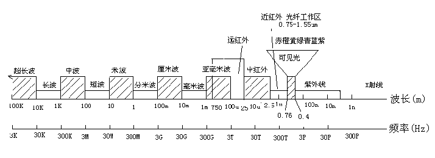{ width="720" }
<figcaption>图 10-A　电磁波谱：上轴是波长，下轴是频率，从无线电的超长波一直延伸到可见光和 X 射线（图源：郭辉萍教材配套课件）</figcaption>
</figure>

**表 10-1　电磁波谱的划分**

| 名称 | 频率范围 | 波长范围 |
|---|---|---|
| 无线电波 | $<3$ THz | $>0.1$ mm |
| 红外线 | 0.3～384 THz | 1000～0.78 μm |
| 可见光 | 384～770 THz | 0.78～0.39 μm |
| 紫外线 | 770 THz～30 PHz | 0.39～0.01 μm |
| X 射线 | 30～30 000 PHz | 0.01 μm～0.01 nm |
| $\gamma$ 射线 | $>30\,000$ PHz | $<0.01$ nm |

频率从几十赫兹（甚至更低）到 3000 GHz（波长从几万千米到 0.1 mm）的电磁波称为**无线电波**；其中 300 MHz～3000 GHz（波长 1 m～0.1 mm）称为**微波**。

**表 10-2　无线电波的划分及主要应用**

| 频段 | 频率范围 | 波段 | 主要应用 |
|---|---|---|---|
| 极低频 ELF | 3～30 Hz | 极长波 | 地下通信、对潜通信 |
| 超低频 SLF | 30～300 Hz | 超长波 | 地质结构探测、电离层研究、对潜通信 |
| 特低频 ULF | 300～3000 Hz | 特长波 | 水下潜艇通信、电离层结构研究 |
| 甚低频 VLF | 3～30 kHz | 甚长波 | 导航、声呐、时间与频率标准传递 |
| 低频 LF | 30～300 kHz | 长波 | 无线电信标、导航 |
| 中频 MF | 300～3000 kHz | 中波 | 调幅广播、海岸通信、测向 |
| 高频 HF | 3～30 MHz | 短波 | 国际短波广播、远程通信、业余无线电、船岸与船空通信 |
| 甚高频 VHF | 30～300 MHz | 米波 | 电视、调频广播、空中交通管制、航空导航信标 |
| 特高频 UHF | 300～3000 MHz | 分米波 | 电视、卫星通信、警戒雷达、蜂窝移动通信 |
| 超高频 SHF | 3～30 GHz | 厘米波 | 机载雷达、微波中继、卫星通信 |
| 极高频 EHF | 30～300 GHz | 毫米波 | 短距离通信、雷达、卫星遥感 |
| 至高频 | 300～3000 GHz | 亚毫米波 | 短距离通信 |

不同频段主要依靠不同的传播方式，这也是本章 10.3～10.6 节的划分依据：

| 传播方式 | 主要频段 | 机理 | 特点 |
|---|---|---|---|
| 地面波（10.5 节） | 长波、中波、短波低端 | 沿地表传播 | 稳定；频率越高衰减越大 |
| 天波（10.4 节） | 短波 3～30 MHz | 电离层连续折射 | 距离远；不稳定、有静区 |
| 视距波（10.3 节） | 超短波、微波（$>30$ MHz） | 直线传播 + 地面反射 | 受地球曲率限制，需架高天线或中继 |
| 散射（10.6 节） | 30 MHz 以上 | 对流层、电离层不均匀体的散射 | 超视距、损耗极大 |

!!! info "直觉：为什么频率决定传播方式"

    - **天线尺寸**：天线要与波长可比才能有效辐射。中波 $\lambda\approx300$ m，天线只能是竖在地面上的铁塔，电波自然贴着地面走；微波 $\lambda$ 为厘米级，可以做成高增益的抛物面，架在高塔上“对准”传播。
    - **地面**：大地的 $\sigma/(\omega\varepsilon)$ 随频率升高而减小，高频时大地从“导体”变成“有耗介质”，地面波衰减迅速增大（10.5 节）。
    - **电离层**：等离子体 $\varepsilon_r=1-f_p^2/f^2$，只有频率不太高的电波才能被折回（10.4 节）；频率很高时电离层几乎“透明”，于是卫星通信用微波。

---

## 10.2 无线信道的基本特性

电磁波从发射天线到接收天线所经过的传输媒质称为**无线信道**。大地、大气层、电离层以及云雾雨雪都会影响电波的传播。

### 10.2.1 无线电波在自由空间信道的传播

<figure markdown>
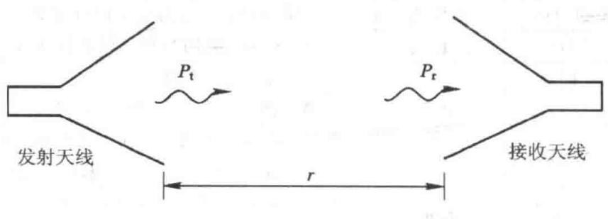{ width="520" }
<figcaption>图 10-1　自由空间中相距 $r$ 的收、发天线（图源：教材）</figcaption>
</figure>

**推导。** 设发射天线输入功率 $P_{\mathrm{in}}$、增益 $G_t$，收发天线最大辐射方向对准、极化匹配、馈线匹配。若是无方向性天线，功率均匀分布在半径 $r$ 的球面上；增益 $G_t$ 使最大方向的功率密度提高 $G_t$ 倍：

$$S=\frac{P_{\mathrm{in}}G_t}{4\pi r^2}.$$

接收天线把功率密度“收集”成功率的能力用**有效接收面积** $A_e=\dfrac{\lambda^2}{4\pi}G_r$ 描述，于是

!!! theorem "定理 10.1（弗里斯传输公式与自由空间损耗）"

    $$P_r=\frac{P_{\mathrm{in}}G_t}{4\pi r^2}\cdot\frac{\lambda^2G_r}{4\pi}=P_{\mathrm{in}}G_tG_r\left(\frac{\lambda}{4\pi r}\right)^2 .$$

    令 $G_t=G_r=1$，定义**自由空间基本传输损耗** $L_{bf}=\left(\dfrac{4\pi r}{\lambda}\right)^2$，其分贝形式

    $$L_{bf}\ (\mathrm{dB})=32.45+20\lg f\,(\mathrm{MHz})+20\lg r\,(\mathrm{km}).$$

    计入天线增益后，收发之间的传输损耗 $L=\dfrac{P_{\mathrm{in}}}{P_r}$ 为 $L\ (\mathrm{dB})=L_{bf}-G_t\,(\mathrm{dB})-G_r\,(\mathrm{dB})$。

<figure class="video" markdown>
<video controls preload="metadata" width="100%" poster="assets/posters/C10_Friis.jpg"><source src="assets/videos/C10_Friis.mp4" type="video/mp4"></video>
<figcaption>动画 10-1　发射机发出的功率在越来越大的球面上摊薄：口径固定的接收天线截获的份额 $\propto1/r^2$。右图：$P_{\mathrm{in}}=1$ W、900 MHz、$G_t=G_r=1$ 时接收功率随距离的变化，自由空间每十倍程下降 20 dB（1 km 处 $-61.5$ dBm）；虚线为 10.3.3 节两径模型远区的 $-40$ dB/十倍程。</figcaption>
</figure>

**32.45 从哪来。** $20\lg\dfrac{4\pi rf}{c}$ 中代入 $r$ 以 km、$f$ 以 MHz 计：$20\lg\dfrac{4\pi\times10^3\times10^6}{3\times10^8}=20\lg41.89=32.45$。

!!! warning "易错点：自由空间损耗不是能量被“吃掉”"

    自由空间没有任何吸收。$L_{bf}$ 反映的是球面波能量随距离扩散：总功率不变，分摊到更大的球面上。它随 $f^2$ 增大，也不是因为高频“更难传”，而是因为在增益一定时，接收天线的有效面积 $\propto\lambda^2$ 变小了。若改用面积固定的天线（$G\propto1/\lambda^2$），高频反而更有利。

!!! example "例题 10.1（卫星链路，教材例 10-1）"

    某卫星信道发射天线增益 22 dB，接收天线增益 18 dB，收发距离 14 500 km，载波 5.904 GHz。求：(1) 传输损耗；(2) 发射功率 25 W 时接收机的输入功率。

    **解。** (1) $L_{bf}=32.45+20\lg5904+20\lg14500=32.45+75.42+83.23=191.1$ dB，计入天线增益 $L=191.1-22-18\approx151.1$ dB。

    (2) $P_r=25\times10^{-15.11}\approx1.94\times10^{-14}$ W。卫星接收机前端的信号极其微弱，所以要用低噪声放大器和高增益天线。

!!! example "例题 10.2（链路预算：最大通信距离）"

    2.4 GHz 无线链路：发射功率 20 dBm，收、发天线增益均为 2 dBi，接收机灵敏度 $-80$ dBm，为衰落和遮挡预留 20 dB 余量。按自由空间估算最大通信距离。

    **解。** 分贝运算把乘除变成加减。允许的自由空间损耗

    $$L_{bf}\le P_t+G_t+G_r-P_{r,\min}-M=20+2+2-(-80)-20=84\ \mathrm{dB}.$$

    由 $32.45+20\lg2400+20\lg r_{\mathrm{km}}\le84$，即 $32.45+67.60+20\lg r_{\mathrm{km}}\le84$，得 $20\lg r_{\mathrm{km}}\le-16.05$，$r\le0.157$ km $\approx157$ m。余量每减小 6 dB，距离加倍。

!!! warning "易错点：dB 与 dBm 不能乱加"

    dBm 是**绝对功率**（相对 1 mW），dB 是**比值**。“功率（dBm）$\pm$ 增益或损耗（dB）$=$ 功率（dBm）”合法；两个 dBm 直接相加则没有意义（两路功率叠加要先换回 mW 再相加）。$P\,(\mathrm{dBm})=10\lg\dfrac{P}{1\ \mathrm{mW}}$，所以 1 W $=30$ dBm，$10^{-14}$ W $=-110$ dBm。

### 10.2.2 无线信道特性

描述无线信道的参数有信道损耗、衰落、失真与容许带宽等。

**1. 信道损耗**

实际信道中除了扩散损耗，还有大气吸收和散射、绕过球形地面或障碍物等带来的额外损耗。设同样条件下实际接收场强为 $E$、功率为 $P_r'$，自由空间中为 $E_0$、$P_r$，定义**衰减因子**

$$A=20\lg\frac{|E|}{|E_0|}=10\lg\frac{P_r'}{P_r}\ \ (\mathrm{dB}),\qquad L_b=L_{bf}-A\ \ (\mathrm{dB}).$$

$A$ 通常为负值。不同传播方式、不同媒质的 $A$ 不同，这是本章各节要回答的问题。

**2. 衰落现象**

**衰落**是信号电平随时间的随机起伏，按成因分两类：

- **吸收型衰落（慢衰落）**：大气中的氧、水汽及云雾雨雪对电波的吸收随气象缓慢变化，信号中值（分钟、小时、月中值）缓慢起伏。
- **干涉型衰落（快衰落）**：收发之间有多条路径，各路径的时延随机变化，合成信号的幅度和相位快速起伏。移动通信、短波电离层信道、散射信道中都很明显。

<figure markdown>
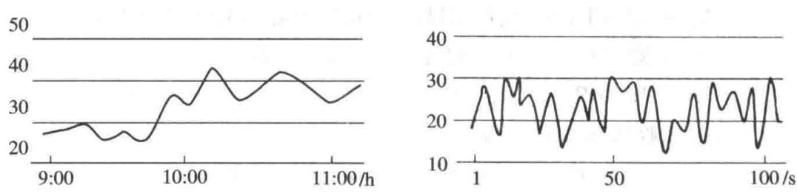{ width="680" }
<figcaption>图 10-2　慢衰落（左，横轴为时刻）与快衰落（右，横轴以秒计）（图源：教材）</figcaption>
</figure>

快衰落叠加在慢衰落之上。衰落严重影响通信的稳定性和可靠性，常用**分集接收**等措施克服：几副相距较远的天线（或几个频率、两种极化）同时陷入深衰落的概率很小。

!!! info "拓展：快衰落有多快——多普勒频移"

    接收机以速度 $v$ 运动、来波方向（指向波源）与运动方向夹角为 $\theta$ 时，单位时间内接收机多“碰到” $\dfrac{v\cos\theta}{\lambda}$ 个波峰，接收频率变为

    $$f'=f+f_D,\qquad f_D=\frac{v}{\lambda}\cos\theta,\qquad |f_D|\le f_m=\frac v\lambda .$$

    $f_m$ 称为**最大多普勒频移**。多径信道中各路波来自不同方向，各有不同的 $f_D$，接收信号的频谱被展宽到 $f\pm f_m$（多普勒扩展）。从空间的角度看，两列相向的波叠成**驻波**（[第 6 章 6.6 节](ch6.md#66)），深谷间隔 $\lambda/2$；接收机以速度 $v$ 穿过这一图样，深衰落的时间间隔约为 $\dfrac{\lambda}{2v}=\dfrac{1}{2f_m}$。所以**空间上的干涉图样 + 运动 = 时间上的快衰落**，车速越快、频率越高，衰落越快。

<figure class="video" markdown>
<video controls preload="metadata" width="100%" poster="assets/posters/C10_Doppler.jpg"><source src="assets/videos/C10_Doppler.mp4" type="video/mp4"></video>
<figcaption>动画 10-2　上：平面波斜向射来，接收机向右运动，接收频率 $f^\prime=f+\frac{v}{\lambda}\cos\theta$（900 MHz、30 m/s 时 $f_m=90$ Hz）。下：直射波与反射波相向叠成驻波 $|E|=2E_0|\cos kx|$，接收机匀速穿过，接收电平每走 $\lambda/2$ 跌入一次深谷，时间上的衰落周期为 $1/(2f_m)$。</figcaption>
</figure>

!!! example "例题 10.3（多普勒频移与衰落速率）"

    车速 120 km/h，载频 1.8 GHz。求最大多普勒频移和相邻两次深衰落的平均时间间隔；若某数字系统一个数据帧长 0.5 ms，在一帧内信道能否近似看作不变？

    **解。** $v=33.3$ m/s，$\lambda=\dfrac{3\times10^8}{1.8\times10^9}=0.167$ m，$f_m=\dfrac{v}{\lambda}=200$ Hz。深衰落间隔 $\approx\dfrac{\lambda}{2v}=\dfrac{1}{2f_m}=2.5$ ms。0.5 ms 只是 2.5 ms 的 1/5，一帧内信道变化不大，可近似看作不变（慢变）；若帧长与 2.5 ms 可比，就必须在帧内多次估计信道。

!!! warning "易错点：多普勒中的角度与“频率选择性”的区别"

    1. $\theta$ 是**运动方向与来波方向（指向波源）**的夹角：迎着波源走 $\theta=0$，频率升高；背离波源 $\theta=\pi$，频率降低；垂直于来波方向运动 $f_D=0$。
    2. 多普勒扩展决定衰落**在时间上**变化多快（时间选择性），多径时延 $\tau$ 决定衰落**在频率上**变化多快（频率选择性，下文的容许带宽）。两者是不同的参数，不要混为一谈。

**3. 失真与容许带宽**

电波通过信道还会产生振幅失真和相位失真，原因有两个：

- **色散效应**：不同频率的电波传播速度不同（如电离层），信号各频率分量的相位关系被破坏。
- **随机多径传输**：信号经长度不同的路径到达接收点。

<figure markdown>
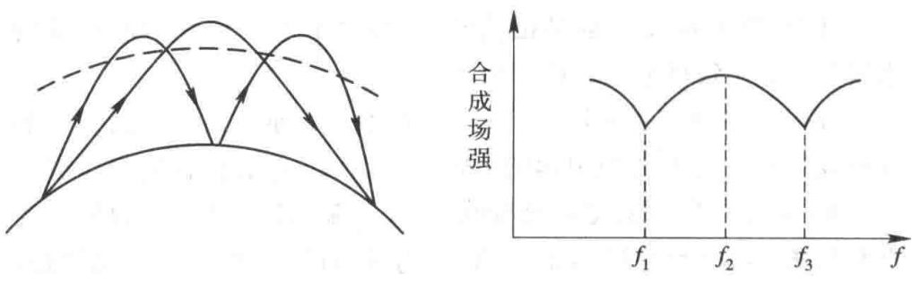{ width="640" }
<figcaption>图 10-3　多径传输（左）与合成场强随频率的起伏（右）（图源：教材）</figcaption>
</figure>

设两条路径的时延差（**多径时延**）为 $\tau$，接收场是两路信号的相量和，两者的相位差 $\varphi=\omega\tau$ 随频率变化：$\omega_1\tau=\pi$ 的分量两路反相抵消，$\omega_2\tau=2\pi$ 的分量同相相加。于是合成场强随频率周期起伏，相邻极小相隔 $1/\tau$，这称为**频率选择性衰落**。

!!! definition "定义 10.1（容许带宽）"

    为使信号不产生明显失真，信号带宽不应超过

    $$\Delta f=\frac1\tau ,$$

    称为信道的**容许带宽**（现代文献中称相干带宽，常取 $1/(5\tau)$ 等更保守的值）。

<figure class="video" markdown>
<video controls preload="metadata" width="100%" poster="assets/posters/C10_Multipath.jpg"><source src="assets/videos/C10_Multipath.mp4" type="video/mp4"></video>
<figcaption>动画 10-3　上半段：两径信道 $1+a\,\mathrm e^{-\mathrm j2\pi f\tau}$ 的相量随频率旋转，合成场强每隔 $1/\tau$ 出现一次深谷，宽带信号因此失真。下半段：十条散射路径的相量首尾相接，接收机移动不到一个波长，合成场强就出现多次 $-20$ dB 以下的深衰落。</figcaption>
</figure>

!!! example "例题 10.4（多径时延与容许带宽）"

    城区移动信道中，经远处高楼反射的路径比直射路径长 1.5 km。(1) 求多径时延和容许带宽；(2) 判断 200 kHz 和 20 MHz 带宽的信号是否会出现明显的频率选择性衰落。

    **解。** (1) $\tau=\dfrac{\Delta r}{c}=\dfrac{1500}{3\times10^8}=5\ \mu\mathrm s$，$\Delta f=\dfrac1\tau=200$ kHz。

    (2) 200 kHz 的信号刚好与容许带宽相当，处于临界，需要均衡器；20 MHz 的信号带宽是容许带宽的 100 倍，带内会有约 100 个衰落深谷，必然严重失真——这正是宽带系统采用 OFDM（拆成许多窄于 $1/\tau$ 的子载波）的原因。

!!! note "前后联系：多径与第 6 章的驻波"

    快衰落的空间结构与第 6 章垂直入射时的驻波本质相同：入射波和反射波相干叠加，强弱相间，间隔约 $\lambda/2$。区别只在于多径信道里有很多方向随机的波，所以“驻波图样”是随机的。数字通信中，多径时延扩展使相邻码元互相重叠（码间干扰），OFDM 把宽带信号拆成许多窄子载波，让每个子载波的带宽小于 $1/\tau$，正是为了绕开频率选择性衰落。

**4. 电波传播方向的变化**

均匀线性媒质中射线沿直线传播。实际信道中，媒质分界面使电波**反射、折射**，不均匀体（如对流层湍流）使电波**散射**，球形地面和障碍物使电波**绕射**，时变信道还使射线到达角随机起伏。这些都是研究实际信道时必须考虑的。

---

## 10.3 视距传播信道

**视距传播**是指超短波和微波基本沿视线传播的方式，用于微波中继干线、移动通信、卫星通信、雷达等。

### 10.3.1 视线距离

<figure markdown>
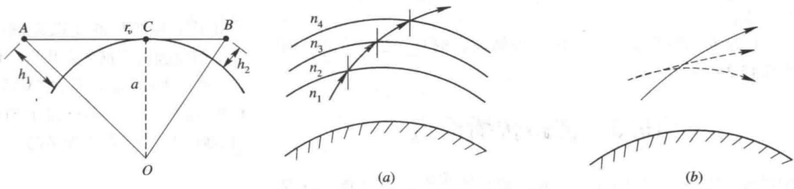{ width="660" }
<figcaption>图 10-4　视线距离（左）；图 10-5　大气层对电波的折射（右）（图源：教材）</figcaption>
</figure>

由于地球曲率，收发天线（高 $h_1$、$h_2$）只在一定距离内能互相“看见”。由图 10-4，切线 $AC$ 满足 $AC^2=(a+h_1)^2-a^2\approx2ah_1$（$h_1\ll a$），同理 $CB\approx\sqrt{2ah_2}$：

!!! theorem "定理 10.2（视线距离）"

    $$r_v\approx\sqrt{2a}\left(\sqrt{h_1}+\sqrt{h_2}\right)=3.57\left(\sqrt{h_1}+\sqrt{h_2}\right)\ \mathrm{km}\qquad(h\ \text{以 m 计},\ a=6370\ \mathrm{km}).$$

    考虑大气折射后，用**等效地球半径** $a_e=\frac43a$ 代替 $a$：

    $$r_v=\sqrt{2a_e}\left(\sqrt{h_1}+\sqrt{h_2}\right)=4.12\left(\sqrt{h_1}+\sqrt{h_2}\right)\ \mathrm{km}.$$

**大气折射。** 标准大气中 $\varepsilon_r$ 随高度增加而减小并趋于 1，折射率 $n=\sqrt{\varepsilon_r}$ 也随高度减小。把大气分成许多均匀薄层，射线每穿过一个界面都按折射定律向法线外偏折，于是轨迹成为一条**向下弯曲**的弧线（图 10-5），电波可以传得比几何视距更远。把射线“拉直”、相应地把地球“放大”成半径 $a_e$，就得到上面的修正公式。

!!! example "例题 10.5（极限传播距离，教材习题 10.5）"

    发射天线高 225 m，接收天线高 16 m，求视距传播的极限距离。

    **解。** $r_v=4.12\times(\sqrt{225}+\sqrt{16})=4.12\times19=78.3$ km（不计大气折射为 $3.57\times19=67.8$ km）。

### 10.3.2 大气对电波的衰减

大气对电波的衰减来自两方面：

- **吸收**：云、雾、雨中的水滴对电波的热吸收（与水滴浓度有关），以及水汽分子、氧分子的**谐振吸收**（在特定频率附近，如 22 GHz 水汽、60 GHz 氧气吸收峰）；
- **散射**：水滴使电波散射，散射衰减与水滴半径的 6 次方成正比、与波长的 4 次方成反比。

工作波长短于 5 cm（$f>6$ GHz）时就要计及大气衰减，短于 3 cm（$f>10$ GHz）时衰减趋于严重，其中**降雨衰减**最为突出，是 10 GHz 以上卫星和地面微波线路设计必须留余量的原因。

### 10.3.3 场分析

视距信道中，接收点除了直射波，还有经地面反射的反射波（图 10-6），接收场是两者的叠加。

<figure markdown>
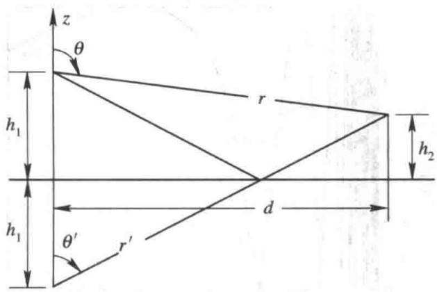{ width="440" }
<figcaption>图 10-6　直射波与地面反射波；反射波相当于从镜像天线发出（图源：教材）</figcaption>
</figure>

$$E=E_0f(\theta)\frac{\mathrm e^{-\je kr}}{r}+R\,E_0f(\theta')\frac{\mathrm e^{-\je kr'}}{r'},$$

$R=|R|\mathrm e^{\je\varphi}$ 为地面反射系数，$f(\theta)$ 为天线方向函数。$d\gg h_1,h_2$ 时 $\theta\approx\theta'$，振幅中 $r\approx r'$，但相位中的程差不能忽略：

$$E=E_0f(\theta)\frac{\mathrm e^{-\je kr}}{r}F,\qquad F=1+|R|\mathrm e^{-\je[k(r'-r)-\varphi]} ,$$

$F$ 称为**路径因子**。由图 10-6，$r=\sqrt{d^2+(h_2-h_1)^2}$，$r'=\sqrt{d^2+(h_1+h_2)^2}$，用 $\sqrt{1+x}\approx1+x/2$：

$$r'-r\approx\frac{(h_1+h_2)^2-(h_2-h_1)^2}{2d}=\frac{2h_1h_2}{d}.$$

射线仰角很小（视距通信通常小于 $1^\circ$）时，无论水平极化还是垂直极化，地面反射系数都趋近于 $-1$（掠入射，第 6 章斜入射的结果），于是

!!! theorem "定理 10.3（两径模型的路径因子）"

    $$|F|=\left|1-\mathrm e^{-\je2kh_1h_2/d}\right|=2\left|\sin\frac{2\pi h_1h_2}{\lambda d}\right| .$$

    接收场强在 0（两径相消）和自由空间值的 2 倍（两径相加）之间起伏。

<figure class="video" markdown>
<video controls preload="metadata" width="100%" poster="assets/posters/C10_TwoRay.jpg"><source src="assets/videos/C10_TwoRay.mp4" type="video/mp4"></video>
<figcaption>动画 10-4　$h_1=h_2=40\lambda$（$\lambda=1$ m）时，接收点由近及远移动：程差 $2h_1h_2/d$ 逐渐变小，右下角两个相量的夹角随之变化，$|F|$ 在 0 与 2 之间振荡；$d>6.4$ km 后单调下降。</figcaption>
</figure>

几点结论：

- 最后一个极大值在 $\dfrac{2\pi h_1h_2}{\lambda d}=\dfrac\pi2$，即 $d=\dfrac{4h_1h_2}{\lambda}$ 处；更远处 $|F|\approx\dfrac{4\pi h_1h_2}{\lambda d}$，接收场强 $\propto\dfrac{h_1h_2}{d^2}$，**功率按 $1/d^4$ 衰减**——这是移动通信中常用的“两径模型”，比自由空间的 $1/d^2$ 快得多。
- 固定 $d$ 而改变天线高度，场强同样起伏，如图 10-B 右图；所以中继站天线高度要仔细选择。
- 为了接收场强稳定，微波中继线路希望反射波越少越好：选择路径时利用起伏的地形地物遮挡或改变反射波方向。移动通信中除地面外还有大量建筑物反射，场强起伏严重（多径效应），必须用分集技术克服。

<figure markdown>
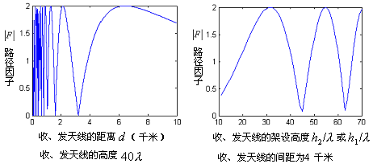{ width="640" }
<figcaption>图 10-B　两径模型的路径因子 $|F|$：左图为固定天线高度（$40\lambda$）时随距离的振荡，远区单调下降；右图为固定距离（$4$ km）时随天线高度的起伏（图源：郭辉萍教材配套课件）</figcaption>
</figure>

!!! example "例题 10.6（两径模型的转折距离与远区接收功率）"

    基站天线高 $h_1=30$ m，手机高 $h_2=1.5$ m，$f=900$ MHz，发射功率 10 W，$G_t=G_r=1$，地面反射系数取 $-1$。(1) 求最后一个场强极大点的距离；(2) 求 $d=5$ km 处的接收功率，并与自由空间比较。

    **解。** $\lambda=\dfrac13$ m。

    (1) $d_b=\dfrac{4h_1h_2}{\lambda}=\dfrac{4\times30\times1.5}{1/3}=540$ m。

    (2) $d=5$ km $\gg d_b$，$|F|\approx\dfrac{4\pi h_1h_2}{\lambda d}$，于是

    $$P_r=P_{\mathrm{in}}G_tG_r\Big(\frac{\lambda}{4\pi d}\Big)^2|F|^2=P_{\mathrm{in}}G_tG_r\frac{h_1^2h_2^2}{d^4}=10\times\frac{45^2}{(5000)^4}=3.24\times10^{-11}\ \mathrm W\ (-74.9\ \mathrm{dBm}).$$

    自由空间：$L_{bf}=32.45+59.08+13.98=105.5$ dB，$P_r=40-105.5=-65.5$ dBm。两径模型比自由空间低约 9.4 dB，且距离再增加 10 倍要再多掉 40 dB（自由空间只多掉 20 dB）。注意远区结果与 $\lambda$ 无关，而与天线高度的平方成正比——提高天线比提高频率或功率更“划算”。

!!! warning "易错点：掠入射时反射系数是 $-1$，不是 $+1$"

    视距链路的地面反射是**掠入射**（入射角接近 $90^\circ$）。由 [第 6 章斜入射](ch6.md#67) 的菲涅耳公式，此时无论平行极化还是垂直极化，反射系数 $R\to-1$（第 6 章菲涅耳公式中亦记作 $\Gamma$）。第 6 章图 6-B 把干土、湿土和水面的反射系数模值随入射角画了出来：接近 $90^\circ$ 时两条曲线都升到 $1$，再计及相位就是 $-1$。若误取 $+1$，近距离处两径恰好相长的位置会被算成相消，远区也得不到 $1/d^4$ 规律（$1+\mathrm e^{-\mathrm j\Delta}\to2$，场强不衰减反而加倍）。

### 拓展：菲涅耳区与传播余隙 {#fresnel}

两径模型只考虑了“一条”反射线。按惠更斯原理，波前上的每一点都是次级波源；从发射点 $T$ 经空间某点 $P$ 到接收点 $R$ 的路径比直线 $d$ 长出 $\Delta=r_1+r_2-d$。满足 $\Delta=n\lambda/2$ 的点构成以 $T$、$R$ 为焦点的一族椭球面，相邻椭球面之间的区域称为第 $n$ **菲涅耳区**。第一菲涅耳区内（$\Delta<\lambda/2$）的次级波到达 $R$ 时大致同相，贡献了接收场的主要部分。在距两端分别为 $d_1$、$d_2$ 处，第一菲涅耳区的半径

$$F_1=\sqrt{\frac{\lambda d_1d_2}{d_1+d_2}} ,\qquad F_n=\sqrt n\,F_1 .$$

（推导：$r_1+r_2\approx d_1+\dfrac{F^2}{2d_1}+d_2+\dfrac{F^2}{2d_2}$，令多出的部分等于 $\lambda/2$ 即得。）工程上要求路径上障碍物与视线之间的**余隙**不小于 $0.6F_1$，这时绕射附加损耗可以忽略，链路才按“自由空间 + 地面反射”计算；障碍物刚好擦到视线时附加损耗约 6 dB；视线被挡住后仍有绕射波，但损耗随遮挡深度迅速增大。

<figure class="video" markdown>
<video controls preload="metadata" width="100%" poster="assets/posters/C10_Fresnel.jpg"><source src="assets/videos/C10_Fresnel.mp4" type="video/mp4"></video>
<figcaption>动画 10-5　以收发两点为焦点、程差为 $\lambda/2$ 的椭圆即第一菲涅耳区边界。下半段：刃形障碍物从远低于视线升高到高出视线 $2F_1$，按刃形绕射近似计算附加损耗——余隙 $\ge0.6F_1$ 时约为 0，掠过视线时约 6 dB，遮挡后迅速增大。</figcaption>
</figure>

!!! example "例题 10.7（微波中继的余隙）"

    6 GHz 微波中继线路，站距 40 km，距一端 10 km 处有一座山头。求该处第一菲涅耳区半径和所需的最小余隙。

    **解。** $\lambda=0.05$ m，$d_1=10$ km，$d_2=30$ km：

    $$F_1=\sqrt{\frac{0.05\times10^4\times3\times10^4}{4\times10^4}}=\sqrt{375}=19.4\ \mathrm m,\qquad 0.6F_1=11.6\ \mathrm m .$$

    山顶应比收发天线连线至少低 11.6 m（另外还要考虑等效地球半径造成的地球凸起）。频率越高 $F_1$ 越小，所需余隙越小，但越难绕过障碍物。

!!! warning "易错点：“看得见”不等于“畅通无阻”"

    几何视线不被挡住只说明直射线存在。若障碍物侵入第一菲涅耳区，接收场强就会明显下降；反过来，视线被轻微挡住时也并非完全收不到。判断视距链路是否畅通，要看余隙与 $F_1$ 的比值，而不是只看几何视线。

---

## 10.4 短波电离层反射信道

短波指 3～30 MHz（波长 100～10 m）的无线电波。经高空电离层“反射”后到达接收点的传播方式称为**天波传播**。

### 10.4.1 电离层概况

电离层是离地面约 60～1000 km 的高空大气，主要由太阳紫外线辐射电离而成。按电子密度随高度的分布分为 D、E、F$_1$、F$_2$ 层，各层都有一个电子密度极大值。

<figure markdown>
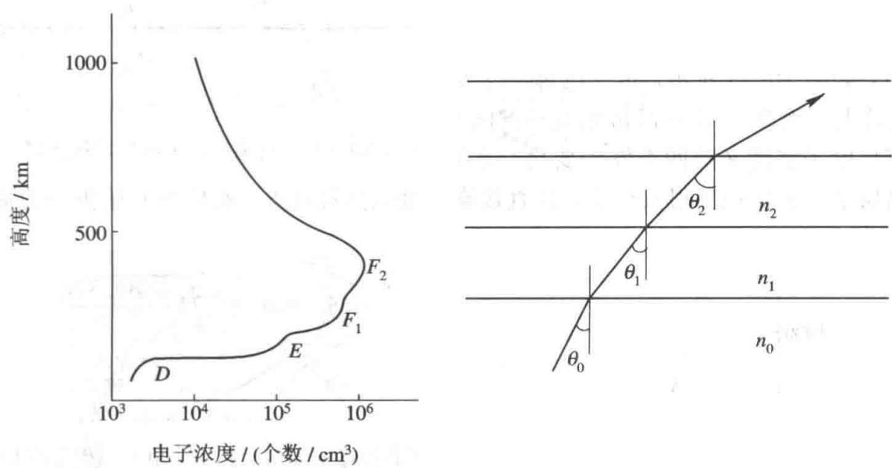{ width="620" }
<figcaption>图 10-9　电离层电子浓度的高度分布（左）；图 10-10　分层媒质中的连续折射（右）（图源：教材）</figcaption>
</figure>

电子密度与日照密切相关：白天大、夜间小，夜间 D 层消失；还随季节、太阳黑子活动周期变化，太阳活动剧烈时甚至中断短波通信。

### 10.4.2 无线电波在电离层信道中的传播

**电离层的介电常数。** 电离层是含自由电子的等离子体。电子在电场 $\vv E\mathrm e^{\je\omega t}$ 作用下运动 $m\dfrac{\dd\vv v}{\dd t}=-e\vv E$，$\vv v=\dfrac{-e\vv E}{\je\omega m}$，形成电流 $\vv J=-N_ee\vv v=\dfrac{N_ee^2}{\je\omega m}\vv E$。代入 $\nabla\times\vv H=\vv J+\je\omega\varepsilon_0\vv E=\je\omega\varepsilon_0\left(1-\dfrac{N_ee^2}{m\varepsilon_0\omega^2}\right)\vv E$：

!!! theorem "定理 10.4（电离层的相对介电常数）"

    $$\varepsilon_r=1-\frac{N_ee^2}{m\varepsilon_0\omega^2}=1-\frac{f_p^2}{f^2}=1-\frac{80.8N_e}{f^2},\qquad n=\sqrt{1-\frac{80.8N_e}{f^2}}<1,$$

    $N_e$ 为电子密度（个/m$^3$），$f$ 以 Hz 计；$f_p=\sqrt{80.8N_e}\approx9\sqrt{N_e}$ 称为**等离子体频率**。

$\varepsilon_r<1$，且频率越低越小：电离层是**色散媒质**（第 6 章）。$f<f_p$ 时 $\varepsilon_r<0$，电波不能传播（倏逝），这是“反射”的本质原因之一。

**连续折射。** 把电离层分成许多电子密度均匀的薄层。电波从空气进入电离层时 $n$ 变小，折射角大于入射角，射线向下偏折；继续上升，电子密度增大、$n$ 继续变小，射线连续下折，直到某一高度射线变成水平，然后折回地面。所以电离层的“反射”实际上是**连续折射**的结果。在各层界面上连续应用折射定律：

$$n_0\sin\theta_0=n_1\sin\theta_1=\cdots=n_i\sin\theta_i ,$$

$n_0=1$，$\theta_0$ 为射线进入电离层时的入射角（与竖直方向的夹角）。射线在第 $i$ 层折回时 $\theta_i=90^\circ$：

$$\sin\theta_0=n_i=\sqrt{1-\frac{80.8N_i}{f^2}},\qquad f=\sqrt{80.8N_i}\,\sec\theta_0 .$$

这给出了频率 $f$、入射角 $\theta_0$ 和折回处电子密度 $N_i$ 的关系。（与第 6 章全反射对照：$n_i=\sin\theta_0$ 正是从“$n_0=1$ 的媒质”入射到“$n=n_i$ 的媒质”的临界角条件。）

<figure class="video" markdown>
<video controls preload="metadata" width="100%" poster="assets/posters/C10_Ionosphere.jpg"><source src="assets/videos/C10_Ionosphere.mp4" type="video/mp4"></video>
<figcaption>动画 10-6　按 $n^2=1-f_p^2(h)/f^2$ 对抛物型电离层（峰值临界频率 8 MHz）做射线追踪。上：$\theta_0=60^\circ$ 时 12、15 MHz 折回，18 MHz（高于 $f_{\max}=16$ MHz）穿出。下：$f=12$ MHz 时入射角由大到小，落地点先近后远，近处形成静区；$\theta_0<48^\circ$ 的射线穿出电离层。</figcaption>
</figure>

**1）最高可用频率**

!!! theorem "定理 10.5（最高可用频率，正割定律）"

    入射角为 $\theta_0$ 时，电离层能折回的最高频率为

    $$f_{\max}=\sqrt{80.8N_{\max}}\,\sec\theta_0 ,$$

    $N_{\max}$ 为电离层的最大电子密度。$\theta_0=0$（垂直入射）时 $f_{\max}=f_c=\sqrt{80.8N_{\max}}$，称为**临界频率**。

$\theta_0$ 一定时，频率越高，电波要到达电子密度越大处才折回，落地越远；频率高于 $f_{\max}$ 时，电离层中没有那么大的电子密度，电波穿出电离层（教材图 10-11）。这正是超短波和微波不能以天波传播、而可以用于卫星通信的原因。

<figure markdown>
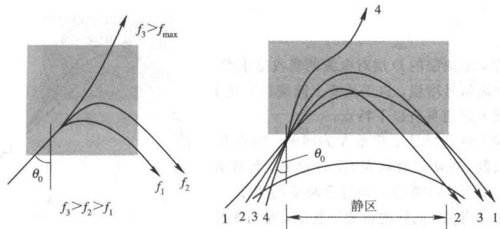{ width="640" }
<figcaption>图 10-11　$\theta_0$ 一定、频率不同时的射线（左）；图 10-12　频率一定时通信距离与入射角的关系，近处为静区（右）（图源：教材）</figcaption>
</figure>

**2）天波静区**

频率一定时，电离层能把电波折回的**最小入射角**

$$\theta_{0\min}=\arcsin\sqrt{1-\frac{80.8N_{\max}}{f^2}} .$$

入射角由大减小，射线需要的电子密度增大，通信距离先变近；继续减小，射线深入电离层，在层中走得更远，通信距离又变远；$\theta_0<\theta_{0\min}$ 时射线穿出电离层。因此以发射天线为中心、一定半径内没有天波到达，而地面波在短波段衰减很快又到不了，形成**静区**。

**3）多径效应**

天线射向电离层的是一束射线，各射线入射角稍有不同，在不同高度折回，有多条路径到达接收点（多跳、高角射线与低角射线、寻常波与非寻常波等）。电离层电子密度随机起伏，各路径的程差不断变化，接收场强随之起伏——**多径效应**。它使模拟信号产生选择性衰落，使数字信号产生时延扩展（码间干扰），限制了短波信道的带宽和传输速率。

<figure markdown>
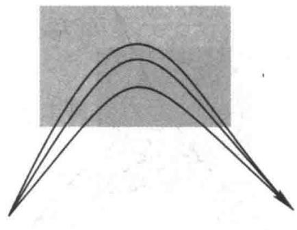{ width="380" }
<figcaption>图 10-13　电离层信道的多径传输（图源：教材）</figcaption>
</figure>

<figure markdown>
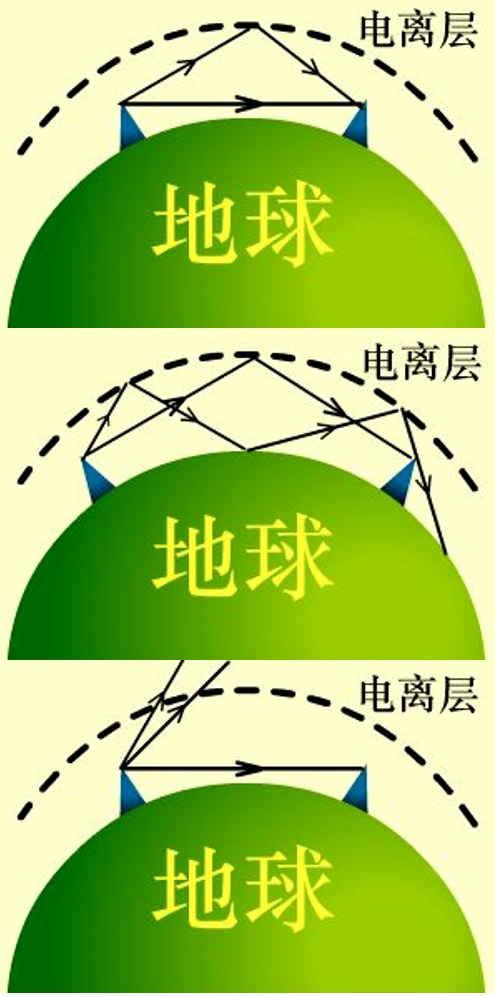{ width="360" }
<figcaption>图 10-C　天波的几种路径：单跳（上）、经地面再次反射的多跳（中），以及入射角太小、频率高于 MUF 时射线穿出电离层（下）。多跳把通信距离延伸到数千千米，也是短波多径的来源之一（图源：上海交大何广强《电磁场与波》课件）</figcaption>
</figure>

**4）最佳工作频率**

电离层中自由电子与中性粒子碰撞会消耗电波能量，吸收主要发生在 D 层和 E 层，且频率越低吸收越大（吸收 $\propto1/f^2$），所以宜用较高的频率；但频率过高，电波要深入电子密度很大处才能折回，在电离层中的路径变长，衰减又增大，并且接近 $f_{\max}$ 时电离层稍有变化就会穿透。折中取

$$f_{\mathrm{opt}}=0.85f_{\max} .$$

夜间 D 层消失，吸收减小，天波信号增强，所以晚上能收到更多更远的短波电台；但同时远处的干扰和噪声也一起传过来，电台拥挤、杂音大。

!!! example "例题 10.8（最高可用频率，教材习题 10.7）"

    电离层最大电子密度 $N_{\max}=10^{12}$ 个/m$^3$，入射角 $\theta_0=45^\circ$，求最高可用频率和最佳工作频率。

    **解。** $f_c=\sqrt{80.8\times10^{12}}=8.99$ MHz，$f_{\max}=f_c\sec45^\circ=12.7$ MHz，$f_{\mathrm{opt}}=0.85\times12.7\approx10.8$ MHz。

!!! example "例题 10.9（静区半径的估算）"

    电离层临界频率 $f_c=9$ MHz，等效反射高度 300 km，工作频率 15 MHz。按平面地面近似估算静区半径。

    **解。** $\sin\theta_{0\min}=\sqrt{1-(f_c/f)^2}=\sqrt{1-0.36}=0.8$，$\theta_{0\min}=53.1^\circ$。射线在等效反射高度 $h'$ 处“镜面反射”，落地距离 $D=2h'\tan\theta_0$，入射角小于 $\theta_{0\min}$ 的射线穿出电离层，所以最近的落地点为

    $$D_{\min}=2\times300\times\tan53.1^\circ\approx800\ \mathrm{km}.$$

    以发射台为中心、半径约 800 km 的范围内收不到天波（地面波只能覆盖几十千米），这就是静区。工作频率越高，$\theta_{0\min}$ 越大，静区越大；频率低于 $f_c$ 时连垂直入射都能折回，没有静区。

!!! warning "易错点：正割定律里的角度"

    $f_{\max}=f_c\sec\theta_0$ 中的 $\theta_0$ 是射线与**竖直方向**（电离层法线）的夹角，射线越“平”$\theta_0$ 越大，$f_{\max}$ 越高。若误用仰角 $\Delta=90^\circ-\theta_0$，结论会完全颠倒。另外，电离层的“反射”是连续折射，频率越高折回点越高、越难折回，与金属面的镜面反射不同（等效反射高度只是一个几何简化）。

!!! abstract "电离层反射信道的特点"

    1. **频率选择至关重要**：太高穿透、太低吸收过大，必须在最佳频率附近工作；而它随年、月、日、时和通信距离变化，通常一天使用日频、夜频两个或三个频率。
    2. 随机多径严重，多径时延大，**信道带宽窄**，数字通信需要抗多径措施。
    3. 信道不稳定，**衰落严重**，线路设计要留足电平余量。
    4. 可用频段（3～30 MHz）窄，电台拥挤，相互干扰大，夜间尤甚。
    5. 高空电离层不易被人为破坏，在军事和应急通信中有重要意义。
    6. 用较小功率就能实现数千千米的远距离通信，是远程通信的重要信道之一。

---

## 10.5 地表面波传播信道

电波沿地球表面传播称为**地面波传播**。天线架设不高、最大辐射沿水平方向时，电波主要以地面波传播，长波、中波和短波的低频端都可以用这种方式。传播情况主要取决于地面的电参数和地形地物。

描述大地电磁性质的参数是 $\varepsilon$、$\sigma$、$\mu$（大多数地质 $\mu\approx\mu_0$）。大地中既有传导电流也有位移电流，由第 6 章，$\dfrac{\sigma}{\omega\varepsilon}\gg1$ 时为良导体，否则为有耗介质。

**表 10-3　不同地质的电参数**

| 地质 | $\varepsilon_r$ 范围 | $\varepsilon_r$ 平均 | $\sigma$ 范围（S/m） | $\sigma$ 平均（S/m） |
|---|---|---|---|---|
| 海水 | 80 | 80 | 0.66～6.6 | 4 |
| 淡水 | 80 | 80 | $10^{-3}$～$2.4\times10^{-2}$ | $10^{-3}$ |
| 湿土 | 10～30 | 20 | $3\times10^{-3}$～$3\times10^{-2}$ | $10^{-2}$ |
| 干土 | 2～6 | 4 | $1.1\times10^{-5}$～$2\times10^{-3}$ | $10^{-3}$ |

例如 1 MHz 时海水 $\dfrac{\sigma}{\omega\varepsilon}\approx900$，湿土约 9，干土约 4.5；100 MHz 时干土只有 0.045，已经是介质。中、长波段大地一般呈良导体性质。

<figure markdown>
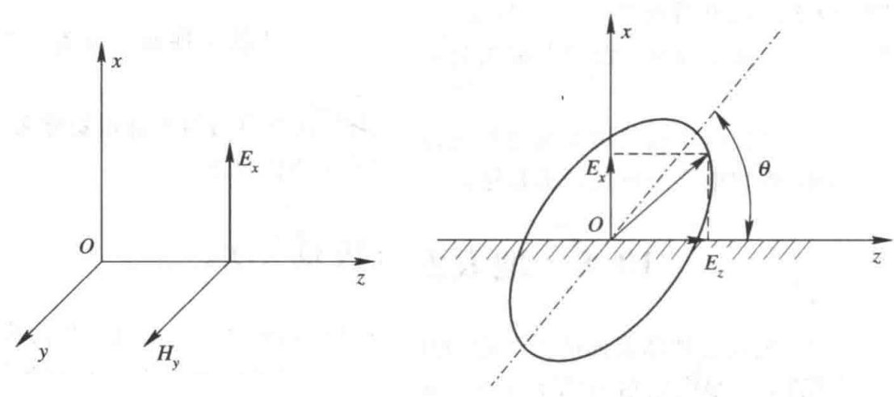{ width="600" }
<figcaption>图 10-14　理想导电地面上的垂直极化波（左）；图 10-15　非理想导电地面上波前倾斜，成为椭圆极化（右）（图源：教材）</figcaption>
</figure>

**波前倾斜。** 直立天线辐射的垂直极化波沿地面传播。若大地是理想导体，地面上切向电场为零，接收点仍是纯垂直极化波。实际大地导电性有限，电场在地面感应出随波移动的电荷和电流，产生欧姆损耗，电波能量被大地吸收（有功率向下流入大地）；于是地面附近出现沿传播方向的水平电场分量 $E_z$，合成电场向传播方向前倾，垂直极化波变成**椭圆极化波**。波前倾斜程度反映了大地对电波的吸收程度。

不计地球曲率时，距发射天线 $r$ 处的场强为

$$E_x=\frac{\sqrt{60P_\Sigma D}}{r}A,\qquad A\approx\frac{2+0.3g}{2+g+0.6g^2},\qquad g=\frac{\pi r}{\lambda}\cdot\frac{\sqrt{(\varepsilon_r-1)^2+(60\lambda\sigma)^2}}{\varepsilon_r^2+(60\lambda\sigma)^2},$$

$P_\Sigma$ 为辐射功率，$D$ 为考虑地面影响后的方向系数，$A$ 为衰减因子。（$60\lambda\sigma=\dfrac{\sigma}{\omega\varepsilon_0}$，正是复介电常数 $\varepsilon_r-\je60\lambda\sigma$ 的虚部。$g$ 小时 $A\to1$；$g$ 大时 $A\approx\dfrac{1}{2g}$，场强按 $1/r^2$ 衰减。）

!!! abstract "地面波信道的特点"

    1. **损耗与地面电导率有关**：电导率越小，$E_z$ 越大，损耗越大。海水电导率高，所以电波在海面上比在陆地上传得远。
    2. **频率越高损耗越大**：$\sigma/(\omega\varepsilon)$ 随频率减小，大地导电性变差。所以地面波主要用于中、长波；短波和米波小电台只能用地波通信几千米到十几千米。
    3. **信号稳定**：地面电性能和地貌地物不随时间快速变化，基本不受气候影响。
    4. **采用垂直极化**：水平极化波的电场与地面平行，在地面引起的感应电流比垂直极化大得多，能量被大地大量吸收。

---

## 10.6 不均匀媒质散射信道

电波在低空对流层或高空电离层下缘遇到不均匀的“介质团”会发生散射，一部分散射波到达接收天线，这种方式称为**散射通信**：电离层散射主要用于 30～100 MHz，对流层散射主要用于 100 MHz 以上。下面以对流层散射为例。

<figure markdown>
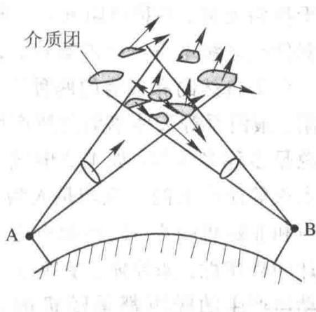{ width="420" }
<figcaption>图 10-16　对流层散射：收、发天线波束相交的公共体积中的散射体（图源：教材）</figcaption>
</figure>

对流层是从地面到约 $(13\pm5)$ km 的大气最低层。地面受热后的对流使温度、压强、湿度不断变化，在涡旋气团内部及周围形成介电常数随机起伏的小尺度不均匀体。电波照射到这些不均匀体时，在其中激起感应电流（极化电流），使之成为二次辐射源，把能量向四面八方再辐射出去——即**散射**。于是电波能到达散射体能“看见”、而发射点“看不见”的超视距地点。接收场强是收发天线波束相交的**公共体积**内所有散射体贡献的总和。

!!! abstract "对流层散射信道的特点"

    1. 散射波很弱，传输损耗很大（自由空间损耗、散射损耗、大气吸收、天线方面的损耗，一般超过 200 dB），需要大功率发射机、高灵敏度接收机和高增益天线。
    2. 散射体随机运动、相互独立，随机多径使信号产生严重的快衰落，一般用分集接收克服。
    3. 容量较大、可靠性高、保密性好，单跳跨距可达 300～800 km。
    4. 适用于难以建立微波中继站的地区，如海岛之间，或跨越湖泊、沙漠、雪山。
    5. 是应急通信系统的可选方案之一，在军事和应急指挥中有重要意义。

---

## 10.7 电磁干扰

**电磁干扰**（EMI）指除本系统欲传输信号以外的一切规则或非规则信号（也称噪声）对系统造成的影响。

### 10.7.1 电磁干扰的分类

无线电接收的好坏不只取决于信号的绝对强度，更取决于**信噪比** SNR。

- 按来源：**内部噪声**（电阻热噪声、半导体器件噪声等，由系统自身产生）和**外部干扰**；外部干扰又分为**自然干扰**（雷电、太阳、银河系射电源）和**人为干扰**（工业电气设备、高压线、电机、家用电器、汽车点火等）。
- 按性质：**随机噪声**（不可预测，但有统计规律，如热噪声）和**非随机噪声**（通常来自其他电气设备的辐射）。

干扰会使电视画面出现亮点、供电线路切断瞬间使计算机失常、高压电缆使低电平信号线误码；高功率微波武器可以使整个防御系统失灵。

### 10.7.2 自然噪声

- **天电噪声（大气噪声）**：主要来自雷电。雷电是大功率、宽频带的脉冲辐射源，最大辐射功率可达 $10^6$ MW 量级，频谱从几赫兹到几十兆赫兹，主要能量在 20 MHz 以下，集中在低频及以下波段。30 MHz 以上可以不考虑大气噪声。
- **宇宙噪声**：宇宙射电源（太阳、银河系中心区域，以及天鹅座、仙后座、金牛座等方向的强射电源）辐射的电磁波。太阳在米波、分米波段的功率流密度可达 $10^{-18}$、$10^{-19}$ W/m$^2$ 量级。20～500 MHz 宇宙噪声是主要的噪声，超过 1 GHz 后很小。它是决定米波及分米波低端所需最小场强的主要因素。
- **其他**：1 GHz 以上，大气中的水汽、氧分子以及雨雪对微波的吸收和散射也会成为进入接收机的噪声（吸收体同时也是热辐射体）。

### 10.7.3 人为干扰

人为干扰可能是有意的（如电子对抗中的干扰机）或无意的。按频谱分**窄带干扰**（带宽小于接收机带宽）和**宽带干扰**（频谱均匀、连续，带宽大于接收机带宽）；按时间分连续、间歇和瞬间干扰。宽带干扰大致有两类：占空比很小的脉冲型干扰（峰值高、平均值小，测试取峰值或准峰值），以及非常密集的“白噪声”型干扰（峰值略大于有效值，测试取平均值或有效值）。

典型的人为干扰源：

1. **其他无线电设备**：特别是大功率发射机，形成同频、邻道、谐波或寄生干扰；不仅来自天线，还会从机柜和各种连接线泄漏。
2. **工业、科研和医疗（ISM）设备**：如塑料焊机、高频加热器，一般产生 30 MHz～1 GHz 的正弦信号，300 m 处电平可达 0～60 dBm；ISM 频段使用免申请，设备越来越多。
3. **本机振荡器**：超外差接收机的本振、数字系统的时钟，经电源线传导或机壳辐射。
4. **转换开关**：通断瞬间电流突变；触点间的电弧反复熄灭、重燃，闭合时触点弹跳，产生持续几微秒的强脉冲，对数字系统尤其有害。电流越大，干扰越强，闭合时比断开时更严重。
5. **电机**：直流电机电刷与换向器的接触噪声和换向火花，频带很宽。
6. **其他**：电焊机、汽车点火系统、气体放电管、高压线电晕放电、静电放电、核电磁脉冲等，都具有脉冲干扰的特性。

一般频率高于 300 MHz 或远离干扰源时，人为干扰的影响可以忽略；在大城市和工业区则相当严重。

**表 10-4　几种典型辐射源**

| 频率 | 波长 | 受干扰对象 | 典型辐射源 |
|---|---|---|---|
| 100 GHz | 3 mm | 微波 | 电子器件 |
| 10 GHz | 3 cm | 微波、雷达 | 电子器件 |
| 1 GHz | 30 cm | 雷达 | 电子器件、各种微粒 |
| 100 MHz | 3 m | 电视、调频广播 | 电子器件、天电 |
| 10 MHz | 30 m | 短波无线电 | 电子器件、天电 |
| 1 MHz | 300 m | 中、短波无线电 | 电子器件、天电 |
| 100 kHz | 3 km | 长波、甚长波无线电 | 电子器件、天电 |
| 10 kHz | 30 km | 甚长波无线电、感应加热 | 电子器件、天电 |
| 1 kHz | 300 km | 特长波无线电、感应加热 | 电子器件、天电 |
| 100 Hz | 3000 km | 电力 | 电机、天电 |
| 10 Hz | 30 000 km | 电力 | 电机 |

### 10.7.4 干扰的传播途径

!!! definition "定义 10.2（干扰的三种传播途径）"

    - **辐射**（远场辐射干扰）：干扰源辐射的电磁波传到被干扰部件，经天线、谐振环等敏感部件进入系统。外部的广播电台、通信台、雷达是强辐射源；本系统发射机经机柜、电源线、信号线泄漏的辐射是弱辐射源。
    - **感应**（近场耦合）：干扰源与被干扰电路距离较近时，电场经**电容性耦合**（第 2 章的电耦合）、磁场经**电感性耦合**（第 4 章的磁耦合）进入电路，如开关、继电器对邻近线路的干扰。
    - **传导**：干扰经干扰源与被干扰电路之间的**公共阻抗**（公共电源内阻、公共地线电阻和电感）进入，电源线、信号线都会引入传导噪声。

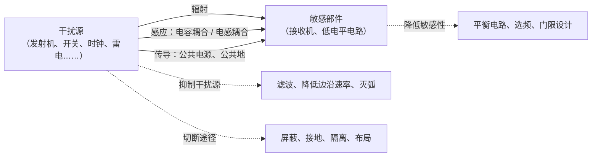

**干扰三要素**：干扰源、耦合途径、敏感部件，缺一不可。抑制干扰就从三方面入手：抑制干扰源、切断传播途径、降低接收部件的敏感性。完全消除干扰很难，但可以用技术措施保证系统可靠工作。

<figure class="video" markdown>
<video controls preload="metadata" width="100%" poster="assets/posters/C10_Coupling.jpg"><source src="assets/videos/C10_Coupling.mp4" type="video/mp4"></video>
<figcaption>动画 10-7　干扰源回路与敏感回路之间的四条耦合途径：电容耦合 $u_n\approx\mathrm j\omega C_mRu_s$、电感耦合 $u_n=\mathrm j\omega Mi_s$、公共地阻抗 $u_n=Z_gi_s$、远场辐射；最后给敏感回路加上接地屏蔽盒，并列出相应对策。</figcaption>
</figure>

!!! example "例题 10.10（感应与传导耦合的估算）"

    (1) 开关电源回路中 1 MHz、幅值 0.5 A 的电流与邻近信号回路的互感 $M=10$ nH，求感应噪声电压；(2) 两电路共用一段长 10 cm 的地线（电感约 100 nH，电阻可忽略），地线中有 10 MHz、幅值 1 A 的干扰电流，求在地线上产生的公共阻抗噪声电压。

    **解。** (1) $|u_n|=\omega Mi_s=2\pi\times10^6\times10^{-8}\times0.5=31$ mV。对毫伏级的传感器信号，这已是不可忽略的干扰。

    (2) $|Z_g|\approx\omega L=2\pi\times10^7\times10^{-7}=6.3\ \Omega$，$|u_n|=6.3$ V。一段几厘米的“地线”在高频下就是几欧的电感，这就是“地不是零电位”的原因，也是 10.8.3 节要求高频多点、就近接地的根据。两者都与 $\omega$ 成正比，频率越高（脉冲边沿越陡）耦合越强。

!!! warning "易错点：电容耦合与电感耦合的不同对策"

    电容耦合由**电压**变化 $\dd u/\dd t$ 引起，接地的静电屏蔽（哪怕很薄的金属）即可切断；电感耦合由**电流**变化 $\dd i/\dd t$ 引起，薄铜皮在低频几乎无效，要靠减小回路面积（双绞线、信号线与回线紧贴）、拉开距离、正交布置或高 $\mu$ 材料。先判断是“高电压小电流”还是“大电流低电压”的源，再选对策。

---

## 10.8 电磁兼容

!!! definition "定义 10.3（电磁兼容）"

    **电磁兼容**（EMC）：设备或系统在其电磁环境中能正常工作，且不对该环境中任何事物构成不能承受的电磁骚扰的能力（GB/T 4365—2003《电工术语　电磁兼容》）。

它包含两层意思：设备要有一定的**抗扰能力**（电磁敏感性/耐受性 EMS），在电磁环境中能正常工作；设备工作时产生的**电磁发射**（EMI）要控制在一定水平，不能对同一环境中的其他设备、人、动植物构成不能承受的骚扰。各国都有强制标准，电子、电气产品须通过电磁兼容检验才能上市。

### 10.8.1 设计思想

电磁兼容设计要从 EMI 和 EMS 两方面考虑。主要干扰有射频干扰、静电干扰、电力干扰和自干扰。降低射频干扰的有效措施是合理利用无线电频谱：

- **频谱分配**：无线电频谱是有限资源，国际上由国际电信联盟（ITU）分配，我国由国家无线电管理机构制定法规管理，设备须按规定申请频率、经批准才能研制和使用。
- **频谱节约与开发**：用压缩语音频带、单边带、提高频率稳定度等技术减小信道间隔，开发新频段。

具体设计时，先明确系统所处的电磁环境和对外干扰的允许指标，分析干扰源、敏感对象和耦合途径，把指标逐级分配到分系统、电路和元器件，采取措施后再用实验检验，不满足则继续改进。两个重要参数：

!!! definition "定义 10.4（敏感门限与电磁兼容安全系数）"

    使设备不能正常工作的干扰临界电平称为**敏感门限电平** $P_s$。**电磁兼容安全系数**

    $$m=P_s-P_I\ \ (\mathrm{dB}),$$

    $P_I$ 为设备实际接收的干扰电平（dB）。$m<0$ 不兼容（受干扰），$m=0$ 为临界，$m>0$ 才处于兼容状态。一般要求：重要设备 6 dB，次要设备 3 dB，含电触发引爆装置的设备 20 dB。

不满足时可采取：空间隔离（合理布局）、时间分隔、频率分隔、极化分隔；增强设备、电路或元器件的抗扰能力（平衡电路、触点保护、整形电路）；用屏蔽切断近场感应和远场辐射；用滤波抑制干扰源和传导耦合；用良好接地减少公共地阻抗耦合。下面讨论屏蔽、接地、滤波三项主要技术。

### 10.8.2 屏蔽技术

**屏蔽**是用导电或导磁材料制成的壳、盒或网，把电场或磁场的影响限制在某一空间内：防止外部干扰进入，或防止内部干扰泄漏出去。屏蔽的理论基础是电磁波的**反射与吸收**（第 6 章）。屏蔽效果用**屏蔽效能**表示：

$$\mathrm{SE}=20\lg\frac{E_{\mathrm{inc}}}{E_{\mathrm{t}}}=\mathrm{SE}_a+\mathrm{SE}_r\ \ (\mathrm{dB}),$$

$E_{\mathrm{inc}}$、$E_{\mathrm t}$ 分别为屏蔽前、后同一点的场强，$\mathrm{SE}_a$ 为吸收屏蔽效能，$\mathrm{SE}_r$ 为反射屏蔽效能。线性电路中也可以用屏蔽前后同一元件上的干扰电压之比 $20\lg(U_B/U_B')$ 表示。

按屏蔽对象分为电屏蔽（静电耦合）、磁屏蔽（低频磁场）和电磁屏蔽（高频电磁场）。

**1. 电屏蔽（静电屏蔽）**

<figure markdown>
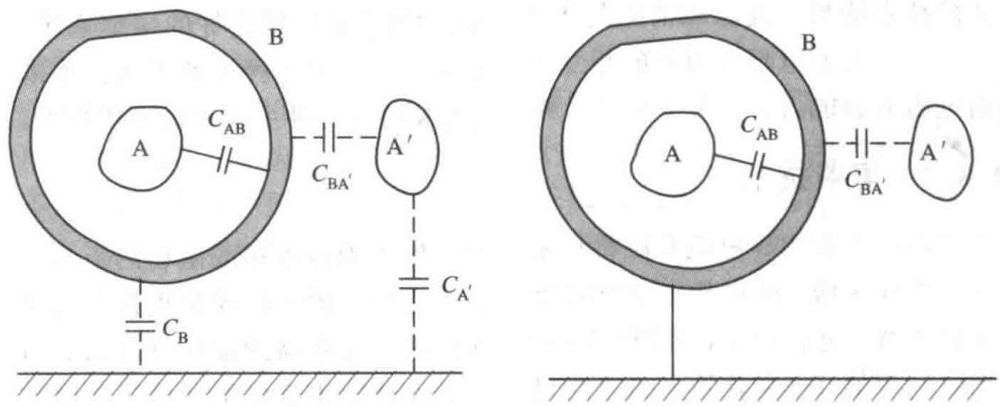{ width="620" }
<figcaption>图 10-17　屏蔽盒不接地（左）；图 10-18　屏蔽盒接地（右）（图源：教材）</figcaption>
</figure>

带电 $+Q$ 的导体 A 放在金属盒 B 中：由高斯定理，盒内表面感应 $-Q$，外表面出现 $+Q$，外表面电荷的电场照样干扰外部设备 A′——**不接地的盒子挡不住**。把盒接地，外表面的 $+Q$ 流入大地，盒内电荷的电力线终止在盒内表面，到达不了外部。用等效电路看，接地前 A 经 $C_{AB}$、$C_{BA'}$ 串联耦合到 A′；接地后 B 点电位为零，耦合通路被切断。这称为**对外静电屏蔽**（有源屏蔽）。

<figure markdown>
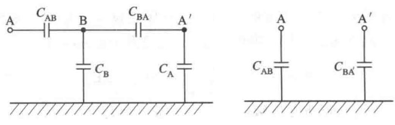{ width="560" }
<figcaption>图 10-19　屏蔽盒不接地（左）与接地（右）时的等效电路（图源：教材）</figcaption>
</figure>

若被屏蔽的源是交流的，地线中会有交变电流。频率低时地线是“短线”，屏蔽有效；频率高时地线变成“长线”（第 7 章），自身就会辐射，所以有源静电屏蔽一般用于 10 kHz 以下。

<figure markdown>
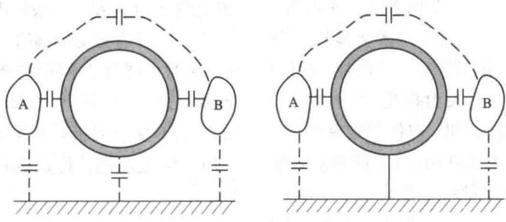{ width="620" }
<figcaption>图 10-20　对内（无源）静电屏蔽：金属盒不接地（左）与接地（右）（图源：教材）</figcaption>
</figure>

空心金属盒放在外电场中，内部场为零（第 2 章导体的静电平衡），称为**对内静电屏蔽**（无源屏蔽）。它可以不接地，但盒的存在会使电力线畸变，增大邻近电路之间的静电耦合，所以通常也要接地。静电屏蔽常用铜、铝，要求不高时用薄钢板；效果主要取决于**接地质量**，屏蔽体与地之间的阻抗越小越好。

**2. 磁屏蔽**

用高磁导率材料把磁场“分流”到它的壳壁中，一般用于 10 kHz 以下的低频。这就是第 4 章的磁路原理：高 $\mu$ 材料的磁阻很小，磁力线绝大部分集中在壳体内。

- **对外（有源）磁屏蔽**：干扰源放在高 $\mu$ 壳内，磁力线绝大部分在壳壁中闭合，只有少量漏磁通。漏磁取决于材料的磁导率和壳厚，多层屏蔽可以减少漏磁。
- **对内（无源）磁屏蔽**：外部磁场绕道高 $\mu$ 壳壁，只有少量进入壳内。理想的 $\mu\to\infty$ 才能完全隔绝，实际做不到。

磁屏蔽不需要接地；只有为了同时消除静电影响时才接地。

**3. 电磁屏蔽**

由第 6 章，平面波入射到良导体上大部分被反射，透入的部分以衰减常数

$$\alpha\approx\sqrt{\pi f\mu\sigma}$$

迅速衰减，**趋肤深度** $\delta=\dfrac1\alpha=\dfrac{1}{\sqrt{\pi f\mu\sigma}}$，频率越高 $\delta$ 越小。厚 $t$ 的板的吸收损耗

$$\mathrm{SE}_a=20\lg\mathrm e^{t/\delta}=8.686\,\frac t\delta\ \ \mathrm{dB}.$$

例如取 $t=2\pi\delta$（一个导体内波长），$\mathrm{SE}_a\approx54.6$ dB，场衰减到约 $1/535$。平面波入射时的反射损耗 $\mathrm{SE}_r\approx20\lg\dfrac{\eta_0}{4|\eta_c|}$，良导体 $|\eta_c|=\sqrt{\omega\mu/\sigma}$ 很小，反射损耗也很大。

<figure class="video" markdown>
<video controls preload="metadata" width="100%" poster="assets/posters/C10_Shielding.jpg"><source src="assets/videos/C10_Shielding.mp4" type="video/mp4"></video>
<figcaption>动画 10-8　平面波射向良导体屏蔽板：空气中入射波与反射波叠成驻波（表面处 $E\approx0$）；板内的场每深入一个 $\delta$ 衰减到 $1/\mathrm e$；透出的波极弱。后半段：0.5 mm 铜板在不同频率下的吸收损耗，从 50 Hz 的不到 1 dB 增大到 100 MHz 的数百 dB。</figcaption>
</figure>

所以高频电磁屏蔽用非铁磁的良导体（铜、铝）薄板即可（高频时铁磁材料磁滞损耗大、发热）。高频下电场与磁场相互依存，屏蔽了一方另一方也随之消失；一般用良导体板屏蔽罩并接地。不便用金属板时可用金属网，此时以反射损耗为主，网孔越小、导线越粗、屏蔽空间越大，效果越好，但即使很密的网也不如金属板，高频时尤其如此。要求 100 dB 以上时可用多层屏蔽，铁磁材料与非铁磁良导体交替的多层结构效果更好。

!!! warning "易错点：电磁屏蔽设计中的三个陷阱"

    1. **近场与远场不同**：靠近波源时，电场源（高压、小电流）的波阻抗远大于 377 Ω，反射损耗大；磁场源（大电流、低电压）的波阻抗远小于 377 Ω，反射损耗很小。所以低频近区磁场最难屏蔽，要用高 $\mu$ 材料或加厚。
    2. **孔和缝**：屏蔽效能往往不由板材决定，而由孔缝决定。长度与半波长可比的缝隙就是一副缝隙天线（二次辐射源），具有方向性，会使某些区域的屏蔽效能很差；通风孔、接缝、电缆入口都要专门设计（截止波导通风窗、导电衬垫、穿心滤波器）。
    3. **箱体谐振**：屏蔽箱本身是一个谐振腔，有自然谐振频率；频率合适的干扰以很小能量耦合进去后可能被放大，出现**负屏蔽效能**，设计时要避开。

!!! example "例题 10.11（铜板的屏蔽效能）"

    1 MHz 平面波垂直入射到厚 1 mm 的铜板（$\sigma=5.8\times10^7$ S/m，$\mu=\mu_0$），估算吸收损耗、反射损耗和总屏蔽效能。

    **解。** $\delta=\dfrac{1}{\sqrt{\pi\times10^6\times4\pi\times10^{-7}\times5.8\times10^7}}=66.1\ \mu\mathrm m$，

    $$\mathrm{SE}_a=8.686\times\frac{1000}{66.1}=131\ \mathrm{dB}.$$

    $|\eta_c|=\sqrt{\dfrac{\omega\mu}{\sigma}}=\sqrt{\dfrac{2\pi\times10^6\times4\pi\times10^{-7}}{5.8\times10^7}}=3.69\times10^{-4}\ \Omega$，

    $$\mathrm{SE}_r\approx20\lg\frac{\eta_0}{4|\eta_c|}=20\lg\frac{377}{4\times3.69\times10^{-4}}=108\ \mathrm{dB}.$$

    总屏蔽效能约 239 dB。实际屏蔽体远达不到这个数，因为孔、缝、电缆入口的泄漏才是瓶颈（见下面的易错点）——这再次说明“材料够厚”不等于“屏蔽够好”。

### 10.8.3 接地技术

**接地**是为电源和信号提供回路和基准电位。目的是防止电磁干扰、消除公共阻抗耦合，以及保证人身和设备安全。接地与屏蔽结合可以解决大部分干扰问题。

理想接地面电位处处为零。大地是理想的接地面，也可用高电导率的铜板或铜栅网构成接地平面，并要有足够的长、宽、厚，使它在所有频率上都呈现低阻抗：固定设备的接地面应延伸到所有设备底面以下并比最大尺寸多伸出 2 m 以上，大功率发射机的接地面径向延伸到最长工作波长的 1/4；还要设置接地母线，就近汇流，接地点间隔小于 2 m。

<figure markdown>
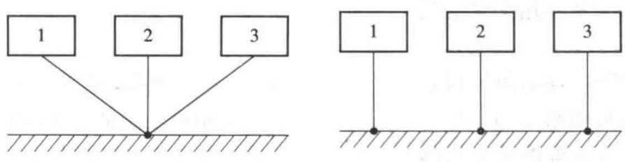{ width="660" }
<figcaption>图 10-21　单点接地（左）；图 10-22　多点接地（右）（图源：教材）</figcaption>
</figure>

- **单点接地**：所有对地连接汇到一个参考点，各支路的地电位只与自身电流和地线电阻有关，互不干扰。要求各接地线长度远小于波长；高频时地线感抗增大、地线间的电感和电容耦合增强，反而互相干扰。地线多而长，结构复杂。
- **多点接地**：每一级或每一装置就近接到接地面，地线短、阻抗低，适合高频。
- **多点串联接地**（图 10-23）：各段地线 OA、AB、BC 的阻抗被多个支路共用，产生公共阻抗耦合，离电源（接地点 O）越近的支路受干扰越小，所以应把**低电平电路放在最靠近接地点**的位置。
- **混合接地**：低电平电路接“信号地”，继电器、电动机等大电流电路接“干扰地”（功率地），机壳接“机壳地/屏蔽地”，最后在一点汇入大地。复杂设备至少分三组：低电平信号地、高电平干扰地、机壳地。

<figure markdown>
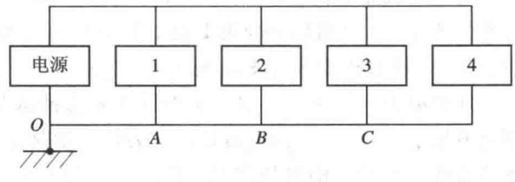{ width="400" }
<figcaption>图 10-23　多点串联接地：地线各段的阻抗被多个支路共用（图源：教材）</figcaption>
</figure>

经验规则：$f<1$ MHz 或接地点间距较小时用单点接地；$f>10$ MHz 或间距较大时用多点接地；介于其间用混合接地。电缆长度小于 $0.15\lambda$ 时屏蔽层可单点接地，否则多点接地。接地按用途还分为安全地、静电地、避雷地、电源地、信号地、屏蔽地等：所有设备的机壳和底盘都要接安全地，否则杂散阻抗可能使机壳带高电位、危及人身；电源要单独建立基准接地点，经扼流圈、旁路电容接地，并与信号地隔离。

!!! note "前后联系：“地”也是一段传输线"

    第 7 章说过，长度超过 $\lambda/20$ 左右的导线就要当传输线看待。100 MHz 时 $\lambda=3$ m，15 cm 的地线已是一段不可忽略的电感，两端电位不再相同；长度接近 $\lambda/4$ 的地线甚至会把“短路”变成“开路”（$\lambda/4$ 变换性）。这就是高频必须多点、就近、大面积接地的根本原因。

### 10.8.4 滤波技术

滤波既是抑制**传导干扰**的主要措施（如电源滤波），也是对付**辐射干扰**的重要手段（如收发前端滤波）。电磁干扰滤波器通过**反射**或**吸收**干扰信号，让有用信号通过；它比屏蔽成本低、体积小、重量轻。其特点是：

1. 干扰源阻抗变化范围很大，滤波器通常工作在**阻抗失配**状态；
2. 干扰频谱很宽，不能简单地用集总参数描述滤波器的高频特性（元件的寄生电感、电容会使特性在高频“翻转”）；
3. 要在大电流、高电压下长期工作，对干扰衰减大、对信号衰减小。

EMI 滤波器有 LC 滤波器、无源组合式滤波器、电缆滤波器、有源滤波器等；结构上有 Γ 型、T 型、π 型；功能上有低通、高通、带通、带阻。主要性能参数有**插入损耗**（接入滤波器前后负载上的电压之比，常用 dB 表示）、输入输出阻抗和额定电压（反映耐浪涌能力）。

安装要点：

1. 滤波器最好装在干扰源出口处，与干扰源在同一屏蔽盒内；空间不够时装在出口外侧，并与机壳良好搭接。
2. 输入线与输出线必须分开、相互隔离，否则干扰会绕过滤波器直接耦合过去。
3. 元件引线尽可能短，避免引线电感与电容在某频率谐振；各电抗元件相互垂直安装，减小相互耦合。
4. 滤波器接地线上有很大的干扰短路电流，要防止它再产生干扰。
5. 导线相互隔离、避免交叉；同一插座上的每根导线都必须滤波，否则滤波失效。

### 10.8.5 电磁辐射对环境的影响

电磁辐射包括**有意辐射**（各种无线系统）和**无意辐射**（设备对外泄漏的电磁能量）。它对人体和设备的危害来自**热效应**和**场效应**；电磁干扰就是场效应对信号接收的危害。

电磁波照射人体与照射介质一样，有反射、透射和吸收（第 6 章），产生热效应和非热效应。实验表明，体表功率密度 10 mW/cm$^2$ 时体温约升高 1 °C。150～1000 MHz 的电磁波主要被深部组织吸收；1～3 GHz 体表与深部吸收大致相当，含水多的组织吸收多；3 GHz 以上主要被体表吸收（趋肤深度随频率减小）。高强度微波照射可能导致白内障（眼睛对 1～3 GHz 最敏感），睾丸对辐射更敏感；还可能引起脑功能减退、血细胞减少等。动物实验中，波长 1.25 cm、强度 150 mW/cm$^2$ 的微波照射 5 min 即可致白鼠死亡。

移动通信中常用**比吸收率**（SAR，单位质量组织吸收的功率，W/kg）衡量手机等终端的辐射安全性。各国射频辐射安全标准不尽相同：例如美国对 10 MHz～100 GHz 规定 10 mW/cm$^2$（6 min 平均），英国对 30 MHz～30 GHz 规定 10 mW/cm$^2$（8 h 平均），我国对长期职业性微波暴露的限值则低得多（μW/cm$^2$ 量级）。超过标准时必须采取防护措施，如穿射频防护服。

强电场还会在金属杆、线、柱上感应高电压（长度接近谐振长度时尤甚），人员接触可能灼伤，射频感应电压的危害限值约 140 V；感应电压产生的火花可能点燃可燃气体或损坏设备；对电起爆的武器装备，射频能量可能经电缆或屏蔽的孔缝进入引爆装置造成误爆。这些都要靠电磁兼容设计解决。

---

## 知识点归纳总结

!!! abstract "知识点归纳总结"

    **一条主线**：频率决定传播方式 → 每种信道都是“损耗 + 衰落 + 失真”的不同组合 → 干扰沿“源—途径—敏感部件”传播 → 用屏蔽、接地、滤波切断。

    **核心公式：**

    | 内容 | 公式 |
    |---|---|
    | 弗里斯公式 | $P_r=P_{\mathrm{in}}G_tG_r\left(\dfrac{\lambda}{4\pi r}\right)^2$ |
    | 自由空间损耗 | $L_{bf}=32.45+20\lg f_{\mathrm{MHz}}+20\lg r_{\mathrm{km}}$ dB |
    | 信道损耗 | $L_b=L_{bf}-A$，$A=20\lg\lvert E/E_0\rvert$ |
    | 容许带宽 | $\Delta f=1/\tau$ |
    | 多普勒频移 | $f_D=\dfrac v\lambda\cos\theta$，$f_m=v/\lambda$，深衰落间隔 $\approx\lambda/(2v)$ |
    | 视线距离 | $r_v=3.57(\sqrt{h_1}+\sqrt{h_2})$ km；计大气折射 $4.12(\sqrt{h_1}+\sqrt{h_2})$ km |
    | 两径路径因子 | $\lvert F\rvert=2\left\lvert\sin\dfrac{2\pi h_1h_2}{\lambda d}\right\rvert$，$r'-r\approx\dfrac{2h_1h_2}{d}$ |
    | 两径远区 | $d>\dfrac{4h_1h_2}{\lambda}$ 时 $P_r\approx P_{\mathrm{in}}G_tG_r\dfrac{h_1^2h_2^2}{d^4}$ |
    | 第一菲涅耳区 | $F_1=\sqrt{\dfrac{\lambda d_1d_2}{d_1+d_2}}$，余隙 $\ge0.6F_1$ |
    | 电离层 | $\varepsilon_r=1-\dfrac{80.8N}{f^2}$；$f_{\max}=\sqrt{80.8N_{\max}}\sec\theta_0$；$f_{\mathrm{opt}}=0.85f_{\max}$ |
    | 静区 | $\theta_{0\min}=\arcsin\sqrt{1-80.8N_{\max}/f^2}$ |
    | 静区（平面地近似） | $D_{\min}=2h'\tan\theta_{0\min}$ |
    | 耦合噪声 | 电容 $u_n\approx\je\omega C_mRu_s$；电感 $u_n=\je\omega Mi_s$；公共阻抗 $u_n=Z_gi_s$ |
    | 安全系数 | $m=P_s-P_I$（dB），重要设备 6 dB，电起爆 20 dB |
    | 屏蔽 | $\mathrm{SE}=\mathrm{SE}_a+\mathrm{SE}_r$，$\delta=\dfrac{1}{\sqrt{\pi f\mu\sigma}}$，$\mathrm{SE}_a=8.686\,t/\delta$ dB，$\mathrm{SE}_r\approx20\lg\dfrac{\eta_0}{4\lvert\eta_c\rvert}$ |

    **四种信道对比：**

    | 信道 | 频段 | 损耗与衰落 | 优点 | 缺点 |
    |---|---|---|---|---|
    | 视距 | $>30$ MHz | 扩散 + 两径干涉，10 GHz 以上雨衰 | 带宽宽、稳定 | 距离受视距限制 |
    | 电离层 | 3～30 MHz | 吸收、多径快衰落 | 小功率远距离 | 带宽窄、不稳定、有静区 |
    | 地面波 | 长、中波 | 地面吸收，随频率增大 | 稳定 | 频率低、带宽小 |
    | 散射 | $>30$ MHz | 损耗 $>200$ dB，快衰落 | 超视距、保密 | 需大功率、高增益 |

    **屏蔽选型：** 静电场 → 良导体 + **接地**；低频磁场（$<10$ kHz）→ 高 $\mu$ 材料，不必接地；高频电磁场 → 良导体（非铁磁）板，注意孔缝和谐振。

    **接地选型：** $f<1$ MHz 单点；$f>10$ MHz 多点；之间混合。

    **解题方法：**

    1. **链路计算**：一律化成分贝做加减：$P_r(\mathrm{dBm})=P_t(\mathrm{dBm})+G_t+G_r-L_{bf}-(\text{附加损耗})$；反求距离时先求允许的 $L_{bf}$，再解 $20\lg r$。
    2. **视距问题**：先用 $4.12(\sqrt{h_1}+\sqrt{h_2})$ 判断是否在视距内，再算 $d_b=4h_1h_2/\lambda$ 判断处于干涉区还是 $1/d^4$ 区，最后检查障碍物处的 $0.6F_1$ 余隙。
    3. **天波问题**：$f_c=\sqrt{80.8N_{\max}}$ $\to$ $f_{\max}=f_c\sec\theta_0$ $\to$ $f_{\mathrm{opt}}=0.85f_{\max}$；给定频率求静区先求 $\theta_{0\min}$。
    4. **衰落问题**：时延 $\tau\to$ 容许带宽 $1/\tau$（频率选择性）；速度 $v\to f_m=v/\lambda$，衰落间隔 $\lambda/2v$（时间选择性）。
    5. **EMC 问题**：先找“源—途径—敏感部件”，判断是电场型、磁场型、传导型还是辐射型，再对应选屏蔽（接地与否、材料）、布线、接地方式和滤波。

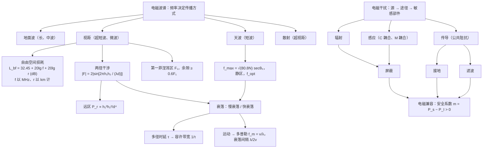

**易错点汇总。**

- $L_{bf}$ 公式中 $f$ 以 **MHz**、$r$ 以 **km** 计；单位换了常数就不是 32.45。分贝相加减对应功率相乘除。
- 视距公式中 $h$ 以 **m** 计、结果为 km；3.57 不计大气折射，4.12 计入（等效地球半径 $\frac43a$）。
- dBm 是绝对功率、dB 是比值：dBm $\pm$ dB 合法，两个 dBm 不能直接相加。
- 两径远区功率 $\propto h_1^2h_2^2/d^4$，与频率无关；掠入射时 $\Gamma\approx-1$。
- 几何视线未被挡住不等于无附加损耗，要看余隙是否 $\ge0.6F_1$。
- 多普勒的 $\theta$ 是运动方向与来波方向（指向波源）的夹角；多普勒扩展管时间选择性，多径时延管频率选择性。
- 正割定律中 $\theta_0$ 是射线与**竖直方向**（电离层法线）的夹角，不是仰角。
- 电离层的“反射”是连续折射，不是金属面那样的镜面反射；频率越高折回越高、越难折回。
- 夜间短波电台多，是因为 D 层消失、吸收减小，并不是电离层电子更多（夜间电子密度反而小，$f_{\max}$ 降低，所以夜频比日频低）。
- 地面波用**垂直极化**；视距传播掠入射时两种极化的反射系数都约为 $-1$。
- 静电屏蔽必须**接地**；磁屏蔽不必接地。低频磁场不能靠薄铜板屏蔽（$\delta$ 太大）。
- 安全系数 $m=P_s-P_I$，两者都用 dB；$m>0$ 才兼容。

---

## 练习题

!!! example "练习 1"

    某移动信道发射功率 1 kW，发射天线增益 6 dB，载频 900 MHz，接收天线增益 1.5 dB，收发距离 10 km。按自由空间计算接收机输入功率。

    ??? success "答案"

        $L_{bf}=32.45+20\lg900+20\lg10=32.45+59.08+20=111.53$ dB，计入天线增益 $L=111.53-6-1.5=104.03$ dB。

        $$P_r=10^3\times10^{-10.403}\approx3.95\times10^{-8}\ \mathrm W\ (-44\ \mathrm{dBm}).$$

        实际城市环境还有建筑物遮挡和多径，接收功率比这小得多。

!!! example "练习 2"

    视距信道中发射天线高 225 m，接收天线高 16 m。(1) 极限传播距离多少？(2) 若接收天线升高到 64 m，极限距离增加多少？

    ??? success "答案"

        (1) $r_v=4.12\times(15+4)=78.3$ km。

        (2) $r_v=4.12\times(15+8)=94.8$ km，增加 16.5 km。视距只按 $\sqrt h$ 增长，天线高度增加到 4 倍，它那一段距离才翻倍。

!!! example "练习 3"

    电离层 $N_{\max}=10^{12}$ 个/m$^3$。(1) 临界频率多少？(2) $\theta_0=45^\circ$ 时的最高可用频率和最佳工作频率；(3) 若用 15 MHz 工作，能被折回的最小入射角是多少？

    ??? success "答案"

        (1) $f_c=\sqrt{80.8\times10^{12}}=8.99$ MHz。

        (2) $f_{\max}=8.99\times\sqrt2=12.7$ MHz，$f_{\mathrm{opt}}=10.8$ MHz。

        (3) $\sin\theta_{0\min}=\sqrt{1-(8.99/15)^2}=\sqrt{1-0.359}=0.800$，$\theta_{0\min}\approx53.2^\circ$。入射角更小（射线更陡）的电波会穿出电离层。

!!! example "练习 4"

    微波视距线路中 $h_1=50$ m，$h_2=10$ m，$f=300$ MHz，地面反射系数取 $-1$。(1) 求最后一个场强极大点的距离；(2) 列出 $d<2$ km 范围内场强为零的位置；(3) $d=10$ km 处接收场强是自由空间场强的多少倍？

    ??? success "答案"

        $\lambda=1$ m，$\dfrac{2\pi h_1h_2}{\lambda d}=\dfrac{1000\pi}{d}$（$d$ 以 m 计）。

        (1) $\dfrac{1000\pi}{d}=\dfrac\pi2$，$d=2$ km，此处 $|F|=2$（比自由空间高 6 dB）。

        (2) $\dfrac{1000\pi}{d}=n\pi$，$d=\dfrac{1000}{n}$ m：1000 m、500 m、333 m、250 m……

        (3) $|F|=2\sin(0.1\pi)=0.618$，即比自由空间低 4.2 dB；且此后按 $1/d^2$ 继续下降。

!!! example "练习 5"

    短波电离层信道中两条主要路径的时延差为 2 ms。求容许带宽，并判断它能否不失真地传输带宽 3 kHz 的话音信号。

    ??? success "答案"

        $\Delta f=\dfrac1\tau=\dfrac{1}{2\times10^{-3}}=500$ Hz。3 kHz 的信号带宽远大于 500 Hz，会出现明显的频率选择性衰落（话音“发哑”、时强时弱）；数字传输则需要降低码速率或采用抗多径技术。

!!! example "练习 6"

    分别计算海水（$\varepsilon_r=80$，$\sigma=4$ S/m）和干土（$\varepsilon_r=4$，$\sigma=10^{-3}$ S/m）在 1 MHz 和 100 MHz 时的 $\sigma/(\omega\varepsilon)$，说明为什么海上中波广播传得远、而米波不用地面波传播。

    ??? success "答案"

        $\dfrac{\sigma}{\omega\varepsilon}=\dfrac{\sigma}{2\pi f\varepsilon_r\varepsilon_0}$：

        | | 1 MHz | 100 MHz |
        |---|---|---|
        | 海水 | 899 | 9.0 |
        | 干土 | 4.5 | 0.045 |

        中波时海水是极好的导体，地面吸收小、波前倾斜小，地波传得远；干土只是不良导体，衰减大得多。到 100 MHz，干土已是介质（$\ll1$），地面吸收很大，地面波只能传很近，所以米波以上改用视距传播。

!!! example "练习 7"

    用铝板（$\sigma=3.5\times10^7$ S/m，$\mu=\mu_0$）屏蔽 1 MHz 的电磁干扰。(1) 求趋肤深度；(2) 要求吸收损耗 $\mathrm{SE}_a\ge60$ dB，板厚至少多少？(3) 若干扰是 50 Hz 的磁场，这样的铝板还有效吗？

    ??? success "答案"

        (1) $\delta=\dfrac{1}{\sqrt{\pi\times10^6\times4\pi\times10^{-7}\times3.5\times10^7}}=8.5\times10^{-5}\ \mathrm m=85\ \mu\mathrm m$。

        (2) $8.686\,t/\delta\ge60$，$t\ge6.91\delta\approx0.59$ mm。

        (3) 50 Hz 时 $\delta=85\ \mu\mathrm m\times\sqrt{10^6/50}=12$ mm，0.6 mm 的板吸收损耗不到 0.5 dB；且近区磁场源的波阻抗很低，反射损耗也小。必须改用高磁导率材料（坡莫合金、硅钢）做磁屏蔽。

!!! example "练习 8"

    (1) 某设备的敏感门限电平为 $-60$ dBm，实际接收的干扰电平为 $-70$ dBm，它是否满足重要设备的电磁兼容要求？(2) 若它是含电起爆装置的设备呢？(3) 简述夜间收到的短波电台多且杂音大的原因。

    ??? success "答案"

        (1) $m=-60-(-70)=10$ dB $>6$ dB，满足。

        (2) 要求 20 dB，不满足，还需把干扰再降低 10 dB 以上（屏蔽、滤波或拉开距离）。

        (3) 夜间 D 层消失，电离层吸收大大减小，远处电台的天波能以很小的衰减到达，所以收到的电台多；同时远方的电台干扰和天电噪声也同样传了过来，短波频段本就拥挤，于是杂音大、串台多。

!!! example "练习 9"

    用铜板（$\sigma=5.8\times10^7\ \mathrm{S/m}$，$\mu=\mu_0$）屏蔽 $100$ kHz～$1$ GHz 的平面波干扰，要求吸收损耗不小于 $40$ dB。屏蔽罩至少多厚？为什么必须按最低频率计算？并估算这块板在 $1$ GHz 时的吸收损耗。

    ??? success "答案"

        吸收损耗 $\mathrm{SE}_a=8.686\,t/\delta$，趋肤深度 $\delta=1/\sqrt{\pi f\mu\sigma}$ 随频率升高而减小。同一个厚度，频率越低 $\mathrm{SE}_a$ 越小，所以必须代入频段的**最低频率** $100$ kHz：

        $$\delta(100\ \mathrm{kHz})=0.209\ \mathrm{mm},\qquad\frac{t}{\delta}\ge\frac{40}{8.686}=4.61,\qquad t\ge0.96\ \mathrm{mm}.$$

        若误按 $1$ GHz 计算，$\delta$ 只有 $2.09\ \mu\mathrm m$，会得到“十几微米就够了”的错误结论——那块薄片在 $100$ kHz 时几乎没有吸收。用 $t=0.96$ mm 再看 $1$ GHz：$\delta$ 缩小为原来的 $1/100$，$\mathrm{SE}_a$ 扩大 $100$ 倍，约为 $4000$ dB，已经远不是瓶颈；真正限制高频屏蔽效能的是孔、缝和电缆入口（例题 10.11）。

        这个结论与第 6 章练习 8、本章练习 7 是同一件事：低频最难靠趋肤效应屏蔽，近区磁场还要改用高 $\mu$ 材料。

!!! quote "参考资料"

    本章图 10-A、图 10-B 取自郭辉萍《电磁场与电磁波》（第 6 版）配套课件（[西安电子科技大学出版社](https://www.xduph.com/pages/BookDetail.aspx?doi=e161cf56-2ab9-4c3c-a69d-66d0f0722d24)）；图 10-C 取自[上海交通大学何广强《电磁场与波》公开课件](https://qnp.sjtu.edu.cn/content.aspx?flag=56&info_lb=56)；练习 9 改编自[东南大学电磁场试卷](https://github.com/zhufeiyu2023/diancichangyubo) 的屏蔽设计简答题。第 6 章图 6-B 可与 10.3.3 节掠入射反射系数对照。

---

上一章：[第 7 章 传输线](ch7.md)　·　全课程回顾：[全课程总结](summary.md)
