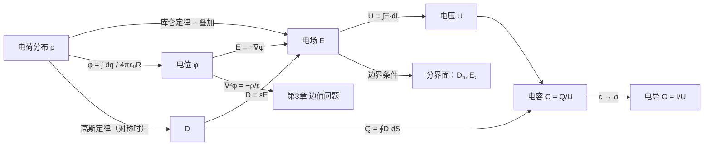

# 第 2 章 静电场和恒定电场

!!! tip "本章目标"

    1. 会用库仑定律和叠加原理，由电荷分布求电场强度 $\vv E$ 和电位 $\phi$；理解 $\vv E=-\nabla\phi$ 及电位参考点的选取。
    2. 掌握高斯定律的积分形式和微分形式，会对球、柱、面对称的问题选高斯面求场。
    3. 理解电介质极化、束缚电荷、电通量密度 $\vv D$ 和本构关系 $\vv D=\varepsilon\vv E$。
    4. 会计算平行板、同轴线、双导线的电容，了解部分电容和电耦合（串扰）。
    5. 掌握静电场的边界条件，会分析分界面上场的方向变化。
    6. 掌握恒定电场的基本方程、电流连续性、接地电阻、跨步电压和漏电导，会用静电比拟 $C/G=\varepsilon/\sigma$。

**本章在全书中的位置。** 这是第一个具体的矢量场。按第 1 章的亥姆霍兹定理，只需回答两件事：静电场的**散度**是什么？**旋度**是什么？答案是 $\nabla\cdot\vv D=\rho_V$、$\nabla\times\vv E=\vv 0$。本章讲的“基本方程 + 本构关系 + 边界条件”这套框架，第 4 章（磁场）和第 5 章（时变场）会原样再用一次。

---

## 2.1 电场强度与电位函数

### 2.1.1 库仑定律

!!! theorem "定理 2.1（库仑定律）"

    真空中，位于 $\vv r'$ 的点电荷 $q_1$ 对位于 $\vv r$ 的点电荷 $q_2$ 的作用力为

    $$\vv F_{12}=\frac{q_1q_2}{4\pi\varepsilon_0R^2}\vv a_R=\frac{q_1q_2\,\vv R}{4\pi\varepsilon_0R^3},\qquad\vv R=\vv r-\vv r',$$

    其中 $\varepsilon_0=\dfrac{1}{36\pi}\times10^{-9}\approx8.854\times10^{-12}\ \mathrm{F/m}$ 为真空介电常数。

力沿两电荷连线，同号相斥、异号相吸，与距离平方成反比。多个电荷的作用力可以**线性叠加**。

### 2.1.2 电场强度

!!! definition "定义 2.1（电场强度）"

    $$\vv E=\lim_{q_t\to0}\frac{\vv F}{q_t}\quad(\mathrm{V/m}),$$

    即单位正试验电荷受到的力。取 $q_t\to0$ 是为了不扰动原来的电荷分布。

**点电荷**的电场：$\vv E(\vv r)=\dfrac{q}{4\pi\varepsilon_0}\dfrac{\vv R}{R^3}$。**分布电荷**把电荷元 $\dd q$ 看作点电荷再积分：

$$\vv E(\vv r)=\frac{1}{4\pi\varepsilon_0}\int\frac{\vv R}{R^3}\,\dd q,\qquad\dd q=\rho_V\,\dd V'\ \text{（体）},\quad\rho_S\,\dd S'\ \text{（面）},\quad\rho_l\,\dd l'\ \text{（线）}.$$

!!! warning "易错点：源点与场点"

    积分变量是**源点** $\vv r'$（带撇），结果是**场点** $\vv r$ 的函数。$\vv R=\vv r-\vv r'$ 由源点指向场点。由于 $\vv R$ 的方向随源点变化，矢量积分时一定要先把 $\vv R$ 分解到**直角坐标**的常单位矢量上，再逐个分量积分；能用对称性判断为零的分量先划掉。

!!! example "例题 2.1（有限长线电荷）"

    长为 $2L$ 的直线段沿 $z$ 轴放置（$-L\le z'\le L$），均匀带线电荷 $\rho_l$。求其中垂面上距线 $\rho$ 处的电场。

    **解。** 由对称性，场点取 $(\rho,0,0)$。源点 $(0,0,z')$，$\vv R=\ax\rho-\az z'$，$R=\sqrt{\rho^2+z'^2}$。上下对称的电荷元的 $z$ 分量抵消，只剩 $\rho$ 分量：

    $$E_\rho=\frac{\rho_l}{4\pi\varepsilon_0}\int_{-L}^{L}\frac{\rho\,\dd z'}{(\rho^2+z'^2)^{3/2}}=\frac{\rho_l}{4\pi\varepsilon_0}\cdot\frac{z'}{\rho\sqrt{\rho^2+z'^2}}\Bigg|_{-L}^{L}=\frac{\rho_lL}{2\pi\varepsilon_0\rho\sqrt{\rho^2+L^2}}.$$

    令 $L\to\infty$，得**无限长线电荷**的场 $\vv E=\arho\dfrac{\rho_l}{2\pi\varepsilon_0\rho}$。例题 2.4 会用高斯定律一步得到同样的结果。

### 2.1.3 电位函数

点电荷的场可以写成梯度：由第 1 章例题 1.8，$\dfrac{\vv R}{R^3}=-\nabla\dfrac1R$，于是 $\vv E=-\nabla\left(\dfrac{q}{4\pi\varepsilon_0R}\right)$。叠加后任何静电场都是某个标量函数的负梯度，因而**无旋**：$\nabla\times\vv E=\vv 0$。

!!! definition "定义 2.2（电位）"

    静电场中，满足 $\vv E=-\nabla\phi$ 的标量函数 $\phi$ 叫**电位**（单位 V）。$A,B$ 两点的电位差（电压）为

    $$U_{AB}=\phi_A-\phi_B=\int_A^B\vv E\cdot\dd\vv l,$$

    它与积分路径无关。选定参考点 $P_0$（令 $\phi_{P_0}=0$）后，$\phi(P)=\int_P^{P_0}\vv E\cdot\dd\vv l$。电荷分布在有限区域时，通常取**无穷远**为参考点。

!!! success "关键公式：由电荷分布求电位（参考点在无穷远）"

    $$\phi(\vv r)=\frac{1}{4\pi\varepsilon_0}\int\frac{\dd q}{R}=\frac{1}{4\pi\varepsilon_0}\int_V\frac{\rho_V(\vv r')}{\lvert\vv r-\vv r'\rvert}\,\dd V'\quad(\text{面、线电荷同理}).$$

    这是**标量积分**，比直接求 $\vv E$ 的矢量积分简单得多。求出 $\phi$ 后再用 $\vv E=-\nabla\phi$。

!!! info "直觉：为什么要引入电位"

    - **省事**：三个分量的矢量积分变成一个标量积分。
    - **有物理意义**：$q\phi$ 是电荷的电位能；$U_{AB}$ 就是电路里的“电压”。
    - **可以求解边值问题**：第 3 章会看到，电位满足泊松方程 $\nabla^2\phi=-\rho_V/\varepsilon$，有成套的解法。
    - **等位面**是 $\phi$ 的等值面，电场垂直于等位面并指向电位降低的方向（第 1 章梯度的性质）。

!!! warning "易错点：参考点"

    电荷延伸到无穷远时（例如无限长线电荷、无限大平面电荷），$\int\dd q/R$ 发散，**不能**以无穷远为参考点。这时应取有限远处的一点为参考点，直接由 $\int\vv E\cdot\dd\vv l$ 求电位差。例如无限长线电荷，取 $\rho_0$ 处为零电位，则 $\phi=\dfrac{\rho_l}{2\pi\varepsilon_0}\ln\dfrac{\rho_0}{\rho}$。

!!! example "例题 2.2（带电导体球）"

    真空中半径为 $a$ 的导体球带电 $Q$。求球内外的电场和电位。

    **解。** 静电平衡时导体内部 $\vv E=\vv 0$，电荷全部分布在表面，且由对称性均匀分布，$\rho_S=\dfrac{Q}{4\pi a^2}$。

    球外（$r>a$）：由高斯定律（2.2 节）或直接叠加，$\vv E=\ar\dfrac{Q}{4\pi\varepsilon_0r^2}$，$\phi=\displaystyle\int_r^\infty E\,\dd r=\dfrac{Q}{4\pi\varepsilon_0r}$。

    球内（$r<a$）：$\vv E=\vv 0$，所以 $\phi$ 为常数，等于球面上的值 $\dfrac{Q}{4\pi\varepsilon_0a}$。**导体是等位体，导体表面是等位面。**

    由此得孤立导体球的电容 $C=\dfrac{Q}{\phi}=4\pi\varepsilon_0a$。地球（$a\approx6.4\times10^6\ \mathrm m$）的电容也只有约 $710\ \mu\mathrm F$。

### 2.1.4 电偶极子

<figure class="video" markdown>
<video controls preload="metadata" width="100%" poster="assets/posters/C2_FieldLines.jpg"><source src="assets/videos/C2_FieldLines.mp4" type="video/mp4"></video>
<figcaption>动画 2-1　四种电荷组合的电力线与等位线：单个点电荷、电偶极子、两个等量正电荷、$+q$ 与 $-2q$（零电位面是一个球面）。</figcaption>
</figure>

!!! definition "定义 2.3（电偶极子）"

    相距很近（间距 $d$）的一对等量异号点电荷 $\pm q$ 叫**电偶极子**。**电偶极矩** $\vv p=q\vv d$，$\vv d$ 由 $-q$ 指向 $+q$。

把 $\vv p$ 放在原点沿 $\az$，$+q$ 在 $z=d/2$，$-q$ 在 $z=-d/2$。场点 $r\gg d$ 时，$\dfrac{1}{r_+}-\dfrac{1}{r_-}\approx\dfrac{d\cos\theta}{r^2}$，所以

$$\phi=\frac{q}{4\pi\varepsilon_0}\left(\frac{1}{r_+}-\frac1{r_-}\right)\approx\frac{p\cos\theta}{4\pi\varepsilon_0r^2}=\frac{\vv p\cdot\ar}{4\pi\varepsilon_0r^2},$$

$$\vv E=-\nabla\phi=\frac{p}{4\pi\varepsilon_0r^3}\left(\ar\,2\cos\theta+\atheta\sin\theta\right).$$

电偶极子的场比点电荷衰减得快（$\phi\propto1/r^2$，$E\propto1/r^3$），因为远处看两个电荷几乎抵消。电偶极子是 2.3 节**电介质极化**的微观模型，也是第 9 章天线（电基本振子）的原型。

---

## 2.2 真空中静电场的基本方程

### 2.2.1 电通量和电通量密度

真空中定义**电通量密度**（电位移矢量）$\vv D=\varepsilon_0\vv E$（单位 $\mathrm{C/m^2}$）。穿过曲面 $S$ 的电通量为 $\Psi=\int_S\vv D\cdot\dd\vv S$。引入 $\vv D$ 的好处在 2.3 节才完全显现：在介质中，$\vv D$ 的通量只和**自由电荷**有关。

### 2.2.2 高斯定律

<figure class="video" markdown>
<video controls preload="metadata" width="100%" poster="assets/posters/C2_Gauss.jpg"><source src="assets/videos/C2_Gauss.mp4" type="video/mp4"></video>
<figcaption>动画 2-2　高斯定律：数穿出和穿入闭合面的电力线。包围电荷时净数目不变，不包围时进出抵消。</figcaption>
</figure>

!!! theorem "定理 2.2（高斯定律）"

    $$\oint_S\vv D\cdot\dd\vv S=q\quad(\text{积分形式}),\qquad\nabla\cdot\vv D=\rho_V\quad(\text{微分形式}),$$

    其中 $q$ 是闭合面 $S$ **内**的总电荷。

!!! proof "推导"

    对位于原点的点电荷，$\vv D=\dfrac{q}{4\pi}\dfrac{\ar}{r^2}$。由第 1 章例题 1.5，$\dfrac{\ar}{r^2}$ 穿过任何包围原点的闭合面的通量都是 $4\pi$（立体角），不包围原点时为 $0$。所以 $\oint\vv D\cdot\dd\vv S=q$ 或 $0$。任意电荷分布由叠加原理得积分形式。再对左边用散度定理，$\int_V\nabla\cdot\vv D\,\dd V=\int_V\rho_V\,\dd V$ 对任意 $V$ 成立，故 $\nabla\cdot\vv D=\rho_V$。

**用高斯定律求场的条件**：电荷分布有足够的对称性，能找到一个闭合面，使面上各处 $D$ 大小相同、方向与面垂直（或在部分面上与面平行）。三种典型对称：

| 对称性 | 高斯面 | 结果 |
|---|---|---|
| 球对称（点电荷、带电球） | 同心球面 | $D_r\cdot4\pi r^2=q_{\text{in}}$ |
| 轴对称（无限长线、圆柱） | 同轴圆柱面 | $D_\rho\cdot2\pi\rho l=q_{\text{in}}$ |
| 平面对称（无限大平面） | 跨过平面的“药盒” | $2D\cdot S=\rho_SS$ |

!!! example "例题 2.3（无限长线电荷与无限大平面电荷）"

    (1) 用高斯定律求无限长线电荷 $\rho_l$ 的电场；(2) 求无限大均匀面电荷 $\rho_S$ 的电场。

    **解。** (1) 由轴对称，$\vv D=\arho D_\rho(\rho)$。取半径 $\rho$、长 $l$ 的同轴圆柱面：上下底面 $\vv D\perp\dd\vv S$ 无贡献，侧面 $D_\rho\cdot2\pi\rho l=\rho_ll$，所以 $\vv E=\arho\dfrac{\rho_l}{2\pi\varepsilon_0\rho}$，与例题 2.1 取极限的结果一致。

    (2) 由对称性，平面两侧的场垂直于平面、背离平面（$\rho_S>0$）、大小相等。取横截面积 $S$ 的药盒：$2DS=\rho_SS$，$E=\dfrac{\rho_S}{2\varepsilon_0}$，与距离无关。两块带等量异号电荷的平行平面之间场加倍、外侧抵消，得到平行板电容器的 $E=\rho_S/\varepsilon_0$。

!!! example "例题 2.4（均匀带电球体）"

    半径为 $a$ 的球体内均匀分布电荷，总电量 $Q$。求球内外的电场和球心的电位。

    **解。** $\rho_V=\dfrac{3Q}{4\pi a^3}$。取半径 $r$ 的同心球面：

    - $r\le a$：$q_{\text{in}}=Q\dfrac{r^3}{a^3}$，$E_r=\dfrac{Qr}{4\pi\varepsilon_0a^3}$，随 $r$ 线性增大；
    - $r\ge a$：$E_r=\dfrac{Q}{4\pi\varepsilon_0r^2}$，和点电荷一样。

    球心电位：$\phi(0)=\displaystyle\int_0^a\frac{Qr}{4\pi\varepsilon_0a^3}\,\dd r+\int_a^\infty\frac{Q}{4\pi\varepsilon_0r^2}\,\dd r=\frac{Q}{8\pi\varepsilon_0a}+\frac{Q}{4\pi\varepsilon_0a}=\frac{3Q}{8\pi\varepsilon_0a}$。

    检验微分形式：球内 $\nabla\cdot\vv D=\dfrac{1}{r^2}\dfrac{\dd}{\dd r}\left(r^2\dfrac{Qr}{4\pi a^3}\right)=\dfrac{3Q}{4\pi a^3}=\rho_V$；球外 $\nabla\cdot\vv D=0$。

### 2.2.3 电场强度的环量

由 $\nabla\times\vv E=\vv 0$ 和斯托克斯定理，$\oint_l\vv E\cdot\dd\vv l=0$：**静电场是保守场**，单位正电荷沿任意闭合路径移动一周，电场力做功为零。这正是电路中基尔霍夫电压定律 $\sum U=0$ 的场论根源（时变时它被法拉第定律修正，见第 5 章）。

!!! success "关键公式：真空中静电场的基本方程"

    $$\oint_S\vv D\cdot\dd\vv S=q,\qquad\oint_l\vv E\cdot\dd\vv l=0;\qquad\nabla\cdot\vv D=\rho_V,\qquad\nabla\times\vv E=\vv 0;\qquad\vv D=\varepsilon_0\vv E.$$

    静电场是**有散无旋场**：电荷是它的通量源，它没有涡旋源。

---

## 2.3 电介质的极化及介质中的场方程

<figure class="video" markdown>
<video controls preload="metadata" width="100%" poster="assets/posters/C2_Polarization.jpg"><source src="assets/videos/C2_Polarization.mp4" type="video/mp4"></video>
<figcaption>动画 2-3　电介质的极化：偶极子沿外场排列，内部正负抵消，表面剩下束缚电荷。部分电场线终止于束缚电荷，介质内的电场变弱。</figcaption>
</figure>

电介质（绝缘体）中的电子被束缚在分子内，不能自由移动。外电场使无极分子的正负电荷中心分离，或使有极分子的固有偶极矩转向，宏观上出现大量沿电场方向排列的电偶极子，这叫**极化**。

!!! definition "定义 2.4（极化强度）"

    单位体积内电偶极矩的矢量和 $\vv P=\lim\limits_{\Delta V\to0}\dfrac{\sum\vv p_i}{\Delta V}$（单位 $\mathrm{C/m^2}$）叫**极化强度**。线性、各向同性介质中 $\vv P=\chi_e\varepsilon_0\vv E$，$\chi_e$ 为**电极化率**。

!!! theorem "定理 2.3（束缚电荷）"

    极化介质对外的作用等效于一组**束缚电荷**：

    $$\rho_{Vb}=-\nabla\cdot\vv P\quad(\text{体}),\qquad\rho_{Sb}=\vv P\cdot\an\quad(\text{面，}\an\text{ 为介质表面外法向}).$$

!!! proof "推导"

    每个偶极子在远处的电位为 $\dfrac{\vv P\,\dd V'\cdot\vv a_R}{4\pi\varepsilon_0R^2}=\dfrac{1}{4\pi\varepsilon_0}\vv P\cdot\nabla'\dfrac1R\,\dd V'$。用 $\vv P\cdot\nabla'\dfrac1R=\nabla'\cdot\dfrac{\vv P}{R}-\dfrac{\nabla'\cdot\vv P}{R}$，再对第一项用散度定理：

    $$\phi=\frac{1}{4\pi\varepsilon_0}\left[\oint_S\frac{\vv P\cdot\an}{R}\,\dd S'+\int_V\frac{-\nabla'\cdot\vv P}{R}\,\dd V'\right].$$

    与面电荷、体电荷的电位公式对照即得。均匀极化（$\vv P$ 为常矢量）时 $\rho_{Vb}=0$，只有表面的束缚电荷，与动画一致。

**介质中的高斯定律。** 介质中的电场由自由电荷和束缚电荷共同产生：$\nabla\cdot(\varepsilon_0\vv E)=\rho_V+\rho_{Vb}=\rho_V-\nabla\cdot\vv P$，移项得 $\nabla\cdot(\varepsilon_0\vv E+\vv P)=\rho_V$。于是**推广**电通量密度的定义：

!!! definition "定义 2.5（电通量密度与本构关系）"

    $$\vv D=\varepsilon_0\vv E+\vv P .$$

    对线性、各向同性介质，$\vv D=\varepsilon_0(1+\chi_e)\vv E=\varepsilon_r\varepsilon_0\vv E=\varepsilon\vv E$。$\varepsilon$ 为介电常数，$\varepsilon_r=1+\chi_e$ 为相对介电常数。这叫**本构关系**。

!!! success "关键公式：介质中静电场的基本方程"

    $$\oint_S\vv D\cdot\dd\vv S=q_{\text{自由}},\quad\oint_l\vv E\cdot\dd\vv l=0;\qquad\nabla\cdot\vv D=\rho_V,\quad\nabla\times\vv E=\vv 0;\qquad\vv D=\varepsilon\vv E .$$

!!! info "直觉：$\vv E$、$\vv D$、$\vv P$ 分别“认”哪些电荷"

    - $\varepsilon_0\vv E$ 的通量 = 自由电荷 + 束缚电荷（**所有电荷**）。它是真正作用在电荷上的场。
    - $\vv P$ 的通量 = −束缚电荷。
    - $\vv D$ 的通量 = **只有自由电荷**。所以先用高斯定律求 $\vv D$，再用 $\vv E=\vv D/\varepsilon$，就绕开了未知的束缚电荷。

介质能承受的最大电场强度叫**介电强度**（击穿场强）。空气约 $3\times10^6\ \mathrm{V/m}$，超过后会击穿放电。设计电容器和高压电缆时要保证最大场强低于它，见例题 2.8 和练习 8。

!!! example "例题 2.5（介质球中的点电荷）"

    点电荷 $q$ 位于半径 $a$、介电常数 $\varepsilon$ 的介质球中心，球外为真空。求 $\vv D,\vv E,\vv P$ 和束缚电荷。

    **解。** 由高斯定律，处处 $\vv D=\ar\dfrac{q}{4\pi r^2}$，与介质无关。

    $\vv E=\ar\dfrac{q}{4\pi\varepsilon r^2}$（$r<a$），$\ar\dfrac{q}{4\pi\varepsilon_0r^2}$（$r>a$）。

    球内 $\vv P=\vv D-\varepsilon_0\vv E=\ar\left(1-\dfrac{1}{\varepsilon_r}\right)\dfrac{q}{4\pi r^2}$。$r\neq0$ 处 $\rho_{Vb}=-\nabla\cdot\vv P=0$；球面 $r=a$ 上 $\rho_{Sb}=\vv P\cdot\ar=\left(1-\dfrac1{\varepsilon_r}\right)\dfrac{q}{4\pi a^2}$，总量 $\left(1-\dfrac1{\varepsilon_r}\right)q$。由于束缚电荷总量为零，球心处还紧贴着 $-\left(1-\dfrac1{\varepsilon_r}\right)q$ 的束缚电荷，它把点电荷“屏蔽”成 $q/\varepsilon_r$，这就是球内 $E$ 减小为真空时 $1/\varepsilon_r$ 的原因。

---

## 2.4 导体间的电容及电耦合

### 2.4.1 导体间的电容

!!! definition "定义 2.6（电容）"

    两导体分别带电 $+Q$ 和 $-Q$，电位差为 $U$，则电容 $C=\dfrac{Q}{U}$（单位 F）。电容只取决于导体的形状、尺寸、相对位置和周围介质，与 $Q$、$U$ 无关。

**求电容的标准步骤**：

1. 假设导体带电 $\pm Q$（或单位长度 $\pm\rho_l$）；
2. 由高斯定律求 $\vv D$，再得 $\vv E=\vv D/\varepsilon$；
3. 沿一条路径积分得 $U=\int_+^-\vv E\cdot\dd\vv l$；
4. $C=Q/U$，此时 $Q$ 必然约掉。

!!! example "例题 2.6（同轴线与双导线的电容）"

    (1) 同轴线内导体半径 $a$、外导体内半径 $b$，填充介质 $\varepsilon$，求单位长度电容 $C_0$。(2) 平行双导线直径 $d$、轴线间距 $D\gg d$，求 $C_0$。(3) 计算一根实际同轴电缆 $a=0.45\ \mathrm{mm}$，$b=1.47\ \mathrm{mm}$，$\varepsilon_r=2.3$ 的 $C_0$。

    **解。** (1) 设内导体单位长度带电 $\rho_l$，$\vv E=\arho\dfrac{\rho_l}{2\pi\varepsilon\rho}$，$U=\displaystyle\int_a^b\frac{\rho_l}{2\pi\varepsilon\rho}\,\dd\rho=\frac{\rho_l}{2\pi\varepsilon}\ln\frac ba$，

    $$C_0=\frac{2\pi\varepsilon}{\ln(b/a)} .$$

    (2) 两导线带 $\pm\rho_l$，两线之间连线上的场是两根线电荷场的叠加：$E=\dfrac{\rho_l}{2\pi\varepsilon}\left(\dfrac1x+\dfrac1{D-x}\right)$。从 $x=d/2$ 积分到 $D-d/2$：

    $$U=\frac{\rho_l}{\pi\varepsilon}\ln\frac{D-d/2}{d/2}\approx\frac{\rho_l}{\pi\varepsilon}\ln\frac{2D}{d},\qquad C_0\approx\frac{\pi\varepsilon}{\ln(2D/d)} .$$

    (3) $C_0=\dfrac{2\pi\times2.3\times8.854\times10^{-12}}{\ln(1.47/0.45)}=\dfrac{1.280\times10^{-10}}{1.184}\approx108\ \mathrm{pF/m}$。这正是常见 50 Ω 同轴电缆标称的约 100 pF/m。第 7 章会用 $C_0$ 和 $L_0$ 算出特性阻抗 $Z_0=\sqrt{L_0/C_0}$。

!!! example "例题 2.7（分层介质的平行板电容器）"

    平行板电容器极板面积 $S$、间距 $d$，外加电压 $U_0$。(1) 板间平行于极板分两层：厚 $d_1$ 的介质 $\varepsilon_1$ 和厚 $d_2$ 的介质 $\varepsilon_2$；(2) 板间垂直于极板分成两半，面积各 $S/2$，分别填 $\varepsilon_1,\varepsilon_2$。分别求各区域的 $E$ 和电容。

    **解。** (1) 分界面与场垂直，**$D$ 连续**：$D=\varepsilon_1E_1=\varepsilon_2E_2$，且 $E_1d_1+E_2d_2=U_0$。解得

    $$E_1=\frac{\varepsilon_2U_0}{\varepsilon_2d_1+\varepsilon_1d_2},\quad E_2=\frac{\varepsilon_1U_0}{\varepsilon_2d_1+\varepsilon_1d_2},\quad C=\frac{S}{d_1/\varepsilon_1+d_2/\varepsilon_2}\ (\text{两电容串联}).$$

    介电常数**小**的那层场强**大**。例如空气隙与玻璃串联时，空气先击穿。

    (2) 分界面与场平行，**$E$ 连续**：$E_1=E_2=U_0/d$，而 $D_1=\varepsilon_1U_0/d\neq D_2$，两半极板上的面电荷不同。$C=\dfrac{(\varepsilon_1+\varepsilon_2)S}{2d}$（两电容并联）。

**部分电容。** 三个以上导体时，每对导体之间的电压受其余导体电荷的影响。由叠加原理，各导体电位与电荷呈线性关系 $\phi_i=\sum_j\alpha_{ij}q_j$。反解后可写成“每个导体对地有一个电容 $C_{ii}$，每两个导体之间有一个电容 $C_{ij}$”的等效电容网络，这些 $C_{ij}$ 叫**部分电容**。

**电场能量。** 把电荷从无穷远逐步搬到导体上要克服电场力做功，这些功储存在电场中：

$$W_e=\frac12\int_V\rho_V\phi\,\dd V=\frac12\int_V\vv D\cdot\vv E\,\dd V,\qquad w_e=\frac12\vv D\cdot\vv E=\frac12\varepsilon E^2,\qquad W_e=\frac12CU^2 .$$

能量密度 $w_e$ 分布在**场所在的空间**里，而不只在电荷上。第 5 章的坡印廷定理会把它和磁场能量、功率流统一起来。

### 2.4.2 电耦合

任意两个相邻导体之间都有电容，例如 PCB 上相邻的走线、芯片相邻的引脚。这个电容的容抗 $Z_C=\dfrac{1}{\je\omega C}$ 随频率升高而减小：低频时它几乎是开路，高频时一条线上的电压变化会通过它向相邻线注入电流，这叫**电耦合**（容性串扰）。减小电耦合的办法是：加大间距、在两线之间加接地的屏蔽线，或者降低信号边沿的陡度（见第 10 章电屏蔽）。

---

## 2.5 静电场的边界条件

<figure class="video" markdown>
<video controls preload="metadata" width="100%" poster="assets/posters/C2_Refraction.jpg"><source src="assets/videos/C2_Refraction.mp4" type="video/mp4"></video>
<figcaption>动画 2-4　$\vv D$ 线穿过两种介质的分界面时发生“折射”，满足 $\tan\theta_1/\tan\theta_2=\varepsilon_1/\varepsilon_2$。</figcaption>
</figure>

微分方程在分界面上失效（$\varepsilon$ 跳变，导数不存在），这时要用**积分形式**的方程推出分界面两侧场的关系。约定：分界面法向 $\an$ **由媒质 2 指向媒质 1**。

!!! theorem "定理 2.4（静电场的边界条件）"

    $$\an\cdot(\vv D_1-\vv D_2)=\rho_S\ \Leftrightarrow\ D_{1n}-D_{2n}=\rho_S;\qquad\an\times(\vv E_1-\vv E_2)=\vv 0\ \Leftrightarrow\ E_{1t}=E_{2t};\qquad\phi_1=\phi_2 .$$

    $\rho_S$ 是分界面上的**自由**面电荷密度。

!!! proof "推导"

    - **法向**：跨分界面作一个扁平小圆柱（药盒），高 $\Delta h\to0$。侧面通量趋于零，由高斯定律 $(D_{1n}-D_{2n})\Delta S=\rho_S\Delta S$。
    - **切向**：跨分界面作一个窄矩形回路，宽 $\Delta h\to0$。两条短边贡献趋于零，由 $\oint\vv E\cdot\dd\vv l=0$ 得 $(E_{1t}-E_{2t})\Delta l=0$。
    - $E_t$ 连续且 $E_n$ 有限，所以跨过分界面积分 $\int\vv E\cdot\dd\vv l\to0$，电位连续。

!!! success "关键公式：两种特殊分界面"

    | 分界面 | 条件 | 含义 |
    |---|---|---|
    | 两种理想介质（$\rho_S=0$） | $D_{1n}=D_{2n}$，$E_{1t}=E_{2t}$ | $\dfrac{\tan\theta_1}{\tan\theta_2}=\dfrac{\varepsilon_1}{\varepsilon_2}$ |
    | 介质（1）与导体（2） | $D_{1n}=\rho_S$，$E_{1t}=0$ | 电场**垂直**于导体表面，$\rho_S=\varepsilon_1E_{1n}$ |

    其中 $\theta$ 是场与法线的夹角。由 $\varepsilon_1E_1\cos\theta_1=\varepsilon_2E_2\cos\theta_2$ 与 $E_1\sin\theta_1=E_2\sin\theta_2$ 相除得折射关系。

!!! example "例题 2.8（两层介质的同轴电缆）"

    同轴电缆内导体半径 $a$，介质分界面半径 $b$，外导体内半径 $c$；内层 $\varepsilon_1$、外层 $\varepsilon_2$，外加电压 $U$。求各层 $E$、单位长度电容，并说明怎样选 $\varepsilon_1,\varepsilon_2$ 能使最大场强更小。

    **解。** 场沿径向，垂直于分界面，$D$ 连续。设单位长度电荷 $\rho_l$，$D=\dfrac{\rho_l}{2\pi\rho}$，$E_{1,2}=\dfrac{\rho_l}{2\pi\varepsilon_{1,2}\rho}$。

    $$U=\frac{\rho_l}{2\pi}\left(\frac1{\varepsilon_1}\ln\frac ba+\frac1{\varepsilon_2}\ln\frac cb\right),\qquad C_0=\frac{2\pi}{\frac1{\varepsilon_1}\ln\frac ba+\frac1{\varepsilon_2}\ln\frac cb}.$$

    $$E_1=\frac{U}{\varepsilon_1\rho\left(\frac1{\varepsilon_1}\ln\frac ba+\frac1{\varepsilon_2}\ln\frac cb\right)}\ (a<\rho<b),\qquad E_2=\frac{U}{\varepsilon_2\rho\left(\frac1{\varepsilon_1}\ln\frac ba+\frac1{\varepsilon_2}\ln\frac cb\right)}\ (b<\rho<c).$$

    单一介质时最大场强在内导体表面 $\rho=a$。若内层用介电常数**较大**的材料（$\varepsilon_1>\varepsilon_2$），内层场强降低，外层在 $\rho=b$ 处场强升高，两处的最大值可以“拉平”，整体耐压提高。这是高压电缆分层绝缘的原理。

!!! example "例题 2.9（分界面上的场）"

    $z=0$ 为分界面，$z>0$ 为 $\varepsilon_{r1}=2$，$z<0$ 为 $\varepsilon_{r2}=5$，分界面上无自由电荷。已知紧贴分界面处 $\vv E_1=3\ax+4\az\ (\mathrm{V/m})$，求 $\vv E_2$ 和两侧场与法线的夹角。

    **解。** 切向连续：$E_{2x}=3$。法向 $D$ 连续：$\varepsilon_2E_{2z}=\varepsilon_1E_{1z}$，$E_{2z}=\dfrac25\times4=1.6$。所以 $\vv E_2=3\ax+1.6\az\ \mathrm{V/m}$。

    $\theta_1=\arctan\dfrac34=36.9^\circ$，$\theta_2=\arctan\dfrac{3}{1.6}=61.9^\circ$。检验：$\dfrac{\tan\theta_1}{\tan\theta_2}=\dfrac{0.75}{1.875}=0.4=\dfrac{\varepsilon_1}{\varepsilon_2}$。进入 $\varepsilon$ 较大的媒质后，场偏离法线、变得更“贴着”分界面。

---

## 2.6 恒定电场

导体中有恒定电流流过时，导体内部的电场叫**恒定电场**。它与静电场的区别在于：电荷在运动，导体内 $\vv E\neq\vv 0$；但电荷分布不随时间变化，所以它仍然是无旋场。

### 2.6.1 电流与电流密度

!!! definition "定义 2.7（电流密度）"

    **体电流密度** $\vv J$（$\mathrm{A/m^2}$）的方向为正电荷运动方向，大小为垂直于该方向的单位面积上通过的电流：$I=\int_S\vv J\cdot\dd\vv S$。若电荷密度为 $\rho_V$、速度为 $\vv v$，则 $\vv J=\rho_V\vv v$。电流集中在厚度趋于零的薄层中时用**面电流密度** $\vv J_S$（$\mathrm{A/m}$）。

!!! theorem "定理 2.5（欧姆定律的微分形式与焦耳定律）"

    $$\vv J=\sigma\vv E,\qquad p=\vv J\cdot\vv E=\sigma E^2\ (\mathrm{W/m^3}),$$

    $\sigma$ 为电导率（S/m）。对长 $l$、截面积 $S$ 的均匀导体积分，得到熟悉的 $U=IR$，$R=\dfrac{l}{\sigma S}$，$P=I^2R$。

### 2.6.2 恒定电场的基本方程

电荷守恒：流出闭合面的电流等于面内电荷的减少率，$\oint_S\vv J\cdot\dd\vv S=-\dfrac{\dd q}{\dd t}$，微分形式为**电流连续性方程** $\nabla\cdot\vv J=-\dfrac{\partial\rho_V}{\partial t}$。恒定时 $\partial\rho_V/\partial t=0$：

!!! success "关键公式：恒定电场的基本方程"

    $$\oint_S\vv J\cdot\dd\vv S=0,\quad\oint_l\vv E\cdot\dd\vv l=0;\qquad\nabla\cdot\vv J=0,\quad\nabla\times\vv E=\vv 0;\qquad\vv J=\sigma\vv E .$$

    均匀导电媒质中 $\nabla\cdot\vv E=0$，又 $\vv E=-\nabla\phi$，故 $\nabla^2\phi=0$（拉普拉斯方程）。

$\oint\vv J\cdot\dd\vv S=0$ 就是电路中的**基尔霍夫电流定律**：流入节点的电流之和等于流出的电流之和。

!!! info "直觉：静电比拟"

    恒定电场（导电媒质中）与静电场（无源区）的方程一一对应：

    | 静电场 | 恒定电场 |
    |---|---|
    | $\nabla\cdot\vv D=0$，$\nabla\times\vv E=\vv 0$ | $\nabla\cdot\vv J=0$，$\nabla\times\vv E=\vv 0$ |
    | $\vv D=\varepsilon\vv E$ | $\vv J=\sigma\vv E$ |
    | $q=\oint\vv D\cdot\dd\vv S$ | $I=\int\vv J\cdot\dd\vv S$ |
    | $C=q/U$ | $G=I/U$ |

    两种问题的边界形状相同时，只需把 $\varepsilon$ 换成 $\sigma$，就能从电容公式得到电导公式：

    $$\frac{C}{G}=\frac{\varepsilon}{\sigma}.$$

    例如同轴线 $C_0=\dfrac{2\pi\varepsilon}{\ln(b/a)}$，立刻得到漏电导 $G_0=\dfrac{2\pi\sigma}{\ln(b/a)}$。第 7 章传输线的分布参数 $C_0$ 和 $G_0$ 就是这样算的。

### 2.6.3 接地电阻与漏电导

**接地电阻**：电流从接地电极流入大地时，大地（土壤）呈现的电阻。电极附近电流密度最大，电阻主要集中在电极附近的土壤里。

!!! example "例题 2.10（半球形接地电极与跨步电压）"

    半径 $a=10\ \mathrm{cm}$ 的半球形导体电极埋在地面下，球面朝下、平面与地面重合，土壤电导率 $\sigma=10^{-2}\ \mathrm{S/m}$。(1) 求接地电阻；(2) 若有 $I=100\ \mathrm A$ 的短路电流流入地中，一个人以 0.5 m 的步距走向电极，前脚距球心 2 m，求跨步电压和土壤的损耗功率。

    **解。** (1) 电流从球面沿径向均匀流入下半空间：$J=\dfrac{I}{2\pi r^2}$，$E=\dfrac{I}{2\pi\sigma r^2}$，$U=\displaystyle\int_a^\infty E\,\dd r=\dfrac{I}{2\pi\sigma a}$，所以

    $$R=\frac{1}{2\pi\sigma a}=\frac{1}{2\pi\times0.01\times0.1}\approx159\ \Omega .$$

    (2) 两脚分别在 $r_1=2\ \mathrm m$ 和 $r_2=2.5\ \mathrm m$：

    $$U_{\text{跨步}}=\frac{I}{2\pi\sigma}\left(\frac1{r_1}-\frac1{r_2}\right)=\frac{100}{2\pi\times0.01}\times0.1\approx159\ \mathrm V .$$

    这已远超安全电压。损耗功率 $P=I^2R\approx1.59\times10^6\ \mathrm W$。这就是高压线落地点、变电站接地极周围要设置警戒区，人要**单脚跳**或**并脚**离开的原因。

**漏电导**：电容器、电缆的绝缘材料不是理想介质（$\sigma\neq0$），在两极之间会有微小的漏电流。$G=I/U$ 叫漏电导，它和电容并联。

!!! example "例题 2.11（两层有损介质的同轴线）"

    例题 2.8 的同轴线中，两层介质还有电导率 $\sigma_1,\sigma_2$。求单位长度漏电导和分界面上的自由面电荷。

    **解。** 设单位长度漏电流 $I$，由 $\nabla\cdot\vv J=0$，$J_n$ 连续：$\vv J=\arho\dfrac{I}{2\pi\rho}$，$E_{1,2}=\dfrac{I}{2\pi\sigma_{1,2}\rho}$。由 $U=\int E\,\dd\rho$：

    $$G_0=\frac IU=\frac{2\pi}{\frac1{\sigma_1}\ln\frac ba+\frac1{\sigma_2}\ln\frac cb}\quad(\text{与例题 2.8 的 }C_0\text{ 形式相同}).$$

    分界面 $\rho=b$ 上（$\an=\arho$，由内层指向外层，即外层是“媒质 1”）：

    $$\rho_S=D_{2\text{外}}-D_{1\text{内}}=\left(\frac{\varepsilon_2}{\sigma_2}-\frac{\varepsilon_1}{\sigma_1}\right)J\Big|_{\rho=b}=\left(\frac{\varepsilon_2}{\sigma_2}-\frac{\varepsilon_1}{\sigma_1}\right)\frac{I}{2\pi b}.$$

    恒定电流下，两种媒质的 $\varepsilon/\sigma$ 不同时，分界面上必然积累自由电荷；只有 $\varepsilon_1/\sigma_1=\varepsilon_2/\sigma_2$ 时 $\rho_S=0$。

### 2.6.4 电动势

导电回路中要维持恒定电流，必须有**非静电力**（化学力、电磁感应力等）不断把正电荷从低电位搬到高电位，否则电荷会被静电场推着走到电位平衡为止。单位正电荷受到的非静电力记作 $\vv E'$（局外场），电源**电动势** $\mathscr E=\displaystyle\int_{-}^{+}\vv E'\cdot\dd\vv l$（在电源内部从负极到正极）。整个回路中 $\oint\vv E\cdot\dd\vv l=0$ 仍成立，而 $\oint(\vv E+\vv E')\cdot\dd\vv l=\mathscr E$。第 5 章的感应电动势就是一种 $\vv E'$，那时 $\oint\vv E\cdot\dd\vv l$ 不再为零。

### 2.6.5 边界条件

由 $\oint\vv J\cdot\dd\vv S=0$ 和 $\oint\vv E\cdot\dd\vv l=0$，与 2.5 节同样的推导给出

$$J_{1n}=J_{2n},\qquad E_{1t}=E_{2t},\qquad\frac{\tan\theta_1}{\tan\theta_2}=\frac{\sigma_1}{\sigma_2}.$$

**良导体与不良导体的分界面**（如铜导线与周围的土壤、绝缘层）：$\sigma_1\gg\sigma_2$ 时 $\theta_2\to0$，电流线在不良导体一侧**几乎垂直**于良导体表面流出，所以良导体表面近似为等位面。这是计算接地电阻时把电极看作等位体的依据。

---

## 知识点归纳总结

!!! abstract "知识点归纳总结"

    **三基**（适用于静电场和恒定电场）：

    | | 静电场 | 恒定电场 |
    |---|---|---|
    | 基本方程（积分） | $\oint\vv D\cdot\dd\vv S=q$，$\oint\vv E\cdot\dd\vv l=0$ | $\oint\vv J\cdot\dd\vv S=0$，$\oint\vv E\cdot\dd\vv l=0$ |
    | 基本方程（微分） | $\nabla\cdot\vv D=\rho_V$，$\nabla\times\vv E=\vv 0$ | $\nabla\cdot\vv J=0$，$\nabla\times\vv E=\vv 0$ |
    | 本构关系 | $\vv D=\varepsilon\vv E=\varepsilon_0\vv E+\vv P$ | $\vv J=\sigma\vv E$ |
    | 边界条件 | $D_{1n}-D_{2n}=\rho_S$，$E_{1t}=E_{2t}$ | $J_{1n}=J_{2n}$，$E_{1t}=E_{2t}$ |
    | 位函数 | $\vv E=-\nabla\phi$，$\nabla^2\phi=-\rho_V/\varepsilon$ | $\nabla^2\phi=0$ |

    **二量**：电容 $C=Q/U$；电导 $G=I/U$；静电比拟 $C/G=\varepsilon/\sigma$。

    **二应用**：电耦合（容性串扰 $Z_C=1/\je\omega C$）；接地（接地电阻 $R=1/2\pi\sigma a$、跨步电压）。

**解题方法小结。**

1. **求场**：有对称性 → 高斯定律求 $\vv D$；无对称性 → 先求 $\phi=\int\dd q/4\pi\varepsilon_0R$ 再求梯度，或直接对 $\vv E$ 积分（分解到直角分量）。
2. **求电容**：设电荷 → 求 $\vv D,\vv E$ → 积分得 $U$ → $C=Q/U$。
3. **分层介质**：分界面垂直于场时 $D$ 连续（“串联”），平行于场时 $E$ 连续（“并联”）。
4. **求电导、接地电阻**：设电流 $I$ → $\vv J$ → $\vv E=\vv J/\sigma$ → $U$ → $G=I/U$；或者由电容公式做静电比拟。

**易错点汇总。**

- 无限大分布的电荷不能以无穷远为电位参考点。
- 矢量积分要先分解到直角坐标的常单位矢量上。
- 高斯定律中的 $q$ 只算**闭合面内**的**自由**电荷；求 $\vv D$ 时不需要知道束缚电荷。
- 边界条件中 $\an$ 由媒质 2 指向媒质 1，$\rho_S$ 是**自由**面电荷。
- 导体内部静电场为零、导体是等位体，但恒定电流时导体内部 $\vv E\neq\vv 0$。

---

## 练习题

!!! example "练习 1"

    点电荷 $q_1=8\ \mathrm C$ 位于 $x$ 轴上 $x=4$ 处，$q_2=-4\ \mathrm C$ 位于 $y$ 轴上 $y=4$ 处。求点 $(0,0,4)$ 处的电场强度。

    ??? success "答案"

        $\vv R_1=(-4,0,4)$，$\vv R_2=(0,-4,4)$，$R_1=R_2=4\sqrt2$，$R^3=128\sqrt2$。

        $$\vv E=\frac{1}{4\pi\varepsilon_0\cdot128\sqrt2}\left[8(-4,0,4)-4(0,-4,4)\right]=\frac{(-32,16,16)}{512\sqrt2\,\pi\varepsilon_0}=\frac{-2\ax+\ay+\az}{32\sqrt2\,\pi\varepsilon_0}\ \mathrm{V/m}.$$

!!! example "练习 2"

    点电荷 $+q$ 位于 $(-a,0,0)$，$-2q$ 位于 $(a,0,0)$。求电位为零的曲面；空间中有电场强度为零的点吗？（对照动画 2-1 的最后一幕。）

    ??? success "答案"

        $\phi=0\Leftrightarrow\dfrac{1}{R_1}=\dfrac{2}{R_2}\Leftrightarrow R_2^2=4R_1^2$：

        $(x-a)^2+y^2+z^2=4\left[(x+a)^2+y^2+z^2\right]\Rightarrow\left(x+\dfrac53a\right)^2+y^2+z^2=\dfrac{16}{9}a^2$，是球心 $(-\tfrac53a,0,0)$、半径 $\tfrac43a$ 的球面。

        $\vv E=0$ 只可能在 $x$ 轴上、两电荷外侧靠近小电荷一边（$x<-a$）：$\dfrac{q}{(x+a)^2}=\dfrac{2q}{(x-a)^2}$，得 $x=-(3+2\sqrt2)a\approx-5.83a$。

!!! example "练习 3"

    两无限长同轴导体圆柱面，半径 $a<b$，其间为空气，内外圆柱面上的面电荷密度分别为 $\rho_{S1}$ 和 $\rho_{S2}$。求 (1) 各区域的 $\vv E$；(2) 两导体间的电压；(3) 要使 $\rho>b$ 处 $\vv E=0$，$\rho_{S1}$ 与 $\rho_{S2}$ 应满足什么关系？

    ??? success "答案"

        单位长度电荷：内 $2\pi a\rho_{S1}$，外 $2\pi b\rho_{S2}$。

        (1) $\rho<a$：$\vv E=\vv 0$；$a<\rho<b$：$\vv E=\arho\dfrac{a\rho_{S1}}{\varepsilon_0\rho}$；$\rho>b$：$\vv E=\arho\dfrac{a\rho_{S1}+b\rho_{S2}}{\varepsilon_0\rho}$。

        (2) $U=\displaystyle\int_a^b\frac{a\rho_{S1}}{\varepsilon_0\rho}\,\dd\rho=\frac{a\rho_{S1}}{\varepsilon_0}\ln\frac ba$。

        (3) $a\rho_{S1}+b\rho_{S2}=0$，即 $\dfrac{\rho_{S1}}{\rho_{S2}}=-\dfrac ba$（两柱面单位长度电荷等量异号）。

!!! example "练习 4"

    $z=0$ 为分界面，$z>0$ 区域 $\varepsilon_{r1}=2$，$z<0$ 区域 $\varepsilon_{r2}=5$，分界面上无自由电荷。已知 $\vv D_1=\ax2y-\ay2x+\az(2+z)$。能求出区域 2 中哪些地方的 $\vv E_2$ 和 $\vv D_2$？求之。

    ??? success "答案"

        边界条件只联系**紧贴分界面**两侧的场，所以只能求出 $z=0^-$ 处的 $\vv E_2,\vv D_2$，无法得到区域 2 内部任意点的场。

        $z=0$ 处 $\vv D_1=(2y,-2x,2)$。法向：$D_{2z}=D_{1z}=2$。切向：$\vv E_{2t}=\vv E_{1t}=\dfrac{(2y,-2x)}{2\varepsilon_0}=\dfrac{(y,-x)}{\varepsilon_0}$。

        $$\vv E_2=\frac{1}{\varepsilon_0}\left(\ax y-\ay x+0.4\az\right),\qquad\vv D_2=\ax5y-\ay5x+2\az\quad(z=0^-).$$

!!! example "练习 5"

    无限大空气平行板电容器的电容为 $C_0$（间距 $d$）。平行于极板插入一块 $\varepsilon_r=4$ 的介质板，厚度 $d_1$。(1) 保持电荷不变，要使电容变为 $2C_0$，求 $d_1/d$；(2) 若 $d_1=\tfrac23d$，保持电压不变，电容变为多少？

    ??? success "答案"

        串联：$C=\dfrac{\varepsilon_0S}{(d-d_1)+d_1/\varepsilon_r}=\dfrac{\varepsilon_0S}{d-\tfrac34d_1}$。

        (1) $d-\tfrac34d_1=\tfrac d2\Rightarrow\dfrac{d_1}{d}=\dfrac23$。

        (2) 电容只取决于几何与介质，与保持电荷还是电压无关：$C=2C_0$。

!!! example "练习 6"

    平行板电容器极板面积 $S$，两层有损介质厚 $d_1,d_2$，参数 $(\varepsilon_1,\sigma_1)$、$(\varepsilon_2,\sigma_2)$，外加直流电压 $U_0$。求 (1) 两层中的 $E$；(2) 分界面上的自由面电荷；(3) 漏电导 $G$；(4) $\sigma_1\varepsilon_2=\sigma_2\varepsilon_1$ 时 $G/C$ 等于多少？

    ??? success "答案"

        (1) 恒定电流下 $J$ 连续：$\sigma_1E_1=\sigma_2E_2$，$E_1d_1+E_2d_2=U_0$：

        $$E_1=\frac{\sigma_2U_0}{\sigma_2d_1+\sigma_1d_2},\qquad E_2=\frac{\sigma_1U_0}{\sigma_2d_1+\sigma_1d_2}.$$

        注意：稳态时场的分配由 $\sigma$ 决定，而不是由 $\varepsilon$ 决定。

        (2) 设电流从媒质 2 流向媒质 1，则 $\vv D$ 与 $\an$（由 2 指向 1）同向：$\rho_S=\varepsilon_1E_1-\varepsilon_2E_2=\dfrac{(\varepsilon_1\sigma_2-\varepsilon_2\sigma_1)U_0}{\sigma_2d_1+\sigma_1d_2}$。

        (3) $G=\dfrac{J S}{U_0}=\dfrac{\sigma_1\sigma_2S}{\sigma_2d_1+\sigma_1d_2}$。

        (4) 此时 $\rho_S=0$，两层的 $\varepsilon/\sigma$ 相同，静电比拟成立：$\dfrac GC=\dfrac{\sigma_1}{\varepsilon_1}=\dfrac{\sigma_2}{\varepsilon_2}$。

!!! example "练习 7"

    两同心理想导体球面半径 $R_1<R_2$，之间充满电导率 $\sigma=\dfrac{\sigma_0(1+K)}{r}$ 的材料（$\sigma_0,K$ 为常数）。求两球面间的电阻。

    ??? success "答案"

        设电流 $I$，$J=\dfrac{I}{4\pi r^2}$，$E=\dfrac{J}{\sigma}=\dfrac{I}{4\pi\sigma_0(1+K)r}$。

        $$U=\int_{R_1}^{R_2}E\,\dd r=\frac{I}{4\pi\sigma_0(1+K)}\ln\frac{R_2}{R_1},\qquad R=\frac{\ln(R_2/R_1)}{4\pi\sigma_0(1+K)}.$$

!!! example "练习 8"

    同轴电缆外导体内半径 $b=2\ \mathrm{cm}$ 固定，绝缘介质的击穿场强 $E_b=2\times10^7\ \mathrm{V/m}$。内导体半径 $a$ 取多大时电缆能承受的电压最高？最高电压是多少？

    ??? success "答案"

        最大场强在内导体表面：$E_{\max}=\dfrac{U}{a\ln(b/a)}$。令 $E_{\max}=E_b$，$U=E_ba\ln\dfrac ba$。对 $a$ 求导：$\ln\dfrac ba-1=0$，所以 $a=\dfrac be\approx0.736\ \mathrm{cm}$。

        $U_{\max}=E_b\dfrac be=2\times10^7\times\dfrac{0.02}{e}\approx1.47\times10^5\ \mathrm V$。

---

下一章：[第 3 章 边值问题的解法](ch3.md)——当电荷分布未知、只知道导体电位时，怎样求场。
