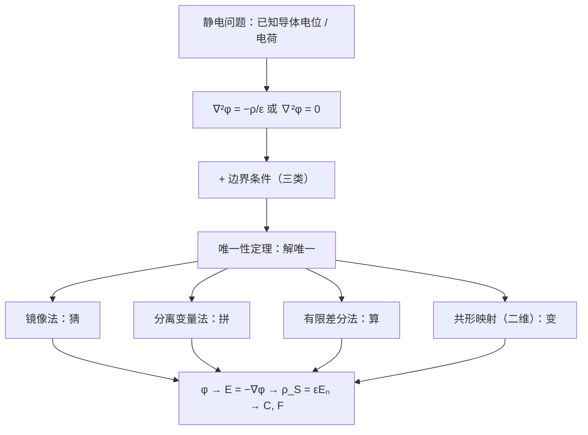

# 第 3 章 边值问题的解法

!!! tip "本章目标"

    1. 会把静电问题写成“泊松 / 拉普拉斯方程 + 边界条件”的**边值问题**，区分三类边界条件。
    2. 理解**唯一性定理**的内容和证明，知道它为什么是镜像法、分离变量法等各种方法的“合法性证明”。
    3. 掌握**镜像法**：点电荷与接地平面、导体劈、导体球；线电荷与导体圆柱；平行双导线的电容。
    4. 掌握直角坐标中的**分离变量法**，了解圆柱、球坐标中的分离变量法。
    5. 了解**有限差分法**：五点差分格式、简单迭代和超松弛迭代。

**本章在全书中的位置。** 第 2 章的方法都是“已知电荷求场”。但实际问题常常是：只知道导体的**电位**（接在电源上或接地），导体表面的感应电荷分布事先未知。这时要解微分方程。本章的“方程 + 边界条件 → 唯一解”的思想在后面反复出现：第 6 章的反射与透射、第 7 章的传输线终端条件，都是边值问题。

---

## 3.1 边值问题的提法

### 3.1.1 泊松方程和拉普拉斯方程

由 $\nabla\cdot\vv D=\rho_V$、$\vv D=\varepsilon\vv E$、$\vv E=-\nabla\phi$，在均匀线性介质中：

!!! theorem "定理 3.1（泊松方程与拉普拉斯方程）"

    $$\nabla^2\phi=-\frac{\rho_V}{\varepsilon}\quad(\text{泊松方程}),\qquad\nabla^2\phi=0\quad(\text{无源区：拉普拉斯方程}).$$

    三种坐标系中的拉普拉斯算子：

    $$\nabla^2\phi=\frac{\partial^2\phi}{\partial x^2}+\frac{\partial^2\phi}{\partial y^2}+\frac{\partial^2\phi}{\partial z^2}
    =\frac1\rho\frac{\partial}{\partial\rho}\left(\rho\frac{\partial\phi}{\partial\rho}\right)+\frac1{\rho^2}\frac{\partial^2\phi}{\partial\phi^2}+\frac{\partial^2\phi}{\partial z^2}$$

    $$=\frac1{r^2}\frac{\partial}{\partial r}\left(r^2\frac{\partial\phi}{\partial r}\right)+\frac{1}{r^2\sin\theta}\frac{\partial}{\partial\theta}\left(\sin\theta\frac{\partial\phi}{\partial\theta}\right)+\frac{1}{r^2\sin^2\theta}\frac{\partial^2\phi}{\partial\phi^2}.$$

### 3.1.2 边值问题的分类

方程只描述“场在区域内部怎样变化”，还需要**边界上的信息**才能确定唯一解：

!!! definition "定义 3.1（三类边值问题）"

    设区域 $V$ 的边界为 $S$：

    - **第一类（狄利克雷问题）**：给定边界上的电位 $\phi\big|_S$。例如导体接在已知电压上。
    - **第二类（诺伊曼问题）**：给定边界上电位的法向导数 $\dfrac{\partial\phi}{\partial n}\Big|_S$，即给定导体表面的面电荷 $\rho_S=-\varepsilon\dfrac{\partial\phi}{\partial n}$。
    - **第三类（混合问题）**：一部分边界给定 $\phi$，其余边界给定 $\partial\phi/\partial n$。

    区域内有不同介质时，还要加上分界面上的**衔接条件** $\phi_1=\phi_2$，$\varepsilon_1\dfrac{\partial\phi_1}{\partial n}=\varepsilon_2\dfrac{\partial\phi_2}{\partial n}$（无自由面电荷时）。

!!! example "例题 3.1（一维泊松方程）"

    平行板电容器板间距 $d$，$x=0$ 的板接地，$x=d$ 的板电位 $U_0$，板间有均匀体电荷 $\rho_V$（介电常数 $\varepsilon_0$）。求板间电位、电场和两板上的面电荷。

    **解。** 只与 $x$ 有关：$\dfrac{\dd^2\phi}{\dd x^2}=-\dfrac{\rho_V}{\varepsilon_0}$，积分两次：$\phi=-\dfrac{\rho_V}{2\varepsilon_0}x^2+C_1x+C_2$。由 $\phi(0)=0$ 得 $C_2=0$；由 $\phi(d)=U_0$ 得 $C_1=\dfrac{U_0}{d}+\dfrac{\rho_Vd}{2\varepsilon_0}$。

    $$\phi=-\frac{\rho_V}{2\varepsilon_0}x^2+\left(\frac{U_0}{d}+\frac{\rho_Vd}{2\varepsilon_0}\right)x,\qquad\vv E=-\ax\frac{\dd\phi}{\dd x}=\ax\left[\frac{\rho_V}{\varepsilon_0}x-\frac{U_0}{d}-\frac{\rho_Vd}{2\varepsilon_0}\right].$$

    板上面电荷由 $\rho_S=\vv D\cdot\an$（$\an$ 指向板间）：$x=0$ 处 $\an=\ax$，$\rho_S=\varepsilon_0E_x(0)=-\dfrac{\varepsilon_0U_0}{d}-\dfrac{\rho_Vd}{2}$；$x=d$ 处 $\an=-\ax$，$\rho_S=-\varepsilon_0E_x(d)=\dfrac{\varepsilon_0U_0}{d}-\dfrac{\rho_Vd}{2}$。两板电荷之和 $=-\rho_Vd$，恰与板间体电荷抵消。

---

## 3.2 唯一性定理

!!! theorem "定理 3.2（唯一性定理）"

    在区域 $V$ 内满足泊松方程（或拉普拉斯方程）、在边界 $S$ 上满足给定的第一类、第二类或第三类边界条件的电位解是**唯一**的（第二类问题中可以差一个无关紧要的常数）。

!!! proof "证明"

    设 $\phi_1,\phi_2$ 都是解，令 $\psi=\phi_1-\phi_2$。则 $V$ 内 $\nabla^2\psi=0$，边界上 $\psi=0$（第一类）或 $\partial\psi/\partial n=0$（第二类），或两者之一（第三类）。由格林第一恒等式（对 $\psi\nabla\psi$ 用散度定理）：

    $$\int_V\left(\psi\nabla^2\psi+\lvert\nabla\psi\rvert^2\right)\dd V=\oint_S\psi\frac{\partial\psi}{\partial n}\,\dd S .$$

    左边第一项为零，右边在三类边界条件下都为零，所以 $\int_V\lvert\nabla\psi\rvert^2\dd V=0$，处处 $\nabla\psi=\vv 0$，$\psi$ 为常数。对第一类和第三类问题，边界上 $\psi=0$，所以 $\psi\equiv0$。

!!! info "直觉：唯一性定理是“猜答案”的许可证"

    唯一性定理说：**只要一个函数满足方程和边界条件，它就是答案**，不管它是怎样得到的。于是可以：

    - **猜**（镜像法）：在区域外放几个假想电荷，让边界条件恰好满足；
    - **拼**（分离变量法）：用一族简单解叠加去凑边界条件；
    - **算**（有限差分法）：数值逼近。

    三种方法得到的解，只要满足同样的方程和边界条件，就必然相同。

---

## 3.3 镜像法

<figure class="video" markdown>
<video controls preload="metadata" width="100%" poster="assets/posters/C3_ImageMethod.jpg"><source src="assets/videos/C3_ImageMethod.mp4" type="video/mp4"></video>
<figcaption>动画 3-1　镜像法：接地平面的镜像是等量异号电荷；接地导体球的镜像是 $q'=-\frac adq$，位于 $b=\frac{a^2}{d}$，两者的零电位面恰好是球面。</figcaption>
</figure>

!!! definition "定义 3.2（镜像法）"

    在所求场域**之外**放置若干个假想的点电荷或线电荷（**镜像电荷**），用它们代替边界上未知的感应电荷或极化电荷，使原来的边界条件仍然满足。所求区域内的场就等于原电荷与镜像电荷共同产生的场。

**为什么正确**：镜像电荷在所求区域之外，所以区域内的方程（源分布）没有改变；边界条件也没有改变。由唯一性定理，解相同。**镜像电荷只对原区域有效**：导体内部、镜像电荷所在的区域，场并不是镜像解给出的样子。

### 3.3.1 点电荷与平面边界

!!! theorem "定理 3.3（点电荷与接地导体平面）"

    点电荷 $q$ 位于接地导体平面 $z=0$ 上方 $h$ 处，则 $z>0$ 区域的电位为

    $$\phi=\frac{q}{4\pi\varepsilon_0}\left(\frac{1}{R_+}-\frac1{R_-}\right),\qquad R_\pm=\sqrt{x^2+y^2+(z\mp h)^2},$$

    即镜像电荷为 $-q$，位于 $z=-h$。导体表面的感应电荷 $\rho_S=-\dfrac{qh}{2\pi(x^2+y^2+h^2)^{3/2}}$，总量为 $-q$；$q$ 受到导体平面的吸引力 $\vv F=-\az\dfrac{q^2}{4\pi\varepsilon_0(2h)^2}$。

**导体劈。** 两个接地导体半平面成角 $\alpha=\pi/n$（$n$ 为整数）时，经过反复镜像共需 $2n-1$ 个镜像电荷，正负交替地分布在以棱为轴、过原电荷的圆周上。$\pi/\alpha$ 不是整数时镜像电荷会落入所求区域，镜像法失效。

!!! example "例题 3.2（直角导体劈）"

    $x=0$ 与 $y=0$ 两个接地导体半平面构成直角劈，$q=100\ \mathrm{nC}$ 的点电荷位于 $(3,4,0)$（单位 m）。求点 $(3,5,0)$ 的电位和电场。

    **解。** $n=2$，需要 3 个镜像电荷：$-q$ 在 $(-3,4,0)$，$-q$ 在 $(3,-4,0)$，$+q$ 在 $(-3,-4,0)$。从四个电荷到场点 $P(3,5,0)$ 的距离为 $1$、$\sqrt{37}$、$9$、$\sqrt{117}$。

    $$\phi_P=\frac{q}{4\pi\varepsilon_0}\left(1-\frac{1}{\sqrt{37}}-\frac19+\frac{1}{\sqrt{117}}\right)\approx899\times0.817\approx734\ \mathrm V .$$

    电场按 $\dfrac{q_i\vv R_i}{4\pi\varepsilon_0R_i^3}$ 叠加：

    $$\vv E_P\approx899\left[(0,1)-\frac{(6,1)}{37^{3/2}}-\frac{(0,9)}{9^3}+\frac{(6,9)}{117^{3/2}}\right]\approx-19.7\ax+890\ay\ \mathrm{V/m}.$$

**介质平面的镜像。** 点电荷 $q$ 位于介质 $\varepsilon_1$ 中，距平面分界面 $h$，另一侧为 $\varepsilon_2$。求 $\varepsilon_1$ 区域的场时，在对称点放 $q'=\dfrac{\varepsilon_1-\varepsilon_2}{\varepsilon_1+\varepsilon_2}q$，并把整个空间看作 $\varepsilon_1$；求 $\varepsilon_2$ 区域的场时，在原电荷位置放 $q''=\dfrac{2\varepsilon_2}{\varepsilon_1+\varepsilon_2}q$，并把整个空间看作 $\varepsilon_2$。$\varepsilon_2\to\infty$ 时 $q'\to-q$，退化为导体平面的情形。

### 3.3.2 点电荷与球面边界

!!! theorem "定理 3.4（点电荷与接地导体球）"

    点电荷 $q$ 距接地导体球（半径 $a$）的球心为 $d>a$。在球心与 $q$ 的连线上、距球心 $b=\dfrac{a^2}{d}$ 处放镜像电荷

    $$q'=-\frac adq ,$$

    则 $q$ 与 $q'$ 在球面上产生的电位处处为零，球外的场即为二者的场。

!!! proof "推导"

    设球面上任一点到 $q$、$q'$ 的距离为 $R$、$R'$。三角形“球心–$q'$–球面点”与“球心–球面点–$q$”有公共角，且边长比 $\dfrac{b}{a}=\dfrac{a}{d}$，所以两三角形相似，$\dfrac{R'}{R}=\dfrac ad$ 为常数。于是 $\dfrac{q}{R}+\dfrac{q'}{R'}=\dfrac qR-\dfrac{aq/d}{aR/d}=0$。

    （$b\cdot d=a^2$ 说明 $q'$ 与 $q$ 关于球面互为**反演点**，这正是复变函数中的“关于圆周的对称点”，见[复变函数 第 6 章](https://cockroach-f.github.io/complex-functions/ch6.html)。）

- **球不接地、不带电**：再在球心加 $-q'$，使球的总电荷为零，球的电位为 $\dfrac{-q'}{4\pi\varepsilon_0a}=\dfrac{q}{4\pi\varepsilon_0d}$。
- **球带电 $Q$**：在球心加 $Q-q'$。

### 3.3.3 线电荷的镜像

**线电荷与导体圆柱。** 无限长线电荷 $\rho_l$ 平行于接地导体圆柱（半径 $a$），与轴线相距 $d$。镜像线电荷为 $-\rho_l$，位于距轴线 $b=a^2/d$ 处。这是因为两根等量异号线电荷的等位面是一族圆柱面（阿波罗尼斯圆）：到两线距离之比为常数的点构成圆。

!!! example "例题 3.3（平行双导线的电容）"

    两根半径为 $a$ 的无限长平行导线，轴线间距为 $D$，导线间电压为 $U$。求单位长度电容（不要求 $D\gg a$）。

    **解。** 导线表面的电荷不均匀（相互吸引，靠近一侧更密），不能直接用线电荷公式。用镜像法：用两根线电荷 $\pm\rho_l$（称为**电轴**）代替两导线，选它们的位置使两导线表面恰为等位面。设两电轴位于 $x=\pm b$（原点为两导线轴线的中点）。要使导线 1（圆心 $x=D/2$、半径 $a$）的表面为等位面，两电轴必须关于这个圆互为反演点：$(D/2-b)(D/2+b)=a^2$，即

    $$b=\sqrt{(D/2)^2-a^2}.$$

    任一点电位 $\phi=\dfrac{\rho_l}{2\pi\varepsilon}\ln\dfrac{R_2}{R_1}$（$R_1,R_2$ 为到 $\pm\rho_l$ 电轴的距离）。在导线 1 表面离中点最近的点 $x=D/2-a$ 处求得 $\phi_1=\dfrac{\rho_l}{2\pi\varepsilon}\ln\dfrac{D/2+b-a}{a-(D/2-b)}=\dfrac{\rho_l}{2\pi\varepsilon}\ln\dfrac{D/2+b}{a}$，$\phi_2=-\phi_1$。

    $$C_0=\frac{\rho_l}{\phi_1-\phi_2}=\frac{\pi\varepsilon}{\ln\dfrac{D/2+\sqrt{(D/2)^2-a^2}}{a}}=\frac{\pi\varepsilon}{\operatorname{arccosh}\dfrac{D}{2a}}.$$

    $D\gg a$ 时 $\operatorname{arccosh}\dfrac{D}{2a}\approx\ln\dfrac Da$，回到第 2 章的近似公式 $\dfrac{\pi\varepsilon}{\ln(D/a)}$（$=\dfrac{\pi\varepsilon}{\ln(2D/d)}$，$d=2a$）。

!!! note "前后联系：二维静电场与共形映射"

    二维拉普拉斯问题（无限长、截面不变的导体系统）可以用复变函数求解：任一解析函数 $w=f(z)=u+\je v$ 的实部和虚部都满足拉普拉斯方程，且 $u=$ 常数与 $v=$ 常数两族曲线正交，可以分别看作**等位线**和**电力线**。例如：

    - $w=\ln z$：$u=\ln\rho$ 是同轴线的电位，$v=\phi$ 是径向电力线；
    - $w=\ln\dfrac{z-b}{z+b}$：两根线电荷（双导线、电轴）的电位与电力线，$u=$ 常数是阿波罗尼斯圆；
    - 共形映射能把复杂形状的导体边界映成平行板、同轴线等简单边界，再映射回去。

    详见[复变函数 第 2 章（调和函数）](https://cockroach-f.github.io/complex-functions/ch2.html)与[第 6 章（共形映射）](https://cockroach-f.github.io/complex-functions/ch6.html)。

---

## 3.4 分离变量法

<figure class="video" markdown>
<video controls preload="metadata" width="100%" poster="assets/posters/C3_Separation.jpg"><source src="assets/videos/C3_Separation.mp4" type="video/mp4"></video>
<figcaption>动画 3-2　矩形导体槽的分离变量解：随着项数 $N$ 增加，部分和逼近盖板上的阶跃边界条件；高次项离开盖板迅速衰减。</figcaption>
</figure>

**思路**：选与边界形状匹配的坐标系，假设解是各坐标单变量函数的乘积，把偏微分方程拆成几个常微分方程；再用边界条件确定分离常数和系数，最后叠加。

### 3.4.1 直角坐标系中的分离变量法

二维拉普拉斯方程 $\dfrac{\partial^2\phi}{\partial x^2}+\dfrac{\partial^2\phi}{\partial y^2}=0$。令 $\phi=X(x)Y(y)$，代入后除以 $XY$：

$$\frac{X''}{X}=-\frac{Y''}{Y}=-k^2\quad(\text{分离常数}),\qquad X''+k^2X=0,\quad Y''-k^2Y=0 .$$

!!! success "关键公式：直角坐标的基本解"

    | 分离常数 | $X(x)$ | $Y(y)$ |
    |---|---|---|
    | $k=0$ | $A_0+B_0x$ | $C_0+D_0y$ |
    | $k^2>0$ | $A\sin kx+B\cos kx$ | $C\sinh ky+D\cosh ky$（或 $Ce^{ky}+De^{-ky}$） |
    | $k^2<0$（$k=\je\kappa$） | $A\sinh\kappa x+B\cosh\kappa x$ | $C\sin\kappa y+D\cos\kappa y$ |

    **选法**：在两端都为零（齐次）的方向上用三角函数，以产生离散的 $k_n=n\pi/a$；另一个方向用双曲函数（有限区域）或指数函数（半无限区域，取衰减的那一支）。

!!! example "例题 3.4（矩形导体槽）"

    无限长矩形导体槽 $0<x<a$，$0<y<b$，三面接地，顶部盖板（与槽绝缘）电位为 $U_0$。求槽内电位。

    **解。** 边界条件：$\phi(0,y)=\phi(a,y)=0$，$\phi(x,0)=0$，$\phi(x,b)=U_0$。

    1. $x$ 方向两端为零 → $X=\sin\dfrac{n\pi x}{a}$，$k_n=\dfrac{n\pi}{a}$。
    2. $y=0$ 处为零 → $Y=\sinh\dfrac{n\pi y}{a}$。
    3. 叠加：$\phi=\displaystyle\sum_{n=1}^\infty C_n\sin\frac{n\pi x}{a}\sinh\frac{n\pi y}{a}$。
    4. 用 $y=b$ 处的条件定系数：$U_0=\sum C_n\sinh\dfrac{n\pi b}{a}\sin\dfrac{n\pi x}{a}$，这是 $U_0$ 在 $(0,a)$ 上的傅里叶正弦级数：

        $$C_n\sinh\frac{n\pi b}{a}=\frac2a\int_0^aU_0\sin\frac{n\pi x}{a}\,\dd x=\begin{cases}\dfrac{4U_0}{n\pi},&n\text{ 为奇数}\\0,&n\text{ 为偶数}\end{cases}$$

    $$\phi(x,y)=\sum_{n=1,3,5,\dots}\frac{4U_0}{n\pi}\,\frac{\sinh(n\pi y/a)}{\sinh(n\pi b/a)}\sin\frac{n\pi x}{a}.$$

    在槽的深处，$\dfrac{\sinh(n\pi y/a)}{\sinh(n\pi b/a)}\approx e^{-n\pi(b-y)/a}$，高次项衰减得快得多，所以离盖板稍远处电位分布几乎就是第一项 $\sin\dfrac{\pi x}{a}$ 的形状（见动画 3-2）。

### \*3.4.2 圆柱坐标系中的分离变量法

与 $z$ 无关的问题，$\phi=R(\rho)\Phi(\phi)$，$\Phi$ 必须以 $2\pi$ 为周期，所以分离常数取整数 $n$：

$$\phi(\rho,\phi)=A_0+B_0\ln\rho+\sum_{n=1}^\infty\left(A_n\rho^n+B_n\rho^{-n}\right)\left(C_n\cos n\phi+D_n\sin n\phi\right).$$

包含 $\rho=0$ 的区域去掉 $\ln\rho$ 和 $\rho^{-n}$ 项（否则在轴上发散）；延伸到无穷远的区域，按无穷远处的已知场保留相应项。

!!! example "例题 3.5（均匀电场中的介质圆柱）"

    半径 $a$、介电常数 $\varepsilon$ 的无限长介质圆柱放在均匀电场 $\vv E_0=\ax E_0$ 中，轴线与 $\vv E_0$ 垂直，柱外为真空。求柱内外的电位和电场。

    **解。** 远处 $\phi\to-E_0x=-E_0\rho\cos\phi$，所以只需 $n=1$、$\cos\phi$ 的项：

    $$\phi_1=A\rho\cos\phi\ (\rho<a),\qquad\phi_2=-E_0\rho\cos\phi+\frac{B}{\rho}\cos\phi\ (\rho>a).$$

    衔接条件：$\phi_1(a)=\phi_2(a)\Rightarrow Aa=-E_0a+\dfrac Ba$；$\varepsilon\dfrac{\partial\phi_1}{\partial\rho}=\varepsilon_0\dfrac{\partial\phi_2}{\partial\rho}\Rightarrow\varepsilon A=\varepsilon_0\left(-E_0-\dfrac{B}{a^2}\right)$。解得

    $$A=-\frac{2\varepsilon_0}{\varepsilon+\varepsilon_0}E_0,\qquad B=\frac{\varepsilon-\varepsilon_0}{\varepsilon+\varepsilon_0}a^2E_0 .$$

    柱内 $\vv E_1=\ax\dfrac{2\varepsilon_0}{\varepsilon+\varepsilon_0}E_0$，是**均匀场**，比外场弱；柱外是外场叠加一个二维“偶极子”场 $\dfrac{B\cos\phi}{\rho}$。$\varepsilon\to\infty$ 时 $\vv E_1\to0$，与导体圆柱相同。

### \*3.4.3 球坐标系中的分离变量法

与 $\phi$ 无关（轴对称）的问题，$\phi=R(r)\Theta(\theta)$，$\Theta$ 是勒让德多项式 $P_n(\cos\theta)$（$P_0=1$，$P_1=\cos\theta$，$P_2=\tfrac12(3\cos^2\theta-1)$，…）：

$$\phi(r,\theta)=\sum_{n=0}^\infty\left(A_nr^n+\frac{B_n}{r^{n+1}}\right)P_n(\cos\theta).$$

!!! example "例题 3.6（均匀电场中的接地导体球）"

    半径 $a$ 的接地导体球放在均匀电场 $\vv E_0=\az E_0$ 中。求球外电位和球面感应电荷。

    **解。** 远处 $\phi\to-E_0r\cos\theta$，只需 $n=1$：$\phi=\left(-E_0r+\dfrac{B}{r^2}\right)\cos\theta$。由 $\phi(a,\theta)=0$ 得 $B=E_0a^3$：

    $$\phi=-E_0\left(r-\frac{a^3}{r^2}\right)\cos\theta,\qquad\rho_S=-\varepsilon_0\frac{\partial\phi}{\partial r}\Big|_{r=a}=3\varepsilon_0E_0\cos\theta .$$

    上半球带正电、下半球带负电，总量为零。$\dfrac{a^3E_0\cos\theta}{r^2}$ 正是一个电偶极矩 $p=4\pi\varepsilon_0a^3E_0$ 的电位：导体球在外场中“被感应成”一个电偶极子。球面赤道附近，场的最大值是 $3E_0$。

---

## \*3.5 有限差分法

<figure class="video" markdown>
<video controls preload="metadata" width="100%" poster="assets/posters/C3_FiniteDifference.jpg"><source src="assets/videos/C3_FiniteDifference.mp4" type="video/mp4"></video>
<figcaption>动画 3-3　有限差分法解例题 3.4 的矩形槽：电位从盖板逐步“渗”入槽内；超松弛迭代比简单迭代收敛快得多。</figcaption>
</figure>

边界形状复杂时，解析方法无能为力，可以用数值方法。**有限差分法**用网格节点上的电位值代替连续的电位函数，把微分方程化为代数方程组。

**五点差分格式。** 用步长为 $h$ 的正方形网格覆盖区域。由泰勒展开，$\phi_1+\phi_3=2\phi_0+h^2\dfrac{\partial^2\phi}{\partial x^2}+O(h^4)$（$\phi_1,\phi_3$ 为左右相邻节点），$y$ 方向同理。代入二维泊松方程：

$$\phi_1+\phi_2+\phi_3+\phi_4-4\phi_0=-\frac{h^2\rho_V}{\varepsilon},\qquad\text{拉普拉斯方程：}\ \phi_0=\frac14(\phi_1+\phi_2+\phi_3+\phi_4).$$

**无源区每个节点的电位等于周围四个节点电位的平均值**，这是调和函数“平均值性质”的离散版本。

### 3.5.1 简单迭代法

先给内部节点赋初值（例如全为零），然后逐点用五点公式更新；用最新算出的值参与后续计算（高斯–赛德尔迭代），直到相邻两次迭代各节点的最大变化小于给定精度。

### 3.5.2 超松弛法

把每次的修正量放大 $\omega$ 倍（$1<\omega<2$）以加速收敛：

$$\phi_0^{(k+1)}=\phi_0^{(k)}+\omega R_0,\qquad R_0=\frac14\left(\phi_1+\phi_2+\phi_3+\phi_4\right)-\phi_0^{(k)} .$$

对 $M\times N$ 的矩形网格，最佳松弛因子约为 $\omega_{\text{opt}}\approx\dfrac{2}{1+\sin(\pi/p)}$，$p=\max(M,N)$。动画 3-3 中简单迭代需要两百多次才能达到 $10^{-5}$ 的精度，超松弛只需几十次。

---

## 知识点归纳总结

!!! abstract "知识点归纳总结"

    **一定理**：唯一性定理——满足方程和边界条件的解是唯一的。

    **三应用**：

    | 方法 | 适用 | 核心 |
    |---|---|---|
    | 镜像法 | 平面、球面、圆柱面边界，点 / 线电荷 | 区域外放镜像电荷，满足边界条件 |
    | 分离变量法 | 边界与坐标面重合 | 乘积解 + 叠加 + 正交展开定系数 |
    | 有限差分法 | 任意边界 | $\phi_0=\frac14\sum\phi_i$，迭代求解 |

    **常用镜像**：

    | 原问题 | 镜像电荷 |
    |---|---|
    | $q$ 与接地平面，距离 $h$ | $-q$，对称点 |
    | $q$ 与介质平面 | $\varepsilon_1$ 区：$\frac{\varepsilon_1-\varepsilon_2}{\varepsilon_1+\varepsilon_2}q$；$\varepsilon_2$ 区：$\frac{2\varepsilon_2}{\varepsilon_1+\varepsilon_2}q$ |
    | 夹角 $\pi/n$ 的导体劈 | $2n-1$ 个，正负交替 |
    | $q$ 与接地导体球（距球心 $d$） | $-\frac adq$，距球心 $\frac{a^2}{d}$ |
    | $\rho_l$ 与接地导体圆柱 | $-\rho_l$，距轴线 $\frac{a^2}{d}$ |
    | 平行双导线（半径 $a$、间距 $D$） | 电轴 $\pm\rho_l$，距中点 $\sqrt{(D/2)^2-a^2}$ |

**易错点汇总。**

- 镜像电荷必须放在**所求区域之外**；镜像解只在原区域内有效。
- 接地球的镜像电荷**不等于** $-q$，而是 $-\frac adq$；不接地时要在球心补电荷使总电荷守恒。
- 分离变量时，三角函数要放在**两端齐次**的方向上；半无限区域取衰减的指数函数。
- 傅里叶系数中 $\sinh(n\pi b/a)$ 不要遗漏；阶跃边界条件只有奇数项。
- 有限差分中，边界节点的值固定不变，只更新内部节点。

---

## 练习题

!!! example "练习 1"

    点电荷 $q$ 与无限大接地导体平面相距 $d$。求 (1) 上半空间的电位；(2) 导体表面的感应电荷密度；(3) $q$ 所受的力。

    ??? success "答案"

        取平面为 $z=0$，$q$ 在 $(0,0,d)$。

        (1) $\phi=\dfrac{q}{4\pi\varepsilon_0}\left[\dfrac{1}{\sqrt{x^2+y^2+(z-d)^2}}-\dfrac{1}{\sqrt{x^2+y^2+(z+d)^2}}\right]$（$z\ge0$）。

        (2) $\rho_S=-\varepsilon_0\dfrac{\partial\phi}{\partial z}\Big|_{z=0}=-\dfrac{qd}{2\pi(x^2+y^2+d^2)^{3/2}}$。

        (3) $\vv F=-\az\dfrac{q^2}{4\pi\varepsilon_0(2d)^2}=-\az\dfrac{q^2}{16\pi\varepsilon_0d^2}$（吸引）。

!!! example "练习 2"

    两个接地导体半平面成 $60^\circ$ 角（$\phi=0$ 与 $\phi=60^\circ$），劈内 $(1,1,0)$ 处有点电荷 $q$。求 (1) 所有镜像电荷的位置和大小；(2) $(2,1,0)$ 处的电位。

    ??? success "答案"

        (1) $n=3$，共 5 个镜像电荷，都在半径 $\sqrt2$ 的圆上。原电荷在 $45^\circ$：$-q$ 在 $-45^\circ$、$75^\circ$、$195^\circ$；$+q$ 在 $165^\circ$、$285^\circ$。

        (2) 逐个算距离并叠加：$\phi\approx\dfrac{q}{4\pi\varepsilon_0}\times0.320\approx2.88\times10^9q\ \mathrm V$。

!!! example "练习 3"

    半径 $a$、带电 $Q$ 的孤立导体球外有一点电荷 $q$，距球心 $d$。求球外任一点的电位。

    ??? success "答案"

        镜像：$q'=-\dfrac adq$ 位于 $b=\dfrac{a^2}{d}$；为使球的总电荷为 $Q$，在球心再放 $Q-q'=Q+\dfrac adq$。

        $$\phi=\frac{1}{4\pi\varepsilon_0}\left(\frac{q}{r_1}-\frac{aq/d}{r_2}+\frac{Q+aq/d}{r}\right),$$

        $r_1=\sqrt{r^2+d^2-2rd\cos\theta}$，$r_2=\sqrt{r^2+b^2-2rb\cos\theta}$。

!!! example "练习 4"

    平行双导线半径 $a=1\ \mathrm{mm}$，轴线间距 $D=1\ \mathrm{cm}$，空气介质。用精确公式和近似公式分别计算单位长度电容。

    ??? success "答案"

        精确：$C_0=\dfrac{\pi\varepsilon_0}{\operatorname{arccosh}(D/2a)}=\dfrac{\pi\varepsilon_0}{\operatorname{arccosh}5}=\dfrac{27.8\ \mathrm{pF/m}}{2.292}\approx12.13\ \mathrm{pF/m}$。

        近似：$C_0\approx\dfrac{\pi\varepsilon_0}{\ln(D/a)}=\dfrac{27.8}{2.303}\approx12.08\ \mathrm{pF/m}$。$D/a=10$ 时误差已不到 0.5%。

!!! example "练习 5"

    半径为 $a$ 的无限长圆柱面上的电位为 $\phi=U_0$（$0<\phi<\pi$），$\phi=0$（$-\pi<\phi<0$）。求圆柱内的电位。

    ??? success "答案"

        圆柱内（含轴线）：$\phi=A_0+\sum\rho^n(A_n\cos n\phi+B_n\sin n\phi)$。在 $\rho=a$ 处做傅里叶展开：$A_0=\dfrac{U_0}{2}$，$A_n=0$，$B_na^n=\dfrac{1}{\pi}\displaystyle\int_0^\pi U_0\sin n\phi\,\dd\phi=\dfrac{2U_0}{n\pi}$（$n$ 奇），$0$（$n$ 偶）。

        $$\phi(\rho,\phi)=\frac{U_0}{2}+\frac{2U_0}{\pi}\sum_{n=1,3,5,\dots}\frac1n\left(\frac\rho a\right)^n\sin n\phi .$$

        轴线上 $\phi=U_0/2$，正是边界值的平均。

!!! example "练习 6"

    两无限大平行板电极相距 $d$，电位分别为 $0$（$x=0$）和 $U_0$（$x=d$），板间电荷密度 $\rho_V=\rho_0x/d$，介电常数 $\varepsilon_0$。求板间电位和两板上的面电荷。

    ??? success "答案"

        $\phi''=-\dfrac{\rho_0x}{\varepsilon_0d}\Rightarrow\phi=-\dfrac{\rho_0x^3}{6\varepsilon_0d}+C_1x$，由 $\phi(d)=U_0$：$C_1=\dfrac{U_0}{d}+\dfrac{\rho_0d}{6\varepsilon_0}$。

        $\rho_S(0)=\varepsilon_0E_x(0)=-\varepsilon_0\phi'(0)=-\dfrac{\varepsilon_0U_0}{d}-\dfrac{\rho_0d}{6}$；

        $\rho_S(d)=\varepsilon_0\phi'(d)=\dfrac{\varepsilon_0U_0}{d}-\dfrac{\rho_0d}{3}$。

        两者之和 $-\dfrac{\rho_0d}{2}$，与板间总电荷 $\displaystyle\int_0^d\frac{\rho_0x}{d}\dd x=\frac{\rho_0d}{2}$ 等量异号。

!!! example "练习 7"

    沿 $z$ 方向的无限长矩形金属管，截面 $0<x<a$，$0<y<b$。$x=0$、$y=0$、$y=b$ 三面接地，$x=a$ 面电位为 $U$。求 (1) $U=U_0$ 时管内电位；(2) $U=U_0\sin\dfrac{\pi y}{b}$ 时管内电位。

    ??? success "答案"

        这次两端为零的方向是 $y$：$Y=\sin\dfrac{n\pi y}{b}$，$X=\sinh\dfrac{n\pi x}{b}$。

        (1) $\phi=\displaystyle\sum_{n=1,3,\dots}\frac{4U_0}{n\pi}\frac{\sinh(n\pi x/b)}{\sinh(n\pi a/b)}\sin\frac{n\pi y}{b}$。

        (2) 边界值本身就是一个本征函数，只需一项：$\phi=U_0\dfrac{\sinh(\pi x/b)}{\sinh(\pi a/b)}\sin\dfrac{\pi y}{b}$。

!!! example "练习 8"

    半径 $a$ 的导体球放在均匀电场 $\vv E_0=\az E_0$ 中，球带电 $Q$（不接地）。求球外电位。

    ??? success "答案"

        在例题 3.6 的解上叠加一个孤立带电球的电位（满足方程、球面仍为等位面、总电荷为 $Q$）：

        $$\phi=\frac{Q}{4\pi\varepsilon_0r}-E_0\left[1-\left(\frac ar\right)^3\right]r\cos\theta\quad(r>a).$$

        若改为给定球的电位 $U_0$，则第一项换成 $\dfrac{aU_0}{r}$。

---

下一章：[第 4 章 恒定电流的磁场](ch4.md)——从“散度源”转到“旋度源”。
