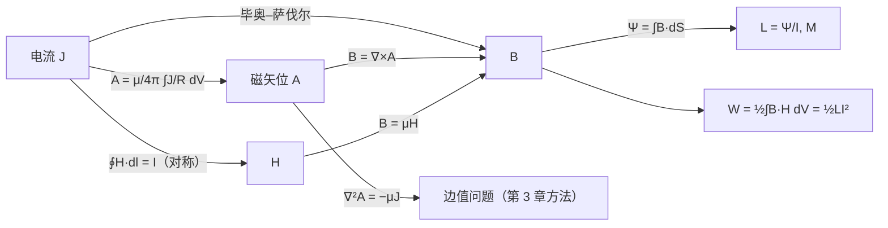

# 第 4 章 恒定电流的磁场

!!! tip "本章目标"

    1. 掌握毕奥–萨伐尔定律，会算直导线、圆环等简单电流分布的磁场。
    2. 掌握恒定磁场的两个基本方程 $\nabla\cdot\vv B=0$、$\nabla\times\vv H=\vv J$ 及其积分形式，会用安培环路定律求对称分布的磁场。
    3. 理解磁矢位 $\vv A$ 及其矢量泊松方程。
    4. 理解磁化、束缚电流和 $\vv B=\mu_0(\vv H+\vv M)$；掌握恒定磁场的边界条件。
    5. 会计算自感、互感和磁场能量，了解磁耦合。

**本章在全书中的位置。** 第 2 章的静电场是**有散无旋场**（源是电荷，$\nabla\cdot\vv D=\rho_V$，$\nabla\times\vv E=0$）。本章的恒定磁场正好相反，是**有旋无散场**（源是电流，$\nabla\times\vv H=\vv J$，$\nabla\cdot\vv B=0$）。由第 1 章的亥姆霍兹定理，散度和旋度合起来就能完全确定一个矢量场。所以本章的结构与第 2 章一一对应，学的时候可以随时对照：

| 静电场（第 2 章） | 恒定磁场（本章） |
|---|---|
| 库仑定律 $\vv F=\dfrac{q_1q_2}{4\pi\varepsilon_0R^2}\ar$ | 安培力定律 |
| $\vv E=\dfrac{1}{4\pi\varepsilon_0}\displaystyle\int\frac{\rho_V\ar}{R^2}\dd V'$ | $\vv B=\dfrac{\mu_0}{4\pi}\displaystyle\int\frac{\vv J\times\ar}{R^2}\dd V'$ |
| $\nabla\times\vv E=0\Rightarrow\vv E=-\nabla\phi$ | $\nabla\cdot\vv B=0\Rightarrow\vv B=\nabla\times\vv A$ |
| $\nabla^2\phi=-\rho_V/\varepsilon$ | $\nabla^2\vv A=-\mu\vv J$ |
| 高斯定理（对称性求 $\vv E$） | 安培环路定律（对称性求 $\vv H$） |
| 电偶极子、极化 $\vv P$、束缚电荷 | 磁偶极子、磁化 $\vv M$、束缚电流 |
| 电容 $C=Q/U$，$W_e=\frac12CU^2$ | 电感 $L=\Psi/I$，$W_m=\frac12LI^2$ |

---

## 4.1 真空中恒定磁场的基本方程

### 4.1.1 磁通（量）密度

**安培力定律。** 真空中两个电流回路 $C_1,C_2$ 之间的作用力为

$$\vv F_{12}=\frac{\mu_0}{4\pi}\oint_{C_2}\oint_{C_1}\frac{I_2\dd\vv l_2\times\left(I_1\dd\vv l_1\times\vv a_R\right)}{R^2},\qquad\mu_0=4\pi\times10^{-7}\ \mathrm{H/m}.$$

用场的观点，回路 $C_1$ 先在空间建立磁场，磁场再对 $C_2$ 中的电流施力，$\vv F_{12}=\oint_{C_2}I_2\dd\vv l_2\times\vv B_1$。

!!! definition "定义 4.1（磁通密度与毕奥–萨伐尔定律）"

    电流元 $I\dd\vv l$ 在磁场中受力 $\dd\vv F=I\dd\vv l\times\vv B$，$\vv B$ 称为**磁通密度**（磁感应强度），单位 T（特斯拉）$=\mathrm{Wb/m^2}$。线电流、面电流、体电流产生的磁通密度分别为

    $$\vv B=\frac{\mu_0}{4\pi}\oint_C\frac{I\dd\vv l'\times\vv a_R}{R^2},\qquad\vv B=\frac{\mu_0}{4\pi}\int_S\frac{\vv J_S\times\vv a_R}{R^2}\dd S',\qquad\vv B=\frac{\mu_0}{4\pi}\int_V\frac{\vv J\times\vv a_R}{R^2}\dd V',$$

    $\vv a_R$ 由源点指向场点。对运动电荷，$\vv F=q\vv v\times\vv B$；与电场力合起来就是**洛伦兹力** $\vv F=q(\vv E+\vv v\times\vv B)$。

<figure class="video" markdown>
<video controls preload="metadata" width="100%" poster="assets/posters/C4_BiotSavart.jpg"><source src="assets/videos/C4_BiotSavart.mp4" type="video/mp4"></video>
<figcaption>动画 4-1　毕奥–萨伐尔定律：沿导线逐段累加电流元的贡献得到有限长直导线的磁场；圆电流环的磁力线是闭合曲线。</figcaption>
</figure>

!!! example "例题 4.1（有限长直导线）"

    沿 $z$ 轴放置、通有电流 $I$ 的直导线，两端点到场点 $P$ 的连线与 $P$ 到导线的垂线之间的夹角分别为 $\alpha_1$、$\alpha_2$（从垂线量起，指向电流方向为正）。求 $P$ 点的磁通密度。

    **解。** 取 $P$ 在 $z=0$ 平面上，到导线距离为 $\rho$。电流元 $I\dd z'\az$ 到 $P$ 的距离矢量 $\vv R=\rho\arho-z'\az$，$\az\times\vv R=\rho\aphi$：

    $$\vv B=\aphi\frac{\mu_0I}{4\pi}\int_{z_1}^{z_2}\frac{\rho\,\dd z'}{\left(\rho^2+z'^2\right)^{3/2}}.$$

    令 $z'=\rho\tan\alpha$，$\dd z'=\rho\sec^2\alpha\,\dd\alpha$，被积式化为 $\dfrac{\cos\alpha\,\dd\alpha}{\rho}$：

    $$\vv B=\aphi\frac{\mu_0I}{4\pi\rho}\left(\sin\alpha_2-\sin\alpha_1\right).$$

    无限长导线 $\alpha_1\to-\pi/2$，$\alpha_2\to\pi/2$：$\vv B=\aphi\dfrac{\mu_0I}{2\pi\rho}$。对长 $2l$、关于 $P$ 对称的导线，$\sin\alpha_2=-\sin\alpha_1=\dfrac{l}{\sqrt{\rho^2+l^2}}$，$\vv B=\aphi\dfrac{\mu_0Il}{2\pi\rho\sqrt{\rho^2+l^2}}$。

### 4.1.2 磁通密度的散度及磁通连续性原理

**1. 磁通密度的散度。** 利用 $\dfrac{\vv a_R}{R^2}=-\nabla\dfrac1R$（对场点求导）和 $\nabla\times(f\vv J)=\nabla f\times\vv J$（$\vv J$ 是源点坐标的函数），

$$\vv B=\frac{\mu_0}{4\pi}\int_V\vv J\times\left(-\nabla\frac1R\right)\dd V'=\nabla\times\left[\frac{\mu_0}{4\pi}\int_V\frac{\vv J(\vv r')}{R}\dd V'\right].$$

!!! definition "定义 4.2（磁矢位）"

    $$\vv A(\vv r)=\frac{\mu_0}{4\pi}\int_V\frac{\vv J(\vv r')}{R}\dd V',\qquad\vv B=\nabla\times\vv A .$$

    线电流时 $\vv A=\dfrac{\mu_0}{4\pi}\displaystyle\oint_C\frac{I\dd\vv l'}{R}$。单位 Wb/m。$\vv A$ 与电流**同方向**，计算往往比直接求 $\vv B$ 简单（被积函数是标量乘矢量，没有叉乘）。

因为旋度的散度恒为零：

!!! theorem "定理 4.1（磁通连续性原理）"

    $$\nabla\cdot\vv B=0,\qquad\oint_S\vv B\cdot\dd\vv S=0 .$$

    穿过任一闭合面的磁通为零：磁力线是**无头无尾的闭合曲线**，自然界中没有“磁荷”。穿过以闭合曲线 $C$ 为边界的曲面的磁通 $\Psi=\int_S\vv B\cdot\dd\vv S=\oint_C\vv A\cdot\dd\vv l$，与曲面的选取无关。

**2. 磁偶极子。**

!!! example "例题 4.2（小电流环——磁偶极子）"

    求半径为 $a$、电流为 $I$ 的小电流环（位于 $xy$ 面，圆心在原点）在远处（$r\gg a$）的磁矢位和磁通密度。

    **解。** 由对称性 $\vv A=A_\phi\aphi$，只与 $r,\theta$ 有关，取场点在 $xz$ 面（$\phi=0$）。电流元 $I a\,\dd\phi'\aphi'$ 在 $\phi=0$ 处的有效分量为 $Ia\cos\phi'\dd\phi'$，

    $$A_\phi=\frac{\mu_0Ia}{4\pi}\int_0^{2\pi}\frac{\cos\phi'\dd\phi'}{R},\qquad R\approx r-a\sin\theta\cos\phi',\quad\frac1R\approx\frac1r\left(1+\frac ar\sin\theta\cos\phi'\right).$$

    积分得 $A_\phi=\dfrac{\mu_0I\pi a^2\sin\theta}{4\pi r^2}$。定义**磁偶极矩** $\vv p_m=I\vv S=I\pi a^2\az$（$\vv S$ 的方向与电流成右手螺旋）：

    $$\vv A=\frac{\mu_0\,\vv p_m\times\ar}{4\pi r^2},\qquad\vv B=\nabla\times\vv A=\frac{\mu_0p_m}{4\pi r^3}\left(2\cos\theta\,\ar+\sin\theta\,\atheta\right).$$

    与电偶极子 $\vv E=\dfrac{p}{4\pi\varepsilon_0r^3}(2\cos\theta\ar+\sin\theta\atheta)$ 形式完全相同（$p/\varepsilon_0\leftrightarrow\mu_0p_m$）。远处的磁偶极子场与电偶极子场一样，但近处不同：电力线从 $+q$ 出发、终止于 $-q$，磁力线却穿过电流环闭合。

### 4.1.3 磁场强度与安培环路定律

对 $\vv B=\nabla\times\vv A$ 再取旋度，利用 $\nabla\times\nabla\times\vv A=\nabla(\nabla\cdot\vv A)-\nabla^2\vv A$，在恒定电流（$\nabla\cdot\vv J=0$）条件下可以证明 $\nabla\cdot\vv A=0$，且 $\nabla^2\vv A=-\mu_0\vv J$（与 $\nabla^2\dfrac{1}{R}=-4\pi\delta$ 的推导相同）。于是 $\nabla\times\vv B=\mu_0\vv J$。

!!! definition "定义 4.3（磁场强度）"

    真空中 $\vv H=\dfrac{\vv B}{\mu_0}$，单位 A/m。介质中的定义见 4.2 节。

!!! theorem "定理 4.2（安培环路定律）"

    $$\nabla\times\vv H=\vv J,\qquad\oint_C\vv H\cdot\dd\vv l=\int_S\vv J\cdot\dd\vv S=I .$$

    $\vv H$ 沿任一闭合路径的环量等于穿过该路径所围曲面的**总电流**（电流方向与环路绕向成右手螺旋时为正）。

与高斯定理一样，安培环路定律总是成立，但只有当电流分布有足够的**对称性**（无限长直线、圆柱、无限大平面、螺线管、螺绕环），能选出 $H$ 大小不变且方向与路径相切（或垂直）的环路时，才能用它直接求场。

!!! example "例题 4.3（无限长直导线）"

    取以导线为轴、半径为 $\rho$ 的圆周为环路，由对称性 $\vv H=H_\phi\aphi$ 且 $H_\phi$ 只与 $\rho$ 有关：$H_\phi\cdot2\pi\rho=I$，

    $$\vv H=\aphi\frac{I}{2\pi\rho},\qquad\vv B=\aphi\frac{\mu_0I}{2\pi\rho}.$$

    与例题 4.1 的结果相同，但只用了一行。

<figure class="video" markdown>
<video controls preload="metadata" width="100%" poster="assets/posters/C4_Ampere.jpg"><source src="assets/videos/C4_Ampere.mp4" type="video/mp4"></video>
<figcaption>动画 4-2　用安培环路定律求同轴线的磁场：环路半径 $\rho$ 从 0 增大到 $c$ 以外，被环路包围的电流 $I_{\text{enc}}$ 决定 $H(\rho)$。</figcaption>
</figure>

!!! example "例题 4.4（同轴电缆）"

    无限长同轴电缆内导体半径 $a$，外导体内、外半径为 $b$、$c$，内导体电流 $I$，外导体电流 $-I$，电流在导体截面上均匀分布。求各区域的磁场。

    **解。** 环路取以轴线为中心、半径为 $\rho$ 的圆周，$H_\phi\cdot2\pi\rho=I_{\text{enc}}$：

    | 区域 | $I_{\text{enc}}$ | $H_\phi$ |
    |---|---|---|
    | $\rho<a$ | $I\dfrac{\rho^2}{a^2}$ | $\dfrac{I\rho}{2\pi a^2}$ |
    | $a<\rho<b$ | $I$ | $\dfrac{I}{2\pi\rho}$ |
    | $b<\rho<c$ | $I-I\dfrac{\rho^2-b^2}{c^2-b^2}$ | $\dfrac{I}{2\pi\rho}\,\dfrac{c^2-\rho^2}{c^2-b^2}$ |
    | $\rho>c$ | $0$ | $0$ |

    外导体的返回电流使电缆外部没有磁场——同轴线**自屏蔽**，这是它被广泛用作传输线（第 7 章）的原因之一。

### 4.1.4 矢量泊松方程

!!! theorem "定理 4.3（磁矢位的矢量泊松方程）"

    选取库仑规范 $\nabla\cdot\vv A=0$，在均匀介质中

    $$\nabla^2\vv A=-\mu\vv J,\qquad\text{无源区}\ \nabla^2\vv A=0 .$$

    直角坐标中分解为三个标量泊松方程 $\nabla^2A_x=-\mu J_x$ 等，每一个都与静电场的 $\nabla^2\phi=-\rho_V/\varepsilon$ 形式相同，其解也相同：$A_x=\dfrac{\mu}{4\pi}\displaystyle\int\frac{J_x}{R}\dd V'$。

**为什么需要规范。** $\vv B=\nabla\times\vv A$ 只规定了 $\vv A$ 的旋度；对任意标量函数 $\psi$，$\vv A+\nabla\psi$ 给出同样的 $\vv B$。由亥姆霍兹定理，还要指定 $\nabla\cdot\vv A$ 才能唯一确定 $\vv A$。恒定场中取 $\nabla\cdot\vv A=0$；第 5 章时变场中改用洛伦兹规范。

**二维问题。** 电流全部沿 $z$ 方向时 $\vv A=A_z\az$，$\vv B=\nabla\times(A_z\az)=\ax\dfrac{\partial A_z}{\partial y}-\ay\dfrac{\partial A_z}{\partial x}$，于是 $\vv B\cdot\nabla A_z=0$：**$A_z$ 的等值线就是磁力线**，相当于静电场中的电位 $\phi$ 换成了“磁通函数”。第 3 章的边值问题方法（镜像法、分离变量法、有限差分法）可以原样搬过来用于 $A_z$。

!!! example "例题 4.5（铁磁体槽中的电流）"

    沿 $z$ 方向无限长、$+y$ 方向也无限深的铁磁体槽 $0<x<a$（$\mu\to\infty$），槽内有沿 $z$ 方向的长直电流 $I$。写出槽内 $A_z$ 满足的方程和边界条件。

    **解。** 槽内（电流所在点除外）$\nabla^2A_z=0$，电流处 $\nabla^2A_z=-\mu_0I\,\delta(x-x_0)\delta(y-y_0)$。在 $\mu\to\infty$ 的铁磁体中 $\vv H=\vv B/\mu\to0$；由 $H_t$ 连续，槽壁空气一侧 $H_t=0$，即磁力线垂直进入铁磁体壁。$H_t=0$ 对应于 $A_z$ 的法向导数为零：

    $$\frac{\partial A_z}{\partial x}\Big|_{x=0}=\frac{\partial A_z}{\partial x}\Big|_{x=a}=0,\qquad\frac{\partial A_z}{\partial y}\Big|_{y=0}=0,\qquad y\to\infty:\ A_z\ \text{有限}.$$

    这是第二类边值问题，可以用镜像法（关于各壁作**同号**镜像电流）求解。

**磁标位。** 在没有电流的区域 $\nabla\times\vv H=0$，可以令 $\vv H=-\nabla\phi_m$，并由 $\nabla\cdot\vv B=0$ 得 $\nabla^2\phi_m=0$。但 $\phi_m$ 只能在不包围电流的单连通区域中使用，否则绕电流一圈 $\phi_m$ 会改变 $I$，不是单值的。

---

## 4.2 磁介质的磁化、介质中的场方程

<figure class="video" markdown>
<video controls preload="metadata" width="100%" poster="assets/posters/C4_Magnetization.jpg"><source src="assets/videos/C4_Magnetization.mp4" type="video/mp4"></video>
<figcaption>动画 4-3　磁化：分子电流环在外场中有序排列，相邻环的公共边电流抵消，只剩介质表面的束缚面电流 $\vv J_{Sb}=\vv M\times\an$。</figcaption>
</figure>

物质中电子的轨道运动和自旋形成**分子电流**，每个分子电流相当于一个磁偶极子 $\vv p_m=I_a\vv S$。无外场时它们取向杂乱，宏观上不显磁性；在外磁场中分子磁矩趋向沿外场排列，物质被**磁化**。

!!! definition "定义 4.4（磁化强度与束缚电流）"

    单位体积内的磁偶极矩之和称为**磁化强度**：$\vv M=\lim\limits_{\Delta V\to0}\dfrac{\sum\vv p_{mi}}{\Delta V}$，单位 A/m。磁化介质产生的场可以用**束缚电流**（磁化电流）来计算：

    $$\vv J_b=\nabla\times\vv M,\qquad\vv J_{Sb}=\vv M\times\an,$$

    $\an$ 是介质表面的外法向单位矢量。

**推导要点。** 体积元 $\vv M\dd V'$ 产生的磁矢位为 $\dfrac{\mu_0\vv M\times\vv a_R}{4\pi R^2}\dd V'$（例题 4.2）。利用 $\dfrac{\vv a_R}{R^2}=\nabla'\dfrac1R$ 和 $\vv M\times\nabla'\dfrac1R=\dfrac1R\nabla'\times\vv M-\nabla'\times\dfrac{\vv M}{R}$，以及 $\displaystyle\int_V\nabla'\times\vv F\dd V'=\oint_S\an\times\vv F\dd S'$：

$$\vv A=\frac{\mu_0}{4\pi}\int_V\frac{\nabla'\times\vv M}{R}\dd V'+\frac{\mu_0}{4\pi}\oint_S\frac{\vv M\times\an}{R}\dd S'.$$

这正是体电流 $\vv J_b$ 和面电流 $\vv J_{Sb}$ 产生的磁矢位。均匀磁化时 $\vv J_b=0$，只剩表面电流（动画 4-3）——与均匀极化的电介质只有表面束缚电荷完全对应。

!!! theorem "定理 4.4（介质中的安培环路定律）"

    把束缚电流也算作源：$\nabla\times\dfrac{\vv B}{\mu_0}=\vv J+\vv J_b=\vv J+\nabla\times\vv M$。定义

    $$\vv H=\frac{\vv B}{\mu_0}-\vv M\quad\Longleftrightarrow\quad\vv B=\mu_0(\vv H+\vv M),$$

    则 $\nabla\times\vv H=\vv J$，$\oint_C\vv H\cdot\dd\vv l=I$：**$\vv H$ 的环量只与自由电流有关**。

对线性、各向同性介质，$\vv M=\chi_m\vv H$（$\chi_m$ 为磁化率），

$$\vv B=\mu_0(1+\chi_m)\vv H=\mu_0\mu_r\vv H=\mu\vv H .$$

- **抗磁质**：$\chi_m<0$，$\lvert\chi_m\rvert\sim10^{-9}\text{–}10^{-5}$（铜、银、水）；
- **顺磁质**：$\chi_m>0$，$\sim10^{-5}\text{–}10^{-3}$（铝、空气）；
- **铁磁质**：$\mu_r$ 可达 $10^2\text{–}10^5$，且 $\vv B$ 与 $\vv H$ 是非线性关系（磁滞回线）。

顺磁质与抗磁质的 $\mu_r\approx1$，工程上统称**非磁性物质**，取 $\mu=\mu_0$。

!!! success "关键公式：媒质的本构关系"

    $$\vv D=\varepsilon\vv E,\qquad\vv J=\sigma\vv E,\qquad\vv B=\mu\vv H .$$

    三个参数 $\varepsilon,\sigma,\mu$ 描述媒质的全部电磁性质，之后各章都用它们刻画媒质。

!!! info "直觉：为什么有两个磁场量"

    $\vv B$ 是“真正的”场，决定对电流的作用力，满足 $\nabla\cdot\vv B=0$；$\vv H$ 是“只看自由电流”的辅助量，满足 $\nabla\times\vv H=\vv J$。这与 $\vv E$（力）和 $\vv D$（只看自由电荷）的分工完全一样：

    | 电场 | 磁场 |
    |---|---|
    | $\vv D=\varepsilon_0\vv E+\vv P$ | $\vv H=\vv B/\mu_0-\vv M$ |
    | $\rho_b=-\nabla\cdot\vv P$，$\rho_{Sb}=\vv P\cdot\an$ | $\vv J_b=\nabla\times\vv M$，$\vv J_{Sb}=\vv M\times\an$ |
    | 束缚电荷削弱介质内的 $\vv E$ | 顺磁、铁磁质的束缚电流增强介质内的 $\vv B$ |

---

## 4.3 恒定磁场的边界条件

!!! theorem "定理 4.5（恒定磁场的边界条件）"

    设 $\an$ 由媒质 2 指向媒质 1，分界面上的自由面电流密度为 $\vv J_S$：

    $$\an\cdot(\vv B_1-\vv B_2)=0\ \ (B_{1n}=B_{2n}),\qquad\an\times(\vv H_1-\vv H_2)=\vv J_S\ \ (H_{1t}-H_{2t}=J_S).$$

    由 $\oint\vv B\cdot\dd\vv S=0$（扁圆柱面）和 $\oint\vv H\cdot\dd\vv l=I$（窄矩形回路）得到，推导与第 2 章的 $D_n$、$E_t$ 条件完全相同。

分界面上没有自由面电流时，$B_n$ 和 $H_t$ 都连续，与静电场中 $D_n$、$E_t$ 连续一样，磁力线在分界面上发生**折射**：

$$\frac{\tan\theta_1}{\tan\theta_2}=\frac{\mu_1}{\mu_2}\qquad(\theta\ \text{为与法线的夹角}).$$

**铁磁质表面。** 若 $\mu_1\gg\mu_2$（如铁与空气），则只要 $\theta_1\ne90^\circ$，$\theta_2\approx0$：磁力线几乎垂直地离开铁磁质表面。铁磁质对磁场的作用，类似于导体对静电场的作用，这正是磁路、磁屏蔽的原理。

!!! example "例题 4.6（分界面上的直线电流）"

    $x<0$ 的半空间是磁导率为 $\mu$ 的均匀媒质，$x>0$ 的半空间为真空，无限长直电流 $I$ 沿 $z$ 轴放在分界面上。求两种媒质中的 $\vv B$ 和磁化电流。

    **解。** 以 $z$ 轴为中心的圆周处处与分界面（$yz$ 平面）**垂直**相交。设 $\vv B=B\aphi$，它在分界面上是法向分量，由 $B_n$ 连续，两种媒质中 $B$ 相同；而 $H$ 不同：$H_1=B/\mu_0$，$H_2=B/\mu$。由安培环路定律：

    $$\pi\rho\frac{B}{\mu_0}+\pi\rho\frac{B}{\mu}=I\ \Rightarrow\ \vv B=\aphi\frac{\mu\mu_0I}{\pi(\mu+\mu_0)\rho}.$$

    媒质中 $\vv M=\dfrac{\vv B}{\mu_0}-\dfrac{\vv B}{\mu}$ 沿 $\aphi$，在 $x<0$ 内部 $\nabla\times\vv M=0$；在分界面上 $\vv M$ 与 $\an$ 平行，$\vv M\times\an=0$。磁化电流只能集中在 $z$ 轴上。用 $\oint\dfrac{\vv B}{\mu_0}\cdot\dd\vv l=I+I_m$：

    $$I_m=\frac{2\pi\rho B}{\mu_0}-I=\frac{\mu-\mu_0}{\mu+\mu_0}I .$$

!!! info "静态场三兄弟：静电场、恒定电场、恒定磁场"

    第 2 章已经看到静电场与恒定电场的相似性（$C/G=\varepsilon/\sigma$）。把恒定磁场加进来：

    | | 静电场（无源区） | 恒定电场（电源外） | 恒定磁场（无电流区） |
    |---|---|---|---|
    | 基本方程 | $\nabla\cdot\vv D=0$，$\nabla\times\vv E=0$ | $\nabla\cdot\vv J=0$，$\nabla\times\vv E=0$ | $\nabla\cdot\vv B=0$，$\nabla\times\vv H=0$ |
    | 本构关系 | $\vv D=\varepsilon\vv E$ | $\vv J=\sigma\vv E$ | $\vv B=\mu\vv H$ |
    | 位函数 | $\vv E=-\nabla\phi$，$\nabla^2\phi=0$ | $\vv E=-\nabla\phi$，$\nabla^2\phi=0$ | $\vv H=-\nabla\phi_m$，$\nabla^2\phi_m=0$ |
    | 边界条件 | $D_n$，$E_t$ 连续 | $J_n$，$E_t$ 连续 | $B_n$，$H_t$ 连续 |
    | 折射定律 | $\tan\theta_1/\tan\theta_2=\varepsilon_1/\varepsilon_2$ | $\sigma_1/\sigma_2$ | $\mu_1/\mu_2$ |
    | 积分参数 | 电容 $C$ | 电导 $G$ | 磁导（磁阻的倒数） |

    三者满足**同样形式**的方程和边界条件，只要几何相同，解就可以互相借用（**对偶原理**）：$\vv E\leftrightarrow\vv E\leftrightarrow\vv H$，$\vv D\leftrightarrow\vv J\leftrightarrow\vv B$，$\varepsilon\leftrightarrow\sigma\leftrightarrow\mu$。电解槽模拟、磁路计算都建立在这个对应之上。

---

## 4.4 自感、互感与磁耦合

### 4.4.1 自感与互感

!!! definition "定义 4.5（磁链与电感）"

    与回路交链的磁通的总和称为**磁链** $\Psi$（$N$ 匝线圈 $\Psi=N\Phi$）。

    - **自感**：回路自身电流 $I$ 产生的磁链 $\Psi$ 与 $I$ 之比，$L=\dfrac{\Psi}{I}$；
    - **互感**：回路 1 的电流 $I_1$ 在回路 2 中产生的磁链 $\Psi_{21}$ 与 $I_1$ 之比，$M_{21}=\dfrac{\Psi_{21}}{I_1}$。

    单位 H（亨）。$L$ 与 $M$ 只与回路的形状、尺寸、相对位置和媒质的 $\mu$ 有关，与电流无关（线性媒质）。

!!! theorem "定理 4.6（诺伊曼公式）"

    真空中两个细导线回路的互感

    $$M_{21}=M_{12}=\frac{\mu_0}{4\pi}\oint_{C_1}\oint_{C_2}\frac{\dd\vv l_1\cdot\dd\vv l_2}{R}.$$

    由 $\Psi_{21}=\oint_{C_2}\vv A_1\cdot\dd\vv l_2$ 及 $\vv A_1=\dfrac{\mu_0I_1}{4\pi}\oint_{C_1}\dfrac{\dd\vv l_1}{R}$ 立即得到。公式关于 1、2 对称，所以 $M_{12}=M_{21}$（互易性）。

**内自感与外自感。** 导体内部的磁通只与部分电流交链。半径 $a$ 的长直圆导线内，$\rho$ 处的磁场 $B=\dfrac{\mu_0I\rho}{2\pi a^2}$，宽 $\dd\rho$ 的薄层磁通只与 $\dfrac{\rho^2}{a^2}$ 份电流交链：

$$\Psi_i=\int_0^a\frac{\rho^2}{a^2}\cdot\frac{\mu_0I\rho}{2\pi a^2}\dd\rho=\frac{\mu_0I}{8\pi},\qquad L_i=\frac{\mu_0}{8\pi}\ \text{（单位长度，与半径无关）}.$$

!!! example "例题 4.7（双导线的自感）"

    求半径为 $a$、轴线间距为 $D\gg a$ 的平行双导线单位长度的自感。

    **解。** 外自感：两导线之间的磁通由两根导线的场叠加，

    $$\Psi_o=\int_a^{D-a}\left[\frac{\mu_0I}{2\pi x}+\frac{\mu_0I}{2\pi(D-x)}\right]\dd x=\frac{\mu_0I}{\pi}\ln\frac{D-a}{a}.$$

    加上两根导线的内自感 $2\times\dfrac{\mu_0}{8\pi}$：

    $$L_0=\frac{\mu_0}{\pi}\left(\frac14+\ln\frac{D-a}{a}\right)\approx\frac{\mu_0}{\pi}\ln\frac Da .$$

!!! example "例题 4.8（双线传输线与矩形线圈的互感）"

    双线传输线的两根导线位于 $x=0$ 和 $x=d$，电流分别为 $I$ 和 $-I$。同一平面内有一矩形线圈，两长边（长 $c$）平行于导线，位于 $x=a+d$ 和 $x=a+d+b$。求互感。

    **解。** 在线圈所在区域，两根导线的磁场方向相反，

    $$\lvert\Psi\rvert=\frac{\mu_0Ic}{2\pi}\int_{a+d}^{a+d+b}\left(\frac{1}{x-d}-\frac1x\right)\dd x=\frac{\mu_0Ic}{2\pi}\ln\frac{(a+b)(a+d)}{a(a+b+d)},$$

    $$\lvert M\rvert=\frac{\mu_0c}{2\pi}\ln\frac{(a+b)(a+d)}{a(a+b+d)} .$$

    $M$ 的正负取决于两回路电流的参考方向。线圈离传输线越远（$a\gg b,d$），$M\approx\dfrac{\mu_0c\,bd}{2\pi a^2}$，衰减得很快。这是因为双线电流一去一回，远处的场相互抵消。

**磁场能量。** 建立电流 $I$ 的过程中，电源要克服感应电动势做功，储存为磁场能量：

!!! success "关键公式：磁场能量"

    $$W_m=\frac12LI^2=\frac12\Psi I,\qquad W_m=\frac12\int_V\vv B\cdot\vv H\,\dd V,\qquad w_m=\frac12\vv B\cdot\vv H=\frac12\mu H^2 .$$

    两个回路时 $W_m=\dfrac12L_1I_1^2+MI_1I_2+\dfrac12L_2I_2^2$。也可以反过来由能量求电感：$L=\dfrac{2W_m}{I^2}$，内自感用这种方法计算最方便。

!!! note "前后联系：电路参数是场的积分"

    电容 $C$、电导 $G$、电感 $L$ 都是从场计算出来的“积分参数”：$C=Q/U$（$\vv D$ 的面积分 / $\vv E$ 的线积分），$L=\Psi/I$（$\vv B$ 的面积分 / $\vv H$ 的线积分）。对同轴线：

    $$C_0=\frac{2\pi\varepsilon}{\ln(b/a)},\qquad L_0=\frac{\mu}{2\pi}\ln\frac ba\ \ (\text{外自感}),\qquad L_0C_0=\mu\varepsilon .$$

    双导线同样有 $L_0C_0\approx\mu\varepsilon$。这不是巧合：第 7 章会看到，传输线上电压、电流波的速度是 $v=\dfrac{1}{\sqrt{L_0C_0}}=\dfrac{1}{\sqrt{\mu\varepsilon}}$，正是第 6 章平面电磁波在该介质中的速度。**电路观点**（$L_0,C_0$）与**场观点**（$\mu,\varepsilon$）在这里汇合。

### 4.4.2 磁耦合

任何相互靠近的两个电流回路之间都有互感。在电子线路中，一个回路的电流变化 $\dfrac{\dd i_1}{\dd t}$ 会在相邻回路中感应出噪声电压 $u_2=M\dfrac{\dd i_1}{\dd t}$，这就是**磁耦合**（低频电路中又称电流耦合、电感性串扰）。例如印刷电路板上共用返回路径或返回路径相近的线路之间就有这种耦合。

由例题 4.8 和诺伊曼公式可以看出减小磁耦合的办法：

- **减小回路面积**：让信号线与它的返回线（地线）紧靠在一起，例如双绞线、相邻的地平面；
- **增大距离**：互感随距离迅速衰减；
- **改变方向**：两回路平面互相垂直时交链的磁通最小；
- **屏蔽**：低频磁场用高 $\mu$ 材料提供低磁阻的旁路；高频磁场用良导体中的涡流抵消（第 6 章的趋肤效应）。

在高速电路中，回路电流变化率很大，即使很小的 $M$ 也会产生明显的串扰，所以估计和控制互感是电路设计中必须考虑的问题。

---

## 知识点归纳总结

!!! abstract "知识点归纳总结"

    **两个基本方程**（恒定磁场是有旋无散场）：

    | 微分形式 | 积分形式 | 意义 |
    |---|---|---|
    | $\nabla\cdot\vv B=0$ | $\oint_S\vv B\cdot\dd\vv S=0$ | 磁通连续，磁力线闭合 |
    | $\nabla\times\vv H=\vv J$ | $\oint_C\vv H\cdot\dd\vv l=I$ | 电流是磁场的旋涡源 |

    **常用结果：**

    | 电流分布 | 磁场 |
    |---|---|
    | 有限长直导线 | $B=\dfrac{\mu_0I}{4\pi\rho}(\sin\alpha_2-\sin\alpha_1)$ |
    | 无限长直导线 | $B=\dfrac{\mu_0I}{2\pi\rho}$ |
    | 圆环轴线上 | $B=\dfrac{\mu_0Ia^2}{2(a^2+z^2)^{3/2}}$，圆心 $\dfrac{\mu_0I}{2a}$ |
    | 无限大面电流 $\vv J_S$ | $\vv B=\dfrac{\mu_0}{2}\vv J_S\times\an$（$\an$ 由面指向场点） |
    | 长直螺线管内 | $B=\mu_0nI$ |
    | 磁偶极子 | $\vv B=\dfrac{\mu_0p_m}{4\pi r^3}(2\cos\theta\ar+\sin\theta\atheta)$ |

    **介质与边界：** $\vv B=\mu_0(\vv H+\vv M)=\mu\vv H$；$\vv J_b=\nabla\times\vv M$，$\vv J_{Sb}=\vv M\times\an$；$B_{1n}=B_{2n}$，$\an\times(\vv H_1-\vv H_2)=\vv J_S$。

    **电感与能量：** $L=\Psi/I$；$L_i=\mu_0/(8\pi)$；$W_m=\frac12LI^2=\frac12\int\vv B\cdot\vv H\dd V$。

**易错点汇总。**

- $\vv a_R$ 由源点指向场点；毕奥–萨伐尔定律中叉乘的顺序是 $\dd\vv l\times\vv a_R$，不能颠倒。
- 安培环路定律中的 $I$ 是**穿过环路**的总自由电流（代数和），不包括环路外的电流——但环路上的 $\vv H$ 是**所有电流**共同产生的。
- $\vv H$ 的环量只看自由电流，$\vv B$ 的环量要加上束缚电流。
- 边界条件中 $B_n$ 连续、$H_t$ 连续（无面电流时）；不要写成 $H_n$ 或 $B_t$ 连续。
- $\vv J_{Sb}=\vv M\times\an$ 中 $\an$ 是**介质的外法线**，叉乘顺序是 $\vv M$ 在前。
- 计算自感时不要漏掉内自感 $\mu_0/(8\pi)$（导线较细、频率较高时可忽略）。

---

## 练习题

!!! example "练习 1"

    真空中半径为 $a$、电流为 $I$ 的圆形线圈位于 $xy$ 平面，圆心在原点。求轴线上任一点的磁通密度。

    ??? success "答案"

        电流元 $Ia\dd\phi'\aphi'$ 到轴上点 $(0,0,z)$ 的距离 $R=\sqrt{a^2+z^2}$，径向分量对称抵消，只剩 $z$ 分量，每个电流元的贡献为 $\dfrac{\mu_0Ia\dd\phi'}{4\pi R^2}\cdot\dfrac{a}{R}$：

        $$\vv B=\az\frac{\mu_0Ia^2}{2\left(a^2+z^2\right)^{3/2}}.$$

        圆心处 $B=\dfrac{\mu_0I}{2a}$；$\lvert z\rvert\gg a$ 时 $B\approx\dfrac{\mu_0(I\pi a^2)}{2\pi\lvert z\rvert^3}$，与例题 4.2 的磁偶极子在 $\theta=0$ 处的结果一致。

!!! example "练习 2"

    半径为 $a$、电流为 $I$（均匀分布）的无限长圆柱导体置于空气中，导体磁导率为 $\mu_0$。求导体内、外的 $\vv H$ 和 $\vv B$。

    ??? success "答案"

        $\rho<a$：$\vv H=\aphi\dfrac{I\rho}{2\pi a^2}$，$\vv B=\aphi\dfrac{\mu_0I\rho}{2\pi a^2}$；

        $\rho>a$：$\vv H=\aphi\dfrac{I}{2\pi\rho}$，$\vv B=\aphi\dfrac{\mu_0I}{2\pi\rho}$。

        $H$ 在 $\rho=a$ 处取最大值 $\dfrac{I}{2\pi a}$，并且连续。

!!! example "练习 3"

    半径为 $a$、电流为 $I$ 的无限长圆柱导体内有一个半径为 $b$ 的圆柱空腔，两轴线平行，间距为 $c$（$b+c<a$）。电流在导体截面上均匀分布。求空腔内的磁通密度。

    ??? success "答案"

        电流密度 $\vv J=\az\dfrac{I}{\pi(a^2-b^2)}$。把空腔看作“电流密度 $\vv J$ 的实心圆柱 + 电流密度 $-\vv J$ 的小圆柱”的叠加。实心圆柱内 $\vv B_1=\dfrac{\mu_0}{2}\vv J\times\vv\rho_1$（$\vv\rho_1$ 从大圆柱轴线指向场点），小圆柱内 $\vv B_2=-\dfrac{\mu_0}{2}\vv J\times\vv\rho_2$。设 $\vv c$ 为从大圆柱轴线指向空腔轴线的矢量，$\vv\rho_1-\vv\rho_2=\vv c$：

        $$\vv B=\frac{\mu_0}{2}\vv J\times\vv c=\frac{\mu_0I}{2\pi(a^2-b^2)}\az\times\vv c .$$

        空腔内是**均匀磁场**，方向垂直于两轴线的连线，大小 $\dfrac{\mu_0Ic}{2\pi(a^2-b^2)}$。

!!! example "练习 4"

    下列矢量中，哪些可能是磁通密度？如果是，求相应的电流密度 $\vv J$（真空）。(1) $\vv F=\arho\rho$（圆柱坐标）；(2) $\vv F=-\ax y+\ay x$；(3) $\vv F=\ax x-\ay y$；(4) $\vv F=-\aphi r$（球坐标）。

    ??? success "答案"

        判断依据：$\nabla\cdot\vv F=0$。

        (1) $\nabla\cdot\vv F=\dfrac1\rho\dfrac{\partial(\rho^2)}{\partial\rho}=2\ne0$，不可能。

        (2) $\nabla\cdot\vv F=0$，可能。$\nabla\times\vv F=2\az$，$\vv J=\dfrac{2}{\mu_0}\az$。

        (3) $\nabla\cdot\vv F=1-1=0$，可能。$\nabla\times\vv F=0$，$\vv J=0$。

        (4) $\nabla\cdot\vv F=\dfrac{1}{r\sin\theta}\dfrac{\partial F_\phi}{\partial\phi}=0$，可能。

        $$\nabla\times\vv F=\ar\frac{1}{r\sin\theta}\frac{\partial(-r\sin\theta)}{\partial\theta}-\atheta\frac1r\frac{\partial(-r^2)}{\partial r}=-\ar\cot\theta+2\atheta,$$

        $\vv J=\dfrac{1}{\mu_0}\left(-\ar\cot\theta+2\atheta\right)$。

!!! example "练习 5"

    已知某电流在空间产生的磁矢位 $\vv A=\ax x^2y+\ay xy^2+\az(y^2-z^2)$，求 $\vv B$。

    ??? success "答案"

        $$\vv B=\nabla\times\vv A=\ax\left(\frac{\partial A_z}{\partial y}-\frac{\partial A_y}{\partial z}\right)+\ay\left(\frac{\partial A_x}{\partial z}-\frac{\partial A_z}{\partial x}\right)+\az\left(\frac{\partial A_y}{\partial x}-\frac{\partial A_x}{\partial y}\right)$$

        $$=\ax\,2y+\az\left(y^2-x^2\right).$$

        （可以验证 $\nabla\cdot\vv B=0$。注意此 $\vv A$ 的散度 $2xy+2xy-2z\ne0$，不满足库仑规范，但这不影响 $\vv B$。）

!!! example "练习 6"

    钢的磁导率 $\mu_1=2000\mu_0$，钢中磁通密度 $B_1=0.5\times10^{-2}\ \mathrm T$，与分界面法线的夹角 $\theta_1=75^\circ$。求磁力线进入空气一侧后 $B_2$ 的大小和与法线的夹角 $\theta_2$。

    ??? success "答案"

        $\tan\theta_2=\dfrac{\mu_2}{\mu_1}\tan\theta_1=\dfrac{3.732}{2000}=1.866\times10^{-3}$，$\theta_2\approx0.107^\circ$。

        $B_{2n}=B_{1n}=B_1\cos75^\circ=1.294\times10^{-3}\ \mathrm T$，$B_{2t}=\mu_0H_{1t}=\dfrac{B_1\sin75^\circ}{2000}=2.41\times10^{-6}\ \mathrm T$，

        $B_2=\sqrt{B_{2n}^2+B_{2t}^2}\approx1.29\times10^{-3}\ \mathrm T$。磁力线几乎垂直地离开钢表面。

!!! example "练习 7"

    无限长直线电流 $I$ 垂直穿过磁导率分别为 $\mu_1$、$\mu_2$ 的两种磁介质的平面分界面。求两种媒质中的 $\vv B_1$、$\vv B_2$。

    ??? success "答案"

        这次 $\vv H=H\aphi$ 平行于分界面，是切向分量；分界面上没有面电流，$H_t$ 连续，所以两侧 $H$ 相同。由安培环路定律 $H\cdot2\pi\rho=I$：

        $$\vv B_1=\aphi\frac{\mu_1I}{2\pi\rho},\qquad\vv B_2=\aphi\frac{\mu_2I}{2\pi\rho}.$$

        与例题 4.6（电流在分界面内、场垂直于分界面，$B$ 相同而 $H$ 不同）对比。

!!! example "练习 8"

    无限长直导线与一个 $a\times b$ 的矩形线圈共面，线圈的两条长为 $a$ 的边与导线平行，与导线的距离分别为 $d$ 和 $d+b$。(1) 求互感；(2) 若导线电流 $i=I_m\sin\omega t$，求线圈中的感应电动势幅值。

    ??? success "答案"

        (1) $\Psi=\displaystyle\int_d^{d+b}\frac{\mu_0I}{2\pi x}a\,\dd x=\frac{\mu_0Ia}{2\pi}\ln\frac{d+b}{d}$，

        $$M=\frac{\mu_0a}{2\pi}\ln\frac{d+b}{d}.$$

        (2) $e=-M\dfrac{\dd i}{\dd t}=-M\omega I_m\cos\omega t$，幅值 $\omega MI_m=\dfrac{\mu_0a\omega I_m}{2\pi}\ln\dfrac{d+b}{d}$（第 5 章法拉第定律）。

---

下一章：[第 5 章 时变电磁场与电磁波](ch5.md)——让 $\vv E$ 与 $\vv B$ 随时间变化，静电场和恒定磁场就耦合在一起。
