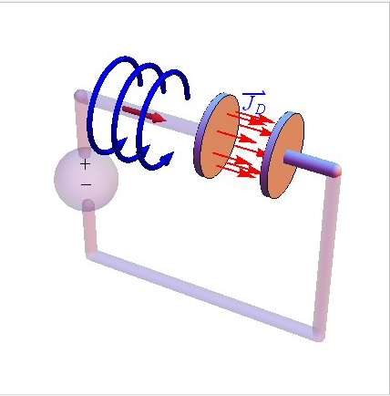
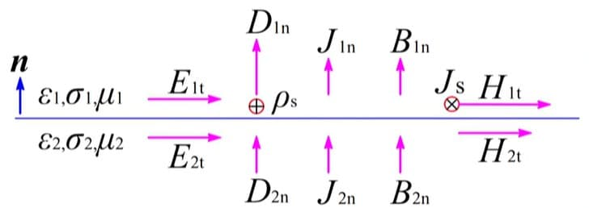
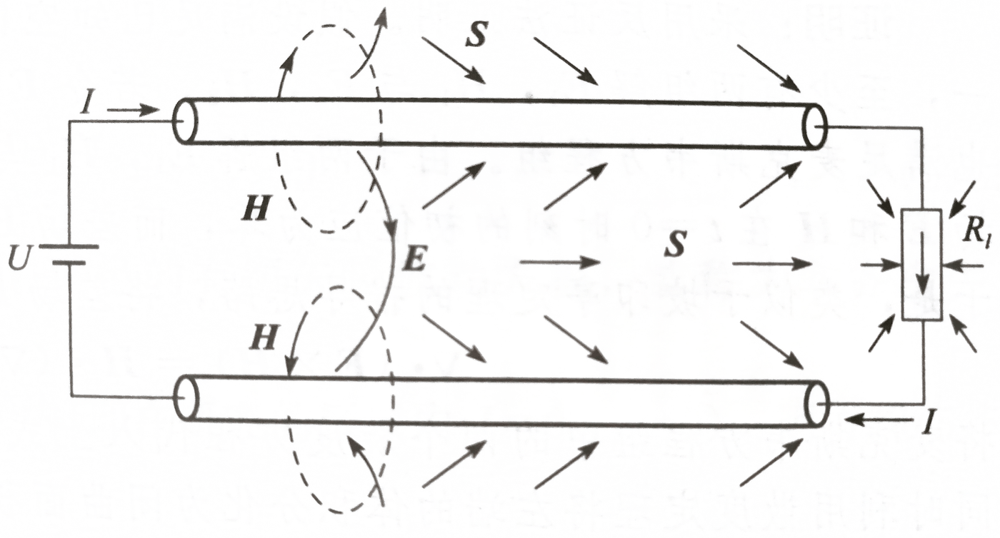
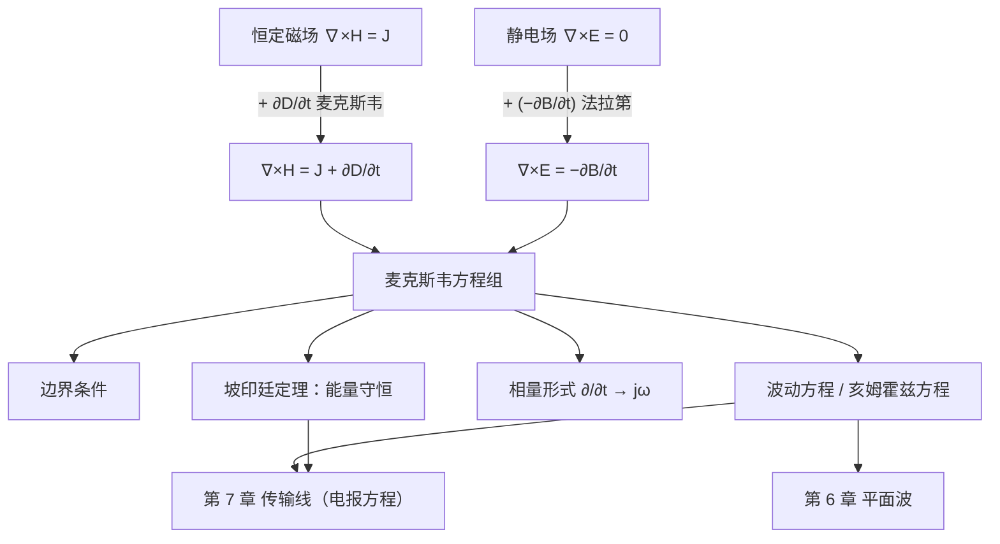

# 第 5 章 时变电磁场与电磁波

!!! tip "本章目标"

    1. 掌握法拉第电磁感应定律和位移电流的概念，理解它们怎样修改静态场的两个旋度方程。
    2. 熟记麦克斯韦方程组的积分形式、微分形式及其物理意义；掌握时变场的边界条件，特别是理想导体表面的边界条件。
    3. 掌握坡印廷定理和坡印廷矢量，会计算能流密度和传输功率；了解时变场的唯一性定理。
    4. 掌握时谐场的相量表示、麦克斯韦方程组的相量形式、复坡印廷矢量和平均坡印廷矢量。
    5. 会从麦克斯韦方程组推出波动方程和亥姆霍兹方程。

**本章在全书中的位置。** 前四章的静态场里，电场和磁场是分开的：

$$\underbrace{\nabla\times\vv E=0,\ \nabla\cdot\vv D=\rho_V}_{\text{静电场（第 2 章）}}\qquad\underbrace{\nabla\times\vv H=\vv J,\ \nabla\cdot\vv B=0}_{\text{恒定磁场（第 4 章）}}$$

本章只改动**两个旋度方程**的右端，分别加上 $-\partial\vv B/\partial t$ 和 $\partial\vv D/\partial t$。这两项把电场和磁场耦合在一起：变化的磁场产生电场，变化的电场产生磁场，两者交替激发，于是可以脱离场源以**波**的形式传播出去。第 6 章的平面波、第 7 章的传输线、第 10 章的无线信道，都是这组方程的解。

---

## 5.1 法拉第电磁感应定律

<figure class="video" markdown>
<video controls preload="metadata" width="100%" poster="assets/posters/C5_Faraday.jpg"><source src="assets/videos/C5_Faraday.mp4" type="video/mp4"></video>
<figcaption>动画 5-1　法拉第定律：正弦变化的磁场在回路上激发涡旋电场，感应电动势 $\mathcal E=-\dd\Psi/\dd t$ 比磁通滞后 $90^\circ$；导体棒在磁场中运动产生动生电动势 $Blv$。</figcaption>
</figure>

!!! theorem "定理 5.1（法拉第电磁感应定律）"

    穿过回路 $C$ 的磁通 $\Psi$ 变化时，回路中产生感应电动势

    $$\mathcal E=-\frac{\dd\Psi}{\dd t}=-\frac{\dd}{\dd t}\int_S\vv B\cdot\dd\vv S ,$$

    $\mathcal E$ 的正方向与 $\Psi$ 的正方向成右手螺旋关系。负号表示**楞次定律**：感应电流产生的磁通总是阻碍原磁通的变化。

**用场来表示。** 电动势是非保守电场（感应电场）沿回路的环量。静止电荷产生的库仑场是保守场，环量为零，所以 $\mathcal E=\oint_C\vv E\cdot\dd\vv l$，$\vv E$ 为总电场。回路静止时，磁通的变化只来自 $\vv B$ 随时间的变化：

$$\oint_C\vv E\cdot\dd\vv l=-\int_S\frac{\partial\vv B}{\partial t}\cdot\dd\vv S\quad\xrightarrow{\ \text{斯托克斯定理}\ }\quad\nabla\times\vv E=-\frac{\partial\vv B}{\partial t}.$$

这个方程不需要有导体回路：只要磁场变化，空间就有涡旋电场。这正是变压器、感应电动机和电磁感应加热的原理。

**动生电动势。** 回路（或其一部分）以速度 $\vv v$ 在磁场中运动时，导体中的电荷受洛伦兹力 $q\vv v\times\vv B$，等效电场为 $\vv v\times\vv B$。一般情形下，

$$\mathcal E=\oint_C(\vv v\times\vv B)\cdot\dd\vv l-\int_S\frac{\partial\vv B}{\partial t}\cdot\dd\vv S\quad(\text{动生}+\text{感生}),$$

两项之和恰好等于 $-\dd\Psi/\dd t$。例如长 $l$ 的导体棒在均匀磁场中以速度 $v$ 垂直于磁场滑动，$\mathcal E=Blv$（动画 5-1 后半部分）。

!!! example "例题 5.1（变化电流旁的线圈）"

    长直导线中电流 $i=I\cos\omega t$，一矩形线圈与导线共面，两条长为 $a$ 的边与导线平行，与导线的距离为 $d$ 和 $d+b$，线圈静止。求感应电动势。

    **解。** 由第 4 章练习 8，$\Psi=Mi$，$M=\dfrac{\mu_0a}{2\pi}\ln\dfrac{d+b}{d}$。

    $$\mathcal E=-M\frac{\dd i}{\dd t}=\frac{\mu_0a\omega I}{2\pi}\ln\frac{d+b}{d}\,\sin\omega t .$$

---

## 5.2 位移电流

<figure class="video" markdown>
<video controls preload="metadata" width="100%" poster="assets/posters/C5_Displacement.jpg"><source src="assets/videos/C5_Displacement.mp4" type="video/mp4"></video>
<figcaption>动画 5-2　电容器充放电：环路 $C$ 上张的曲面 $S$ 被导线穿过，$S'$ 从两极板间穿过。极板间的位移电流 $A\,\dd D/\dd t$ 与导线中的传导电流 $i$ 完全相等。</figcaption>
</figure>

**矛盾。** 把恒定磁场的安培环路定律 $\oint_C\vv H\cdot\dd\vv l=\int_S\vv J\cdot\dd\vv S$ 用于给电容器充电的电路。对同一环路 $C$，取被导线穿过的曲面 $S$，右端为 $i(t)$；取从两极板间穿过的曲面 $S'$，右端为零。同一个左端不可能等于两个值。

从数学上看，矛盾的根源是：对 $\nabla\times\vv H=\vv J$ 取散度，得 $\nabla\cdot\vv J=0$；而时变情形下电荷守恒要求 $\nabla\cdot\vv J=-\dfrac{\partial\rho_V}{\partial t}\ne0$。

**麦克斯韦的修正。** 由高斯定律 $\rho_V=\nabla\cdot\vv D$，

$$\nabla\cdot\vv J+\frac{\partial\rho_V}{\partial t}=\nabla\cdot\left(\vv J+\frac{\partial\vv D}{\partial t}\right)=0 .$$

$\vv J+\partial\vv D/\partial t$ 才是处处连续的“全电流”。

!!! definition "定义 5.1（位移电流）"

    $$\vv J_d=\frac{\partial\vv D}{\partial t}=\varepsilon_0\frac{\partial\vv E}{\partial t}+\frac{\partial\vv P}{\partial t}\qquad(\mathrm{A/m^2})$$

    称为**位移电流密度**。它不是电荷的运动（真空中的 $\varepsilon_0\,\partial\vv E/\partial t$ 部分没有任何电荷移动），但和传导电流一样产生磁场。

!!! theorem "定理 5.2（全电流定律）"

    $$\oint_C\vv H\cdot\dd\vv l=\int_S\left(\vv J+\frac{\partial\vv D}{\partial t}\right)\cdot\dd\vv S,\qquad\nabla\times\vv H=\vv J+\frac{\partial\vv D}{\partial t}.$$

<figure markdown>
{ width="420" }
<figcaption>图 5-A　给平行板电容器充电时，导线里是传导电流，极板之间是位移电流 $\vv J_D=\partial\vv D/\partial t$；两者大小相等，在周围激发同样环绕的磁场（图源：郭辉萍教材配套课件）</figcaption>
</figure>

!!! example "例题 5.2（海水中的位移电流）"

    海水的 $\sigma=4\ \mathrm{S/m}$，$\varepsilon_r=81$。求 $f=1\ \mathrm{MHz}$ 时位移电流与传导电流的幅值之比（$\vv E=\ax E_0\cos\omega t$）。

    **解。** $\vv J_d=\varepsilon\dfrac{\partial\vv E}{\partial t}=-\ax\omega\varepsilon E_0\sin\omega t$，$\vv J_c=\sigma\vv E=\ax\sigma E_0\cos\omega t$。

    $$\frac{J_{dm}}{J_{cm}}=\frac{\omega\varepsilon}{\sigma}=\frac{2\pi\times10^6\times81\times8.854\times10^{-12}}{4}\approx1.13\times10^{-3}.$$

    比值与频率成正比；两者还相差 $90^\circ$ 相位。$\omega\varepsilon/\sigma$ 是判断媒质是“导体”还是“介质”的关键参数，第 6 章会正式使用它。

!!! info "直觉：为什么位移电流这么重要"

    在导线和低频电路中，位移电流通常小得可以忽略，所以安培在实验中没有发现它。但在**真空中**，它是磁场唯一可能的源。没有它，变化的电场不能产生磁场，电磁场就无法脱离电荷和电流自行传播。正是这一项让麦克斯韦预言了电磁波，并算出波速 $1/\sqrt{\mu_0\varepsilon_0}$ 恰好等于光速。

---

## 5.3 麦克斯韦方程组及边界条件

### 5.3.1 麦克斯韦方程组及其物理意义

!!! success "关键公式：麦克斯韦方程组"

    | | 积分形式 | 微分形式 | 名称 |
    |---|---|---|---|
    | ① | $\displaystyle\oint_C\vv H\cdot\dd\vv l=\int_S\left(\vv J+\frac{\partial\vv D}{\partial t}\right)\cdot\dd\vv S$ | $\nabla\times\vv H=\vv J+\dfrac{\partial\vv D}{\partial t}$ | 全电流定律 |
    | ② | $\displaystyle\oint_C\vv E\cdot\dd\vv l=-\int_S\frac{\partial\vv B}{\partial t}\cdot\dd\vv S$ | $\nabla\times\vv E=-\dfrac{\partial\vv B}{\partial t}$ | 法拉第定律 |
    | ③ | $\displaystyle\oint_S\vv B\cdot\dd\vv S=0$ | $\nabla\cdot\vv B=0$ | 磁通连续性原理 |
    | ④ | $\displaystyle\oint_S\vv D\cdot\dd\vv S=q$ | $\nabla\cdot\vv D=\rho_V$ | 高斯定律 |

    加上本构关系 $\vv D=\varepsilon\vv E$，$\vv B=\mu\vv H$，$\vv J=\sigma\vv E$ 和电荷守恒 $\nabla\cdot\vv J=-\partial\rho_V/\partial t$，构成宏观电磁理论的完整基础。

**物理意义。**

- 两个**旋度方程**描述电场与磁场的相互激发：$\vv J$ 与 $\partial\vv D/\partial t$ 是磁场的旋涡源，$-\partial\vv B/\partial t$ 是电场的旋涡源。
- 两个**散度方程**描述通量源：电荷是电场的通量源；磁场没有通量源。
- 时变电场**有旋有散**，电力线可以起止于电荷，也可以自行闭合；时变磁场**有旋无散**，磁力线总是闭合的。
- 在无源区（$\rho_V=0$，$\vv J=0$），电场和磁场都是有旋无散的，电力线与磁力线相互交链、自行闭合，向外传播——这就是电磁波。

**方程不全独立。** 对 ① 取散度并利用电荷守恒，可以得到 $\dfrac{\partial}{\partial t}(\nabla\cdot\vv D-\rho_V)=0$，即 ④（初始时刻成立则永远成立）；同理由 ② 得到 ③。所以独立的是两个旋度方程加电荷守恒。

!!! info "直觉：一张表看静态场怎样成为时变场的特例"

    | 情形 | 方程 ① | 方程 ② | 电、磁关系 |
    |---|---|---|---|
    | 静电场（第 2 章） | — | $\nabla\times\vv E=0$ | 各自独立 |
    | 恒定磁场（第 4 章） | $\nabla\times\vv H=\vv J$ | — | 各自独立 |
    | 准静态（低频电路） | 忽略 $\partial\vv D/\partial t$ | 保留 $-\partial\vv B/\partial t$ | 电感、变压器 |
    | 时变场（本章起） | 全部保留 | 全部保留 | 相互激发 → 电磁波 |

    电路理论中的基尔霍夫电流定律就是忽略了位移电流的 $\nabla\cdot\vv J=0$；电压定律就是忽略了 $\partial\vv B/\partial t$（电感集中在元件内部）的 $\oint\vv E\cdot\dd\vv l=0$。当电路尺寸与波长可比时，这两个近似失效，必须用第 7 章的传输线（分布参数）理论。

### 5.3.2 时变电磁场的边界条件

把积分形式的麦克斯韦方程组用于跨越分界面的扁圆柱面和窄矩形回路（与第 2、4 章的做法完全相同；高度趋于零时 $\partial\vv D/\partial t$、$\partial\vv B/\partial t$ 的面积分趋于零）：

!!! theorem "定理 5.3（时变场的边界条件）"

    设 $\an$ 由媒质 2 指向媒质 1：

    | 矢量形式 | 标量形式 |
    |---|---|
    | $\an\times(\vv E_1-\vv E_2)=0$ | $E_{1t}=E_{2t}$ |
    | $\an\times(\vv H_1-\vv H_2)=\vv J_S$ | $H_{1t}-H_{2t}=J_S$ |
    | $\an\cdot(\vv B_1-\vv B_2)=0$ | $B_{1n}=B_{2n}$ |
    | $\an\cdot(\vv D_1-\vv D_2)=\rho_S$ | $D_{1n}-D_{2n}=\rho_S$ |
    | $\an\cdot(\vv J_1-\vv J_2)=-\dfrac{\partial\rho_S}{\partial t}$ | $J_{1n}-J_{2n}=-\dfrac{\partial\rho_S}{\partial t}$ |

    **两种理想介质**（$\sigma=0$）之间：$\rho_S=0$，$\vv J_S=0$，$\vv E$、$\vv H$ 的切向分量和 $\vv D$、$\vv B$ 的法向分量都连续。

    **理想介质（1）与理想导体（2）之间**：导体内 $\vv E_2=\vv H_2=0$（时变场），

    $$\an\times\vv E_1=0,\qquad\an\times\vv H_1=\vv J_S,\qquad\an\cdot\vv B_1=0,\qquad\an\cdot\vv D_1=\rho_S .$$

    **电场垂直于理想导体表面，磁场平行于理想导体表面。**

为什么理想导体内时变磁场也为零：导体内 $\vv E=0$，由 $\nabla\times\vv E=-\partial\vv B/\partial t$ 得 $\vv B$ 不随时间变化；对时变场，这个不变的部分只能是零。良导体（如铜）与空气的分界面，在射频以上常近似当作理想导体处理（第 6 章的趋肤深度说明了原因）。

<figure markdown>
{ width="640" }
<figcaption>图 5-B　时变场边界条件一览：法向的 $D_n$、$B_n$、$J_n$ 与切向的 $E_t$、$H_t$ 画在同一张图上，$D_{1n}-D_{2n}=\rho_S$，$H_{1t}-H_{2t}=J_S$（图源：SCUTEEE 开源笔记）</figcaption>
</figure>

!!! example "例题 5.3（平行板间的电磁波）"

    两理想导体平板 $z=0$、$z=d$ 之间的空气中，$\vv E=\ay E_0\sin\dfrac{\pi z}{d}\cos(\omega t-k_xx)$。求 (1) $\vv H$；(2) 验证边界条件并求两板上的面电流。

    **解。** (1) 由 $\nabla\times\vv E=-\mu_0\dfrac{\partial\vv H}{\partial t}$，

    $$\nabla\times\vv E=-\ax\frac{\partial E_y}{\partial z}+\az\frac{\partial E_y}{\partial x}=-\ax\frac{\pi E_0}{d}\cos\frac{\pi z}{d}\cos(\omega t-k_xx)+\az k_xE_0\sin\frac{\pi z}{d}\sin(\omega t-k_xx).$$

    对时间积分（去掉静态部分）：

    $$\vv H=\ax\frac{\pi E_0}{\omega\mu_0d}\cos\frac{\pi z}{d}\sin(\omega t-k_xx)+\az\frac{k_xE_0}{\omega\mu_0}\sin\frac{\pi z}{d}\cos(\omega t-k_xx).$$

    (2) 在 $z=0$ 和 $z=d$ 处，$E_y$（切向电场）$\propto\sin\dfrac{\pi z}{d}=0$，$H_z$（法向磁场）$=0$，边界条件满足。面电流：

    $$\vv J_S\big|_{z=0}=\az\times\vv H\big|_{z=0}=\ay\frac{\pi E_0}{\omega\mu_0d}\sin(\omega t-k_xx),\qquad\vv J_S\big|_{z=d}=(-\az)\times\vv H\big|_{z=d}=\ay\frac{\pi E_0}{\omega\mu_0d}\sin(\omega t-k_xx).$$

    电磁波被两块导体板“夹住”沿 $x$ 方向传播，这就是平行板波导的原理。

---

## 5.4 坡印廷定理与坡印廷矢量

### 5.4.1 坡印廷定理和坡印廷矢量

**推导。** 电场对体积 $V$ 内的电流做功的功率为 $\int_V\vv J\cdot\vv E\,\dd V$。用 ① 消去 $\vv J$，用 ② 引入 $\vv H\cdot\partial\vv B/\partial t$，再用恒等式 $\nabla\cdot(\vv E\times\vv H)=\vv H\cdot\nabla\times\vv E-\vv E\cdot\nabla\times\vv H$：

$$-\nabla\cdot(\vv E\times\vv H)=\vv H\cdot\frac{\partial\vv B}{\partial t}+\vv E\cdot\frac{\partial\vv D}{\partial t}+\vv J\cdot\vv E .$$

在线性、不随时间变化的媒质中，$\vv H\cdot\dfrac{\partial\vv B}{\partial t}+\vv E\cdot\dfrac{\partial\vv D}{\partial t}=\dfrac{\partial w}{\partial t}$。

!!! theorem "定理 5.4（坡印廷定理）"

    $$-\oint_S(\vv E\times\vv H)\cdot\dd\vv S=\frac{\dd}{\dd t}\int_V w\,\dd V+\int_V\vv J\cdot\vv E\,\dd V,\qquad w=\frac12\vv E\cdot\vv D+\frac12\vv H\cdot\vv B .$$

    **从外部流入 $V$ 的功率 = $V$ 内电磁能量的增加率 + $V$ 内的损耗功率**（$\vv J\cdot\vv E=\sigma E^2$ 为焦耳热）。这就是电磁场的能量守恒定律。

!!! definition "定义 5.2（坡印廷矢量）"

    $$\vv S(\vv r,t)=\vv E(\vv r,t)\times\vv H(\vv r,t)\qquad(\mathrm{W/m^2})$$

    称为坡印廷矢量（能流密度矢量）。它的方向是该点能量流动的方向，与 $\vv E$、$\vv H$ 都垂直，三者成右手关系；大小是单位时间内穿过与它垂直的单位面积的能量。

几个特殊情形：

- $S$ 为理想导体壁（$\an\times\vv E=0$），没有能量穿过边界，$V$ 内损耗由场能提供；若还无损耗，$W$ 为常数，电能与磁能来回转换，这就是理想谐振腔中的自由振荡。
- 恒定场中 $\dd W/\dd t=0$：$-\oint\vv S\cdot\dd\vv S=\int\vv J\cdot\vv E\dd V$，流入的功率全部变为焦耳热。

<figure class="video" markdown>
<video controls preload="metadata" width="100%" poster="assets/posters/C5_Poynting.jpg"><source src="assets/videos/C5_Poynting.mp4" type="video/mp4"></video>
<figcaption>动画 5-3　同轴线中的能流：$\vv S=\vv E\times\vv H$ 在内外导体之间沿轴向流动，总功率为 $UI$；导体有电阻时，表面多出切向电场，能流倾斜，一部分从侧面流入导体变成焦耳热。</figcaption>
</figure>

!!! example "例题 5.4（同轴线的能量传输）"

    同轴线内导体半径 $a$，外导体内半径 $b$，中间为空气，内外导体间电压为 $U$，电流为 $I$。(1) 导体为理想导体时，求空气中的能流密度和传输功率；(2) 导体电导率为 $\sigma$ 时，求从内导体表面进入导体的功率。

    **解。** (1) 由第 2、4 章，$\vv E=\arho\dfrac{U}{\rho\ln(b/a)}$，$\vv H=\aphi\dfrac{I}{2\pi\rho}$，

    $$\vv S=\vv E\times\vv H=\az\frac{UI}{2\pi\rho^2\ln(b/a)},\qquad P=\int_a^b\frac{UI}{2\pi\rho^2\ln(b/a)}2\pi\rho\,\dd\rho=UI .$$

    与电路理论的结果相同。但注意积分只在导体**之间**的空气中进行：能量是由场携带、在导体外部传输的，导体只起引导作用。

    (2) 内导体中 $\vv E=\dfrac{\vv J}{\sigma}=\az\dfrac{I}{\pi a^2\sigma}$。由切向电场连续，内导体表面外侧也有 $E_z=\dfrac{I}{\pi a^2\sigma}$，于是能流多了一个径向分量

    $$S_\rho=-E_zH_\phi=-\frac{I}{\pi a^2\sigma}\cdot\frac{I}{2\pi a}=-\frac{I^2}{2\pi^2a^3\sigma}\quad(\text{指向导体内}).$$

    单位长度进入内导体的功率 $P=\dfrac{I^2}{2\pi^2a^3\sigma}\cdot2\pi a=I^2\dfrac{1}{\pi a^2\sigma}=I^2R_0$，恰好等于导体内的焦耳热，$R_0$ 为单位长度电阻。

<figure markdown>
{ width="720" }
<figcaption>图 5-C　接电阻负载的双导线：电场 $\vv E$ 由正极指向负极，磁场 $\vv H$ 环绕电流，坡印廷矢量 $\vv S=\vv E\times\vv H$ 从电源附近的空间流出，沿导线外侧传播，再从侧面进入负载。能量并不是“在导线里面走”的（图源：上海交大何广强《电磁场与波》课件）</figcaption>
</figure>

电路里的电能传输都是这个图像：导体只负责引导电场和磁场，真正的功率在导线周围的空间中流动。电阻发热所需的能量，也是从它的侧面流进去的。练习 9 用有耗平行板电容器把这件事算一遍。

!!! note "前后联系：场观点与电路观点"

    电路理论说“功率 $UI$ 沿导线传给负载”；场理论说“功率 $\int\vv E\times\vv H\cdot\dd\vv S$ 在导线之间的空间中流动”。两者数值相同，是同一件事的两种描述。场的观点在两种情况下不可替代：一是没有导线（天线辐射、无线信道，第 10 章）；二是导线长度可与波长相比（传输线，第 7 章），此时“电压”“电流”需要重新定义成沿线变化的波。

### \*5.4.2 场的互能量

能量是场的二次函数，不满足叠加原理。两个电场 $\vv E_1$、$\vv E_2$ 同时存在时，

$$w_e=\frac12\varepsilon E_1^2+\frac12\varepsilon E_2^2+\varepsilon\vv E_1\cdot\vv E_2 ,$$

前两项是各自的**自能量**密度，第三项是**互能量**密度，$W_{\text{int}}=\int_V\varepsilon\vv E_1\cdot\vv E_2\,\dd V$。互能量就是把两个场源从无穷远处搬到现在位置时，外力克服相互作用力所做的功。磁场同理，第 4 章的 $MI_1I_2$ 就是两个电流回路的互能量。

### 5.4.3 时变电磁场的唯一性定理

!!! theorem "定理 5.5（时变场的唯一性定理）"

    在区域 $V$ 内，若 $t=0$ 时 $\vv E$、$\vv H$ 的初始值处处已知，且 $t\ge0$ 时边界 $S$ 上 $\vv E$ 的切向分量或 $\vv H$ 的切向分量已知，则 $t>0$ 时 $V$ 内的电磁场由麦克斯韦方程组唯一确定。

!!! proof "证明"

    设两组解之差为 $\vv E$、$\vv H$，它们满足无源的麦克斯韦方程组，初值为零，边界上 $\an\times\vv E=0$ 或 $\an\times\vv H=0$，所以 $\an\cdot(\vv E\times\vv H)=0$。对差场用坡印廷定理：

    $$\frac{\dd}{\dd t}\int_V\left(\frac12\varepsilon E^2+\frac12\mu H^2\right)\dd V=-\int_V\sigma E^2\,\dd V\le0 .$$

    左边括号中的能量非负，且 $t=0$ 时为零，又不能增加，所以永远为零，$\vv E=\vv H=0$。

与第 3 章静态场的唯一性定理一样，它说明：只要找到一个满足方程和边界条件的解，它就是唯一的解。第 6 章求反射波、透射波时就是这样做的。

---

## 5.5 时谐电磁场

<figure class="video" markdown>
<video controls preload="metadata" width="100%" poster="assets/posters/C5_Phasor.jpg"><source src="assets/videos/C5_Phasor.mp4" type="video/mp4"></video>
<figcaption>动画 5-4　相量：复平面上以角速度 $\omega$ 旋转的矢量，其实部就是瞬时值；对时间求导相当于乘 $\mathrm j\omega$，相位超前 $90^\circ$。</figcaption>
</figure>

场源以单一频率正弦变化时，线性媒质中所有场量都以同一频率正弦变化，称为**时谐场**。任意周期信号都可以用傅里叶级数分解为时谐分量，所以时谐场是研究一般时变场的基础。

### 5.5.1 时谐电磁场的相量表示法

每个分量都可以写成 $E_x(\vv r,t)=E_{xm}(\vv r)\cos[\omega t+\varphi_x(\vv r)]=\Re\left[E_{xm}\mathrm e^{\je\varphi_x}\mathrm e^{\je\omega t}\right]$。

!!! definition "定义 5.3（复振幅矢量）"

    $$\vv E(\vv r,t)=\Re\left[\dot{\vv E}_m(\vv r)\,\mathrm e^{\je\omega t}\right],\qquad\dot{\vv E}_m=\ax E_{xm}\mathrm e^{\je\varphi_x}+\ay E_{ym}\mathrm e^{\je\varphi_y}+\az E_{zm}\mathrm e^{\je\varphi_z}.$$

    $\dot{\vv E}_m$ 称为电场的**复振幅矢量**（相量），只是空间坐标的函数。以后在不致混淆时省去点和下标 $m$，直接用 $\vv E(\vv r)$ 表示复振幅，用 $\vv E(\vv r,t)$ 表示瞬时值。

**本书约定：** 时间因子为 $\mathrm e^{\je\omega t}$，复振幅用**峰值**（不是有效值）。

!!! example "例题 5.5（相量与瞬时值互换）"

    (1) $\vv E=\ax E_0\mathrm e^{\je\varphi}\ \Rightarrow\ \vv E(t)=\ax E_0\cos(\omega t+\varphi)$。

    (2) $\vv E=\ax\je E_0\mathrm e^{-\je kz}=\ax E_0\mathrm e^{\je(\pi/2-kz)}\ \Rightarrow\ \vv E(t)=\ax E_0\cos\left(\omega t-kz+\dfrac\pi2\right)=-\ax E_0\sin(\omega t-kz)$。

    (3) $\vv E(t)=\ax E_0\cos(\omega t-kz)+\ay2E_0\sin(\omega t-kz)$。由 $\sin\alpha=\cos(\alpha-\pi/2)$，$\sin$ 对应相量因子 $\mathrm e^{-\je\pi/2}=-\je$：

    $$\vv E=(\ax-\je2\ay)E_0\mathrm e^{-\je kz}.$$

    **记忆：** $\cos\leftrightarrow1$，$\sin\leftrightarrow-\je$，$-\sin\leftrightarrow\je$。

### 5.5.2 麦克斯韦方程组的相量形式

$\dfrac{\partial}{\partial t}\Re\left[\vv E\mathrm e^{\je\omega t}\right]=\Re\left[\je\omega\vv E\mathrm e^{\je\omega t}\right]$，所以 $\partial/\partial t\to\je\omega$：

!!! success "关键公式：麦克斯韦方程组的相量形式"

    $$\nabla\times\vv H=\vv J+\je\omega\vv D,\qquad\nabla\times\vv E=-\je\omega\vv B,\qquad\nabla\cdot\vv B=0,\qquad\nabla\cdot\vv D=\rho_V .$$

    时间变量消失，方程从四维（$x,y,z,t$）降为三维。在导电媒质中，$\nabla\times\vv H=\sigma\vv E+\je\omega\varepsilon\vv E=\je\omega\left(\varepsilon-\je\dfrac{\sigma}{\omega}\right)\vv E$，可以把导电性并入**复介电常数** $\varepsilon_c=\varepsilon-\je\sigma/\omega$（第 6 章）。

复数、欧拉公式和复指数的运算规则见[复变函数 第 1 章](https://cockroach-f.github.io/complex-functions/ch1.html)。电路课中的相量法（阻抗 $\je\omega L$、$1/(\je\omega C)$）与这里是同一个方法，只是把标量电压、电流换成了矢量场。

### 5.5.3 复坡印廷矢量及平均坡印廷矢量

把 $\vv E(t)=\dfrac12\left[\vv E\mathrm e^{\je\omega t}+\vv E^*\mathrm e^{-\je\omega t}\right]$、$\vv H(t)$ 同样展开代入 $\vv S(t)=\vv E(t)\times\vv H(t)$：

$$\vv S(t)=\frac12\Re\left[\vv E\times\vv H^*\right]+\frac12\Re\left[\vv E\times\vv H\,\mathrm e^{\je2\omega t}\right].$$

第二项以 $2\omega$ 振荡，一个周期内平均为零。

!!! definition "定义 5.4（复坡印廷矢量与平均坡印廷矢量）"

    $$\vv S=\frac12\vv E\times\vv H^*,\qquad\vv S_{\text{av}}=\frac1T\int_0^T\vv S(t)\,\dd t=\Re\left[\frac12\vv E\times\vv H^*\right].$$

    $\vv S$ 为复功率流密度，实部为平均功率流密度（有功），虚部对应电能与磁能之间来回交换的无功功率。式中 $\vv E$、$\vv H$ 为峰值复振幅；若用有效值，则去掉因子 $\frac12$。

!!! example "例题 5.6（自由空间的时谐场）"

    无源自由空间中 $\vv E(z)=\ay E_0\mathrm e^{-\je kz}$。求 (1) $\vv H$；(2) $\vv S(t)$；(3) $\vv S_{\text{av}}$。

    **解。** (1) $\vv H=-\dfrac{1}{\je\omega\mu_0}\nabla\times\vv E=-\dfrac{1}{\je\omega\mu_0}\left(-\ax\dfrac{\partial E_y}{\partial z}\right)=-\ax\dfrac{k}{\omega\mu_0}E_0\mathrm e^{-\je kz}$。

    (2) $\vv E(t)=\ay E_0\cos(\omega t-kz)$，$\vv H(t)=-\ax\dfrac{kE_0}{\omega\mu_0}\cos(\omega t-kz)$，

    $$\vv S(t)=\vv E(t)\times\vv H(t)=\az\frac{kE_0^2}{\omega\mu_0}\cos^2(\omega t-kz).$$

    (3) $\vv S_{\text{av}}=\dfrac12\Re\left[\ay E_0\mathrm e^{-\je kz}\times\left(-\ax\dfrac{kE_0}{\omega\mu_0}\mathrm e^{\je kz}\right)\right]=\az\dfrac{kE_0^2}{2\omega\mu_0}$，正是 $\vv S(t)$ 的时间平均（$\overline{\cos^2}=\frac12$）。

    由下一节，$k=\omega\sqrt{\mu_0\varepsilon_0}$，所以 $\dfrac{k}{\omega\mu_0}=\sqrt{\dfrac{\varepsilon_0}{\mu_0}}=\dfrac{1}{\eta_0}$，$\eta_0\approx377\ \Omega$。这是第 6 章平面波的基本关系。

---

## 5.6 波动方程与电磁波

在线性、均匀、各向同性的无源媒质中（$\rho_V=0$，$\vv J=\sigma\vv E$ 为媒质中的传导电流）：

$$\nabla\times\vv H=\sigma\vv E+\varepsilon\frac{\partial\vv E}{\partial t},\qquad\nabla\times\vv E=-\mu\frac{\partial\vv H}{\partial t},\qquad\nabla\cdot\vv H=0,\qquad\nabla\cdot\vv E=0 .$$

对第二式取旋度，利用 $\nabla\times\nabla\times\vv E=\nabla(\nabla\cdot\vv E)-\nabla^2\vv E=-\nabla^2\vv E$，再代入第一式：

!!! theorem "定理 5.6（波动方程）"

    $$\nabla^2\vv E=\mu\sigma\frac{\partial\vv E}{\partial t}+\mu\varepsilon\frac{\partial^2\vv E}{\partial t^2},\qquad\nabla^2\vv H=\mu\sigma\frac{\partial\vv H}{\partial t}+\mu\varepsilon\frac{\partial^2\vv H}{\partial t^2}.$$

    一阶导数项来自传导电流，表示损耗（波在导电媒质中衰减）。理想介质（$\sigma=0$）中

    $$\nabla^2\vv E-\mu\varepsilon\frac{\partial^2\vv E}{\partial t^2}=0,\qquad\nabla^2\vv H-\mu\varepsilon\frac{\partial^2\vv H}{\partial t^2}=0,$$

    是波速为 $v=\dfrac{1}{\sqrt{\mu\varepsilon}}$ 的三维波动方程；真空中 $v=c=\dfrac{1}{\sqrt{\mu_0\varepsilon_0}}\approx3\times10^8\ \mathrm{m/s}$。

!!! theorem "定理 5.7（亥姆霍兹方程）"

    时谐场中 $\partial^2/\partial t^2\to-\omega^2$，在无耗媒质中

    $$\nabla^2\vv E+k^2\vv E=0,\qquad\nabla^2\vv H+k^2\vv H=0,\qquad k=\omega\sqrt{\mu\varepsilon}.$$

    在导电媒质中 $\nabla^2\vv E=\je\omega\mu\sigma\vv E-k^2\vv E$，即把 $k^2$ 换成 $\omega^2\mu\varepsilon_c$。

**一维的例子。** 若 $\vv E=\ax E_x(z,t)$，波动方程为 $\dfrac{\partial^2E_x}{\partial z^2}=\dfrac{1}{v^2}\dfrac{\partial^2E_x}{\partial t^2}$，通解为 $E_x=f(t-z/v)+g(t+z/v)$：沿 $+z$ 和 $-z$ 方向以速度 $v$ 传播的任意波形。时谐情形 $E_x=E^+\mathrm e^{-\je kz}+E^-\mathrm e^{\je kz}$。第 6 章研究这个解（平面波），第 7 章会看到传输线上的电压满足**完全相同**的方程（电报方程），解也相同。

---

## 知识点归纳总结

!!! abstract "知识点归纳总结"

    **两个新项：** 感生电场 $-\partial\vv B/\partial t$（法拉第），位移电流 $\partial\vv D/\partial t$（麦克斯韦）。

    **麦克斯韦方程组：** $\nabla\times\vv H=\vv J+\dfrac{\partial\vv D}{\partial t}$，$\nabla\times\vv E=-\dfrac{\partial\vv B}{\partial t}$，$\nabla\cdot\vv B=0$，$\nabla\cdot\vv D=\rho_V$。

    **边界条件：** $E_t$ 连续，$H_{1t}-H_{2t}=J_S$，$B_n$ 连续，$D_{1n}-D_{2n}=\rho_S$；理想导体表面 $\vv E\perp$、$\vv H\parallel$。

    **能量：** $w=\frac12\vv E\cdot\vv D+\frac12\vv H\cdot\vv B$，$\vv S=\vv E\times\vv H$，$-\oint\vv S\cdot\dd\vv S=\dfrac{\dd W}{\dd t}+P_{\text{loss}}$。

    **时谐场：** $\partial/\partial t\to\je\omega$；$\vv S_{\text{av}}=\frac12\Re[\vv E\times\vv H^*]$。

    **波动方程：** $\nabla^2\vv E-\mu\varepsilon\partial_t^2\vv E=0$；亥姆霍兹方程 $\nabla^2\vv E+k^2\vv E=0$，$k=\omega\sqrt{\mu\varepsilon}$。

**易错点汇总。**

- 法拉第定律中的负号不能丢：它就是楞次定律。
- 位移电流不是电荷的运动，但它产生磁场；导体中低频时它远小于传导电流。
- 理想导体表面的条件是 $\an\times\vv E=0$、$\an\cdot\vv B=0$——时变场中导体内**磁场也为零**，与恒定磁场不同（恒定电流的磁场可以穿过导体）。
- $\an$ 由媒质 2 指向媒质 1；用 $\an\times\vv H_1=\vv J_S$ 时，$\an$ 是导体表面的**外法线**（指向介质）。
- 复振幅与瞬时值不能混写；只有在线性运算中才能直接用复数，计算能量、功率（乘积）时要用 $\frac12\Re[\vv E\times\vv H^*]$，不能用 $\Re[\vv E]\times\Re[\vv H]$ 的复数形式。
- $\sin(\omega t+\varphi)$ 的相量是 $-\je\mathrm e^{\je\varphi}$，不是 $\je\mathrm e^{\je\varphi}$。

---

## 练习题

!!! example "练习 1"

    圆柱形电容器内导体半径 $a$，外导体内半径 $b$，长 $l$，中间为真空，外加电压 $u=U_0\sin\omega t$。计算极板间的总位移电流，并证明它等于引线中的传导电流。

    ??? success "答案"

        $\vv E=\arho\dfrac{u}{\rho\ln(b/a)}$，$\vv J_d=\varepsilon_0\dfrac{\partial\vv E}{\partial t}=\arho\dfrac{\varepsilon_0\omega U_0\cos\omega t}{\rho\ln(b/a)}$。穿过半径 $\rho$ 的圆柱面：

        $$i_d=J_d\cdot2\pi\rho l=\frac{2\pi\varepsilon_0l\omega}{\ln(b/a)}U_0\cos\omega t .$$

        与 $\rho$ 无关。电容 $C=\dfrac{2\pi\varepsilon_0l}{\ln(b/a)}$，引线电流 $i=C\dfrac{\dd u}{\dd t}=\dfrac{2\pi\varepsilon_0l\omega}{\ln(b/a)}U_0\cos\omega t=i_d$。

!!! example "练习 2"

    $y=0$ 为两种磁介质的分界面，$y<0$ 为媒质 1（$\mu_1$），$y>0$ 为媒质 2（$\mu_2$），分界面上有面电流 $\vv J_S=2\ax\ \mathrm{A/m}$。已知 $\vv H_1=\ax+2\ay+3\az\ \mathrm{A/m}$，求 $\vv H_2$。

    ??? success "答案"

        $\an$ 由媒质 2 指向媒质 1：$\an=-\ay$。设 $\vv D=\vv H_1-\vv H_2$，$-\ay\times\vv D=-D_z\ax+D_x\az=2\ax$，得 $D_z=-2$，$D_x=0$。

        所以 $H_{2x}=1$，$H_{2z}=3+2=5$；法向 $\mu_1H_{1y}=\mu_2H_{2y}$，$H_{2y}=\dfrac{2\mu_1}{\mu_2}$。

        $$\vv H_2=\ax+\frac{2\mu_1}{\mu_2}\ay+5\az\ \ \mathrm{A/m}.$$

!!! example "练习 3"

    计算下列媒质中传导电流密度与位移电流密度的幅值之比 $\sigma/(\omega\varepsilon)$，$f_1=1\ \mathrm{kHz}$、$f_2=1\ \mathrm{MHz}$：(1) 铜 $\sigma=5.8\times10^7\ \mathrm{S/m}$，$\varepsilon_r=1$；(2) 蒸馏水 $\sigma=2\times10^{-4}\ \mathrm{S/m}$，$\varepsilon_r=80$；(3) 聚苯乙烯 $\sigma=10^{-16}\ \mathrm{S/m}$，$\varepsilon_r=2.53$。

    ??? success "答案"

        | 媒质 | 1 kHz | 1 MHz |
        |---|---|---|
        | 铜 | $1.04\times10^{15}$ | $1.04\times10^{12}$ |
        | 蒸馏水 | $44.9$ | $4.49\times10^{-2}$ |
        | 聚苯乙烯 | $7.10\times10^{-10}$ | $7.10\times10^{-13}$ |

        铜在任何无线电频率下都是良导体；聚苯乙烯是极好的绝缘体；蒸馏水在 kHz 时像导体，在 MHz 时像介质。“导体”与“介质”不是材料的绝对属性，取决于频率。

!!! example "练习 4"

    空气中 $\vv E=\ay0.1\sin(10\pi x)\cos(6\pi\times10^9t-\beta z)\ \mathrm{V/m}$。求 $\vv H$ 和 $\beta$。

    ??? success "答案"

        复振幅 $E_y=0.1\sin(10\pi x)\mathrm e^{-\je\beta z}$ 满足亥姆霍兹方程 $\nabla^2E_y+k_0^2E_y=0$：$-(10\pi)^2-\beta^2+k_0^2=0$，$k_0=\dfrac{\omega}{c}=20\pi$，

        $$\beta=\sqrt{(20\pi)^2-(10\pi)^2}=10\sqrt3\,\pi\approx54.4\ \mathrm{rad/m}.$$

        $\vv H=-\dfrac{1}{\je\omega\mu_0}\nabla\times\vv E$，$\nabla\times(E_y\ay)=-\ax\dfrac{\partial E_y}{\partial z}+\az\dfrac{\partial E_y}{\partial x}$，$\omega\mu_0=2400\pi^2$：

        $$\vv H=-\ax2.30\times10^{-4}\sin(10\pi x)\cos(\omega t-\beta z)-\az1.33\times10^{-4}\cos(10\pi x)\sin(\omega t-\beta z)\ \ \mathrm{A/m}.$$

!!! example "练习 5"

    自由空间中 $\vv E=\ax4\cos(\omega t-\beta z)+\ay3\cos(\omega t-\beta z)\ \mathrm{V/m}$。求 (1) $\vv H$ 的复数形式；(2) 坡印廷矢量的瞬时值；(3) 平均坡印廷矢量。

    ??? success "答案"

        (1) $\vv E=(4\ax+3\ay)\mathrm e^{-\je\beta z}$。$\nabla\times\vv E=-\je\beta(E_x\ay-E_y\ax)$，$\vv H=\dfrac{\beta}{\omega\mu_0}(E_x\ay-E_y\ax)=\dfrac{1}{120\pi}(-3\ax+4\ay)\mathrm e^{-\je\beta z}\ \mathrm{A/m}$。

        (2) $\vv S(t)=\az\dfrac{4\cdot4+3\cdot3}{120\pi}\cos^2(\omega t-\beta z)=\az\dfrac{5}{24\pi}\cos^2(\omega t-\beta z)\ \mathrm{W/m^2}$。

        (3) $\vv S_{\text{av}}=\az\dfrac{5}{48\pi}\approx\az0.0332\ \mathrm{W/m^2}$。

!!! example "练习 6"

    $x=0$ 与 $x=a$ 两个无限大理想导电壁之间有电场 $\vv E=\ay E_0\sin(k_xx)\cos(\omega t-\beta z)$。求 (1) $\vv H$；(2) 边界条件及 $k_x$；(3) 两壁上的面电流。

    ??? success "答案"

        (1) $\nabla\times\vv E=-\ax\dfrac{\partial E_y}{\partial z}+\az\dfrac{\partial E_y}{\partial x}$，由 $-\mu_0\partial\vv H/\partial t=\nabla\times\vv E$：

        $$\vv H=-\ax\frac{\beta E_0}{\omega\mu_0}\sin(k_xx)\cos(\omega t-\beta z)-\az\frac{k_xE_0}{\omega\mu_0}\cos(k_xx)\sin(\omega t-\beta z).$$

        (2) 壁上切向电场 $E_y=0$：$\sin(k_xa)=0$，取最低次 $k_x=\dfrac{\pi}{a}$（一般 $k_x=\dfrac{m\pi}{a}$）。法向磁场 $H_x\propto\sin(k_xx)$ 在两壁也为零。

        (3) $x=0$：$\an=\ax$，$H_z=-\dfrac{k_xE_0}{\omega\mu_0}\sin(\omega t-\beta z)$，$\vv J_S=\ax\times\vv H=\ay\dfrac{k_xE_0}{\omega\mu_0}\sin(\omega t-\beta z)$（$\ax\times\az=-\ay$）。

        $x=a$：$\an=-\ax$，$\cos(k_xa)=-1$，$H_z$ 变号，$\vv J_S=-\ax\times\vv H\big|_{x=a}=\ay\dfrac{k_xE_0}{\omega\mu_0}\sin(\omega t-\beta z)$。两壁电流相同。

!!! example "练习 7"

    把下列场矢量在复数形式和瞬时形式之间互换：(1) $\vv E=\ax4\mathrm e^{-\je\beta z}+\ay3\je\mathrm e^{-\je\beta z}$；(2) $\vv E=\ax4\sin\dfrac{\pi x}{a}\sin(\omega t-\beta z)+\az\cos\dfrac{\pi x}{a}\cos(\omega t-\beta z)$；(3) $\vv E=\ax\cos(\omega t-\beta z)+\ay2\sin(\omega t-\beta z)$；(4) $\vv E=\ay2\sin(\omega t-\beta z+\varphi)$。

    ??? success "答案"

        (1) $\vv E(t)=\ax4\cos(\omega t-\beta z)-\ay3\sin(\omega t-\beta z)$。

        (2) $\vv E=\left(-\je4\ax\sin\dfrac{\pi x}{a}+\az\cos\dfrac{\pi x}{a}\right)\mathrm e^{-\je\beta z}$。

        (3) $\vv E=(\ax-\je2\ay)\mathrm e^{-\je\beta z}$。

        (4) $\vv E=-\je2\ay\mathrm e^{\je(\varphi-\beta z)}$。

!!! example "练习 8"

    设 $\vv E=\vv E_0\cos(\omega t+\varphi_e)$，$\vv H=\vv H_0\cos(\omega t+\varphi_m)$（$\vv E_0$、$\vv H_0$ 为实常矢量）。求平均坡印廷矢量，并说明 $\varphi_e-\varphi_m=\pm90^\circ$ 时的物理意义。

    ??? success "答案"

        复振幅 $\vv E=\vv E_0\mathrm e^{\je\varphi_e}$，$\vv H=\vv H_0\mathrm e^{\je\varphi_m}$，

        $$\vv S_{\text{av}}=\frac12\Re\left[\vv E_0\times\vv H_0\mathrm e^{\je(\varphi_e-\varphi_m)}\right]=\frac12\vv E_0\times\vv H_0\cos(\varphi_e-\varphi_m).$$

        $\varphi_e-\varphi_m=\pm90^\circ$ 时平均能流为零：能量只在电场和磁场之间来回交换，没有净传输，复坡印廷矢量为纯虚数（无功功率）。第 6 章的驻波、理想导体前的场就是这种情况。

!!! example "练习 9"

    半径为 $a$ 的圆形平行板电容器，板间距为 $d$，中间均匀填充电导率为 $\sigma$ 的有耗介质。两板之间加直流电压 $U$，上板电位较高。求板间的电场、传导电流密度、磁场和坡印廷矢量，并证明从侧面流入介质的总功率等于介质的焦耳损耗 $U^2/R$。

    ??? success "答案"

        取圆柱坐标，原点在两板之间，$z$ 轴由下板指向上板。板间电场均匀：

        $$\vv E=-\az\frac{U}{d},\qquad\vv J=\sigma\vv E=-\az\frac{\sigma U}{d}.$$

        在半径 $r<a$ 处取绕 $z$ 轴的圆回路。穿过该回路所张圆面的电流沿 $-\az$，大小为 $(\sigma U/d)\pi r^2$，故

        $$\vv H=-\aphi\frac{\sigma U r}{2d}.$$

        由 $\az\times\aphi=-\ar$，

        $$\vv S=\vv E\times\vv H=-\ar\frac{\sigma U^2 r}{2d^2}.$$

        $\vv S$ 沿径向指向轴心，能量从圆柱侧面流入。侧面 $r=a$ 上 $|S|=\sigma U^2 a/(2d^2)$，侧面积 $2\pi a d$，流入的总功率

        $$P=\frac{\sigma U^2 a}{2d^2}\cdot 2\pi a d=\frac{\sigma U^2\pi a^2}{d}.$$

        两板之间介质的直流电阻 $R=d/(\sigma\pi a^2)$，所以 $P=U^2/R$，正好是焦耳损耗。电源输出的功率并不是“沿导线内部”送到介质里的，而是从电容器的侧面流进去的。

!!! example "练习 10"

    无源真空中 $\vv B=\ay 10^{-2}\cos(6\pi\times10^8 t)\cos(2\pi z)$ T。求位移电流密度。

    ??? success "答案"

        无源区 $\nabla\times\vv H=\partial\vv D/\partial t=\vv J_d$，即 $\vv J_d=(\nabla\times\vv B)/\mu_0$。$B$ 只有 $y$ 分量且只随 $z$ 变化：

        $$(\nabla\times\vv B)_x=-\frac{\partial B_y}{\partial z}=2\pi\times10^{-2}\cos(6\pi\times10^8 t)\sin(2\pi z),$$

        其余分量为零。$\mu_0=4\pi\times10^{-7}\ \mathrm{H/m}$，

        $$\vv J_d=\ax\frac{2\pi\times10^{-2}}{4\pi\times10^{-7}}\cos(6\pi\times10^8 t)\sin(2\pi z)=\ax 5\times10^4\cos(6\pi\times10^8 t)\sin(2\pi z)\ \mathrm{A/m^2}.$$

        这是一个沿 $z$ 的磁场驻波：$\omega/k=(6\pi\times10^8)/(2\pi)=c$，与真空中的波动方程一致。

!!! example "练习 11"

    无源区中磁场的复振幅为 $\vv H=\aphi (H_m/r)\sin\theta\,\mathrm e^{-\je kr}$（$H_m$ 为实常数）。求 (1) 电场的远区主项；(2) 平均坡印廷矢量；(3) 严格计算时 $E_r$ 是什么，它对平均功率有没有贡献？

    ??? success "答案"

        无源时谐场 $\nabla\times\vv H=\je\omega\varepsilon_0\vv E$，即 $\vv E=(\nabla\times\vv H)/(\je\omega\varepsilon_0)$。在球坐标系中，$H$ 只有 $\phi$ 分量：

        $$(\nabla\times\vv H)_\theta=-\frac1r\frac{\partial}{\partial r}(r H_\phi)=\je k\frac{H_m}{r}\sin\theta\,\mathrm e^{-\je kr},\qquad
        (\nabla\times\vv H)_r=\frac{1}{r\sin\theta}\frac{\partial}{\partial\theta}(\sin\theta\,H_\phi)=\frac{2H_m\cos\theta}{r^2}\mathrm e^{-\je kr}.$$

        (1) 远区主项（$1/r$）来自 $(\nabla\times\vv H)_\theta$：

        $$\vv E_\theta=\atheta\frac{k H_m}{\omega\varepsilon_0 r}\sin\theta\,\mathrm e^{-\je kr}.$$

        它与 $H_\phi$ 同相。对应的瞬时坡印廷矢量径向分量为

        $$\vv S_r(t)=\ar\frac{k H_m^2}{\omega\varepsilon_0 r^2}\sin^2\theta\cos^2(\omega t-kr).$$

        (2) $\overline{\cos^2}=1/2$，故

        $$\vv S_{\mathrm{av}}=\ar\frac{k H_m^2}{2\omega\varepsilon_0 r^2}\sin^2\theta.$$

        (3) 严格地说还有径向电场

        $$E_r=\frac{2H_m\cos\theta}{\je\omega\varepsilon_0 r^2}\mathrm e^{-\je kr},$$

        它与 $H_\phi$ 相差 $90^\circ$，只给 $\vv S(t)$ 增加一个 $\propto 1/r^3$ 的 $\atheta$ 向振荡项，时间平均为零，不贡献辐射功率。$E_r$ 属于近区的储能场；平均功率只由远区的 $E_\theta$、$H_\phi$ 携带——这正是“近区储能、远区辐射”的场结构。若只保留 $1/r$ 项，就得到 (1)(2) 的常用结果。

!!! example "练习 12"

    (1) 电流连续性方程与位移电流假说是什么关系？(2) 判断对错并说明理由：“色散媒质一定有损耗；有损耗的媒质一定色散。”

    ??? success "答案"

        (1) 对 $\nabla\times\vv H=\vv J$ 取散度得到 $\nabla\cdot\vv J=0$，与电荷守恒 $\nabla\cdot\vv J=-\partial\rho_V/\partial t$ 矛盾。把高斯定律 $\rho_V=\nabla\cdot\vv D$ 代入连续性方程，立刻得到 $\nabla\cdot(\vv J+\partial\vv D/\partial t)=0$，因此必须把安培定律改成 $\nabla\times\vv H=\vv J+\partial\vv D/\partial t$。位移电流不是一个额外的实验假设，它是让麦克斯韦方程组与电荷守恒自洽的必然结果。

        (2) 对**因果的物质响应**，两者都对，这是 Kramers–Kronig 关系的直观说法：$\varepsilon(\omega)$ 的实部与虚部互为希尔伯特变换，一个随频率变化，另一个就不能在所有频率上恒为零。有耗媒质（例如电导率为常数 $\sigma$）的复介电常数 $\varepsilon_c=\varepsilon-\je\sigma/\omega$ 本身就随频率变化，相速 $v_p=\omega/\beta(\omega)$ 不是常数，所以一定色散（第 6 章 6.2、6.5 节）。反过来，“色散一定有损耗”只对物质色散成立，而且允许在有限频段内损耗很小；波导、周期结构那种由边界几何造成的色散，即使壁是理想导体也可以几乎无耗，不能套用这句话。

!!! quote "参考资料"

    本章图 5-A 取自郭辉萍《电磁场与电磁波》（第 6 版）配套课件（[西安电子科技大学出版社](https://www.xduph.com/pages/BookDetail.aspx?doi=e161cf56-2ab9-4c3c-a69d-66d0f0722d24)）；图 5-C 取自[上海交通大学何广强《电磁场与波》公开课件](https://qnp.sjtu.edu.cn/content.aspx?flag=56&info_lb=56)；图 5-B 取自 [SCUTEEE 电磁场与电磁波笔记](https://github.com/SCUTEEE/electromagnetic-fields-and-waves)；练习 9 改编自[东南大学电磁场试卷](https://github.com/zhufeiyu2023/diancichangyubo)，练习 10、11 改编自[浙江大学 icicles](https://github.com/QSCTech/zju-icicles) 收录的课程测验。

---

下一章：[第 6 章 平面电磁波](ch6.md)——亥姆霍兹方程最简单、也最重要的解。
