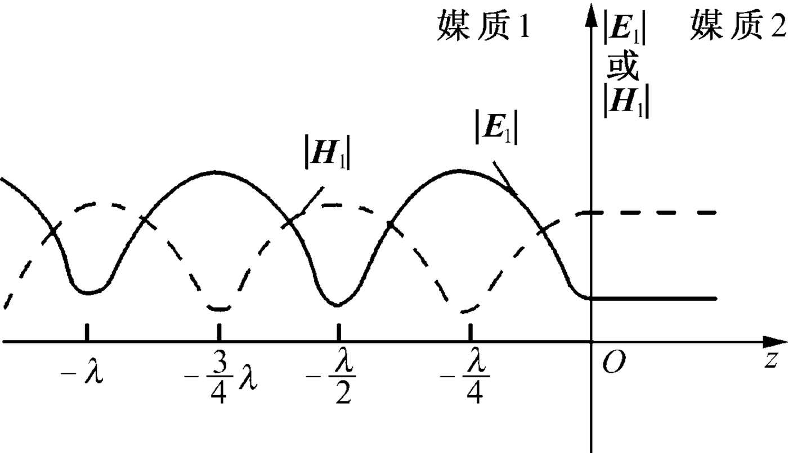
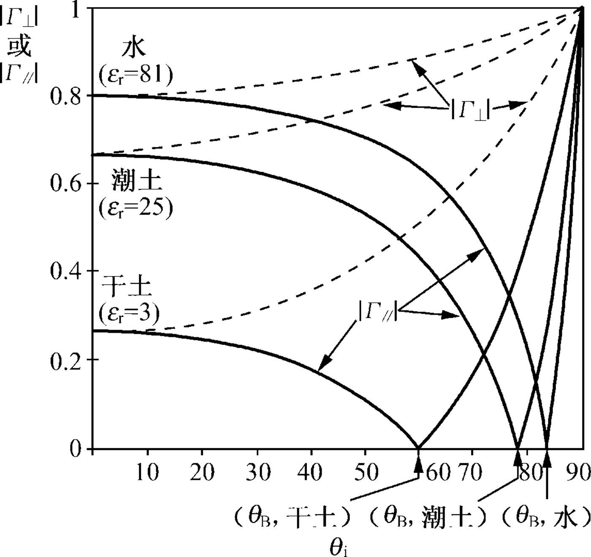
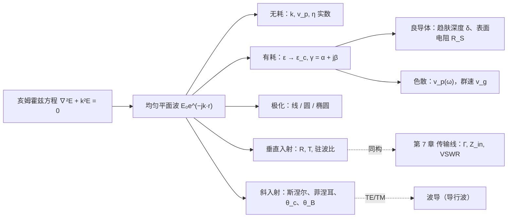

# 第 6 章 平面电磁波

!!! tip "本章目标"

    1. 掌握无耗媒质中均匀平面波的传播特性：相位常数、相速、波长、波阻抗、能流密度；会写沿任意方向传播的平面波。
    2. 掌握导电媒质中的平面波：复介电常数、传播常数 $\gamma=\alpha+\je\beta$、复波阻抗；良导体中的趋肤效应与趋肤深度。
    3. 会判断电磁波的极化方式（线、圆、椭圆，左旋、右旋）。
    4. 理解色散、相速与群速。
    5. 掌握平面波对平面边界的垂直入射（驻波、行驻波、驻波比）和斜入射（斯涅尔定律、菲涅耳公式、全反射、布儒斯特角）。

**本章在全书中的位置。** 第 5 章得到了无源区的亥姆霍兹方程 $\nabla^2\vv E+k^2\vv E=0$。本章研究它最简单的解：**均匀平面波**。它是理想化的模型（无限大的等相位面、无限大的能量），但远离天线的任何电磁波在局部都近似为平面波，而任意的波都可以分解为平面波的叠加。本章的反射、透射与驻波，在第 7 章会以“电压波、电流波”的形式在传输线上再出现一次：**平面波垂直入射与传输线上的反射在数学上完全相同**。

---

## 6.1 无耗媒质中的均匀平面波

!!! definition "定义 6.1（均匀平面波）"

    **等相位面**（波阵面）为平面的波称为平面波；若等相位面上各点的场强大小、方向都相同，称为**均匀平面波**。

设波沿 $z$ 方向传播，场量只与 $z$、$t$ 有关。由 $\nabla\cdot\vv E=0$ 得 $\partial E_z/\partial z=0$，时谐场中 $E_z=0$；同理 $H_z=0$。**均匀平面波是横电磁波（TEM 波）**：$\vv E$、$\vv H$ 都没有沿传播方向的分量。

取 $\vv E=\ax E_x(z)$，亥姆霍兹方程化为

$$\frac{\dd^2E_x}{\dd z^2}+k^2E_x=0,\qquad k=\omega\sqrt{\mu\varepsilon},\qquad E_x=E_0^+\mathrm e^{-\je kz}+E_0^-\mathrm e^{\je kz}.$$

两项分别是沿 $+z$、$-z$ 方向传播的波。下面只讨论 $+z$ 方向的波 $\vv E=\ax E_0\mathrm e^{-\je kz}$（$E_0=E_m\mathrm e^{\je\varphi_0}$）。由 $\nabla\times\vv E=-\je\omega\mu\vv H$：

$$\vv H=\ay\frac{k}{\omega\mu}E_0\mathrm e^{-\je kz}=\ay\frac{E_0}{\eta}\mathrm e^{-\je kz}.$$

<figure class="video" markdown>
<video controls preload="metadata" width="100%" poster="assets/posters/C6_PlaneWave.jpg"><source src="assets/videos/C6_PlaneWave.mp4" type="video/mp4"></video>
<figcaption>动画 6-1　无耗媒质中的均匀平面波：$\vv E$（黄）沿 $x$，$\vv H$（青）沿 $y$，两者同相，都垂直于传播方向 $z$。</figcaption>
</figure>

### 1. 电磁波的相位

瞬时值 $E_x(z,t)=E_m\cos(\omega t-kz+\varphi_0)$。宗量 $\omega t-kz+\varphi_0$ 称为**相位**：$\omega t$ 是时间相位，$-kz$ 是空间相位，$\varphi_0$ 是初相。

### 2. 行波与相速

等相位点满足 $\omega t-kz=$ 常数，$\dfrac{\dd z}{\dd t}=\dfrac{\omega}{k}$：

$$v_p=\frac{\omega}{k}=\frac{1}{\sqrt{\mu\varepsilon}}=\frac{c}{\sqrt{\mu_r\varepsilon_r}},\qquad c=\frac{1}{\sqrt{\mu_0\varepsilon_0}}\approx3\times10^8\ \mathrm{m/s}.$$

$v_p$ 称为**相速**。$n=\sqrt{\mu_r\varepsilon_r}$ 为折射率。

### 3. 波长与相位常数

相位相差 $2\pi$ 的两等相位面之间的距离为波长 $\lambda=\dfrac{2\pi}{k}=\dfrac{v_p}{f}=\dfrac{\lambda_0}{n}$。$k=\dfrac{2\pi}{\lambda}$ 表示单位长度上的相位变化，称为**相位常数**（波数），单位 rad/m。

### 4. 波阻抗与功率流密度

!!! definition "定义 6.2（波阻抗）"

    $$\eta=\frac{E_x}{H_y}=\sqrt{\frac{\mu}{\varepsilon}}\ (\Omega),\qquad\eta_0=\sqrt{\frac{\mu_0}{\varepsilon_0}}=120\pi\approx377\ \Omega .$$

    无耗媒质中 $\eta$ 为实数：$\vv E$ 与 $\vv H$ 同相。

!!! theorem "定理 6.1（均匀平面波的场关系）"

    沿单位矢量 $\vv a_k$ 方向传播的均匀平面波满足

    $$\vv H=\frac1\eta\vv a_k\times\vv E,\qquad\vv E=\eta\vv H\times\vv a_k,\qquad\vv a_k\cdot\vv E=\vv a_k\cdot\vv H=0 .$$

    $\vv E$、$\vv H$、$\vv a_k$ 两两垂直，成右手关系。电场能量密度等于磁场能量密度：$\dfrac12\varepsilon E^2=\dfrac12\mu H^2$。

**能流。** $\vv S_{\text{av}}=\dfrac12\Re[\vv E\times\vv H^*]=\az\dfrac{|E_0|^2}{2\eta}$，平均能量密度 $w_{\text{av}}=\dfrac12\varepsilon|E_0|^2$，于是 $\dfrac{S_{\text{av}}}{w_{\text{av}}}=\dfrac{1}{\eta\varepsilon}=\dfrac{1}{\sqrt{\mu\varepsilon}}=v_p$：无耗媒质中**能量传播速度等于相速**。

!!! example "例题 6.1（自由空间中的平面波）"

    自由空间中 $\vv E(z,t)=\ax60\pi\cos(\omega t-6\pi z)\ \mathrm{V/m}$。求传播速度、波长、频率、磁场的瞬时表达式和平均坡印廷矢量。

    **解。** $v=c=3\times10^8\ \mathrm{m/s}$；$k=6\pi$，$\lambda=\dfrac{2\pi}{k}=\dfrac13\ \mathrm m$；$f=\dfrac c\lambda=9\times10^8\ \mathrm{Hz}$。

    $$\vv H=\frac{1}{\eta_0}\az\times\vv E=\ay\frac{60\pi}{120\pi}\cos(1.8\pi\times10^9t-6\pi z)=\ay0.5\cos(1.8\pi\times10^9t-6\pi z)\ \mathrm{A/m},$$

    $$\vv S_{\text{av}}=\az\frac12\times60\pi\times0.5=\az15\pi\approx\az47.1\ \mathrm{W/m^2}.$$

### 5. 沿任意方向传播的平面波表达式

设传播方向为 $\vv a_k=\ax\cos\alpha+\ay\cos\beta+\az\cos\gamma$，定义**波矢量** $\vv k=k\vv a_k=\ax k_x+\ay k_y+\az k_z$。等相位面是垂直于 $\vv a_k$ 的平面 $\vv a_k\cdot\vv r=$ 常数，所以

$$\vv E(\vv r)=\vv E_0\,\mathrm e^{-\je\vv k\cdot\vv r}=\vv E_0\,\mathrm e^{-\je(k_xx+k_yy+k_zz)},\qquad\vv k\cdot\vv E_0=0,\qquad k_x^2+k_y^2+k_z^2=k^2 .$$

对这种波，$\nabla\to-\je\vv k$：$\nabla\times\vv E=-\je\vv k\times\vv E$，于是麦克斯韦方程变成代数关系 $\vv k\times\vv E=\omega\mu\vv H$，$\vv k\times\vv H=-\omega\varepsilon\vv E$，即定理 6.1。

---

## 6.2 导电媒质中的均匀平面波

### 6.2.1 复介电常数

导电媒质中 $\nabla\times\vv H=\sigma\vv E+\je\omega\varepsilon\vv E=\je\omega\varepsilon_c\vv E$：

!!! definition "定义 6.3（复介电常数与损耗角正切）"

    $$\varepsilon_c=\varepsilon-\je\frac{\sigma}{\omega}=\varepsilon'-\je\varepsilon'',\qquad\tan\delta_c=\frac{\varepsilon''}{\varepsilon'}=\frac{\sigma}{\omega\varepsilon}.$$

    $\tan\delta_c$ 是传导电流与位移电流的幅值之比。工程上：

    | $\sigma/(\omega\varepsilon)$ | 媒质类型 |
    |---|---|
    | $\ll1$（如 $<0.01$） | 低损耗介质（电介质） |
    | $\sim1$ | 一般导电媒质（半导体、湿土） |
    | $\gg1$（如 $>100$） | 良导体 |

    介质的极化损耗同样可以用 $\varepsilon''$ 表示，所以 $\tan\delta$ 也直接作为介质材料的参数给出。

把无耗媒质结果中的 $\varepsilon$ 换成 $\varepsilon_c$，就得到导电媒质中的结果。

### 6.2.2 导电媒质中的均匀平面波

!!! theorem "定理 6.2（导电媒质中的平面波）"

    $$\vv E=\ax E_0\mathrm e^{-\gamma z}=\ax E_0\mathrm e^{-\alpha z}\mathrm e^{-\je\beta z},\qquad\gamma=\je\omega\sqrt{\mu\varepsilon_c}=\alpha+\je\beta,$$

    $$\alpha=\omega\sqrt{\frac{\mu\varepsilon}{2}\left[\sqrt{1+\left(\frac{\sigma}{\omega\varepsilon}\right)^2}-1\right]},\qquad\beta=\omega\sqrt{\frac{\mu\varepsilon}{2}\left[\sqrt{1+\left(\frac{\sigma}{\omega\varepsilon}\right)^2}+1\right]},$$

    $$\eta_c=\sqrt{\frac{\mu}{\varepsilon_c}}=|\eta_c|\mathrm e^{\je\psi},\qquad\vv H=\ay\frac{E_0}{|\eta_c|}\mathrm e^{-\alpha z}\mathrm e^{-\je(\beta z+\psi)},\qquad0\le\psi<\frac\pi4 .$$

    $\gamma$ 为**传播常数**，$\alpha$ 为**衰减常数**（Np/m），$\beta$ 为相位常数（rad/m）。

<figure class="video" markdown>
<video controls preload="metadata" width="100%" poster="assets/posters/C6_Lossy.jpg"><source src="assets/videos/C6_Lossy.mp4" type="video/mp4"></video>
<figcaption>动画 6-2　导电媒质中的平面波：振幅按 $\mathrm e^{-\alpha z}$ 衰减（虚线包络），$\vv H$ 滞后 $\vv E$ 的相角 $\psi$ 随损耗增大，良导体中 $\psi=45^\circ$，波在一个波长之内几乎衰减殆尽。</figcaption>
</figure>

与无耗情形相比：

- 振幅按 $\mathrm e^{-\alpha z}$ 衰减；
- 波阻抗为复数，$\vv H$ 比 $\vv E$ 滞后 $\psi$；
- $\beta$ 随频率非线性变化，$v_p=\omega/\beta$ 与频率有关——**色散**（见 6.5 节）；
- $\vv S_{\text{av}}=\az\dfrac{|E_0|^2}{2|\eta_c|}\cos\psi\,\mathrm e^{-2\alpha z}$：功率按 $\mathrm e^{-2\alpha z}$ 衰减。

**分贝与奈培。** 场强衰减 $\mathrm e^{-\alpha z}$，用分贝表示为 $20\lg\mathrm e^{\alpha z}=8.686\,\alpha z$ dB。1 Np = 8.686 dB。

!!! example "例题 6.2（一般导电媒质）"

    $f=1.8\ \mathrm{GHz}$ 的均匀平面波在 $\mu_r=1.6$、$\varepsilon_r=25$、$\sigma=2.5\ \mathrm{S/m}$ 的媒质中传播，$\vv E=\ax\mathrm e^{-\alpha z}\cos(\omega t-\beta z)\ \mathrm{V/m}$。求传播常数、衰减常数、波阻抗、相速和平均坡印廷矢量。

    **解。** $\dfrac{\sigma}{\omega\varepsilon}=\dfrac{2.5}{2\pi\times1.8\times10^9\times25\times8.854\times10^{-12}}\approx1.0$，属于一般导电媒质，必须用精确公式。

    $\gamma=\je\omega\sqrt{\mu\varepsilon_c}\approx108.5+\je262.1\ \mathrm{m^{-1}}$：$\alpha\approx108.5\ \mathrm{Np/m}$，$\beta\approx262.1\ \mathrm{rad/m}$。

    $\eta_c=\sqrt{\mu/\varepsilon_c}\approx80.2\,\mathrm e^{\je22.5^\circ}\ \Omega$（$\tan2\psi=\sigma/\omega\varepsilon=1$）；$v_p=\omega/\beta\approx4.32\times10^7\ \mathrm{m/s}$。

    $$\vv S_{\text{av}}=\az\frac{1}{2\times80.2}\cos22.5^\circ\,\mathrm e^{-2\alpha z}\approx\az5.76\times10^{-3}\,\mathrm e^{-217z}\ \mathrm{W/m^2}.$$

    穿透深度 $1/\alpha\approx9.2\ \mathrm{mm}$，只有波长（2.4 cm）的 0.38 倍。

**低损耗介质的近似。** $\sigma/(\omega\varepsilon)\ll1$ 时，

$$\alpha\approx\frac{\sigma}{2}\sqrt{\frac{\mu}{\varepsilon}},\qquad\beta\approx\omega\sqrt{\mu\varepsilon},\qquad\eta_c\approx\sqrt{\frac\mu\varepsilon}\left(1+\je\frac{\sigma}{2\omega\varepsilon}\right).$$

除了缓慢衰减外，与无耗情形几乎相同。

---

## 6.3 良导体中的均匀平面波、趋肤效应

$\sigma/(\omega\varepsilon)\gg1$ 时 $\varepsilon_c\approx-\je\sigma/\omega$，$\sqrt{-\je}=\dfrac{1-\je}{\sqrt2}$：

!!! theorem "定理 6.3（良导体中的平面波）"

    $$\gamma\approx\sqrt{\je\omega\mu\sigma}=(1+\je)\sqrt{\pi f\mu\sigma},\qquad\alpha=\beta=\sqrt{\pi f\mu\sigma},$$

    $$\eta_c\approx\sqrt{\frac{\je\omega\mu}{\sigma}}=(1+\je)\sqrt{\frac{\pi f\mu}{\sigma}},\qquad\psi=45^\circ .$$

!!! definition "定义 6.4（趋肤深度）"

    场强衰减到表面值的 $1/\mathrm e$ 所经过的距离

    $$\delta=\frac1\alpha=\frac{1}{\sqrt{\pi f\mu\sigma}}=\frac{\lambda}{2\pi}.$$

    高频时电磁场与电流集中在导体表面很薄的一层内，称为**趋肤效应**。良导体中波长 $\lambda=2\pi\delta$，经过一个波长场强衰减为 $\mathrm e^{-2\pi}\approx0.19\%$。

铜（$\sigma=5.8\times10^7\ \mathrm{S/m}$）：$\delta\approx\dfrac{66\ \mathrm{mm}}{\sqrt{f/\mathrm{Hz}}}$。50 Hz 时 9.3 mm，1 MHz 时 66 μm，1 GHz 时 2.1 μm。

**表面阻抗。** 导体中电流集中在表面附近，单位宽度上的总电流 $J_S=\int_0^\infty J_0\mathrm e^{-\gamma z}\dd z=J_0/\gamma$，表面切向电场 $E_0=J_0/\sigma$，于是

$$Z_S=\frac{E_0}{J_S}=\frac{\gamma}{\sigma}=\eta_c=R_S+\je X_S,\qquad R_S=X_S=\sqrt{\frac{\pi f\mu}{\sigma}}=\frac{1}{\sigma\delta}.$$

$R_S$ 相当于厚度为 $\delta$、电流均匀分布的导体层的方阻。高频下圆导线（半径 $a\gg\delta$）单位长度电阻 $R\approx\dfrac{R_S}{2\pi a}$，随 $\sqrt f$ 增大。这就是高频电路要用镀银导体、多股绞合线（利兹线）的原因，也是电磁屏蔽的原理（练习 8）。

!!! info "直觉：为什么导体内场衰减得这么快"

    在导体中位移电流可以忽略，方程变为 $\nabla^2\vv E=\je\omega\mu\sigma\vv E$，这是**扩散方程**（与热传导方程相同），不是波动方程。场不是“传播”进去，而是“扩散”进去，扩散深度 $\sim\sqrt{1/(\omega\mu\sigma)}$。另一种看法：导体中的感应涡流产生的场抵消了外场（楞次定律），频率越高，抵消越彻底。

---

## 6.4 电磁波的极化

<figure class="video" markdown>
<video controls preload="metadata" width="100%" poster="assets/posters/C6_Polarization.jpg"><source src="assets/videos/C6_Polarization.mp4" type="video/mp4"></video>
<figcaption>动画 6-3　极化：三维图是某一时刻 $\vv E$ 沿 $z$ 的分布，橙色是 $z=0$ 处的电场矢量；右下小窗是迎着波看 $z=0$ 处 $\vv E$ 矢端的轨迹。依次为线极化、右旋圆极化、左旋圆极化、椭圆极化。</figcaption>
</figure>

!!! definition "定义 6.5（极化）"

    空间某固定点处电场矢量的**矢端随时间变化的轨迹**称为电磁波的极化。沿 $z$ 方向传播的平面波一般可写成

    $$\vv E=\ax E_{xm}\cos(\omega t-kz+\varphi_x)+\ay E_{ym}\cos(\omega t-kz+\varphi_y).$$

    令 $\Delta\varphi=\varphi_y-\varphi_x$：

    - **线极化**：$\Delta\varphi=0$ 或 $\pm\pi$。矢端在一条直线上振动。
    - **圆极化**：$E_{xm}=E_{ym}$ 且 $\Delta\varphi=\pm\dfrac\pi2$。矢端以角速度 $\omega$ 画圆。
    - **椭圆极化**：其他情形。

    **旋向**：大拇指指向传播方向，若电场矢量旋转方向与其余四指的弯曲方向一致，为**右旋**；相反为**左旋**。对沿 $+z$ 传播的波，$\Delta\varphi=-\pi/2$（$E_y$ 滞后）为右旋，$\Delta\varphi=+\pi/2$ 为左旋；一般地 $-\pi<\Delta\varphi<0$ 为右旋，$0<\Delta\varphi<\pi$ 为左旋。

### 6.4.1 线极化波

$\Delta\varphi=0$ 时 $\dfrac{E_y}{E_x}=\dfrac{E_{ym}}{E_{xm}}$ 为常数，矢端在与 $x$ 轴成 $\arctan\dfrac{E_{ym}}{E_{xm}}$ 的直线上来回振动。电视、调频广播多用水平或垂直线极化波。

### 6.4.2 圆极化波

$E_{xm}=E_{ym}=E_m$，$\Delta\varphi=-\pi/2$，在 $z=0$ 处：$E_x=E_m\cos\omega t$，$E_y=E_m\sin\omega t$，$E_x^2+E_y^2=E_m^2$，矢量从 $x$ 转向 $y$，与 $+z$ 成右手螺旋：**右旋圆极化**，复数形式 $\vv E=(\ax-\je\ay)E_m\mathrm e^{-\je kz}$。

**一个线极化波可以分解为两个等幅、旋向相反的圆极化波**：$\ax=\dfrac12(\ax-\je\ay)+\dfrac12(\ax+\je\ay)$；反之，圆极化波也可以分解为两个空间正交、时间相差 $90^\circ$ 的线极化波。圆极化天线可以接收任意取向的线极化波（只损失一半功率），所以卫星通信、GPS、雷达常用圆极化。

### 6.4.3 椭圆极化波

一般情形下消去 $t$ 可以证明矢端轨迹是椭圆：

$$\frac{E_x^2}{E_{xm}^2}-\frac{2E_xE_y}{E_{xm}E_{ym}}\cos\Delta\varphi+\frac{E_y^2}{E_{ym}^2}=\sin^2\Delta\varphi .$$

线极化和圆极化都是椭圆极化的特例。

!!! example "例题 6.3（判断极化）"

    $\vv E=(3\ax+\je4\ay)\mathrm e^{-\je0.5z}$，判断极化。

    **解。** $E_x=3\cos(\omega t-0.5z)$，$E_y=-4\sin(\omega t-0.5z)=4\cos\left(\omega t-0.5z+\dfrac\pi2\right)$。振幅不等、$\Delta\varphi=+\pi/2$，波沿 $+z$ 传播：**左旋椭圆极化**（椭圆的长、短轴分别沿 $y$、$x$）。

**判断步骤**：① 确定传播方向；② 把两个分量都写成 $\cos$ 形式，读出振幅和相位差 $\Delta\varphi=\varphi_y-\varphi_x$；③ 按定义 6.5 判断。对沿 $-z$ 传播的波，旋向的结论相反。

---

## 6.5 电磁波的色散与群速

<figure class="video" markdown>
<video controls preload="metadata" width="100%" poster="assets/posters/C6_GroupVelocity.jpg"><source src="assets/videos/C6_GroupVelocity.mp4" type="video/mp4"></video>
<figcaption>动画 6-4　两个频率相近的波叠加：载波（●）以相速 $v_p$ 前进，包络（▼）以群速 $v_g$ 前进；图中 $v_g=v_p/2$。</figcaption>
</figure>

**色散。** 相速随频率变化的现象称为色散。理想介质中 $\beta=\omega\sqrt{\mu\varepsilon}$ 与 $\omega$ 成正比，$v_p$ 为常数，无色散；导电媒质中 $\beta$ 与 $\omega$ 不成正比，是**色散媒质**。

**群速。** 实际信号占有一定的带宽。设两个频率 $\omega_0\pm\Delta\omega$、相位常数 $\beta_0\pm\Delta\beta$ 的等幅波叠加：

$$E=2E_m\cos(\Delta\omega\,t-\Delta\beta\,z)\cos(\omega_0t-\beta_0z).$$

高频载波 $\cos(\omega_0t-\beta_0z)$ 以 $v_p=\omega_0/\beta_0$ 前进；缓变的包络以 $\Delta\omega/\Delta\beta$ 前进。

!!! definition "定义 6.6（群速）"

    $$v_g=\frac{\dd\omega}{\dd\beta}=\frac{v_p}{1-\dfrac{\omega}{v_p}\dfrac{\dd v_p}{\dd\omega}}.$$

    $\dfrac{\dd v_p}{\dd\omega}<0$ 时 $v_g<v_p$，称为**正常色散**；$\dfrac{\dd v_p}{\dd\omega}>0$ 时 $v_g>v_p$，称为**反常色散**；无色散时 $v_g=v_p$。

信号的能量和信息以群速传播（在色散不太强、群速有意义的情况下）。相速可以大于光速（例如波导中、等离子体中），并不违反相对论，因为相速不传递信息；群速总小于光速。电离层是一种等离子体，$v_pv_g=c^2$，第 10 章会遇到。

---

## 6.6 均匀平面波对平面边界的垂直入射

<figure class="video" markdown>
<video controls preload="metadata" width="100%" poster="assets/posters/C6_Standing.jpg"><source src="assets/videos/C6_Standing.mp4" type="video/mp4"></video>
<figcaption>动画 6-5　垂直入射：理想导体前形成纯驻波（$\vv E$ 黄、$\vv H$ 青，波节固定不动）；介质分界面前形成行驻波，包络在 $1\pm|R|$ 之间起伏，媒质 2 中是衰减为 $T$ 倍的行波。</figcaption>
</figure>

设分界面为 $z=0$，媒质 1（$z<0$）中有沿 $+z$ 传播的入射波 $\vv E^i=\ax E_0^i\mathrm e^{-\je k_1z}$。分界面产生反射波 $\vv E^r=\ax E_0^r\mathrm e^{\je k_1z}$（$\vv H^r=-\ay\dfrac{E_0^r}{\eta_1}\mathrm e^{\je k_1z}$）和透射波 $\vv E^t=\ax E_0^t\mathrm e^{-\je k_2z}$。

### 6.6.1 理想介质与理想导体的分界面

媒质 2 为理想导体：$\vv E^t=0$。由 $z=0$ 处切向电场为零，$E_0^r=-E_0^i$：

$$\vv E_1=\ax E_0^i\left(\mathrm e^{-\je k_1z}-\mathrm e^{\je k_1z}\right)=-\ax\je2E_0^i\sin k_1z,\qquad\vv H_1=\ay\frac{2E_0^i}{\eta_1}\cos k_1z .$$

瞬时值 $\vv E_1=\ax2E_m\sin k_1z\sin\omega t$，$\vv H_1=\ay\dfrac{2E_m}{\eta_1}\cos k_1z\cos\omega t$（$E_0^i=E_m$ 为实数）。

!!! theorem "定理 6.4（纯驻波的特点）"

    1. 各点场强只随时间作简谐振动，不随 $z$ 移动——**驻波**。电场波节（$|E|=0$）在 $z=-n\lambda_1/2$，波腹（$|E|=2E_m$）在 $z=-(2n+1)\lambda_1/4$；磁场的波节、波腹位置恰好相反。导体表面是电场波节、磁场波腹。
    2. $\vv E$ 与 $\vv H$ 在时间上相差 $90^\circ$，空间分布也错开 $\lambda/4$：$\vv S_{\text{av}}=\dfrac12\Re[\vv E_1\times\vv H_1^*]=0$。没有能量传输，只有电能与磁能的相互转换。
    3. 导体表面电流 $\vv J_S=-\az\times\vv H_1\big|_{z=0}=\ax\dfrac{2E_0^i}{\eta_1}$（$\an=-\az$ 指向媒质 1）。

### 6.6.2 两种理想电介质分界面

在 $z=0$ 处 $E$、$H$ 的切向分量连续：

$$E_0^i+E_0^r=E_0^t,\qquad\frac{E_0^i-E_0^r}{\eta_1}=\frac{E_0^t}{\eta_2}.$$

!!! theorem "定理 6.5（垂直入射的反射系数与透射系数）"

    $$R=\frac{E_0^r}{E_0^i}=\frac{\eta_2-\eta_1}{\eta_2+\eta_1},\qquad T=\frac{E_0^t}{E_0^i}=\frac{2\eta_2}{\eta_2+\eta_1},\qquad1+R=T .$$

    非磁性媒质中 $\eta\propto1/n$，$R=\dfrac{n_1-n_2}{n_1+n_2}$。$\eta_2=0$（理想导体）时 $R=-1$，$T=0$，回到 6.6.1。导电媒质中把 $\eta$ 换成复数 $\eta_c$ 即可，$R$、$T$ 一般为复数。

**行驻波。** 媒质 1 中

$$E_1=E_0^i\left(\mathrm e^{-\je k_1z}+R\,\mathrm e^{\je k_1z}\right),\qquad|E_1|=|E_0^i|\left|1+R\,\mathrm e^{\je2k_1z}\right|.$$

可以拆成一个行波和一个驻波之和。$|E_1|$ 在 $|E_0^i|(1+|R|)$ 和 $|E_0^i|(1-|R|)$ 之间周期变化，周期为 $\lambda_1/2$。

!!! definition "定义 6.7（驻波比）"

    $$S=\frac{|E|_{\max}}{|E|_{\min}}=\frac{1+|R|}{1-|R|},\qquad|R|=\frac{S-1}{S+1}.$$

    $1\le S\le\infty$：$S=1$ 为行波（无反射），$S=\infty$ 为纯驻波（全反射）。$R>0$（$\eta_2>\eta_1$）时分界面处为电场波腹；$R<0$ 时为电场波节。

<figure markdown>
{ width="720" }
<figcaption>图 6-A　两种介质分界面（$z=0$）前的行驻波：$|E|$ 与 $|H|$ 的波腹、波节沿 $z$ 错开 $\lambda/4$；进入媒质 2 后是幅度为透射系数的行波，不再有驻波起伏（图源：上海交大何广强《电磁场与波》课件）</figcaption>
</figure>

**能量守恒。** $\dfrac{|E_0^i|^2}{2\eta_1}=\dfrac{|E_0^r|^2}{2\eta_1}+\dfrac{|E_0^t|^2}{2\eta_2}$，即 $1=|R|^2+\dfrac{\eta_1}{\eta_2}|T|^2$。注意透射系数 $T$ 可以大于 1（$\eta_2>\eta_1$ 时），但透射**功率**不会超过入射功率。

!!! example "例题 6.4（介质分界面的垂直入射）"

    平面波在 $\varepsilon_1=9\varepsilon_0$ 的媒质 1 中沿 $+z$ 传播，在 $z=0$ 处垂直入射到 $\varepsilon_2=4\varepsilon_0$ 的媒质 2（均为非磁性）。来波在分界面处的最大值为 0.1 V/m，沿 $+x$ 极化，$\omega=3\times10^8\ \mathrm{rad/s}$。求反射系数、透射系数和两种媒质中的电场。

    **解。** $k_1=\omega\sqrt{\mu_0\varepsilon_1}=\dfrac{3\times10^8\times3}{3\times10^8}=3\ \mathrm{rad/m}$，$k_2=2\ \mathrm{rad/m}$；$\eta_1=\dfrac{120\pi}{3}=40\pi\ \Omega$，$\eta_2=60\pi\ \Omega$。

    $$R=\frac{60\pi-40\pi}{60\pi+40\pi}=0.2,\qquad T=\frac{2\times60\pi}{100\pi}=1.2 .$$

    $$\vv E_1=\ax\left[0.1\cos(3\times10^8t-3z)+0.02\cos(3\times10^8t+3z)\right],\qquad\vv E_2=\ax0.12\cos(3\times10^8t-2z)\ \ \mathrm{V/m}.$$

    验证功率：$|R|^2+\dfrac{\eta_1}{\eta_2}|T|^2=0.04+\dfrac23\times1.44=1$。

!!! note "前后联系：平面波垂直入射 = 传输线端接负载"

    把 $E\leftrightarrow U$、$H\leftrightarrow I$、$\eta\leftrightarrow Z_0$ 对应起来，本节的每一个公式都会在第 7 章重现：$R=\dfrac{Z_L-Z_0}{Z_L+Z_0}$、驻波比 $S=\dfrac{1+|\Gamma|}{1-|\Gamma|}$、短路线上的纯驻波、$\lambda/4$ 阻抗变换器（在两种介质间插入厚 $\lambda/4$、$\eta=\sqrt{\eta_1\eta_3}$ 的介质层消除反射，即光学增透膜）。原因是两者满足同样的方程 $\dfrac{\dd^2E}{\dd z^2}+k^2E=0$ 和同样的边界条件（$E$、$H$ 切向连续 ↔ $U$、$I$ 连续）。

!!! info "拓展：多层介质与传输线类比"

    一层厚度为 $d$、波阻抗为 $\eta_2$ 的介质夹在媒质 1 与媒质 3 之间，垂直入射时，在前界面处向里看的输入波阻抗与第 7 章传输线的输入阻抗形式完全相同：

    $$Z(-d)=\eta_2\frac{\eta_3\cos\beta_2 d+\je\eta_2\sin\beta_2 d}{\eta_2\cos\beta_2 d+\je\eta_3\sin\beta_2 d},\qquad R=\frac{Z(-d)-\eta_1}{Z(-d)+\eta_1}.$$

    两个最有用的特例：

    **1. 半波介质窗。** 若两侧是同一种媒质（$\eta_1=\eta_3$，例如空气–介质–空气），且 $d=n\lambda_2/2$（$n=1,2,\ldots$），则 $\beta_2 d=n\pi$、$Z(-d)=\eta_3=\eta_1$，反射系数为零：这块介质对这个频率“隐身”，全部透射。雷达天线罩、微波观察窗就是按这个条件选取厚度的。例如 $5$ GHz 的波垂直入射到 $\varepsilon_r=4$ 的介质板（$n=2$），板内波长 $\lambda_2=c/(f\sqrt{\varepsilon_r})=3$ cm，无反射的最小厚度为 $\lambda_2/2=1.5$ cm，一般写作 $d=\lambda_0/(2\sqrt{\varepsilon_r})$。

    **2. $\lambda/4$ 匹配层（增透膜）。** 若 $d=(2n+1)\lambda_2/4$，则 $Z(-d)=\eta_2^2/\eta_3$。要使它等于 $\eta_1$，只需

    $$\eta_2=\sqrt{\eta_1\eta_3}\qquad\text{（非磁性媒质即 }\varepsilon_2=\sqrt{\varepsilon_1\varepsilon_3}\text{）}.$$

    这就是光学增透膜，也是第 7 章 $\lambda/4$ 阻抗变换器的场论原型。半波窗只在离散的频率上全透射，带宽较窄；$\lambda/4$ 匹配把反射在中心频率上消掉，在附近一个频带内也保持较小。

---

## 6.7 均匀平面波对平面边界的斜入射

入射波传播方向与分界面法线所成的角 $\theta_i$ 称为**入射角**，入射方向与法线构成的平面称为**入射面**。任意极化的入射波可以分解为两个线极化波：

- **平行极化波**：$\vv E$ 平行于入射面（$\vv H$ 垂直于入射面）；
- **垂直极化波**：$\vv E$ 垂直于入射面。

### 6.7.1 在介质—理想导体分界面的斜入射

取入射面为 $xz$ 面，分界面 $z=0$。入射波 $\vv k^i=k_1(\ax\sin\theta_i+\az\cos\theta_i)$。

**1. 平行极化波。** 由 $z=0$ 处切向电场为零，反射角等于入射角，媒质 1 中合成场为

$$E_{1x}=-2\je E_0\cos\theta_i\sin(k_1z\cos\theta_i)\,\mathrm e^{-\je k_1x\sin\theta_i},\quad E_{1z}=-2E_0\sin\theta_i\cos(k_1z\cos\theta_i)\,\mathrm e^{-\je k_1x\sin\theta_i},$$

$$H_{1y}=\frac{2E_0}{\eta_1}\cos(k_1z\cos\theta_i)\,\mathrm e^{-\je k_1x\sin\theta_i}.$$

**2. 垂直极化波。** $\vv E^i=\ay E_0\mathrm e^{-\je k_1(x\sin\theta_i+z\cos\theta_i)}$，$E_0^r=-E_0$，

$$E_{1y}=-2\je E_0\sin(k_1z\cos\theta_i)\,\mathrm e^{-\je k_1x\sin\theta_i}.$$

两种情形的共同特点：

- 沿分界面（$x$ 方向）是**行波**，相位常数 $k_x=k_1\sin\theta_i$，相速 $v_x=\dfrac{v_1}{\sin\theta_i}>v_1$；
- 垂直分界面（$z$ 方向）是**驻波**，相位常数 $k_z=k_1\cos\theta_i$。在 $z=-\dfrac{n\pi}{k_1\cos\theta_i}$ 处 $E_y=0$，放一块理想导体板不影响场分布——这就是平行板**波导**的原理（第 5 章例题 5.3）；
- 沿 $x$ 方向的合成波是非均匀平面波：平行极化时有 $E_z$ 分量（TM 波），垂直极化时有 $H_z$ 分量（TE 波）。

### 6.7.2 在介质—介质分界面的斜入射

<figure class="video" markdown>
<video controls preload="metadata" width="100%" poster="assets/posters/C6_Oblique.jpg"><source src="assets/videos/C6_Oblique.mp4" type="video/mp4"></video>
<figcaption>动画 6-6　斜入射：左图为入射、反射（线宽与 $|R|$ 成正比）、折射波方向；右图为两种极化的 $|R|$ 随入射角的变化。由空气入射到 $\varepsilon_r=4$ 时有布儒斯特角 $63.4^\circ$；由 $\varepsilon_r=4$ 入射到空气时超过 $30^\circ$ 发生全反射。</figcaption>
</figure>

两种理想介质，$k_1=\omega\sqrt{\mu_1\varepsilon_1}$，$\eta_1=\sqrt{\mu_1/\varepsilon_1}$，$k_2$、$\eta_2$ 同理。分界面上的边界条件必须对所有 $x$ 成立，所以三个波沿分界面的相位变化必须相同：

!!! theorem "定理 6.6（反射定律与斯涅尔折射定律）"

    $$k_1\sin\theta_i=k_1\sin\theta_r=k_2\sin\theta_t\quad\Longrightarrow\quad\theta_r=\theta_i,\qquad\frac{\sin\theta_t}{\sin\theta_i}=\frac{k_1}{k_2}=\frac{n_1}{n_2}.$$

    非磁性媒质中 $\dfrac{\sin\theta_t}{\sin\theta_i}=\sqrt{\dfrac{\varepsilon_1}{\varepsilon_2}}$。

**菲涅耳公式。** 规定：平行极化时，入射、反射、透射波的 $\vv H$ 都取 $\ay$ 方向为正；垂直极化时，三个波的 $\vv E$ 都取 $\ay$ 方向为正。由切向 $\vv E$、$\vv H$ 连续：

!!! theorem "定理 6.7（斜入射的反射系数与透射系数）"

    $$R_{/\!/}=\frac{\eta_1\cos\theta_i-\eta_2\cos\theta_t}{\eta_1\cos\theta_i+\eta_2\cos\theta_t},\qquad T_{/\!/}=\frac{2\eta_2\cos\theta_i}{\eta_1\cos\theta_i+\eta_2\cos\theta_t},\qquad1+R_{/\!/}=\frac{\eta_1}{\eta_2}T_{/\!/};$$

    $$R_\perp=\frac{\eta_2\cos\theta_i-\eta_1\cos\theta_t}{\eta_2\cos\theta_i+\eta_1\cos\theta_t},\qquad T_\perp=\frac{2\eta_2\cos\theta_i}{\eta_2\cos\theta_i+\eta_1\cos\theta_t},\qquad1+R_\perp=T_\perp .$$

    $\theta_i=0$ 时 $R_\perp=\dfrac{\eta_2-\eta_1}{\eta_2+\eta_1}$ 回到垂直入射；$R_{/\!/}$ 在 $\theta_i=0$ 时与 $R_\perp$ 差一个负号，这只是正方向规定不同造成的。

**记法：** 垂直极化等价于把 $\eta$ 换成“等效波阻抗” $\dfrac{\eta}{\cos\theta}$，平行极化等价于换成 $\eta\cos\theta$，然后套用垂直入射公式（平行极化的符号按上面的规定）。

### 6.7.3 全反射和全透射

**1. 全反射。** 波从光密媒质射向光疏媒质（$\varepsilon_1>\varepsilon_2$）时 $\theta_t>\theta_i$。$\theta_t=90^\circ$ 对应的入射角称为**临界角**：

$$\theta_c=\arcsin\sqrt{\frac{\varepsilon_2}{\varepsilon_1}}\qquad(\mu_1=\mu_2).$$

$\theta_i\ge\theta_c$ 时 $\sin\theta_t>1$，$\cos\theta_t=-\je\sqrt{\sin^2\theta_t-1}$ 为纯虚数，$|R_{/\!/}|=|R_\perp|=1$：全部能量被反射。媒质 2 中的场沿 $z$ 方向指数衰减、沿分界面传播，称为**表面波**（倏逝波），不向媒质 2 内部传输平均功率。光纤、介质波导就是靠全反射导引电磁波的。

**2. 全透射。** 对平行极化波，令 $R_{/\!/}=0$，即 $\eta_1\cos\theta_i=\eta_2\cos\theta_t$，结合斯涅尔定律（非磁性媒质）得**布儒斯特角**

$$\theta_B=\arcsin\sqrt{\frac{\varepsilon_2}{\varepsilon_1+\varepsilon_2}}=\arctan\sqrt{\frac{\varepsilon_2}{\varepsilon_1}}.$$

垂直极化波的 $R_\perp$ 不可能为零。所以任意极化的波以 $\theta_B$ 入射时，反射波只剩垂直极化分量——布儒斯特角又称**极化角**，可用来从圆极化或非极化波中得到线极化波。

!!! info "直觉：布儒斯特角时反射波与折射波垂直"

    非磁性媒质中，$\theta_i=\theta_B$ 时可以验证 $\theta_i+\theta_t=90^\circ$。媒质 2 中被透射波电场驱动的极化偶极子沿透射波的 $\vv E$ 方向振动（平行极化时在入射面内），而偶极子在其轴线方向不辐射。反射波正好要沿这个方向出射，所以没有反射。

<figure markdown>
{ width="560" }
<figcaption>图 6-B　空气入射到干土（$\varepsilon_r=3$）、湿土（$25$）和水面（$81$）时，$|\Gamma_\perp|$（虚线）与 $|\Gamma_{/\!/}|$（实线）随入射角的变化。平行极化在布儒斯特角降到零（分别约为 $60^\circ$、$79^\circ$、$84^\circ$）；掠入射（$\theta_i\to 90^\circ$）时两种极化的 $|\Gamma|$ 都趋于 $1$，计及相位即 $\Gamma\to-1$，第 10 章两径模型正是用了这一点（图源：上海交大何广强《电磁场与波》课件）</figcaption>
</figure>

这个曲线还有一个日常应用：拍摄玻璃橱窗时，把相机放在布儒斯特角附近（普通玻璃 $n\approx 1.5$，$\theta_B\approx 56^\circ$），再让偏振片的透振方向位于入射面内，就可以滤掉残余的垂直极化反射光，拍到里面的陈列。

---

## 知识点归纳总结

!!! abstract "知识点归纳总结"

    | 参数 | 无耗媒质 | 良导体（$\sigma\gg\omega\varepsilon$） |
    |---|---|---|
    | 传播常数 | $\gamma=\je k$，$k=\omega\sqrt{\mu\varepsilon}$ | $\gamma=(1+\je)\sqrt{\pi f\mu\sigma}$ |
    | 相速 | $1/\sqrt{\mu\varepsilon}$ | $\sqrt{2\omega/(\mu\sigma)}$（很小） |
    | 波阻抗 | $\sqrt{\mu/\varepsilon}$（实数） | $(1+\je)\sqrt{\pi f\mu/\sigma}$（$45^\circ$） |
    | 振幅 | 不衰减 | $\mathrm e^{-z/\delta}$，$\delta=1/\sqrt{\pi f\mu\sigma}$ |
    | $\vv E$ 与 $\vv H$ | 同相 | $\vv H$ 滞后 $45^\circ$ |

    **场关系**：$\vv H=\dfrac1\eta\vv a_k\times\vv E$；$\vv S_{\text{av}}=\dfrac{|E|^2}{2|\eta|}\cos\psi\,\vv a_k$。

    **极化**：$\Delta\varphi=\varphi_y-\varphi_x$；$0,\pm\pi$ 线；等幅 $\pm\pi/2$ 圆；$-\pi<\Delta\varphi<0$ 右旋（$+z$ 传播）。

    **垂直入射**：$R=\dfrac{\eta_2-\eta_1}{\eta_2+\eta_1}$，$T=1+R$，$S=\dfrac{1+|R|}{1-|R|}$；理想导体前为纯驻波。

    **斜入射**：$\theta_r=\theta_i$，$n_1\sin\theta_i=n_2\sin\theta_t$；$\theta_c=\arcsin(n_2/n_1)$；$\theta_B=\arctan(n_2/n_1)$（仅平行极化）。

**易错点汇总。**

- $\vv H=\dfrac1\eta\vv a_k\times\vv E$，顺序不能颠倒；反射波的 $\vv a_k$ 反向，所以反射波 $\vv H$ 的符号要重新判断。
- 衰减常数 $\alpha$ 描述**场强**的衰减；功率按 $\mathrm e^{-2\alpha z}$ 衰减。
- 判断极化旋向前先确定传播方向；把 $\sin$ 改写成 $\cos$ 后再读相位差。
- 垂直入射中 $T=1+R$ 可以大于 1，这并不违反能量守恒。
- 斜入射时平行与垂直极化的定义以**入射面**为参照，不是以分界面为参照。
- 布儒斯特角只对平行极化存在；全反射只在从光密到光疏时发生。
- 多层介质可等效为一段传输线：半波厚度（$d=n\lambda_2/2$）全透射，$\lambda/4$ 且 $\eta_2=\sqrt{\eta_1\eta_3}$ 时无反射。

---

## 练习题

!!! example "练习 1"

    自由空间中一均匀平面波的磁场强度为 $\vv H=(\ay+\az)H_0\cos(\omega t-\pi x)\ \mathrm{A/m}$。求 (1) 传播方向；(2) 波长和频率；(3) 电场强度；(4) 瞬时坡印廷矢量。

    ??? success "答案"

        (1) 沿 $+x$ 方向。(2) $k=\pi$，$\lambda=2\ \mathrm m$，$f=1.5\times10^8\ \mathrm{Hz}$。

        (3) $\vv E=\eta_0\vv H\times\ax=120\pi H_0(\ay+\az)\times\ax\cos(\cdot)=120\pi H_0(\ay-\az)\cos(\omega t-\pi x)\ \mathrm{V/m}$。

        (4) $\vv S=\vv E\times\vv H=120\pi H_0^2(\ay-\az)\times(\ay+\az)\cos^2(\cdot)=\ax240\pi H_0^2\cos^2(\omega t-\pi x)\ \mathrm{W/m^2}$。

!!! example "练习 2"

    无耗媒质 $\varepsilon_r=4$、$\mu_r=1$ 中，平面波 $\vv E=\ay E_0\cos(6\times10^8t-\beta z)$。求相速、波阻抗、$\beta$、$\vv H$ 的瞬时表达式和平均坡印廷矢量。

    ??? success "答案"

        $v_p=\dfrac{c}{2}=1.5\times10^8\ \mathrm{m/s}$；$\eta=\dfrac{\eta_0}{2}=60\pi\ \Omega$；$\beta=\dfrac{\omega}{v_p}=4\ \mathrm{rad/m}$。

        $\vv H=\dfrac1\eta\az\times\vv E=-\ax\dfrac{E_0}{60\pi}\cos(6\times10^8t-4z)$；$\vv S_{\text{av}}=\az\dfrac{E_0^2}{120\pi}$。

!!! example "练习 3"

    均匀平面波从海水表面（$x=0$）沿 $+x$ 方向进入海水，$x=0$ 处 $\vv E=\ay100\cos(10^7\pi t)\ \mathrm{V/m}$。海水 $\varepsilon_r=80$，$\mu_r=1$，$\sigma=4\ \mathrm{S/m}$。求 (1) $\alpha$、$\beta$、$\eta_c$、$v_p$、$\lambda$、$\delta$；(2) 电场衰减到表面值 1% 的距离；(3) $x=0.8\ \mathrm m$ 处的 $\vv E$、$\vv H$；(4) 若 $f=50\ \mathrm{kHz}$，重做 (2)。

    ??? success "答案"

        $f=5\ \mathrm{MHz}$，$\dfrac{\sigma}{\omega\varepsilon}=\dfrac{4}{10^7\pi\times80\times8.854\times10^{-12}}\approx180\gg1$，按良导体计算。

        (1) $\alpha=\beta=\sqrt{\pi f\mu_0\sigma}=8.89$；$\eta_c=(1+\je)\sqrt{\pi f\mu_0/\sigma}=\pi\,\mathrm e^{\je45^\circ}\ \Omega$；$v_p=\omega/\beta=3.53\times10^6\ \mathrm{m/s}$；$\lambda=0.707\ \mathrm m$；$\delta=0.112\ \mathrm m$。

        (2) $\mathrm e^{-\alpha x}=0.01$，$x=\dfrac{\ln100}{8.89}=0.52\ \mathrm m$。

        (3) $\mathrm e^{-0.8\alpha}=8.2\times10^{-4}$，$\beta x=7.11\ \mathrm{rad}$：$\vv E=\ay0.082\cos(10^7\pi t-7.11)\ \mathrm{V/m}$，$\vv H=\az0.026\cos(10^7\pi t-7.11-\pi/4)\ \mathrm{A/m}$。

        (4) $\alpha=\sqrt{\pi\times5\times10^4\times4\pi\times10^{-7}\times4}=0.889$，$x=5.2\ \mathrm m$。频率越低穿透越深，所以与潜艇的通信要用甚低频。

!!! example "练习 4"

    判断下列平面波的极化：(1) $\vv E=\ax\cos(\omega t-\beta z)+\ay2\sin(\omega t-\beta z)$；(2) $\vv E=\ax\sin(\omega t-\beta z)+\ay\cos(\omega t-\beta z)$；(3) $\vv E=\ax\sin(\omega t-\beta z)+\ay5\sin(\omega t-\beta z)$；(4) $\vv E=\ax\cos\left(\omega t-\beta z-\dfrac\pi4\right)+\ay2\sin\left(\omega t-\beta z+\dfrac\pi4\right)$。

    ??? success "答案"

        都沿 $+z$ 传播。

        (1) $E_y=2\cos(\omega t-\beta z-\pi/2)$，$\Delta\varphi=-\pi/2$，振幅不等：右旋椭圆极化。

        (2) $E_x=\cos(\omega t-\beta z-\pi/2)$，$E_y=\cos(\omega t-\beta z)$，$\Delta\varphi=+\pi/2$，等幅：左旋圆极化。

        (3) 同相：线极化。

        (4) $E_y=2\cos(\omega t-\beta z-\pi/4)$，与 $E_x$ 同相：线极化。

!!! example "练习 5"

    $f=100\ \mathrm{MHz}$ 的均匀平面波从空气垂直入射到 $x=0$ 的理想导体上，入射波电场沿 $+y$，振幅 $6\ \mathrm{mV/m}$。写出 (1) 入射波；(2) 反射波；(3) 合成波的电场和磁场；(4) 离导体最近的电场波腹位置。

    ??? success "答案"

        $\beta=\dfrac{2\pi f}{c}=\dfrac{2\pi}{3}\ \mathrm{rad/m}$，$\dfrac{6\times10^{-3}}{120\pi}=1.59\times10^{-5}$。

        (1) $\vv E^i=\ay6\times10^{-3}\cos(2\pi\times10^8t-\tfrac{2\pi}{3}x)$，$\vv H^i=\az1.59\times10^{-5}\cos(2\pi\times10^8t-\tfrac{2\pi}{3}x)$。

        (2) $\vv E^r=-\ay6\times10^{-3}\cos(2\pi\times10^8t+\tfrac{2\pi}{3}x)$，$\vv H^r=\az1.59\times10^{-5}\cos(2\pi\times10^8t+\tfrac{2\pi}{3}x)$。

        (3) $\vv E=\ay12\times10^{-3}\sin\left(\tfrac{2\pi}{3}x\right)\sin(2\pi\times10^8t)$，$\vv H=\az3.18\times10^{-5}\cos\left(\tfrac{2\pi}{3}x\right)\cos(2\pi\times10^8t)$。

        (4) $\left|\sin\tfrac{2\pi}{3}x\right|=1$，$x=-\dfrac{\lambda}{4}=-\dfrac34\ \mathrm m$。

!!! example "练习 6"

    圆极化波 $\vv E=(\ay+\je\az)E_0\mathrm e^{-\je\beta x}$ 从空气沿 $+x$ 方向垂直入射到 $\varepsilon_r=4$、$\mu_r=1$ 的理想介质表面。求反射波、透射波的电场，并判断它们的极化。

    ??? success "答案"

        $\eta_2=\eta_1/2$：$R=-\dfrac13$，$T=\dfrac23$，$\beta_2=2\beta$。

        $$\vv E^r=-\frac13(\ay+\je\az)E_0\mathrm e^{\je\beta x},\qquad\vv E^t=\frac23(\ay+\je\az)E_0\mathrm e^{-\je2\beta x}.$$

        入射波：$E_y=E_0\cos(\omega t-\beta x)$，$E_z=-E_0\sin(\omega t-\beta x)$，矢量由 $y$ 转向 $-z$；而 $\ay\times\az=\ax$，所以对 $+x$ 传播是左旋。透射波形式相同，**左旋**圆极化；反射波旋转方向不变但传播方向反向，为**右旋**圆极化。

!!! example "练习 7"

    线极化平面波从自由空间入射到 $\varepsilon_r=4$、$\mu_r=1$ 的理想介质表面，入射波电场与入射面成 $45^\circ$。(1) 入射角为何值时，反射波只有垂直极化分量？(2) 此时反射波平均功率是入射波的百分之几？

    ??? success "答案"

        (1) $\theta_i=\theta_B=\arctan2=63.4^\circ$。

        (2) $\cos\theta_i=0.447$，$\sin\theta_t=\sin\theta_i/2=0.447$，$\cos\theta_t=0.894$，$\eta_2=\eta_1/2$：

        $$R_\perp=\frac{0.5\times0.447-0.894}{0.5\times0.447+0.894}=-0.6 .$$

        入射功率一半在垂直极化分量中，反射功率比 $=\dfrac12|R_\perp|^2=0.18$，即 18%。

!!! example "练习 8"

    用铜（$\sigma=5.8\times10^7\ \mathrm{S/m}$）做电磁屏蔽罩，要求厚度至少为 5 个趋肤深度。(1) 为屏蔽 200 kHz ~ 3 GHz 的干扰，铜层至少多厚？(2) 若要屏蔽 10 kHz ~ 3 GHz 呢？

    ??? success "答案"

        趋肤深度随频率增大而减小，厚度由频段的**最低频率**决定。

        (1) $\delta=\dfrac{1}{\sqrt{\pi\times2\times10^5\times4\pi\times10^{-7}\times5.8\times10^7}}=1.48\times10^{-4}\ \mathrm m$，$5\delta\approx0.74\ \mathrm{mm}$。

        (2) $\delta(10\ \mathrm{kHz})=0.66\ \mathrm{mm}$，$5\delta\approx3.3\ \mathrm{mm}$。穿过 $5\delta$ 后场强只剩 $\mathrm e^{-5}\approx0.7\%$（约 $-43$ dB）。

!!! example "练习 9"

    空气（$z<0$）与介质 $\varepsilon=4\varepsilon_0$、$\mu=\mu_0$（$z>0$）的分界面为 $z=0$。入射波磁场

    $$\vv H_i=(\sqrt{3}\ax+\az)\mathrm e^{\je 2(x-\sqrt{3}z)}\ \mathrm{A/m}.$$

    求 (1) 角频率、介质中的波长、入射角和折射角；(2) 入射波电场，并判断极化；(3) 反射系数与透射系数；(4) 进入介质的平均功率流密度（沿分界面法向）。

    ??? success "答案"

        本书时间因子为 $\mathrm e^{\je\omega t}$，沿 $\vv k$ 传播的波写成 $\mathrm e^{-\je\vv k\cdot\vv r}$。给定的指数 $\mathrm e^{\je 2(x-\sqrt{3}z)}=\mathrm e^{-\je\vv k_i\cdot\vv r}$ 对应

        $$\vv k_i=-2\ax+2\sqrt{3}\az,\qquad k_i=4\ \mathrm{rad/m}.$$

        $k_{iz}>0$，波从 $z<0$ 射向分界面。空气中 $k=\omega/c$，故 $\omega=1.2\times10^9\ \mathrm{rad/s}$。介质中 $k_2=2k_i=8\ \mathrm{rad/m}$，$\lambda_2=2\pi/8=0.785\ \mathrm m$。

        $\sin\theta_i=|k_{ix}|/k_i=1/2$，$\theta_i=30^\circ$。由斯涅尔定律 $\sin\theta_t=\sin\theta_i/2=1/4$，$\theta_t=\arcsin(1/4)=14.48^\circ$。

        (2) $\vv a_k=\vv k_i/k_i=(-1/2)\ax+(\sqrt{3}/2)\az$，$\vv E_i=\eta_0\vv a_k\times\vv H_i=-\ay 240\pi\,\mathrm e^{\je 2(x-\sqrt{3}z)}\ \mathrm{V/m}$。$\vv E$ 垂直于入射面（$xz$ 面），是**垂直极化**。

        (3) $\eta_2=\eta_0/2$，$\cos\theta_t=\sqrt{15}/4$，

        $$R_\perp=\frac{\cos\theta_i-2\cos\theta_t}{\cos\theta_i+2\cos\theta_t}=\frac{\sqrt{3}-\sqrt{15}}{\sqrt{3}+\sqrt{15}}=-0.382,\qquad T_\perp=1+R_\perp=0.618.$$

        (4) 入射功率流密度 $S_i=|E_i|^2/(2\eta_0)=240\pi\ \mathrm{W/m^2}$。透射波 $|E_t|=T_\perp|E_i|$，$S_t=|E_t|^2/(2\eta_2)=240\pi(3-\sqrt{5})$，沿法向进入介质的平均功率为

        $$S_t\cos\theta_t=60\pi(3-\sqrt{5})\sqrt{15}=557.7\ \mathrm{W/m^2}.$$

        用 $|R_\perp|^2 S_i\cos\theta_i$ 加上这项，正好等于入射法向功率 $S_i\cos\theta_i=120\pi\sqrt{3}$，能量守恒。

!!! example "练习 10"

    已知电场复振幅 $\vv E=(\ax-\je 0.5\ay)E_0\cos kz$。求 (1) $\vv H$；(2) 平均坡印廷矢量与瞬时坡印廷矢量；(3) 把电场拆成沿 $+z$ 与沿 $-z$ 传播的两个分量，判断沿 $-z$ 那个分量的极化。

    ??? success "答案"

        (1) 这是驻波，不能套用行波公式 $\vv H=\vv a_k\times\vv E/\eta$。由 $\vv H=-(\nabla\times\vv E)/(\je\omega\mu)$：

        $$\vv H=\frac{k E_0}{\omega\mu}(0.5\ax-\je\ay)\sin kz.$$

        (2) $\vv E\times\vv H^*$ 的 $z$ 分量是纯虚数，故 $\vv S_{\mathrm{av}}=0$。瞬时值

        $$E_x=E_0\cos kz\cos\omega t,\quad E_y=0.5 E_0\cos kz\sin\omega t,$$

        $$H_x=0.5\frac{k E_0}{\omega\mu}\sin kz\cos\omega t,\quad H_y=\frac{k E_0}{\omega\mu}\sin kz\sin\omega t,$$

        于是

        $$\vv S(t)=\az\frac{3k E_0^2}{16\omega\mu}\sin 2kz\sin 2\omega t.$$

        能量只在相邻的 $\lambda/4$ 段之间以 $2\omega$ 来回振荡，没有净传输。

        (3) $\cos kz=(e^{\je kz}+e^{-\je kz})/2$，沿 $-z$ 的分量为 $0.5(\ax-\je 0.5\ay)E_0 e^{\je kz}$。$\Delta\varphi=-\pi/2$、振幅不等：对沿 $+z$ 传播的波这是右旋椭圆极化，传播方向反过来以后旋向也反过来，所以沿 $-z$ 的分量是**左旋椭圆极化**。

!!! example "练习 11"

    真空中平面波 $\vv E=(2\ax+2\je\ay)\mathrm e^{-\je 30z}\ \mathrm{V/m}$ 垂直入射到 $z=0$ 处的理想导体（导体位于 $z>0$）。求 (1) 入射波的极化与频率；(2) 反射波电场及其极化；(3) 导体表面电流的复数形式和幅值。

    ??? success "答案"

        (1) $k=30\ \mathrm{rad/m}$，$f=ck/(2\pi)=1.43\ \mathrm{GHz}$。$E_x=2$、$E_y=2\je$，等幅且 $\Delta\varphi=+\pi/2$，沿 $+z$ 传播：**左旋圆极化**。

        (2) 导体表面切向电场为零，故 $E_0^r=-E_0^i$，

        $$\vv E_r=-(2\ax+2\je\ay)\mathrm e^{\je 30z}\ \mathrm{V/m}.$$

        两个分量的相位差仍是 $+\pi/2$，但传播方向变为 $-z$，旋向相反，反射波是**右旋圆极化**。圆极化波在理想导体上反射，左旋变成右旋（练习 6 在介质分界面上也有同样的旋向反转）。

        (3) $\vv H_i=(2/\eta_0)(-\je\ax+\ay)\mathrm e^{-\je 30z}$，反射波使表面处切向磁场加倍（磁场波腹）。$\an=-\az$（由导体指向空气），

        $$\vv J_S=\an\times(\vv H_i+\vv H_r)\big|_{z=0}=\frac{4}{120\pi}(\ax+\je\ay)=\frac{1}{30\pi}(\ax+\je\ay)\ \mathrm{A/m}.$$

        这是一个随时间旋转的面电流，幅值 $|J_S|=\sqrt{2}/(30\pi)=1.50\times10^{-2}\ \mathrm{A/m}$。

!!! example "练习 12"

    某区域中电场沿 $2\ax-\ay$ 方向，磁场沿 $\ax+2\ay+\az$ 方向。把这列波看作沿某个“纵向”传播的导行波时：沿哪个方向取纵向，可以把它当成 TM 波？沿哪个方向是 TE 波？沿哪个方向是 TEM 波？

    ??? success "答案"

        先验证 $\vv E\cdot\vv H=2-2+0=0$，两个场正交，可以构成电磁波。

        - **TM** 要求纵向磁场为零、纵向电场不为零，即纵向 $\hat\ell$ 满足 $\hat\ell\perp\vv H$ 且 $\hat\ell\not\perp\vv E$。例如 $\ax-\az$，或就取电场方向 $2\ax-\ay$。
        - **TE** 要求 $\hat\ell\perp\vv E$ 且 $\hat\ell\not\perp\vv H$，例如就取磁场方向 $\ax+2\ay+\az$。
        - **TEM** 要求纵向与 $\vv E$、与 $\vv H$ 都垂直，即沿坡印廷方向 $\vv E\times\vv H=-\ax-2\ay+5\az$。

        区分散 TE、TM、TEM，只要看纵向分量：只有 $E_\ell$ 的是 TM，只有 $H_\ell$ 的是 TE，两个纵向分量都为零的是 TEM。

!!! quote "参考资料"

    本章图 6-A、图 6-B 取自[上海交通大学何广强《电磁场与波》公开课件](https://qnp.sjtu.edu.cn/content.aspx?flag=56&info_lb=56)；练习 9、10 改编自[东南大学电磁场试卷](https://github.com/zhufeiyu2023/diancichangyubo)，练习 11、12 改编自[浙江大学 icicles](https://github.com/QSCTech/zju-icicles) 收录的试题（练习 11 原为浙工大试卷）。

---

下一章：[第 7 章 传输线](ch7.md)——把“场”换成“电压、电流”，同样的波动方程再解一次。
