# 第 7 章 传输线

!!! tip "本章目标"

    1. 理解“长线”与分布参数的概念，会由分布参数电路导出传输线方程（电报方程）并写出它的通解。
    2. 掌握特性阻抗 $Z_0$、传播常数 $\gamma=\alpha+\je\beta$、相速与线上波长的定义和计算。
    3. 掌握反射系数 $\Gamma(z)$、输入阻抗 $Z_{\mathrm{in}}(z)$、驻波比 $\rho$ 三个状态参量及其相互换算，熟记 $\lambda/2$ 重复性和 $\lambda/4$ 变换性。
    4. 会分析行波、纯驻波、行驻波三种工作状态，会用短路线、开路线等效电感、电容和谐振电路。
    5. 理解史密斯圆图的构成（分式线性映射），会用它求输入阻抗、负载阻抗和驻波比。
    6. 会计算传输效率与功率容量；了解双导线、同轴线、微带线的特性参数；掌握 $\lambda/4$ 阻抗变换器和支节匹配，了解微波滤波器的实现思路。

**本章在全书中的位置。** 第 6 章的平面波在无界空间里传播，能量向四面八方散开。实际系统要把电磁能量**沿指定方向**送到指定地点，就要用导体或介质把波“关”起来、引着走，这类装置统称**传输线**（导波系统），被引导的波叫**导行波**。传输线大致分三类：

| 类型 | 例子 | 传输的波 | 本站 |
|---|---|---|---|
| 双（多）导体传输线 | 平行双线、同轴线、带状线、微带线 | TEM 波或准 TEM 波 | 本章 |
| 金属波导 | 矩形波导、圆波导、脊波导 | TE 波、TM 波 | 不讲（教材第 8 章） |
| 介质传输线（表面波波导） | 介质波导、光纤 | 表面波 | 不讲 |

研究导波系统有两种方法：**场的方法**（解麦克斯韦方程 + 边界条件，求出 $\vv E$、$\vv H$）和**路的方法**（等效电路法：引入分布参数，用电压、电流描述波）。对 TEM 传输线，横截面内的场与静态场的分布完全相同（第 2、4 章），所以电压、电流有明确定义，“化场为路”是严格的。本章主要用路的方法；而所有结论都可以与第 6 章一一对照：

| 均匀平面波（第 6 章） | 均匀传输线（本章） |
|---|---|
| $E_x$、$H_y$ | $U$、$I$ |
| 本构参数 $\varepsilon,\mu,\sigma$ | 分布参数 $C_0,L_0,G_0,R_0$ |
| 波阻抗 $\eta=\sqrt{\mu/\varepsilon}$ | 特性阻抗 $Z_0=\sqrt{L_0/C_0}$ |
| $\gamma=\sqrt{\je\omega\mu(\sigma+\je\omega\varepsilon)}$ | $\gamma=\sqrt{(R_0+\je\omega L_0)(G_0+\je\omega C_0)}$ |
| 垂直入射的反射系数 $\Gamma=\dfrac{\eta_2-\eta_1}{\eta_2+\eta_1}$ | $\Gamma_L=\dfrac{Z_L-Z_0}{Z_L+Z_0}$ |
| 驻波、驻波比 | 驻波、驻波比 |
| 坡印廷矢量 $\frac12\Re(\vv E\times\vv H^*)$ | 传输功率 $\frac12\Re(UI^*)$ |

!!! note "前后联系：为什么 TEM 线的“路”和“场”严格对应"

    对 TEM 波，$E_z=H_z=0$，横截面上 $\nabla_t\times\vv E_t=0$、$\nabla_t\cdot\vv E_t=0$——这正是二维静电场的方程。所以横截面内电场就是静电场、磁场就是恒定磁场，$C_0$、$L_0$ 可以直接用第 2、4 章的静态公式计算（同轴线 $C_0=\dfrac{2\pi\varepsilon}{\ln(b/a)}$，$L_0=\dfrac{\mu}{2\pi}\ln\dfrac ba$），而且总有 $L_0C_0=\mu\varepsilon$。

---

## 7.1 均匀传输线的分析

### 7.1.1 均匀传输线等效及传输线方程的解

**长线与短线。** 电路理论默认“电路各处的电压、电流同时变化”，这只在电路尺寸 $l\ll\lambda$ 时成立。50 Hz 的工频 $\lambda=6000$ km，几十米的导线是“短线”；1 GHz 时 $\lambda=30$ cm，一根 10 cm 的 PCB 走线就已是三分之一波长，沿线各点电压的相位明显不同，必须当作“**长线**”处理。工程上常以 $l/\lambda>0.05$ 作为长线的判据。

**分布参数。** 截面尺寸、形状、媒质分布、材料与边界条件沿线都不变的导波系统称为**均匀传输线**。高频电流流过导线会发热（**分布电阻**），导线间绝缘不完善有漏电流（**分布电导**），电流周围有磁场（**分布电感**），两导线间有电场（**分布电容**）。它们沿线连续分布，用单位长度的量描述：$R_0$（Ω/m）、$G_0$（S/m）、$L_0$（H/m）、$C_0$（F/m），都可以用静态场的方法求出（见 7.5 节表 7-1）。

<figure markdown>
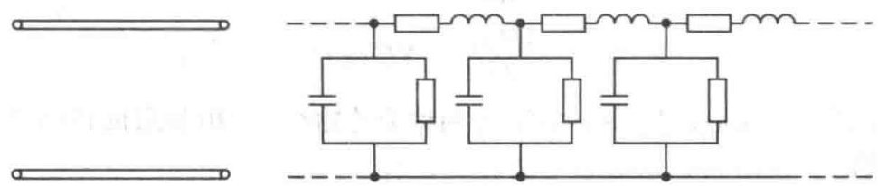{ width="640" }
<figcaption>图 7-1　均匀传输线及其分布参数等效电路（图源：教材）</figcaption>
</figure>

取坐标原点在**负载端**、$z$ 轴由负载指向信号源（图 7-2），任取一小段 $\Delta z$，它可以看作由 $R_0\Delta z$、$L_0\Delta z$、$G_0\Delta z$、$C_0\Delta z$ 组成的集总参数网络，对它用基尔霍夫定律。

<figure markdown>
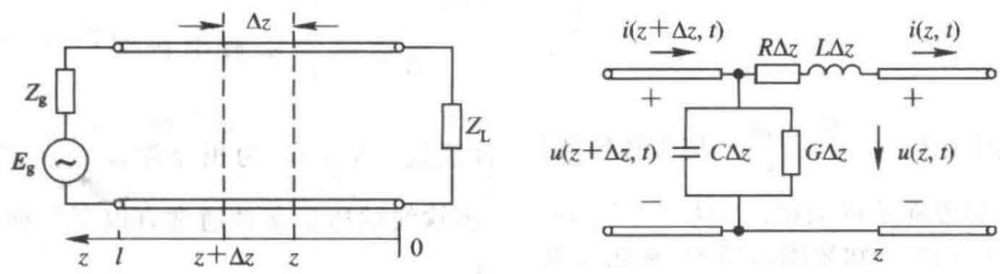{ width="720" }
<figcaption>图 7-2　传输线系统（左，原点在负载处，$z$ 指向电源）与长为 $\Delta z$ 的微分段的等效电路（右）（图源：教材）</figcaption>
</figure>

$$u(z+\Delta z,t)-u(z,t)=R_0\Delta z\,i(z,t)+L_0\Delta z\frac{\partial i(z,t)}{\partial t},\qquad i(z+\Delta z,t)-i(z,t)=G_0\Delta z\,u(z,t)+C_0\Delta z\frac{\partial u(z,t)}{\partial t}.$$

除以 $\Delta z$ 并令 $\Delta z\to0$：

!!! theorem "定理 7.1（传输线方程 / 电报方程）"

    $$\frac{\partial u}{\partial z}=R_0\,i+L_0\frac{\partial i}{\partial t},\qquad\frac{\partial i}{\partial z}=G_0\,u+C_0\frac{\partial u}{\partial t}.$$

    对角频率为 $\omega$ 的时谐信号，用复振幅（相量）$u(z,t)=\Re[U(z)\mathrm e^{\je\omega t}]$、$i(z,t)=\Re[I(z)\mathrm e^{\je\omega t}]$，得**时谐传输线方程**

    $$\frac{\dd U}{\dd z}=ZI,\qquad\frac{\dd I}{\dd z}=YU,\qquad Z=R_0+\je\omega L_0,\ \ Y=G_0+\je\omega C_0,$$

    $Z$、$Y$ 分别是单位长度的串联阻抗和并联导纳。

（相量就是复数的指数形式，$\Re[\,\cdot\,]$ 与求导可以交换，见[复变函数 第 1 章](https://cockroach-f.github.io/complex-functions/ch1.html)。注意 $z$ 指向电源，所以方程右边没有负号。）

消去 $I$ 得 $\dfrac{\dd^2U}{\dd z^2}=\gamma^2U$，$\gamma^2=ZY$。这是常系数二阶线性方程，通解是两个指数函数的组合：

!!! theorem "定理 7.2（传输线方程的通解）"

    $$U(z)=A_1\mathrm e^{\gamma z}+A_2\mathrm e^{-\gamma z},\qquad I(z)=\frac{1}{Z_0}\left(A_1\mathrm e^{\gamma z}-A_2\mathrm e^{-\gamma z}\right),$$

    $$\gamma=\sqrt{(R_0+\je\omega L_0)(G_0+\je\omega C_0)}=\alpha+\je\beta,\qquad Z_0=\sqrt{\frac{R_0+\je\omega L_0}{G_0+\je\omega C_0}}.$$

    $A_1$、$A_2$ 由边界条件确定。若已知终端电压 $U_L$、电流 $I_L$（$z=0$）：$A_1=\frac12(U_L+I_LZ_0)$，$A_2=\frac12(U_L-I_LZ_0)$，于是

    $$\begin{bmatrix}U(z)\\ I(z)\end{bmatrix}=\begin{bmatrix}\cosh\gamma z&Z_0\sinh\gamma z\\ \dfrac{1}{Z_0}\sinh\gamma z&\cosh\gamma z\end{bmatrix}\begin{bmatrix}U_L\\ I_L\end{bmatrix}.$$

边界条件常见三种：已知始端 $U_i,I_i$；已知终端 $U_L,I_L$；已知信号源 $E_g,Z_g$ 和负载 $Z_L$。上面的矩阵就是一段传输线的 **$ABCD$ 矩阵**，多段级联时矩阵依次相乘。

### 7.1.2 传输线方程解的分析

令 $\gamma=\alpha+\je\beta$，为简单设 $A_1,A_2,Z_0$ 为实数，写出瞬时值：

$$u(z,t)=\underbrace{A_1\mathrm e^{\alpha z}\cos(\omega t+\beta z)}_{u_+:\ \text{入射波}}+\underbrace{A_2\mathrm e^{-\alpha z}\cos(\omega t-\beta z)}_{u_-:\ \text{反射波}},\qquad i=\frac{1}{Z_0}(u_+-u_-).$$

- 第一项的等相位点满足 $\omega t+\beta z=$ 常数，$t$ 增大时 $z$ 减小：这是从电源**向负载**（$-z$ 方向）传播的**入射波**；第二项是从负载**向电源**传播的**反射波**。
- 两者都是**行波**，传播中振幅按 $\mathrm e^{-\alpha\cdot(\text{传播距离})}$ 衰减：$\alpha$ 为**衰减常数**（Np/m，$1\ \mathrm{Np}=8.686\ \mathrm{dB}$），相位每米变化 $\beta$：$\beta$ 为**相位常数**（rad/m）。
- 反射波电流前面有负号：电流的参考方向是固定的，而反射波的功率是反向流动的。

这与第 6 章平面波垂直入射到分界面上的入射、反射完全一样：负载就是“第二种媒质”，$Z_L$ 就是它的“波阻抗”。

### 7.1.3 特性阻抗与传播常数

!!! definition "定义 7.1（特性阻抗）"

    $$Z_0=\sqrt{\frac{R_0+\je\omega L_0}{G_0+\je\omega C_0}}=\frac{U_+}{I_+}=-\frac{U_-}{I_-},$$

    即传输线上**单向行波**的电压与电流之比。它只由传输线本身（截面结构与媒质）决定，与负载、信号源都无关，故称“特性”阻抗。

- **无耗线**（$R_0=G_0=0$）：$Z_0=\sqrt{L_0/C_0}$，是与频率无关的实数。
- **低耗线**（$R_0\ll\omega L_0$，$G_0\ll\omega C_0$）：$Z_0\approx\sqrt{L_0/C_0}$，近似为实数。

!!! definition "定义 7.2（传播常数）"

    $$\gamma=\sqrt{(R_0+\je\omega L_0)(G_0+\je\omega C_0)}=\alpha+\je\beta .$$

    无耗线 $\gamma=\je\beta$，$\beta=\omega\sqrt{L_0C_0}$；低耗线

    $$\alpha\approx\frac12\left(\frac{R_0}{Z_0}+G_0Z_0\right)=\alpha_c+\alpha_d,\qquad\beta\approx\omega\sqrt{L_0C_0}.$$

**推导低耗近似。** $\gamma=\je\omega\sqrt{L_0C_0}\left(1+\dfrac{R_0}{\je\omega L_0}\right)^{1/2}\left(1+\dfrac{G_0}{\je\omega C_0}\right)^{1/2}\approx\je\omega\sqrt{L_0C_0}\left[1+\dfrac{1}{2\je\omega}\left(\dfrac{R_0}{L_0}+\dfrac{G_0}{C_0}\right)\right]$，实部就是 $\dfrac12\left(R_0\sqrt{\dfrac{C_0}{L_0}}+G_0\sqrt{\dfrac{L_0}{C_0}}\right)$。$\alpha_c=R_0/(2Z_0)$ 来自导体损耗，$\alpha_d=G_0Z_0/2$ 来自介质损耗（7.4 节）。

!!! info "直觉：无失真线"

    一般情况下 $\alpha$、$\beta/\omega$ 都随频率变化，宽带信号的各频率分量衰减和延迟不同，波形会失真（色散）。若满足 **$R_0/L_0=G_0/C_0$**（亥维赛条件），则 $\gamma=\sqrt{R_0G_0}+\je\omega\sqrt{L_0C_0}$，$Z_0=\sqrt{L_0/C_0}$：衰减与频率无关、相速为常数，信号只衰减不变形。早年长途电话线上加“加感线圈”增大 $L_0$，就是为了逼近这个条件。

!!! example "例题 7.1（由截面尺寸求同轴线的特性参数）"

    第 2 章例题中的同轴电缆：内导体半径 $a=0.45$ mm，外导体内半径 $b=1.47$ mm，聚乙烯填充 $\varepsilon_r=2.3$。求无耗时的 $Z_0$、相速和 1 GHz 时线上的波长。

    **解。** 由第 2、4 章，$C_0=\dfrac{2\pi\varepsilon}{\ln(b/a)}$，$L_0=\dfrac{\mu_0}{2\pi}\ln\dfrac ba$，

    $$Z_0=\sqrt{\frac{L_0}{C_0}}=\frac{1}{2\pi}\sqrt{\frac{\mu_0}{\varepsilon}}\ln\frac ba=\frac{60}{\sqrt{\varepsilon_r}}\ln\frac ba=\frac{60}{1.517}\times1.184\approx46.8\ \Omega ,$$

    $$v_p=\frac{1}{\sqrt{L_0C_0}}=\frac{c}{\sqrt{\varepsilon_r}}\approx0.66c=1.98\times10^8\ \mathrm{m/s},\qquad\lambda_g=\frac{v_p}{f}\approx19.8\ \mathrm{cm}.$$

    这就是常说的“50 Ω 电缆、速度因子 0.66”。

### 7.1.4 反射系数与输入阻抗

以下若无特别说明都讨论**无耗线**，$\gamma=\je\beta$，$Z_0$ 为实数。

**1. 反射系数**

!!! definition "定义 7.3（反射系数）"

    线上任一点 $z$ 处反射波电压与入射波电压之比：

    $$\Gamma(z)=\frac{U_r(z)}{U_i(z)}=-\frac{I_r(z)}{I_i(z)}=\frac{A_2\mathrm e^{-\je\beta z}}{A_1\mathrm e^{\je\beta z}}=\Gamma_L\,\mathrm e^{-\je2\beta z},$$

    $$\Gamma_L=\frac{Z_L-Z_0}{Z_L+Z_0}=|\Gamma_L|\mathrm e^{\je\phi_L}\quad\text{（终端反射系数）}.$$

    于是 $U(z)=A_1\mathrm e^{\je\beta z}[1+\Gamma(z)]$，$I(z)=\dfrac{A_1}{Z_0}\mathrm e^{\je\beta z}[1-\Gamma(z)]$。

- 无耗线上 $|\Gamma(z)|=|\Gamma_L|$ 处处相同，只有相位 $\phi_L-2\beta z$ 随位置变化，周期 $\lambda/2$：**$\lambda/2$ 重复性**。
- $Z_L=Z_0$（**负载匹配**）：$\Gamma_L=0$，无反射，负载吸收全部入射功率。
- $Z_L=0$（短路）、$Z_L\to\infty$（开路）、$Z_L=\je X$（纯电抗）：$|\Gamma_L|=1$，**全反射**，负载不吸收功率。
- 其他负载：$0<|\Gamma_L|<1$，部分吸收、部分反射。无源负载（$\Re Z_L\ge0$）总有 $|\Gamma_L|\le1$。

<figure class="video" markdown>
<video controls preload="metadata" width="100%" poster="assets/posters/C7_Gamma.jpg"><source src="assets/videos/C7_Gamma.mp4" type="video/mp4"></video>
<figcaption>动画 7-1　反射系数在 $\Gamma$ 平面上顺时针转圈（离负载越远转得越多，$\lambda/2$ 一圈）。$|U|\propto|1+\Gamma|$ 是 $\Gamma$ 点到 $-1$ 的距离，$|I|\propto|1-\Gamma|$ 是到 $+1$ 的距离；由此读出驻波包络、波腹、波节和驻波比。</figcaption>
</figure>

**2. 输入阻抗**

!!! theorem "定理 7.3（无耗线的输入阻抗）"

    线上任一点的电压与电流之比称为该点向负载看去的**输入阻抗**：

    $$Z_{\mathrm{in}}(z)=\frac{U(z)}{I(z)}=Z_0\frac{Z_L+\je Z_0\tan\beta z}{Z_0+\je Z_L\tan\beta z}=Z_0\frac{1+\Gamma(z)}{1-\Gamma(z)} .$$

    反过来 $\Gamma(z)=\dfrac{Z_{\mathrm{in}}(z)-Z_0}{Z_{\mathrm{in}}(z)+Z_0}$。$Z_0$ 一定时，$Z_{\mathrm{in}}$ 与 $\Gamma$ 一一对应。

**证明。** 取 $\gamma=\je\beta$，$\cosh\je\beta z=\cos\beta z$，$\sinh\je\beta z=\je\sin\beta z$，由定理 7.2 的矩阵式

$$U(z)=U_L\cos\beta z+\je I_LZ_0\sin\beta z,\qquad I(z)=I_L\cos\beta z+\je\frac{U_L}{Z_0}\sin\beta z ,$$

两式相除，分子分母同除 $I_L\cos\beta z$，并用 $U_L=I_LZ_L$ 即得。

输入阻抗与位置、$Z_0$、$Z_L$ 和频率都有关，一般是复数。两个立即可得的特例：

- **$\lambda/2$ 重复性**：$\tan\beta(z+\lambda/2)=\tan\beta z$，故 $Z_{\mathrm{in}}(z+\lambda/2)=Z_{\mathrm{in}}(z)$；
- **$\lambda/4$ 变换性**：$\tan\beta z\to\infty$ 时 $Z_{\mathrm{in}}(\lambda/4)=\dfrac{Z_0^2}{Z_L}$。一般地，无耗线上任意相距 $\lambda/4$ 的两点，$Z_{\mathrm{in}}(z)\,Z_{\mathrm{in}}(z+\lambda/4)=Z_0^2$（因为 $\Gamma$ 恰好变号，$\dfrac{1+\Gamma}{1-\Gamma}\cdot\dfrac{1-\Gamma}{1+\Gamma}=1$）。

**3. 驻波比**

入射波与反射波同相处电压振幅最大，反相处最小：

$$|U|_{\max}=|U_i|(1+|\Gamma_L|),\qquad|U|_{\min}=|U_i|(1-|\Gamma_L|).$$

!!! definition "定义 7.4（电压驻波比与行波系数）"

    $$\rho=\mathrm{VSWR}=\frac{|U|_{\max}}{|U|_{\min}}=\frac{1+|\Gamma_L|}{1-|\Gamma_L|},\qquad K=\frac1\rho,\qquad|\Gamma_L|=\frac{\rho-1}{\rho+1}.$$

    $1\le\rho<\infty$，$0\le K\le1$。匹配时 $\rho=1$；全反射时 $\rho\to\infty$。驻波比可以用测量线直接测出，但不含相位信息，工程上用它衡量匹配程度。

!!! success "关键公式：三个状态参量的换算"

    $$\Gamma_L=\frac{Z_L-Z_0}{Z_L+Z_0},\qquad\Gamma(z)=\Gamma_L\mathrm e^{-\je2\beta z},\qquad Z_{\mathrm{in}}=Z_0\frac{1+\Gamma}{1-\Gamma},\qquad\rho=\frac{1+|\Gamma|}{1-|\Gamma|}.$$

!!! warning "易错点：坐标方向与反射系数的相位"

    本章 $z$ 从**负载**量起、指向电源，所以 $\Gamma(z)=\Gamma_L\mathrm e^{-\je2\beta z}$，离负载越远相位越**滞后**（圆图上顺时针）。有的书把原点放在电源端、$z$ 指向负载，写成 $\Gamma(z)=\Gamma_L\mathrm e^{\je2\beta(z-l)}$，内容相同。做题前先看清坐标；无论哪种写法，**“向电源走 = 顺时针”**都不变。

### 7.1.5 相速与传输线波长

!!! definition "定义 7.5（相速与线上波长）"

    $$v_p=\frac\omega\beta=\frac{1}{\sqrt{L_0C_0}},\qquad\lambda_g=\frac{2\pi}{\beta}=\frac{v_p}{f}=\frac{\lambda_0}{\sqrt{\varepsilon_r}},$$

    $\lambda_0$ 为自由空间波长，$\varepsilon_r$ 为线间填充介质的相对介电常数（$\mu_r=1$）。

由于 TEM 线 $L_0C_0=\mu\varepsilon$，$v_p=1/\sqrt{\mu\varepsilon}$——与第 6 章同一介质中平面波的相速完全相同。线上波长比自由空间缩短 $\sqrt{\varepsilon_r}$ 倍，工程上用高 $\varepsilon_r$ 基片来缩小微波元件的尺寸。

---

## 7.2 传输线的等效

负载不同，反射波不同，线上合成波的样子就不同。按 $|\Gamma_L|$ 可以分成三种工作状态：

| 状态 | 负载 | $\lvert\Gamma_L\rvert$ | $\rho$ | 沿线振幅 | 功率 |
|---|---|---|---|---|---|
| 行波 | $Z_L=Z_0$ | 0 | 1 | 处处相等 | 全部被负载吸收 |
| 纯驻波 | 短路、开路、纯电抗 | 1 | $\infty$ | 正弦分布，有零点（波节） | 不传输，只在线上来回交换 |
| 行驻波 | 其他 | $(0,1)$ | $(1,\infty)$ | 有最大最小但不为零 | 部分吸收、部分反射 |

<figure class="video" markdown>
<video controls preload="metadata" width="100%" poster="assets/posters/C7_Waves.jpg"><source src="assets/videos/C7_Waves.mp4" type="video/mp4"></video>
<figcaption>动画 7-2　三种工作状态：匹配负载上的行波向负载“跑”；短路负载把入射波全部反射回来，两者叠成原地振荡的纯驻波（波节固定）；$Z_L=3Z_0$ 时部分反射，形成行驻波，$\rho=3$。</figcaption>
</figure>

**纯驻波的表达式。** 以终端短路为例，$\Gamma_L=-1$，$U_L=0$：

$$U(z)=\je2A_1\sin\beta z,\qquad I(z)=\frac{2A_1}{Z_0}\cos\beta z,\qquad u(z,t)=-2|A_1|\sin\beta z\sin\omega t .$$

电压、电流在时间和空间上都相差 $90^\circ$，$\frac12\Re(UI^*)=0$：没有净功率流动，电能和磁能在相邻的 $\lambda/4$ 段之间来回交换。

### 7.2.1 行驻波状态

设 $\Gamma_L=|\Gamma_L|\mathrm e^{\je\phi_L}$，驻波比为 $\rho$。由 $|U(z)|=|A_1|\,|1+|\Gamma_L|\mathrm e^{\je(\phi_L-2\beta z)}|$：

!!! theorem "定理 7.4（行驻波的波腹与波节）"

    (1) **电压波腹**（电流波节）在 $\phi_L-2\beta z=-2n\pi$ 处：

    $$z_{\max}=\frac{\lambda}{4\pi}\phi_L+n\frac\lambda2,\qquad|U|_{\max}=|A_1|(1+|\Gamma_L|),\qquad R_{\max}=Z_0\frac{1+|\Gamma_L|}{1-|\Gamma_L|}=Z_0\rho .$$

    (2) **电压波节**（电流波腹）在 $\phi_L-2\beta z=-(2n+1)\pi$ 处：

    $$z_{\min}=\frac{\lambda}{4\pi}\phi_L+(2n+1)\frac\lambda4,\qquad|U|_{\min}=|A_1|(1-|\Gamma_L|),\qquad R_{\min}=\frac{Z_0}{\rho}.$$

    $n=0,1,2,\cdots$（$\phi_L$ 取 $[0,2\pi)$）。波腹与波节相距 $\lambda/4$，两处阻抗都是**纯电阻**，且 $R_{\max}R_{\min}=Z_0^2$。

波腹、波节处阻抗为纯电阻，是因为那里 $\Gamma$ 为实数。这两个位置是测量和匹配的“抓手”：测出 $\rho$ 和第一个波节位置，就能反推负载（例题 7.3）；在波腹或波节处接入 $\lambda/4$ 变换器，就能匹配复数负载（7.7 节）。

<figure markdown>
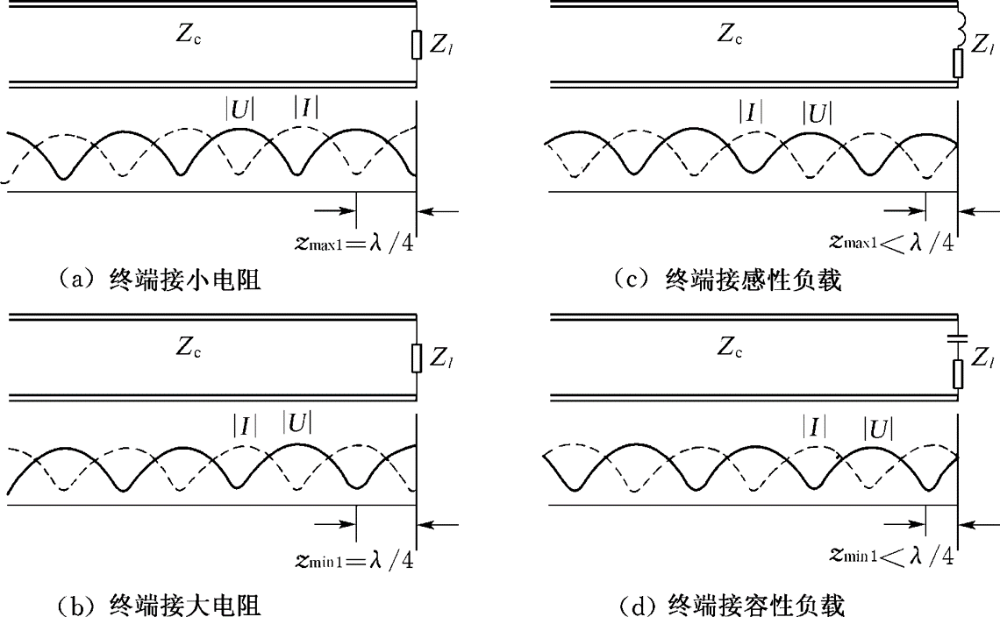{ width="720" }
<figcaption>图 7-A　四种负载的行驻波：$R_L<Z_0$ 时负载处为电压波节，$R_L>Z_0$ 时为电压波腹；感性负载的第一个电压波腹、容性负载的第一个电压波节都在离负载不到 $\lambda/4$ 处。坐标从负载量起（图源：上海交大何广强《电磁场与波》课件）</figcaption>
</figure>

<figure markdown>
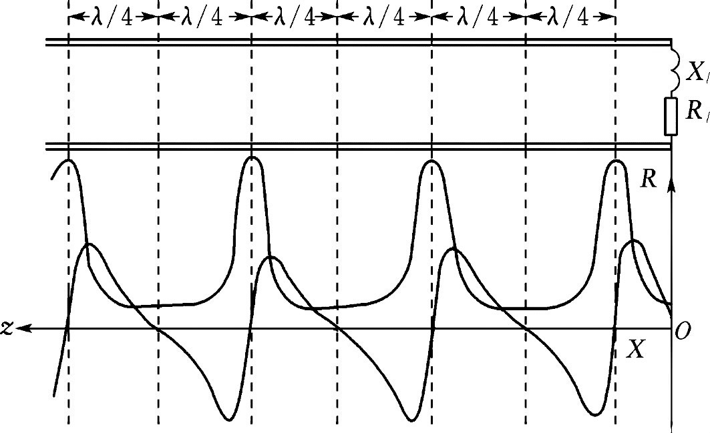{ width="700" }
<figcaption>图 7-B　任意负载沿线的输入电阻 $R$ 与电抗 $X$：每经过 $\lambda/4$，$R$ 达到一次极大或极小（对应电压波腹或波节，该处 $X=0$），$X$ 则在正负之间交替变化，周期为 $\lambda/2$（图源：上海交大何广强《电磁场与波》课件）</figcaption>
</figure>

!!! example "例题 7.2（负载上的状态参量）"

    $Z_0=50\ \Omega$ 的无耗线接负载 $Z_L=(25+\je50)\ \Omega$。求 $\Gamma_L$、$\rho$、第一个电压波腹和波节的位置及其阻抗，以及距负载 $\lambda/8$ 处的输入阻抗。

    **解。**

    $$\Gamma_L=\frac{-25+\je50}{75+\je50}=\frac{(-25+\je50)(75-\je50)}{75^2+50^2}=0.077+\je0.615=0.620\,\mathrm e^{\je82.9^\circ},\qquad\rho=\frac{1.620}{0.380}=4.27 .$$

    $\phi_L=82.9^\circ=1.446$ rad：$z_{\max1}=\dfrac{1.446}{4\pi}\lambda=0.115\lambda$，$R_{\max}=50\times4.27=213\ \Omega$；$z_{\min1}=0.115\lambda+0.25\lambda=0.365\lambda$，$R_{\min}=50/4.27=11.7\ \Omega$。

    $\lambda/8$ 处 $\tan\beta z=1$：

    $$Z_{\mathrm{in}}=50\frac{25+\je50+\je50}{50+\je(25+\je50)}=50\frac{25+\je100}{\je25}=(200-\je50)\ \Omega .$$

    （负载是感性的，$\Gamma_L$ 在上半平面，向电源先到达正实轴，所以先遇到电压波腹。）

!!! example "例题 7.3（由驻波测量确定负载，教材习题 7.3、7.6）"

    $Z_0=50\ \Omega$ 的无耗线上测得 $|U|_{\max}=100$ mV，$|U|_{\min}=20$ mV，第一个电压波节离负载 $l_{\min1}=\lambda/3$。求 $Z_L$。

    **解。** 先推一般公式。波节处 $Z_{\mathrm{in}}=Z_0/\rho$，它是“负载经过长 $l_{\min1}$ 的线变换”的结果；反过来，负载是波节阻抗**向负载方向**移动 $l_{\min1}$ 的结果，在输入阻抗公式中把 $z$ 换成 $-l_{\min1}$：

    $$Z_L=Z_0\frac{Z_0/\rho-\je Z_0\tan\beta l_{\min1}}{Z_0-\je(Z_0/\rho)\tan\beta l_{\min1}}=Z_0\frac{1-\je\rho\tan\beta l_{\min1}}{\rho-\je\tan\beta l_{\min1}} .$$

    代入 $\rho=100/20=5$，$\tan(2\pi/3)=-\sqrt3$：

    $$Z_L=50\times\frac{1+\je5\sqrt3}{5+\je\sqrt3}=50\times(0.714+\je1.485)\approx(35.7+\je74.2)\ \Omega=82.4\angle64.3^\circ\ \Omega .$$

### 7.2.2 传输线的等效

**1. 等效电感与等效电容**

在输入阻抗公式中分别令 $Z_L=0$、$Z_L\to\infty$：

!!! theorem "定理 7.5（短路线与开路线的输入阻抗）"

    $$\text{短路线：}\ Z_{\mathrm{in}}=\je Z_0\tan\beta l,\qquad\text{开路线：}\ Z_{\mathrm{in}}=-\je Z_0\cot\beta l .$$

    都是**纯电抗**，随长度在感性与容性之间交替：

    | 长度 $l$ | 短路线 | 开路线 |
    |---|---|---|
    | $0<l<\lambda/4$ | 电感 | 电容 |
    | $l=\lambda/4$ | 开路（并联谐振） | 短路（串联谐振） |
    | $\lambda/4<l<\lambda/2$ | 电容 | 电感 |
    | $l=\lambda/2$ | 短路（串联谐振） | 开路（并联谐振） |

<figure class="video" markdown>
<video controls preload="metadata" width="100%" poster="assets/posters/C7_Stub.jpg"><source src="assets/videos/C7_Stub.mp4" type="video/mp4"></video>
<figcaption>动画 7-3　短路线的输入电抗 $X_{\mathrm{in}}/Z_0=\tan\beta l$ 随长度变化：$\lambda/4$ 以内是电感，$\lambda/4$ 处并联谐振，再往后变成电容；开路线的曲线正好平移 $\lambda/4$。</figcaption>
</figure>

<figure markdown>
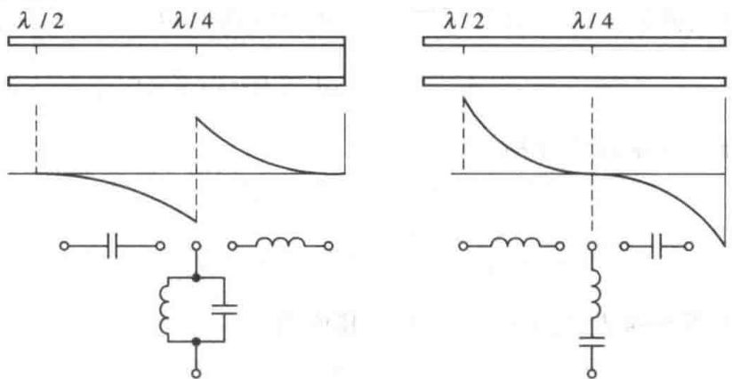{ width="620" }
<figcaption>图 7-5　短路线（左）与开路线（右）沿线输入电抗的变化及等效元件（图源：教材）</figcaption>
</figure>

<figure markdown>
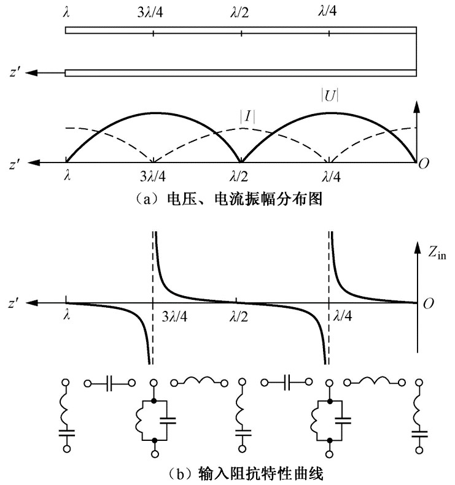{ width="480" }
<figcaption>图 7-C　终端短路：$|U|$、$|I|$ 沿正弦分布，负载处为电压波节、电流波腹；对应的输入电抗在每个 $\lambda/4$ 段分别等效为电感、并联谐振、电容、串联谐振（图源：上海交大何广强《电磁场与波》课件）</figcaption>
</figure>

<figure markdown>
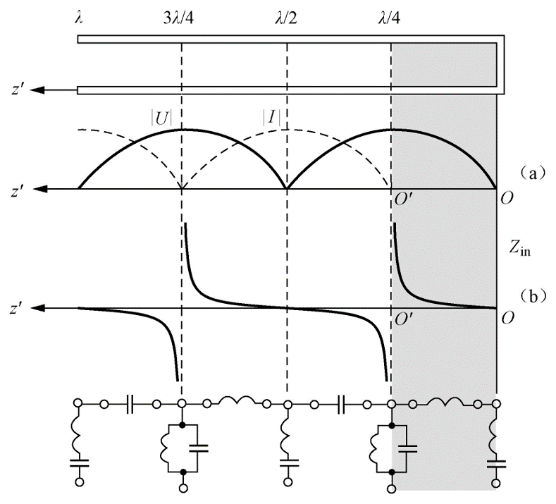{ width="480" }
<figcaption>图 7-D　终端开路：分布比短路线平移了 $\lambda/4$（阴影段），负载处为电压波腹、电流波节；输入阻抗的性质也整体平移 $\lambda/4$（图源：上海交大何广强《电磁场与波》课件）</figcaption>
</figure>

所以 $l<\lambda/4$ 的短路线可以代替感抗为 $X_L$ 的电感，开路线可以代替容抗为 $X_C$ 的电容，所需长度

$$l_{\mathrm{sc}}=\frac{\lambda}{2\pi}\arctan\frac{X_L}{Z_0},\qquad l_{\mathrm{oc}}=\frac{\lambda}{2\pi}\operatorname{arccot}\frac{X_C}{Z_0}.$$

在微波频段，集总电感、电容的寄生参数太大，常用这种短截线代替。

**2. 谐振元件**

$\lambda/4$ 短路线在谐振频率附近的输入阻抗很大，与并联 $LC$ 谐振电路的行为相同，可用作并联谐振电路；$\lambda/4$ 开路线、$\lambda/2$ 短路线则相当于串联谐振电路。它们与集总谐振电路一样有 $Q$ 值和带宽。

<figure markdown>
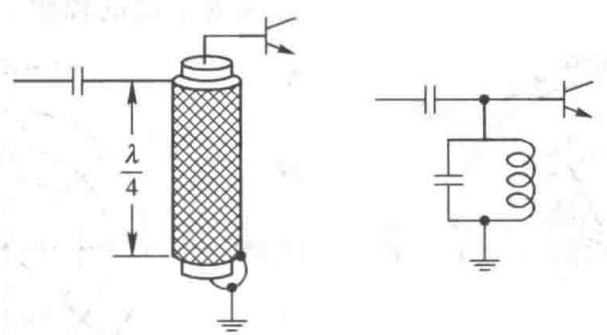{ width="460" }
<figcaption>图 7-6　$\lambda/4$ 短路同轴线用作振荡器的并联谐振回路及其等效电路（图源：教材）</figcaption>
</figure>

<figure markdown>
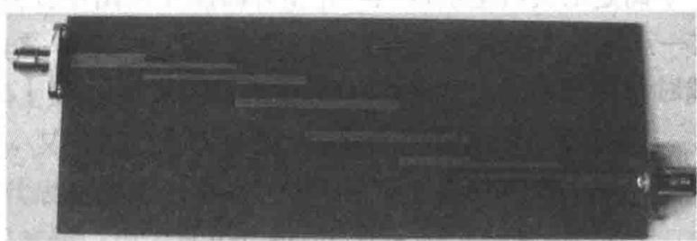{ width="520" }
<figcaption>图 7-7　用 $\lambda/4$ 开路线构成的微带带通滤波器实物（图源：教材）</figcaption>
</figure>

!!! example "例题 7.4（短路线谐振，教材习题 7.12）"

    特性阻抗 300 Ω 的短路线要与推挽功率放大器 5 pF 的输出电容谐振，谐振频率 300 MHz。求短路线的最短长度（空气线）。

    **解。** 谐振要求短路线提供的感抗与电容的容抗相等：

    $$Z_0\tan\beta l=\frac{1}{\omega C}=\frac{1}{2\pi\times3\times10^8\times5\times10^{-12}}=106.1\ \Omega,$$

    $\lambda=1$ m，$l=\dfrac{\lambda}{2\pi}\arctan\dfrac{106.1}{300}=\dfrac{0.340}{2\pi}\ \mathrm m\approx5.41\ \mathrm{cm}$。

---

## 7.3 史密斯圆图及其应用

用输入阻抗公式手算 $\tan$ 和复数除法很繁琐。**史密斯圆图**（Smith Chart）把归一化阻抗和反射系数画在同一张图上，查图就能完成换算，概念直观，至今仍是射频工程和矢量网络分析仪的标准显示方式。

**出发点。** 定义归一化阻抗 $\bar Z=\dfrac{Z_{\mathrm{in}}}{Z_0}=r+\je x$，由定理 7.3

$$\Gamma=\frac{\bar Z-1}{\bar Z+1}=\Gamma_u+\je\Gamma_v .$$

**反射系数圆。** 无耗线上 $\Gamma(z)=|\Gamma_L|\mathrm e^{\je(\phi_L-2\beta z)}$：$|\Gamma|$ 不变，点在以原点为圆心、半径 $|\Gamma_L|$ 的圆上转动。向电源走 $z$ 增大、辐角减小——**顺时针**；向负载走——**逆时针**；每走 $\lambda/2$ 转一周。$|\Gamma|\le1$，所以整张图落在单位圆内。圆图外圈通常刻有“向电源”“向负载”两圈电长度（以波长为单位）。

**阻抗圆。** 由 $\bar Z=\dfrac{1+\Gamma}{1-\Gamma}$，分开实部、虚部：

!!! theorem "定理 7.6（等电阻圆与等电抗圆）"

    $$\left(\Gamma_u-\frac{r}{1+r}\right)^2+\Gamma_v^2=\left(\frac{1}{1+r}\right)^2,\qquad(\Gamma_u-1)^2+\left(\Gamma_v-\frac1x\right)^2=\left(\frac1x\right)^2 .$$

    - **等电阻圆**：圆心 $\left(\dfrac{r}{1+r},0\right)$，半径 $\dfrac{1}{1+r}$。$r=0$ 是单位圆本身，$r\to\infty$ 缩成点 $(1,0)$；所有等电阻圆都在 $(1,0)$ 处相切。
    - **等电抗圆**：圆心 $\left(1,\dfrac1x\right)$，半径 $\dfrac{1}{|x|}$。$x>0$ 在上半平面，$x<0$ 在下半平面，$x=0$ 是实轴，$x\to\pm\infty$ 缩成点 $(1,0)$。

    把反射系数圆、等电阻圆、等电抗圆画在一起就是**阻抗圆图**（史密斯圆图）。

!!! info "直觉：史密斯圆图就是一个分式线性映射"

    $\Gamma=\dfrac{\bar Z-1}{\bar Z+1}$ 是复变函数中的**分式线性映射**（默比乌斯变换）。它的性质直接给出圆图的样子（见[复变函数 第 6 章 共形映射](https://cockroach-f.github.io/complex-functions/ch6.html)）：

    - **把右半平面映成单位圆盘**：$\bar Z=\je x$（虚轴）$\mapsto|\Gamma|=1$，$\bar Z=1\mapsto\Gamma=0$。这正是“无源负载 $r\ge0$ 一定 $|\Gamma|\le1$”。
    - **保圆性**：$\bar Z$ 平面上的直线 $r=$ 常数、$x=$ 常数映成圆（或圆弧），所以等电阻线、等电抗线都变成了圆。
    - **保角性**：$r$ 线与 $x$ 线原来正交，映射后的圆也处处正交。
    - $\bar Z\to1/\bar Z$（阻抗变导纳）对应 $\Gamma\to-\Gamma$，即绕圆心转 $180^\circ$——导纳圆图就是阻抗圆图转半圈。

    推导定理 7.6 的两族圆方程，本质上就是在验证保圆性。

<figure class="video" markdown>
<video controls preload="metadata" width="100%" poster="assets/posters/C7_Smith.jpg"><source src="assets/videos/C7_Smith.mp4" type="video/mp4"></video>
<figcaption>动画 7-4　分式线性映射 $\Gamma=(\bar Z-1)/(\bar Z+1)$ 把阻抗平面的等电阻线、等电抗线变成史密斯圆图上的圆；然后在圆图上完成例题 7.5：沿等 $\rho$ 圆顺时针转 $0.2\lambda$。</figcaption>
</figure>

!!! success "关键公式：读懂史密斯圆图"

    1. 上半圆 $x>0$ 为**感性**，下半圆 $x<0$ 为**容性**；
    2. 实轴上是纯电阻：**左半轴**是电压波节，读数 $r_{\min}=K$；**右半轴**是电压波腹，读数 $r_{\max}=\rho$；
    3. 单位圆 $|\Gamma|=1$ 上是纯电抗；左端点 $(-1,0)$ 为**短路点**，右端点 $(1,0)$ 为**开路点**，圆心 $\bar Z=1$ 为**匹配点**；
    4. 向电源**顺时针**、向负载**逆时针**，转一周 $=\lambda/2$；
    5. 整张图转 $180^\circ$ 即导纳圆图（$\bar Y=g+\je b$）。

!!! example "例题 7.5（用圆图求输入阻抗，教材例 7-1）"

    $Z_0=50\ \Omega$，$Z_L=(25+\je25)\ \Omega$，求距负载 $0.2\lambda$ 处的输入阻抗。

    **解。** $\bar Z_L=0.5+\je0.5$，在圆图上找到 $r=0.5$ 圆与 $x=0.5$ 圆的交点 $P_1$（$\Gamma_L=-0.2+\je0.4=0.447\angle116.6^\circ$）。以圆心为中心、$OP_1$ 为半径作等 $\rho$ 圆，向电源顺时针转 $0.2\lambda$（辐角减小 $2\beta z=144^\circ$）到 $P_2$，读得 $\bar Z_{\mathrm{in}}\approx1.97-\je1.01$，

    $$Z_{\mathrm{in}}(0.2\lambda)\approx(98.5-\je50.7)\ \Omega .$$

    顺便读出：等 $\rho$ 圆与正实轴交于 $r=2.62$，所以 $\rho=2.62$。用公式验算：$\rho=\dfrac{1+0.447}{1-0.447}=2.62$。

!!! example "例题 7.6（用圆图由驻波测量求负载，教材例 7-2）"

    $Z_0=50\ \Omega$ 的无耗线上测得 $\rho=5$，电压波节在 $z=\lambda/3$ 处，求负载。

    **解。** 波节处阻抗为纯电阻 $r_{\min}=K=1/\rho=0.2$，位于左半实轴。从这一点沿 $\rho=5$ 的等 $\rho$ 圆**逆时针**（向负载）转 $\lambda/3$，读得 $\bar Z_L\approx0.71+\je1.48$，$Z_L\approx(35.7+\je74.2)\ \Omega$，与例题 7.3 的解析结果一致。

---

## 7.4 传输线的效率、损耗和功率容量

实际传输线的导体和介质都有损耗，需要考虑效率、衰减和能承受的最大功率。

### 7.4.1 传输效率

设 $Z_0$ 为实数，$\gamma=\alpha+\je\beta$，$\alpha\ne0$，则

$$U(z)=A_1\left[\mathrm e^{\alpha z}\mathrm e^{\je\beta z}+\Gamma_L\mathrm e^{-\alpha z}\mathrm e^{-\je\beta z}\right],\qquad I(z)=\frac{A_1}{Z_0}\left[\mathrm e^{\alpha z}\mathrm e^{\je\beta z}-\Gamma_L\mathrm e^{-\alpha z}\mathrm e^{-\je\beta z}\right],$$

$$P(z)=\frac12\Re[U(z)I^*(z)]=\frac{|A_1|^2}{2Z_0}\mathrm e^{2\alpha z}\left[1-|\Gamma_L|^2\mathrm e^{-4\alpha z}\right].$$

（交叉项是纯虚数，不贡献有功功率：入射功率减去反射功率。）

!!! theorem "定理 7.7（传输效率）"

    长为 $l$ 的线，负载吸收功率 $P_L=P(0)$ 与始端输入功率 $P_0=P(l)$ 之比

    $$\eta=\frac{P_L}{P_0}=\frac{1-|\Gamma_L|^2}{\mathrm e^{2\alpha l}-|\Gamma_L|^2\mathrm e^{-2\alpha l}} .$$

    匹配（$\Gamma_L=0$）时效率最高 $\eta_{\max}=\mathrm e^{-2\alpha l}$；$\alpha l\ll1$ 时 $\eta\approx1-2\alpha l\,\dfrac{1+|\Gamma_L|^2}{1-|\Gamma_L|^2}$。

失配时反射波在线上来回走，额外损耗了一部分功率，所以效率下降。例如 $\alpha=0.1$ dB/m、长 10 m 的电缆（$\alpha l=1$ dB $=0.115$ Np）：匹配时 $\eta=0.794$；$|\Gamma_L|=0.5$ 时 $\eta=\dfrac{0.75}{1.259-0.25\times0.794}=0.707$。

### 7.4.2 传输线损耗

由低耗线的衰减常数，损耗分为导体损耗和介质损耗两部分：

$$\alpha=\alpha_c+\alpha_d=\frac{R_0}{2Z_0}+\frac{G_0Z_0}{2}.$$

- **导体损耗**：高频时电流挤在导体表面一个趋肤深度 $\delta=1/\sqrt{\pi f\mu\sigma}$ 内（第 6 章），单位长度电阻 $R_0=R_S/(\text{导体周长})$，$R_S=\sqrt{\pi f\mu/\sigma}$ 为表面电阻。所以 $\alpha_c\propto\sqrt f$。
- **介质损耗**：填充介质的损耗角正切为 $\tan\delta$ 时 $G_0=\omega C_0\tan\delta$，

$$\alpha_d=\frac{G_0Z_0}{2}=\frac{\omega\sqrt{L_0C_0}}{2}\tan\delta=\frac{\pi\sqrt{\varepsilon_r}}{\lambda_0}\tan\delta\quad(\mathrm{Np/m}),$$

与第 6 章低损耗介质中平面波的衰减常数相同，$\alpha_d\propto f$。

### 7.4.3 功率容量

传输线允许传输的最大功率称为**功率容量**。限制它的因素有两个：最大电压不能超过介质的击穿电压（脉冲大功率时主要受此限制）；导体和介质损耗引起的温升（连续波时主要受此限制）。设额定电压、电流为 $U_M$、$I_M$，有驻波时波腹电压是行波时的 $1+|\Gamma|$ 倍：

$$P_{\max}=\frac{U_MI_M}{2\rho}=\frac{U_M^2}{2\rho Z_0}=\frac{I_M^2Z_0}{2\rho}.$$

**驻波比越大，功率容量越小**——这是大功率系统必须做好匹配的直接原因。

---

## 7.5 双导线与同轴线

平行双导线和同轴线是最常用的两种 TEM 传输线。

<figure markdown>
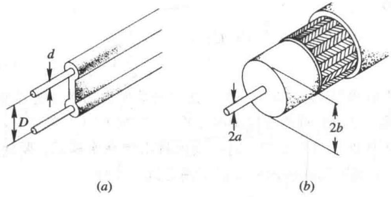{ width="560" }
<figcaption>图 7-13　平行双导线（左，直径 $d$、间距 $D$）与同轴线（右，内半径 $a$、外导体内半径 $b$）（图源：教材）</figcaption>
</figure>

**表 7-1　双导线和同轴线的分布参数**（$\sigma$ 为导体电导率，$\sigma'$ 为填充介质的漏电导率）

| | $R_0$ | $G_0$ | $L_0$ | $C_0$ |
|---|---|---|---|---|
| 平行双导线 | $\dfrac2d\sqrt{\dfrac{f\mu}{\pi\sigma}}$ | $\dfrac{\pi\sigma'}{\ln(2D/d)}$ | $\dfrac\mu\pi\ln\dfrac{2D}{d}$ | $\dfrac{\pi\varepsilon}{\ln(2D/d)}$ |
| 同轴线 | $\sqrt{\dfrac{f\mu}{4\pi\sigma}}\left(\dfrac1a+\dfrac1b\right)$ | $\dfrac{2\pi\sigma'}{\ln(b/a)}$ | $\dfrac{\mu}{2\pi}\ln\dfrac ba$ | $\dfrac{2\pi\varepsilon}{\ln(b/a)}$ |

$L_0$ 与第 4 章例题的外自感一致（高频时内自感可忽略），$C_0$、$G_0$ 与第 2 章一致（静电比拟 $G_0/C_0=\sigma'/\varepsilon$）。

**平行双导线**（$D\gg d$）：

$$Z_0=\frac1\pi\sqrt{\frac\mu\varepsilon}\ln\frac{2D}{d}=\frac{120}{\sqrt{\varepsilon_r}}\ln\frac{2D}{d}\ \ \Omega ,$$

常用值 250～600 Ω（如电视天线的 300 Ω 扁馈线）。双线是开放结构，频率升高后辐射损耗增大，只适用于较低频率（电话线、对绞网线是它的变形）。

**同轴线**：

$$Z_0=\frac{1}{2\pi}\sqrt{\frac\mu\varepsilon}\ln\frac ba=\frac{60}{\sqrt{\varepsilon_r}}\ln\frac ba\ \ \Omega .$$

外导体把场完全封闭在内部（第 4 章的“自屏蔽”），辐射和外界干扰都很小，广泛用于电视、移动通信、雷达和测试系统。硬同轴线用铜管做外导体，软同轴线（同轴电缆）用铜丝编织网。常用 50 Ω 和 75 Ω 两种标准。

**功率容量。** 无耗行波 $U(z)=U_0\mathrm e^{-\je\beta z}$（此处取 $+z$ 为传播方向），$I=U/Z_0$，

$$P=\frac12\Re(UI^*)=\frac{U_0^2}{2Z_0}=\frac{\pi U_0^2}{\sqrt{\mu/\varepsilon}\,\ln(b/a)} .$$

$U_0$ 取击穿电压时就是功率容量。

!!! example "例题 7.7（同轴线的最佳尺寸，教材习题 7.13）"

    空气同轴线外导体内半径 $b=20$ mm。分别求耐压最高、传输功率最大、衰减最小时的内导体半径 $a$。

    **解。** 内导体表面场强最大：$E_{\max}=\dfrac{U}{a\ln(b/a)}$。设空气击穿场强为 $E_{br}$。

    (1) **耐压最高**：$U_{br}=E_{br}\,a\ln(b/a)$，对 $a$ 求极值 $\ln(b/a)-1=0$，$b/a=\mathrm e=2.718$，$a=7.36$ mm（$Z_0=60\ \Omega$）。

    (2) **功率最大**：$P_{br}=\dfrac{U_{br}^2}{2Z_0}\propto\dfrac{a^2\ln^2(b/a)}{\ln(b/a)}=a^2\ln(b/a)$，极值条件 $2\ln(b/a)-1=0$，$b/a=\sqrt{\mathrm e}=1.65$，$a=12.1$ mm（$Z_0=30\ \Omega$）。

    (3) **衰减最小**：$\alpha_c=\dfrac{R_0}{2Z_0}\propto\dfrac{1/a+1/b}{\ln(b/a)}$，令 $x=b/a$，求 $\dfrac{1+x}{\ln x}$ 的极小值，得 $x\ln x=1+x$，$x\approx3.59$，$a=5.57$ mm（$Z_0\approx77\ \Omega$）。

    三个要求不能同时满足。**50 Ω** 是耐压、功率容量和衰减的折中，用作通用标准；**75 Ω** 接近衰减最小，用于长距离传输（有线电视）。

**单模条件。** 以上分析假定同轴线只传 TEM 模。截面尺寸与波长可比时会出现高次模（最低的是 TE$_{11}$ 模，截止波长 $\lambda_c\approx\pi(a+b)$），所以要求

$$\lambda_{\min}>\pi(a+b).$$

选尺寸时既要满足阻抗、功率、损耗要求，又要保证单模工作。电缆之间用同轴连接头（N 型、SMA 型、BNC 型等）连接，连接处的电气和机械尺寸也要匹配，否则会引入反射。

---

## 7.6 微带传输线

**微带线**由介质基片一面的金属导带和另一面的接地板构成。它可以看作双导线的演化：在双导线的对称面插一块无限薄的导体板（板与电力线垂直，不影响场分布），去掉一半，再把圆导线压扁成导带、在导带与接地板之间填上介质。微带线剖面低、易集成、加工一致性好，是微波集成电路和高速 PCB 的基本结构。

<figure markdown>
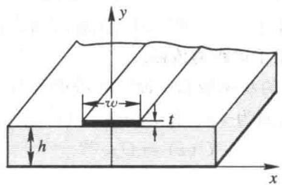{ width="420" }
<figcaption>图 7-15　微带线：导带宽 $w$、厚 $t$，基片厚 $h$、相对介电常数 $\varepsilon_r$（图源：教材）</figcaption>
</figure>

常用基片：氧化铝陶瓷（$\varepsilon_r=9.5\sim10$，$\tan\delta=0.0003$），聚四氟乙烯（$\varepsilon_r=2.1$，$\tan\delta=0.0004$），聚四氟乙烯玻璃纤维板（$\varepsilon_r=2.55$，$\tan\delta=0.008$）；12 GHz 以上可用石英。

**准 TEM 模。** 微带线的场一部分在介质中、一部分在空气中，两种媒质的分界面上不可能存在纯 TEM 波。但基片很薄（$h\ll\lambda$）时，能量大部分集中在导带下方的基片中，纵向分量很弱，主模可近似为 TEM 模，称为**准 TEM 模**，可以用准静态方法分析。

### 7.6.1 特性阻抗 $Z_0$ 与相速

对准 TEM 模仍有 $Z_0=\sqrt{L_0/C_0}=\dfrac{1}{v_pC_0}$，$v_p=\dfrac{1}{\sqrt{L_0C_0}}$。全空气时 $v_p=c$，全介质时 $v_p=c/\sqrt{\varepsilon_r}$，部分填充介于两者之间，引入**有效介电常数**：

!!! definition "定义 7.6（有效介电常数与填充因子）"

    $$\varepsilon_e=\left(\frac{c}{v_p}\right)^2,\qquad v_p=\frac{c}{\sqrt{\varepsilon_e}},\qquad\varepsilon_e=1+q(\varepsilon_r-1),\qquad1\le\varepsilon_e\le\varepsilon_r .$$

    **填充因子** $q$ 表示介质填充的程度（$q=0$ 全空气，$q=1$ 全介质），

    $$q=\frac12\left[1+\left(1+\frac{12h}{w}\right)^{-1/2}\right],\qquad\varepsilon_e=\frac{\varepsilon_r+1}{2}+\frac{\varepsilon_r-1}{2}\left(1+\frac{12h}{w}\right)^{-1/2}.$$

介质只改变电容，不改变电感（$\mu=\mu_0$），$C_0=\varepsilon_eC_0^a$，所以

$$Z_0=\frac{Z_0^a}{\sqrt{\varepsilon_e}},$$

$Z_0^a$ 是同尺寸**空气微带**的特性阻抗。用保角变换（共形映射）可以求得 $Z_0^a$ 和 $\varepsilon_e$ 的严格解（见[复变函数 第 6 章](https://cockroach-f.github.io/complex-functions/ch6.html)及第 3 章的复变函数法），但结果是复杂的超越函数，工程上用近似公式。导带厚度 $t\to0$ 时：

$$Z_0^a=\begin{cases}59.952\ln\left(\dfrac{8h}{w}+\dfrac{w}{4h}\right),&\dfrac wh\le1,\\[2ex]\dfrac{119.904\pi}{\dfrac wh+2.42-0.44\dfrac hw+\left(1-\dfrac hw\right)^6},&\dfrac wh>1 .\end{cases}$$

导带有厚度 $t$ 时，边缘电容增大，相当于导带变宽为 $w_e$（$t<h$，$t<w/2$）：

$$\frac{w_e}{h}=\begin{cases}\dfrac wh+\dfrac{t}{\pi h}\left(1+\ln\dfrac{2h}{t}\right),&\dfrac wh\ge\dfrac{1}{2\pi},\\[2ex]\dfrac wh+\dfrac{t}{\pi h}\left(1+\ln\dfrac{4\pi w}{t}\right),&\dfrac wh\le\dfrac{1}{2\pi},\end{cases}$$

在上面的 $Z_0^a$ 公式中用 $w_e/h$ 代替 $w/h$ 即可。**导带越宽，电容越大，$Z_0$ 越小**；$\varepsilon_r$ 越大，同样 $Z_0$ 所需的导带越窄。

### 7.6.2 波导波长 $\lambda_g$

$$\lambda_g=\frac{\lambda_0}{\sqrt{\varepsilon_e}} .$$

$\varepsilon_e$ 与 $w/h$ 有关，所以同一频率下不同特性阻抗的微带线波长不同——设计 $\lambda_g/4$ 变换器时要按各段自己的 $\varepsilon_e$ 计算长度。

!!! example "例题 7.8（设计一段 50 Ω 微带线，教材习题 7.17）"

    在 $h=1$ mm、$\varepsilon_r=9.6$ 的陶瓷基片上做 50 Ω 微带线（$t\approx0$），工作频率 6 GHz。验证 $w=1$ mm 合适，并求 $\lambda_g/4$ 的长度。

    **解。** $w/h=1$：$Z_0^a=59.952\ln(8+0.25)=126.5\ \Omega$；

    $$\varepsilon_e=\frac{10.6}{2}+\frac{8.6}{2}\times13^{-1/2}=5.30+1.19=6.49,\qquad Z_0=\frac{126.5}{\sqrt{6.49}}=49.7\ \Omega\approx50\ \Omega .$$

    $\lambda_0=50$ mm，$\lambda_g=\dfrac{50}{2.548}=19.6$ mm，$\lambda_g/4\approx4.9$ mm。

### 7.6.3 微带线的色散特性

**色散**是相速随频率变化的现象。频率较低时微带线上是准 TEM 波，可以不考虑色散；不考虑色散的最高频率约为

$$f_{\max}=\frac{0.955}{\sqrt[4]{\varepsilon_r-1}}\sqrt{\frac{Z_0}{h}}\ \ \mathrm{GHz}\qquad(Z_0\ \text{单位}\ \Omega,\ h\ \text{单位 mm}).$$

例如 $Z_0=50\ \Omega$，$\varepsilon_r=9$，$h=1$ mm，$f_{\max}\approx4$ GHz。频率更高时，场更多地集中到介质中，$\varepsilon_e$ 增大、$v_p$ 降低、$Z_0$ 减小。在 $2\le\varepsilon_r\le16$、$0.06\le w/h\le16$、$f\le100$ GHz 范围内可用修正公式

$$\varepsilon_e(f)=\left(\frac{\sqrt{\varepsilon_r}-\sqrt{\varepsilon_e}}{1+4F^{-1.5}}+\sqrt{\varepsilon_e}\right)^2,\qquad F=\frac{4h\sqrt{\varepsilon_r-1}}{\lambda_0}\left\{0.5+\left[1+2\ln\left(1+\frac wh\right)\right]^2\right\},$$

$$Z_0(f)=Z_0\frac{\varepsilon_e(f)-1}{\varepsilon_e-1}\sqrt{\frac{\varepsilon_e}{\varepsilon_e(f)}} .$$

$f\to0$ 时 $F\to0$，$\varepsilon_e(f)\to\varepsilon_e$；$f\to\infty$ 时 $\varepsilon_e(f)\to\varepsilon_r$：高频下场几乎全部进入介质。

### 7.6.4 微带线的损耗

微带线的损耗以导体损耗为主，介质损耗次之；基片薄、$\varepsilon_r$ 大时能量集中在导带附近，辐射损耗可以忽略。

**1. 导体衰减常数。** 导带和接地板上的高频表面电流分布难以精确求出，工程上用近似公式；它们都具有 $\alpha_c\propto\dfrac{R_S}{Z_0w}$ 的形式（$R_S$ 为表面电阻）。降低导体损耗的办法：选用金、银、铜等表面电阻小的材料；导带厚度取 5～8 倍趋肤深度以上；导体表面粗糙度控制在微米以下（粗糙表面使电流路径变长）。

**2. 介质衰减常数。** 只有处在介质中的那部分场产生介质损耗，用填充因子修正：

$$\alpha_d=27.3\,\frac{q\,\varepsilon_r}{\sqrt{\varepsilon_e}}\,\frac{\tan\delta}{\lambda_0}\ \ \mathrm{dB/m}\qquad\left(q=\frac{\varepsilon_e-1}{\varepsilon_r-1}\right).$$

$q=1$ 时退化为 $27.3\sqrt{\varepsilon_r}\tan\delta/\lambda_0$ dB/m，即 7.4.2 节的 $\dfrac{\pi\sqrt{\varepsilon_r}}{\lambda_0}\tan\delta$ Np/m。氧化铝陶瓷（$\varepsilon_r=9.5$，$\tan\delta\approx10^{-4}$）上的 50 Ω 线在 6.4 GHz 时 $\alpha_d\approx0.0013$ dB/cm，远小于导体衰减，一般可忽略；但用硅、砷化镓等半导体作基片时介质损耗不可忽略。

!!! note "前后联系：PCB 走线就是微带线"

    高速数字电路的时钟和数据边沿含有数 GHz 的频率成分，PCB 上的走线（下面是地平面）就是微带线，内层走线（上下都是地）是带状线。设计时控制 $Z_0$（常用 50 Ω 单端、100 Ω 差分）是为了避免反射引起的振铃和过冲；这些都是本章的直接应用，也是第 10 章电磁兼容的基础。

---

## 7.7 传输线的匹配与滤波

### 7.7.1 传输线的三种匹配状态

“匹配”有三种不同的含义。

**1. 负载阻抗匹配**：$Z_L=Z_0$。线上只有入射波，负载吸收全部入射功率。失配时线上出现驻波，波腹电压高、容易击穿，功率容量下降（7.4.3 节），效率也下降。用**阻抗匹配器**实现。

**2. 源阻抗匹配**：信号源内阻 $Z_g=Z_0$（**匹配源**）。此时入射功率与负载无关，负载反射回来的波被信号源吸收，不会再次反射。常用隔离器或去耦衰减器吸收反射波来实现。

**3. 共轭阻抗匹配**：信号源输出最大功率的条件。

<figure markdown>
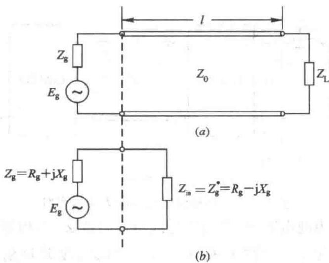{ width="440" }
<figcaption>图 7-16　信号源、传输线与负载（a），从始端看进去的等效电路（b）（图源：教材）</figcaption>
</figure>

!!! theorem "定理 7.8（共轭匹配）"

    设信号源电动势 $E_g$、内阻 $Z_g=R_g+\je X_g$，从始端向负载看去的输入阻抗 $Z_{\mathrm{in}}=R_{\mathrm{in}}+\je X_{\mathrm{in}}$。负载得到的功率

    $$P=\frac12\frac{|E_g|^2R_{\mathrm{in}}}{(R_g+R_{\mathrm{in}})^2+(X_g+X_{\mathrm{in}})^2}$$

    在 $X_{\mathrm{in}}=-X_g$、$R_{\mathrm{in}}=R_g$ 时最大，即

    $$Z_{\mathrm{in}}=Z_g^*,\qquad P_{\max}=\frac{|E_g|^2}{8R_g}.$$

    （无耗线上始端吸收的功率全部送到负载。）

**证明。** 先令分母中 $(X_g+X_{\mathrm{in}})^2=0$；再对 $\dfrac{R_{\mathrm{in}}}{(R_g+R_{\mathrm{in}})^2}$ 求导，令导数为零得 $R_{\mathrm{in}}=R_g$。

### 7.7.2 阻抗匹配的方法

理想的传输系统：信号源端共轭匹配（输出最大功率），负载端与线匹配（全部吸收、无驻波）。信号源端一般用隔离器解决，所以重点是**负载匹配**。从频带上分有窄带匹配和宽带匹配，从手段上分有 **$\lambda/4$ 阻抗变换器**和**支节调配器**。

<figure markdown>
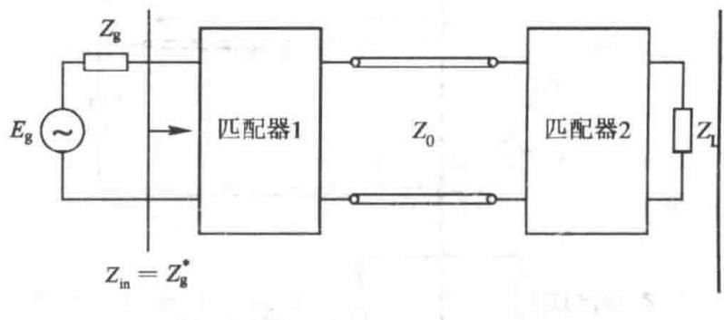{ width="560" }
<figcaption>图 7-17　匹配器 1 使信号源端共轭匹配，匹配器 2 使负载与传输线匹配（图源：教材）</figcaption>
</figure>

**1. $\lambda/4$ 阻抗变换器**

!!! theorem "定理 7.9（$\lambda/4$ 阻抗变换器）"

    纯电阻负载 $R_L\ne Z_0$ 时，在两者之间接一段长 $\lambda/4$、特性阻抗为 $Z_{01}$ 的传输线，由 $\lambda/4$ 变换性 $Z_{\mathrm{in}}=Z_{01}^2/R_L$。取

    $$Z_{01}=\sqrt{Z_0R_L}$$

    则 $Z_{\mathrm{in}}=Z_0$，实现匹配。

<figure markdown>
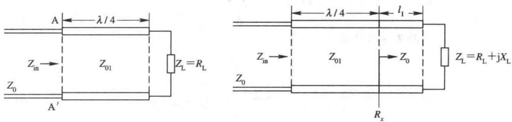{ width="720" }
<figcaption>图 7-18　$\lambda/4$ 阻抗变换器：纯电阻负载（左）；复数负载时接在波腹或波节处（右）（图源：教材）</figcaption>
</figure>

$Z_{01}$ 是实数，所以变换器只能直接匹配**电阻性**负载。复数负载可以先“走”到离负载最近的电压波腹或波节——那里阻抗是纯电阻（定理 7.4）——再接入变换器：

- 接在**波腹**（$l_1=z_{\max1}=\dfrac{\phi_L}{4\pi}\lambda$），$R_x=Z_0\rho$，$Z_{01}=Z_0\sqrt\rho$；
- 接在**波节**（$l_1=z_{\min1}=\dfrac{\phi_L}{4\pi}\lambda+\dfrac\lambda4$），$R_x=Z_0/\rho$，$Z_{01}=Z_0/\sqrt\rho$。

!!! example "例题 7.9（复数负载的 $\lambda/4$ 匹配，教材习题 7.19）"

    $Z_0=150\ \Omega$ 的无耗线接 $Z_L=(250+\je100)\ \Omega$，用 $\lambda/4$ 变换器匹配，求 $Z_{01}$ 及接入位置。

    **解。** $\Gamma_L=\dfrac{100+\je100}{400+\je100}=0.343\angle30.96^\circ$，$\rho=\dfrac{1.343}{0.657}=2.044$。负载是感性的，向电源先遇到电压波腹：

    $$l_1=\frac{\phi_L}{4\pi}\lambda=\frac{0.540}{4\pi}\lambda=0.043\lambda,\qquad Z_{01}=Z_0\sqrt\rho=150\sqrt{2.044}\approx214.5\ \Omega .$$

    也可以接在第一个波节 $0.293\lambda$ 处，此时 $Z_{01}=150/\sqrt{2.044}\approx104.9\ \Omega$。

**带宽。** $\lambda/4$ 变换器的长度只在中心频率 $f_0$ 处恰为 $\lambda/4$，偏离 $f_0$ 后匹配变差，是**窄带**的。用多节阶梯（每节 $\lambda/4$，阻抗逐级过渡）可以展宽频带；渐变线是阶梯数趋于无穷的极限。

<figure class="video" markdown>
<video controls preload="metadata" width="100%" poster="assets/posters/C7_Match.jpg"><source src="assets/videos/C7_Match.mp4" type="video/mp4"></video>
<figcaption>动画 7-5　上半段：50 Ω 线匹配 100 Ω 负载，单节 $\lambda/4$ 变换器与两节阶梯变换器的 $|\Gamma_{\mathrm{in}}|$ 随频率变化，阶梯越多带宽越宽。下半段：在导纳圆图上完成单支节匹配（例题 7.10）。</figcaption>
</figure>

<figure markdown>
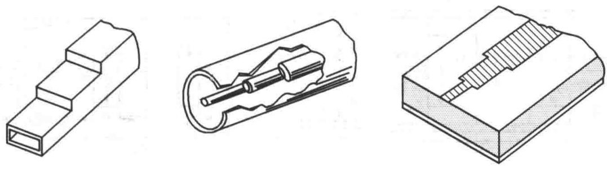{ width="680" }
<figcaption>图 7-19　几种实际的多阶梯阻抗匹配器（图源：教材）</figcaption>
</figure>

**2. 支节匹配**

在离负载 $d$ 处**并联**一段短路（或开路）支节，是另一种常用的匹配方法，它可以直接匹配任意复数负载，且只用一种 $Z_0$ 的线。并联元件用导纳计算方便，所以在导纳圆图上做：

1. 由 $\bar Z_L$ 求 $\bar Y_L=1/\bar Z_L$（圆图上绕圆心转 $180^\circ$）；
2. 沿等 $\rho$ 圆向电源（顺时针）转，直到与 **$g=1$ 圆**相交，此处 $\bar Y=1+\je b$，转过的电长度就是 $d$；
3. 并联一段输入电纳为 $-\je b$ 的支节，总导纳变为 $1$，匹配。短路支节 $\bar Y_s=-\je\cot\beta l$，开路支节 $\bar Y_s=\je\tan\beta l$。

!!! example "例题 7.10（单支节匹配）"

    $Z_0=50\ \Omega$，$Z_L=(100+\je50)\ \Omega$，用并联短路支节匹配。

    **解。** $\bar Z_L=2+\je1$，$\bar Y_L=\dfrac{1}{2+\je1}=0.4-\je0.2$。设距离为 $d$，$t=\tan\beta d$：

    $$\bar Y(d)=\frac{\bar Y_L+\je t}{1+\je\bar Y_Lt},\qquad\Re\bar Y(d)=1 .$$

    数值求解（或在圆图上读）得两组解：

    - $d_1\approx0.199\lambda$，$\bar Y=1+\je1$：支节需 $-\je1$，$\cot\beta l=1$，$l=\lambda/8$；
    - $d_2\approx0.375\lambda$，$\bar Y=1-\je1$：支节需 $+\je1$，$-\cot\beta l=1$，$l=3\lambda/8$。

    一般选 $d$ 和 $l$ 都较短的一组，频带更宽。

### 7.7.3 滤波器

**滤波器**用来分离或组合不同频率的信号，按功能分低通、高通、带通、带阻；按实现分无源、有源；按结构分同轴型、波导型、微带型。主要指标有工作频段、中心频率、带宽、带内插入损耗、带外衰减、输入输出驻波比等。

微波滤波器的设计思路是：先设计**集总参数原型低通滤波器**（串联电感、并联电容的梯形网络），经频率变换得到所需类型，再用**传输线段**实现其中的 $L$ 和 $C$——因为微波频段的集总元件寄生参数太大。

**1. 同轴型（微带型）低通滤波器：高低阻抗线**

<figure markdown>
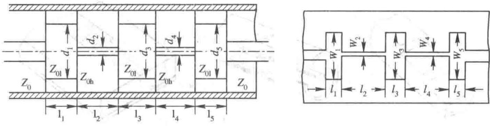{ width="680" }
<figcaption>图 7-21　高、低阻抗段级联构成的同轴型（左）和微带型（右）低通滤波器（图源：教材）</figcaption>
</figure>

一段长 $l<\lambda/8$、特性阻抗 $Z_{0h}$ 很高的线，两端接较低阻抗 $Z_0$：由 $Z_{\mathrm{in}}=Z_{0h}\dfrac{Z_0+\je Z_{0h}\tan\beta l}{Z_{0h}+\je Z_0\tan\beta l}$，$Z_0\ll Z_{0h}$ 时 $Z_{\mathrm{in}}\approx Z_0+\je Z_{0h}\beta l$，相当于**串联电感** $L\approx Z_{0h}l/v_p$。同理，短的低阻抗段相当于**并联电容** $C\approx l/(Z_{0l}v_p)$。直观地看：高阻抗段导体细（$L_0$ 大），低阻抗段导体粗（$C_0$ 大）。高低阻抗段交替级联就实现了 $L$–$C$ 梯形低通网络。

**2. 微带型带阻滤波器**

<figure markdown>
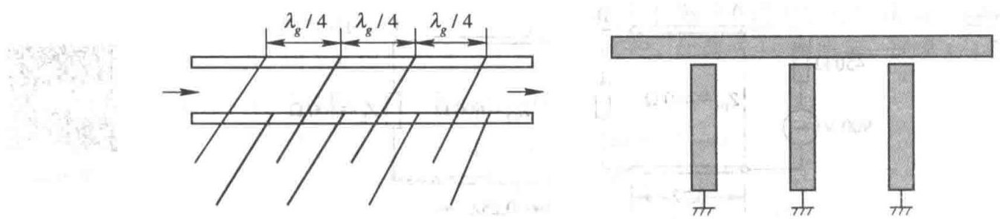{ width="680" }
<figcaption>图 7-24、图 7-25　相隔 $\lambda_g/4$ 的谐振短截线构成带阻滤波器（左），微带实现（右，略去接地板）（图源：教材）</figcaption>
</figure>

主线旁每隔 $\lambda_g/4$ 接一个短截线，短截线等效为**串联谐振电路**：在谐振频率上它的阻抗接近零，把主线短路，信号无法通过；偏离谐振时它几乎不起作用。微带实现中，一端接地、长度小于 $\lambda_g/4$ 的分支线等效为电感，与主线之间的缝隙等效为耦合电容，组成串联谐振。多个谐振器相隔 $\lambda_g/4$ 是为了展宽阻带。

微波滤波器与低频滤波器的原理相同，但必须用分布参数元件实现；分布参数难以精确控制，设计往往需要更多的仿真和实验调整。

---

## 知识点归纳总结

!!! abstract "知识点归纳总结"

    **一条主线**：分布参数 $\Rightarrow$ 电报方程 $\Rightarrow$ 入射波 + 反射波 $\Rightarrow$ 用 $\Gamma$、$Z_{\mathrm{in}}$、$\rho$ 描述状态 $\Rightarrow$ 用圆图计算 $\Rightarrow$ 用变换器和支节做匹配。

    **核心公式（无耗线，$z$ 从负载量起）：**

    | 量 | 公式 |
    |---|---|
    | 特性阻抗 | $Z_0=\sqrt{\dfrac{R_0+\je\omega L_0}{G_0+\je\omega C_0}}\ \xrightarrow{\text{无耗}}\ \sqrt{\dfrac{L_0}{C_0}}$ |
    | 传播常数 | $\gamma=\alpha+\je\beta$；无耗 $\beta=\omega\sqrt{L_0C_0}$；低耗 $\alpha=\dfrac{R_0}{2Z_0}+\dfrac{G_0Z_0}{2}$ |
    | 相速、波长 | $v_p=\dfrac{1}{\sqrt{L_0C_0}}=\dfrac{c}{\sqrt{\varepsilon_r}}$，$\lambda_g=\dfrac{\lambda_0}{\sqrt{\varepsilon_r}}$ |
    | 反射系数 | $\Gamma_L=\dfrac{Z_L-Z_0}{Z_L+Z_0}$，$\Gamma(z)=\Gamma_L\mathrm e^{-\je2\beta z}$ |
    | 输入阻抗 | $Z_{\mathrm{in}}=Z_0\dfrac{Z_L+\je Z_0\tan\beta z}{Z_0+\je Z_L\tan\beta z}=Z_0\dfrac{1+\Gamma}{1-\Gamma}$ |
    | 驻波比 | $\rho=\dfrac{1+\lvert\Gamma_L\rvert}{1-\lvert\Gamma_L\rvert}$，$K=1/\rho$ |
    | 波腹、波节 | $z_{\max}=\dfrac{\phi_L}{4\pi}\lambda+n\dfrac\lambda2$，$R_{\max}=Z_0\rho$；$z_{\min}=z_{\max}+\dfrac\lambda4$，$R_{\min}=Z_0/\rho$ |
    | 短路线、开路线 | $\je Z_0\tan\beta l$；$-\je Z_0\cot\beta l$ |
    | 效率、功率容量 | $\eta=\dfrac{1-\lvert\Gamma_L\rvert^2}{\mathrm e^{2\alpha l}-\lvert\Gamma_L\rvert^2\mathrm e^{-2\alpha l}}$；$P_{\max}=\dfrac{U_M^2}{2\rho Z_0}$ |
    | 双线、同轴线 | $Z_0=\dfrac{120}{\sqrt{\varepsilon_r}}\ln\dfrac{2D}{d}$；$Z_0=\dfrac{60}{\sqrt{\varepsilon_r}}\ln\dfrac ba$ |
    | 微带线 | $\varepsilon_e=1+q(\varepsilon_r-1)$，$Z_0=Z_0^a/\sqrt{\varepsilon_e}$，$\lambda_g=\lambda_0/\sqrt{\varepsilon_e}$ |
    | 匹配 | $\lambda/4$ 变换器 $Z_{01}=\sqrt{Z_0R_L}$；共轭匹配 $Z_{\mathrm{in}}=Z_g^*$，$P_{\max}=\dfrac{\lvert E_g\rvert^2}{8R_g}$ |

    **两个“魔法长度”：** $\lambda/2$——阻抗重复；$\lambda/4$——阻抗倒置（$Z\to Z_0^2/Z$，短路 $\leftrightarrow$ 开路，感性 $\leftrightarrow$ 容性）。

    **解题方法：**

    1. **求某点阻抗**：公式法 $Z_{\mathrm{in}}(z)$；或圆图法（归一化 → 找点 → 顺时针转 $z/\lambda$ → 读数 → 乘 $Z_0$）。
    2. **由测量求负载**：$\rho$ 和 $l_{\min1}$ $\Rightarrow$ $Z_L=Z_0\dfrac{1-\je\rho\tan\beta l_{\min1}}{\rho-\je\tan\beta l_{\min1}}$；或圆图上从 $r=K$ 逆时针转 $l_{\min1}$。
    3. **复数负载 $\lambda/4$ 匹配**：求 $\Gamma_L$、$\rho$、$\phi_L$ → 波腹（$Z_0\sqrt\rho$）或波节（$Z_0/\sqrt\rho$）处接入。
    4. **支节匹配**：导纳圆图上 $\bar Y_L$ → 顺时针到 $g=1$ 圆 → 支节抵消电纳。

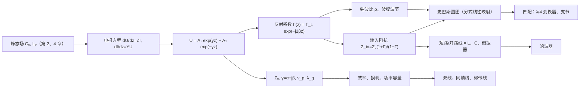

**易错点汇总。**

- 特性阻抗 $Z_0$ 是**行波**的电压电流比，不是线上任一点的 $U/I$（那是输入阻抗 $Z_{\mathrm{in}}$）；只有匹配时二者才相等。
- $\Gamma_L=\dfrac{Z_L-Z_0}{Z_L+Z_0}$，分子是“负载减线”，不要写反；电流反射系数是 $-\Gamma$。
- 驻波比只与 $|\Gamma|$ 有关，不含相位；仅凭 $\rho$ 不能确定负载，还需要波节（或波腹）位置。
- 圆图上“向电源 = 顺时针”，转角是 $2\beta z$（电长度 $z/\lambda$ 对应 $720^\circ\cdot z/\lambda$），转一周是 $\lambda/2$ 而不是 $\lambda$。
- $\lambda/4$ 变换器只能直接匹配纯电阻；复数负载必须先移到波腹或波节。
- 微带线的 $\lambda_g$ 用 $\varepsilon_e$ 而不是 $\varepsilon_r$；不同宽度的微带 $\varepsilon_e$ 不同。
- 功率计算用 $\frac12\Re(UI^*)$（复振幅为峰值）；有反射时 $P=\dfrac{|U_i|^2}{2Z_0}(1-|\Gamma|^2)$。

---

## 练习题

!!! example "练习 1"

    特性阻抗 50 Ω 的无耗线终端接 $R_L=100\ \Omega$。求 $\Gamma_L$，以及离负载 $0.2\lambda$、$0.25\lambda$、$0.5\lambda$ 处的反射系数和输入阻抗。

    ??? success "答案"

        $\Gamma_L=\dfrac{100-50}{100+50}=\dfrac13$，$\Gamma(z)=\dfrac13\mathrm e^{-\je4\pi z/\lambda}$：

        - $0.2\lambda$：$\Gamma=\dfrac13\mathrm e^{-\je0.8\pi}$；$\tan(0.4\pi)=3.078$，$Z_{\mathrm{in}}=50\dfrac{100+\je153.9}{50+\je307.8}=(26.9-\je11.9)\ \Omega=29.4\angle-23.8^\circ\ \Omega$；
        - $0.25\lambda$：$\Gamma=-\dfrac13$，$Z_{\mathrm{in}}=\dfrac{50^2}{100}=25\ \Omega$（$\lambda/4$ 变换）；
        - $0.5\lambda$：$\Gamma=\dfrac13$，$Z_{\mathrm{in}}=100\ \Omega$（$\lambda/2$ 重复）。

!!! example "练习 2"

    内、外导体直径分别为 0.25 cm 和 0.75 cm 的空气同轴线，求特性阻抗；若填充 $\varepsilon_r=2.25$ 的介质，求特性阻抗及 300 MHz 时线上的波长。

    ??? success "答案"

        空气：$Z_0=60\ln3=65.9\ \Omega$。填充后 $Z_0=\dfrac{60}{1.5}\ln3=43.9\ \Omega$，$\lambda_g=\dfrac{\lambda_0}{\sqrt{\varepsilon_r}}=\dfrac{1\ \mathrm m}{1.5}=66.7\ \mathrm{cm}$。

!!! example "练习 3"

    $Z_0=50\ \Omega$ 的无耗线，填充介质 $\varepsilon_r=2.25$、$\mu_r=1$，终端接 $R_L=1\ \Omega$，$f=100$ MHz 时线长为 $\lambda/4$。求：(1) 线的实际长度；(2) 终端反射系数；(3) 输入端反射系数；(4) 输入阻抗。

    ??? success "答案"

        (1) $\lambda_g=\dfrac{3\ \mathrm m}{1.5}=2$ m，$l=50$ cm。

        (2) $\Gamma_L=\dfrac{1-50}{1+50}=-\dfrac{49}{51}$。

        (3) $\Gamma_{\mathrm{in}}=\Gamma_L\mathrm e^{-\je\pi}=\dfrac{49}{51}$。

        (4) $Z_{\mathrm{in}}=\dfrac{Z_0^2}{R_L}=2500\ \Omega$。一个接近短路的负载经过 $\lambda/4$ 变成了接近开路。

!!! example "练习 4"

    $Z_0=50\ \Omega$ 的线上测得 $|\Gamma|=0.2$，求电压波腹点和波节点的输入阻抗。

    ??? success "答案"

        $\rho=\dfrac{1.2}{0.8}=1.5$，$R_{\max}=Z_0\rho=75\ \Omega$，$R_{\min}=Z_0/\rho=33.3\ \Omega$。验证 $R_{\max}R_{\min}=2500=Z_0^2$。

!!! example "练习 5"

    传输线长 1.2 m，工作波长 0.5 m。判断终端短路和开路时输入阻抗的性质；若 $Z_0=50\ \Omega$，终端分别接 100 Ω、20 Ω、50 Ω 时输入阻抗是什么性质？

    ??? success "答案"

        $l/\lambda=2.4$，去掉整数个 $\lambda/2$ 后等效长度 $0.4\lambda$，在 $\lambda/4$ 与 $\lambda/2$ 之间。

        - 短路：$\je Z_0\tan(0.8\pi)$，$\tan(0.8\pi)=-0.727<0$，**容性**；开路：$-\je Z_0\cot(0.8\pi)=+\je1.376Z_0$，**感性**。
        - $Z_L=100\ \Omega$：$Z_{\mathrm{in}}\approx(49.1+\je35.0)\ \Omega$，感性；$Z_L=20\ \Omega$：$Z_{\mathrm{in}}\approx(28.2-\je28.1)\ \Omega$，容性；$Z_L=50\ \Omega$：匹配，$Z_{\mathrm{in}}=50\ \Omega$，纯电阻。

        （$R_L>Z_0$ 时 $\Gamma_L>0$ 在正实轴，转 $0.4\lambda$ 即顺时针 $288^\circ$ 到上半圆；$R_L<Z_0$ 时从负实轴出发转到下半圆。）

!!! example "练习 6"

    无耗线 $Z_0=100\ \Omega$，负载 $Z_L=(50-\je50)\ \Omega$，求离负载 $0.15\lambda$ 处的输入阻抗（用圆图并用公式验证）。

    ??? success "答案"

        $\bar Z_L=0.5-\je0.5$，在下半圆（容性）。$\Gamma_L=\dfrac{-50-\je50}{150-\je50}=-0.2-\je0.4=0.447\angle-116.6^\circ$。顺时针转 $2\beta z=108^\circ$，$\Gamma$ 的辐角变为 $-224.6^\circ=135.4^\circ$，读得 $\bar Z_{\mathrm{in}}\approx0.44+\je0.34$，

        $$Z_{\mathrm{in}}\approx(43.5+\je34.2)\ \Omega .$$

        容性负载转过一段后变成了感性。

!!! example "练习 7"

    $Z_0=100\ \Omega$、长 $\lambda/8$ 的无耗线，终端接 $Z_L=(200+\je300)\ \Omega$，始端接电动势 $500\angle0^\circ$ V（峰值）、内阻 $R_g=100\ \Omega$ 的信号源。求：(1) 始端电压；(2) 负载吸收的平均功率；(3) 终端电压。

    ??? success "答案"

        (1) $\tan\beta l=1$：$Z_{\mathrm{in}}=100\dfrac{200+\je300+\je100}{100+\je(200+\je300)}=100\dfrac{200+\je400}{-200+\je200}=(50-\je150)\ \Omega$。

        $$U_{\mathrm{in}}=E_g\frac{Z_{\mathrm{in}}}{R_g+Z_{\mathrm{in}}}=500\times\frac{50-\je150}{150-\je150}=372.7\angle-26.57^\circ\ \mathrm V .$$

        (2) $I_{\mathrm{in}}=\dfrac{500}{150-\je150}=2.357\angle45^\circ$ A，$P=\dfrac12|I_{\mathrm{in}}|^2R_{\mathrm{in}}=\dfrac12\times5.556\times50=138.9$ W。无耗线，全部送到负载。

        (3) 由 $U(z)=U_L\cos\beta z+\je I_LZ_0\sin\beta z$ 反解：$U_L=U_{\mathrm{in}}\cos\beta l-\je I_{\mathrm{in}}Z_0\sin\beta l=424.9\angle-33.69^\circ$ V。验算：$\dfrac12\dfrac{|U_L|^2}{|Z_L|^2}\cdot200=\dfrac12\times\dfrac{180556}{130000}\times200=138.9$ W。

!!! example "练习 8"

    某微带线空气介质时 $Z_0^a=40\ \Omega$，实际基片 $\varepsilon_r=10$，填充因子 $q=0.4$。求特性阻抗、相速和波导波长。

    ??? success "答案"

        $\varepsilon_e=1+0.4\times9=4.6$，$\sqrt{\varepsilon_e}=2.145$。

        $$Z_0=\frac{40}{2.145}=18.65\ \Omega,\qquad v_p=\frac{c}{\sqrt{\varepsilon_e}}=1.40\times10^8\ \mathrm{m/s},\qquad\lambda_g=\frac{\lambda_0}{\sqrt{\varepsilon_e}}=0.466\lambda_0 .$$

!!! example "练习 9"

    坐标原点在负载处，$z$ 轴由负载指向电源（与本章一致）。(1) 无耗线上观察到纯驻波，电压波节分别位于：(a) $z=0$；(b) $z=\lambda/4$；(c) $0<z<\lambda/4$；(d) $\lambda/4<z<\lambda/2$。判断负载的类型。(2) 终端开路时，离负载 $\lambda/8$ 处的反射系数是多少？

    ??? success "答案"

        (1) 电压波节出现在 $\Gamma(z)=\Gamma_L\mathrm e^{-\je 2\beta z}$ 为负实数的地方。

        - (a) $z=0$ 就是波节：$\Gamma_L=-1$，**短路**。
        - (b) $z=\lambda/4$ 才是第一个波节：负载处为波腹，$\Gamma_L=+1$，**开路**。
        - (c) 第一个波节在 $0$ 与 $\lambda/4$ 之间：负载等效于一段短于 $\lambda/4$ 的开路线，输入阻抗为负电抗，**容性纯电抗**。
        - (d) 第一个波节在 $\lambda/4$ 与 $\lambda/2$ 之间：负载等效于一段短于 $\lambda/4$ 的短路线，**感性纯电抗**（图 7-A 把行驻波的情形也画出来了：感性负载第一个电压波腹就在 $\lambda/4$ 以内，再过 $\lambda/4$ 才到波节）。

        如果把原点放在电源端、把 $z$ 指向负载，上面的位置关系要整体反过来，结论会写反。做题前先看清坐标。

        (2) $\Gamma_L=+1$，$\Gamma(z)=\mathrm e^{-\je 2\beta z}$。$z=\lambda/8$ 时 $2\beta z=\pi/2$，故 $\Gamma(\lambda/8)=\mathrm e^{-\je\pi/2}=-\je$。若误用“离负载越远相位越超前”的相反约定，会得到 $+j$，符号正好反了。

!!! example "练习 10"

    $Z_0=50\ \Omega$ 的无耗线上测得 $U_{\max}=10$ V，$U_{\min}=6$ V，离负载最近的电压波节在 $0.12\lambda$ 处。求驻波比、终端反射系数的模，以及负载阻抗。

    ??? success "答案"

        $\rho=10/6=5/3$，$|\Gamma_L|=(\rho-1)/(\rho+1)=1/4$。由例题 7.3 的公式，把波节处的纯电阻 $Z_0/\rho$ 向负载方向移 $l_{\min}$：

        $$Z_L=Z_0\frac{1-\je\rho\tan\beta l_{\min}}{\rho-\je\tan\beta l_{\min}}.$$

        $\beta l_{\min}=0.24\pi$，$\tan\beta l_{\min}=\tan 43.2^\circ=0.939$，代入得

        $$Z_L\approx(42.9-\je 22.8)\ \Omega.$$

        第一个波节离负载不到 $\lambda/4$，由练习 9，$Z_L$ 的电抗为负，与计算结果一致。

!!! example "练习 11"

    长 $25$ m、填充 $\varepsilon_r=4$、特性阻抗 $Z_0=300\ \Omega$ 的无耗线，始端接幅值为 $100$ V、频率 $3$ MHz、内阻 $Z_g=200\ \Omega$ 的信号源。测得驻波比为 $1.5$，且终端为电压波节。求相速、线上波长、负载电阻、始端电压、负载吸收的平均功率，以及线上的电压波腹和波节值。

    ??? success "答案"

        $v_p=c/\sqrt{\varepsilon_r}=1.5\times10^8\ \mathrm{m/s}$，$\lambda=v_p/f=50$ m，线长正好是 $\lambda/2$，故 $Z_{\mathrm{in}}=Z_L$。终端是电压波节，负载为纯电阻且 $R_L=Z_0/\rho=300/1.5=200\ \Omega$，于是 $Z_{\mathrm{in}}=200\ \Omega$。

        始端分压 $U_{\mathrm{in}}=E_g Z_{\mathrm{in}}/(Z_g+Z_{\mathrm{in}})=50$ V。无耗线上负载吸收的平均功率等于始端输入功率（复振幅为峰值）

        $$P_L=\frac{|U_{\mathrm{in}}|^2}{2R_{\mathrm{in}}}=\frac{50^2}{2\times200}=6.25\ \mathrm W.$$

        $\lambda/2$ 线上 $|U|$ 周期重复，终端与始端都是波节：$U_{\min}=50$ V，$U_{\max}=\rho U_{\min}=75$ V。

!!! example "练习 12"

    信号源 $E_g=900$ V（峰值）、$Z_g=450\ \Omega$ 接到特性阻抗 $Z_{02}=450\ \Omega$ 的无耗线 AB 上。B 处并联电阻 $R=900\ \Omega$，同时经特性阻抗 $Z_{01}=600\ \Omega$ 的 $\lambda/4$ 变换器接到负载 $Z_L=400\ \Omega$。求 (1) 变换器段的终端反射系数与驻波比；(2) AB 段是否为行波；(3) A 点的电压、电流以及电源输出的平均功率；(4) 负载吸收的功率。

    ??? success "答案"

        (1) 变换器看向负载：$\Gamma_L=(400-600)/(400+600)=-0.2$，$|\Gamma_L|=0.2$，$\rho=1.5$。

        (2) $\lambda/4$ 变换把 $Z_L$ 变成 $Z_L'=Z_{01}^2/Z_L=600^2/400=900\ \Omega$，再与 $R=900\ \Omega$ 并联得 $450\ \Omega$，恰好等于 $Z_{02}$，所以 AB 段匹配，是**行波**。

        (3) 从 A 点向右看 $Z_{\mathrm{in}}=450\ \Omega=Z_g$，源端共轭匹配（两者都是实数），

        $$U_A=E_g\frac{Z_{\mathrm{in}}}{Z_g+Z_{\mathrm{in}}}=450\ \mathrm V,\qquad I_A=\frac{U_A}{Z_{\mathrm{in}}}=1\ \mathrm A.$$

        电源输出的平均功率 $P=\frac12\Re(U_A I_A^*)=225$ W。

        (4) AB 段无反射，这 $225$ W 全部到达 B。B 处两个 $900\ \Omega$ 并联均分，负载经 $\lambda/4$ 变换器看来也是 $900\ \Omega$，故 $Z_L$ 吸收 $112.5$ W。

!!! quote "参考资料"

    本章图 7-A、图 7-B、图 7-C、图 7-D 取自[上海交通大学何广强《电磁场与波》公开课件](https://qnp.sjtu.edu.cn/content.aspx?flag=56&info_lb=56)；练习 9–12 改编自[浙江大学 icicles](https://github.com/QSCTech/zju-icicles) 收录的课程测验与期中试题。

---

下一章：[第 10 章 无线信道、电磁干扰与电磁兼容](ch10.md)——电磁波离开传输线、经天线辐射进入自由空间之后，在大地、大气和电离层中如何传播，以及电子设备之间如何互不干扰。
