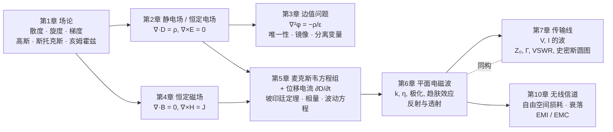

# 电磁场与电磁波从零到精通

这是一份面向**电子信息类本科生**的《电磁场与电磁波》讲义。章节结构与郭辉萍、刘学观编著的《电磁场与电磁波》（第 6 版，西安电子科技大学出版社）一致，讲第 1–7 章和第 10 章；第 8 章（波导与谐振器）、第 9 章（辐射与接收）不在本站范围内。

每一章都会先建立**几何与物理直觉**，再给出严格的定义和定理，然后做手算例题。重要的过程配有 manim 动画，直接嵌在正文里。全书还有一条贯穿始终的主线：**场论 → 静态场 → 麦克斯韦方程组 → 电磁波 → 传输线 → 无线信道**。

!!! tip "怎么用这份讲义"

    - 第一次学：按顺序读，每节先看“直觉”框和动画，再看定义、定理，最后自己做例题。
    - 复习考试：看每章末的**知识点归纳总结**和**练习题**，再配合[公式速查](formulas.md)和[全课程总结](summary.md)。
    - 遇到“前后联系”框：它告诉你这个知识点在哪一章还会用到，或者和复变函数有什么关系。

## 绪论

### 1. 释名

“电磁场与电磁波”其实包含四个概念：**电场、磁场、电磁场、电磁波**。

- 静止电荷产生**静电场**；恒定流动的电荷（恒定电流）在导体中产生**恒定电场**，在周围产生**恒定磁场**。这三种场不随时间变化，电场与磁场**可以分开研究**（第 2–4 章）。
- 场一旦随时间变化，变化的磁场产生电场，变化的电场产生磁场，两者耦合成不可分割的**电磁场**（第 5 章）。
- 电磁场以有限速度在空间传播，就是**电磁波**（第 6 章）。电磁波可以沿导线传播（第 7 章，传输线），也可以在自由空间中传播（第 10 章，无线信道）。

### 2. 历史回顾

| 年份 | 事件 | 对应章节 |
|---|---|---|
| 1785 | 库仑定律：两静止点电荷之间的作用力 | 第 2 章 |
| 1820 | 奥斯特发现电流的磁效应；随后有毕奥–萨伐尔定律、安培定律 | 第 4 章 |
| 1831 | 法拉第发现电磁感应 | 第 5 章 |
| 1864 | 麦克斯韦提出位移电流，写出方程组，预言电磁波 | 第 5 章 |
| 1888 | 赫兹用实验证实电磁波 | 第 6 章 |
| 1895 | 马可尼、波波夫实现无线电通信 | 第 10 章 |

### 3. 一条主线：源产生场

整门课只有一个问题：**给定源（电荷、电流），场是什么样的？场又怎样反过来作用于电荷？**

第 1 章的**亥姆霍兹定理**给出答案的框架：一个矢量场完全由它的**散度**（标量源）、**旋度**（矢量源）和边界条件决定。于是每一种场都可以用“散度方程 + 旋度方程 + 本构关系 + 边界条件”四件套来描述：

| 场 | 散度方程（标量源） | 旋度方程（矢量源） | 本构关系 | 位函数 |
|---|---|---|---|---|
| 静电场（第 2 章） | $\nabla\cdot\vv D=\rho_V$ | $\nabla\times\vv E=\vv 0$ | $\vv D=\varepsilon\vv E$ | $\vv E=-\nabla\phi$，$\nabla^2\phi=-\rho_V/\varepsilon$ |
| 恒定电场（第 2 章） | $\nabla\cdot\vv J=0$ | $\nabla\times\vv E=\vv 0$ | $\vv J=\sigma\vv E$ | $\nabla^2\phi=0$ |
| 恒定磁场（第 4 章） | $\nabla\cdot\vv B=0$ | $\nabla\times\vv H=\vv J$ | $\vv B=\mu\vv H$ | $\vv B=\nabla\times\vv A$，$\nabla^2\vv A=-\mu\vv J$ |
| 时变电磁场（第 5 章） | $\nabla\cdot\vv D=\rho_V$，$\nabla\cdot\vv B=0$ | $\nabla\times\vv E=-\dfrac{\partial\vv B}{\partial t}$，$\nabla\times\vv H=\vv J+\dfrac{\partial\vv D}{\partial t}$ | 同上 | 波动方程 |

从上往下读这张表：前三行的方程都是第四行**令 $\partial/\partial t=0$** 得到的特例。时变时，两条旋度方程把 $\vv E$ 和 $\vv H$ 耦合起来，于是出现了波。

### 4. 三组贯穿全书的类比

!!! info "类比一：静电场 ↔ 恒定电场 ↔ 恒定磁场"

    三种静态场的方程形式完全相同，只是“演员”换了：

    | 静电场 | 恒定电场 | 恒定磁场 |
    |---|---|---|
    | $\vv E,\ \vv D,\ \varepsilon$ | $\vv E,\ \vv J,\ \sigma$ | $\vv H,\ \vv B,\ \mu$ |
    | 电容 $C=q/U$ | 电导 $G=I/U$ | 电感 $L=\Psi/I$ |
    | $D_{1n}-D_{2n}=\rho_S$，$E_{1t}=E_{2t}$ | $J_{1n}=J_{2n}$，$E_{1t}=E_{2t}$ | $B_{1n}=B_{2n}$，$H_{1t}-H_{2t}=J_S$ |

    其中最常用的是 $\dfrac{C}{G}=\dfrac{\varepsilon}{\sigma}$：算出一个，另一个就有了（第 2 章）。

!!! info "类比二：场的观点 ↔ 电路的观点"

    电路理论是电磁场理论在“尺寸远小于波长”时的近似：

    - 电压 $U=\int\vv E\cdot\dd\vv l$；电流 $I=\int\vv J\cdot\dd\vv S$。
    - 基尔霍夫电流定律是 $\nabla\cdot\vv J=-\partial\rho/\partial t$ 的积分形式；基尔霍夫电压定律是 $\oint\vv E\cdot\dd\vv l=0$ 在准静态下的近似。
    - $R,C,L$ 分别是恒定电场、静电场、磁场储能的“集总”描述；功率 $UI$ 是坡印廷矢量 $\vv E\times\vv H$ 的面积分。
    - 尺寸与波长可比时，集总参数失效，要改用**分布参数**，这就是传输线（第 7 章）。

!!! info "类比三：平面波 ↔ 传输线"

    | 均匀平面波（第 6 章） | 均匀传输线（第 7 章） |
    |---|---|
    | $E_x,\ H_y$ | $V,\ I$ |
    | 波阻抗 $\eta=\sqrt{\mu/\varepsilon}$ | 特性阻抗 $Z_0=\sqrt{L_0/C_0}$ |
    | 传播常数 $\gamma=\je\omega\sqrt{\mu\tilde\varepsilon}$ | $\gamma=\sqrt{(R_0+\je\omega L_0)(G_0+\je\omega C_0)}$ |
    | 反射系数 $\Gamma=\dfrac{\eta_2-\eta_1}{\eta_2+\eta_1}$ | $\Gamma_L=\dfrac{Z_L-Z_0}{Z_L+Z_0}$ |
    | 驻波、驻波比 | 驻波、驻波比 |

    两章的数学是同一套，学完第 6 章再读第 7 章会轻松很多。

### 5. 与《复变函数》的联系

本站的姊妹站点[复变函数从零到精通](https://cockroach-f.github.io/complex-functions/)中有几处内容会直接用到：

- **相量**（第 5 章时谐场）：$\cos(\omega t+\varphi)=\operatorname{Re}[e^{\je(\omega t+\varphi)}]$，见复变[第 1 章 复数](https://cockroach-f.github.io/complex-functions/ch1.html)。
- **二维静电场与解析函数**（第 3 章）：解析函数的实部、虚部都满足拉普拉斯方程，可分别看作等位线和电力线；共形映射能把复杂边界变成简单边界，见复变[第 2 章](https://cockroach-f.github.io/complex-functions/ch2.html)、[第 6 章](https://cockroach-f.github.io/complex-functions/ch6.html)。
- **史密斯圆图**（第 7 章）：$\Gamma=\dfrac{z-1}{z+1}$ 是一个分式线性映射，见复变[第 6 章](https://cockroach-f.github.io/complex-functions/ch6.html)。
- **留数与积分变换**：瞬态电路、信号与系统中的拉普拉斯反变换。

## 符号约定

| 记号 | 含义 |
|---|---|
| $\vv A$（粗斜体） | 矢量；$A=\lvert\vv A\rvert$ 是它的大小 |
| $\ax,\ay,\az$ | 直角坐标单位矢量 |
| $\arho,\aphi,\az$ | 圆柱坐标 $(\rho,\phi,z)$ 单位矢量 |
| $\ar,\atheta,\aphi$ | 球坐标 $(r,\theta,\phi)$ 单位矢量 |
| $\an$ | 分界面法向单位矢量（由媒质 2 指向媒质 1） |
| $\rho_V,\ \rho_S,\ \rho_l$ | 体、面、线电荷密度 |
| $\vv J,\ \vv J_S$ | 体电流密度、面电流密度 |
| $\phi$ | 电位（标量位）；$\vv A$ 为矢量磁位 |
| $\je$ | 虚数单位（$\je^2=-1$），时谐因子取 $e^{\je\omega t}$ |
| $\vv E(\vv r,t)$ 与 $\vv E(\vv r)$ | 瞬时值与复振幅（相量）；第 5 章起两者用自变量区分 |
| $\varepsilon_0\approx8.854\times10^{-12}\ \mathrm{F/m}$ | 真空介电常数 |
| $\mu_0=4\pi\times10^{-7}\ \mathrm{H/m}$ | 真空磁导率 |

## 这份讲义怎么读

**几种彩色框的含义。**

!!! tip "本章目标"

    每章开头：读完本章你应当掌握什么。

!!! info "直觉"

    先用几何和物理图像建立直觉，再看严格定义。

!!! definition "定义"

    严格的定义，按章编号（如定义 2.3）。

!!! theorem "定理"

    定理、定律和重要公式，按章编号；重要的给出推导。

!!! proof "推导 / 证明"

    推导过程，可以先跳过，学完例题再回来看。

!!! success "关键公式"

    需要记住的公式和结论。

!!! example "例题"

    带具体数字、可以手算的例题。建议先自己做一遍再看解答。

!!! warning "易错点"

    初学者和考试中最容易错的地方。

!!! note "前后联系"

    这个知识点在后面哪一章会再次用到。

!!! abstract "知识点归纳总结"

    每章结尾的要点回顾。

## 进度

| 章 | 内容 | 状态 |
|---|---|---|
| 第 1 章 | 矢量分析与场论 | 🚧 编写中 |
| 第 2 章 | 静电场和恒定电场 | 🚧 编写中 |
| 第 3 章 | 边值问题的解法 | 🚧 编写中 |
| 第 4 章 | 恒定电流的磁场 | 🚧 编写中 |
| 第 5 章 | 时变电磁场与电磁波 | 🚧 编写中 |
| 第 6 章 | 平面电磁波 | 🚧 编写中 |
| 第 7 章 | 传输线 | 🚧 编写中 |
| 第 10 章 | 无线信道、电磁干扰与电磁兼容 | 🚧 编写中 |

> **资料来源。** 章节结构、知识点顺序和部分例题、习题参考郭辉萍、刘学观编著《电磁场与电磁波》（第 6 版），少量插图取自该教材，见[参考资料与致谢](references.md)。讲解、推导、例题解答和动画均为本站编写制作。
