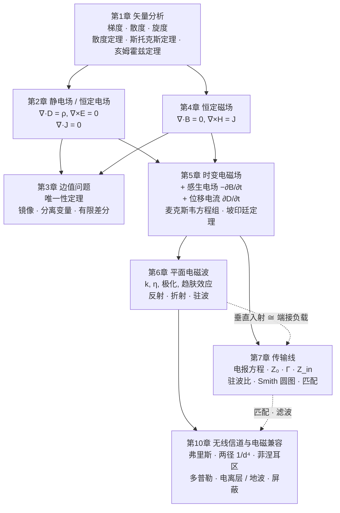

# 全课程总结：一条主线串起八章

全书八章（第 1–7 章、第 10 章）讲的是同一件事：**场由源产生，满足麦克斯韦方程，并以波的形式传播能量**。矢量分析提供语言，静态场是 $\partial/\partial t=0$ 的特例，麦克斯韦方程组把它们合在一起，平面波和传输线是它最重要的两类解，无线信道、电磁兼容则是这些解在工程中的表现。本页把这条主线完整地走一遍，再整理几组反复出现的类比和期末题型。

---

## 1. 知识地图

## 2. 主线：从“源”到“波”

| 步骤 | 内容 | 在哪一章 |
|---|---|---|
| ① | 场用通量和环量描述；散度是通量源密度，旋度是涡旋源密度；散度 + 旋度 + 边界条件唯一确定一个矢量场（亥姆霍兹定理） | 第 1 章 |
| ② | 静电场：有散无旋，$\nabla\cdot\vv D=\rho_V$，$\nabla\times\vv E=\vv 0$，所以可以用标量电位 $\vv E=-\nabla\phi$ | 第 2 章 |
| ③ | 恒定磁场：有旋无散，$\nabla\times\vv H=\vv J$，$\nabla\cdot\vv B=0$，所以可以用磁矢位 $\vv B=\nabla\times\vv A$ | 第 4 章 |
| ④ | 位函数满足泊松 / 拉普拉斯方程；只要满足方程和边界条件，用什么方法求出来的解都一样（唯一性定理） | 第 3 章 |
| ⑤ | 场随时间变化时补上两项：$-\partial\vv B/\partial t$ 使电场有旋，$\partial\vv D/\partial t$ 使电流连续；电场和磁场互相激发 | 第 5 章 |
| ⑥ | 无源区消去一个场得到波动方程，波速 $1/\sqrt{\mu\varepsilon}$——光就是电磁波 | 第 5 章 |
| ⑦ | 波动方程最简单的解是均匀平面波：TEM 波，$\vv H=\frac1\eta\vv a_k\times\vv E$；遇到分界面发生反射和折射 | 第 6 章 |
| ⑧ | 波被两根导体“引导”时，横截面上的场与静态场相同，沿线方向是波：用电压、电流描述就是传输线 | 第 7 章 |
| ⑨ | 波在真实环境中传播：弗里斯公式给出的自由空间损耗、大气与电离层、地面反射（两径模型，远区功率按 $1/d^4$ 衰减）、菲涅耳区余隙、多径与多普勒衰落；同时也会成为干扰，需要屏蔽、接地、滤波 | 第 10 章 |

## 3. 几组反复出现的类比

### 3.1 三种静态场的对偶

| | 静电场 | 恒定电场 | 恒定磁场 |
|---|---|---|---|
| 基本场量 | $\vv E$，$\vv D=\varepsilon\vv E$ | $\vv E$，$\vv J=\sigma\vv E$ | $\vv H$，$\vv B=\mu\vv H$ |
| 无旋 / 无散 | $\nabla\times\vv E=\vv 0$ | $\nabla\times\vv E=\vv 0$ | $\nabla\cdot\vv B=0$ |
| 源 | $\nabla\cdot\vv D=\rho_V$ | $\nabla\cdot\vv J=0$ | $\nabla\times\vv H=\vv J$ |
| 位函数 | $\nabla^2\phi=-\rho_V/\varepsilon$ | $\nabla^2\phi=0$ | $\nabla^2\vv A=-\mu\vv J$ |
| 法向连续 | $D_n$（无面电荷时） | $J_n$ | $B_n$ |
| 切向连续 | $E_t$ | $E_t$ | $H_t$（无面电流时） |
| 集总参数 | $C=Q/U$ | $G=I/U$ | $L=\Psi/I$ |
| 能量 / 功率 | $\frac12CU^2=\frac12\int\vv D\cdot\vv E\dd V$ | $UI=\int\vv J\cdot\vv E\dd V$ | $\frac12LI^2=\frac12\int\vv B\cdot\vv H\dd V$ |

同一几何结构有 $\dfrac CG=\dfrac\varepsilon\sigma$（静电比拟），对于均匀填充的双导体 TEM 结构还有 $L_0C_0=\mu\varepsilon$。所以第 2、4 章算出的同轴线、双导线 $C_0$、$L_0$，到第 7 章直接给出 $Z_0=\sqrt{L_0/C_0}$ 和 $v_p=1/\sqrt{L_0C_0}=1/\sqrt{\mu\varepsilon}$。

### 3.2 场的观点与路的观点

| 场的观点 | 路的观点 | 联系 |
|---|---|---|
| $\vv E$、$\vv H$ | 电压 $U=\int\vv E\cdot\dd\vv l$、电流 $I=\oint\vv H\cdot\dd\vv l$ | 积分 |
| $\nabla\times\vv E=-\je\omega\mu\vv H$ | $\dfrac{\dd U}{\dd z}=(R+\je\omega L)I$ | 法拉第定律 → 串联阻抗（符号约定见表下说明） |
| $\nabla\times\vv H=(\sigma+\je\omega\varepsilon)\vv E$ | $\dfrac{\dd I}{\dd z}=(G+\je\omega C)U$ | 全电流定律 → 并联导纳 |
| 波阻抗 $\eta=\sqrt{\mu/\varepsilon}$ | 特性阻抗 $Z_0=\sqrt{L/C}$ | 都是“行波的电量 / 磁量” |
| 传播常数 $\gamma=\je\omega\sqrt{\mu\varepsilon_c}$ | $\gamma=\sqrt{(R+\je\omega L)(G+\je\omega C)}$ | 形式相同 |
| 坡印廷矢量 $\frac12\Re[\vv E\times\vv H^*]$ | 功率 $\frac12\Re[UI^*]$ | 对截面积分相等 |
| 反射系数 $R=\dfrac{\eta_2-\eta_1}{\eta_2+\eta_1}$ | $\Gamma_L=\dfrac{Z_L-Z_0}{Z_L+Z_0}$ | 平面波垂直入射 ≅ 传输线端接负载 |

**符号约定。** 表中两列的 $z$ 方向不同：平面波一列沿用第 6 章，$z$ 沿入射波传播方向，对 $\vv E=\ax E_x$、$\vv H=\ay H_y$ 有 $\dfrac{\dd E_x}{\dd z}=-\je\omega\mu H_y$、$\dfrac{\dd H_y}{\dd z}=-(\sigma+\je\omega\varepsilon)E_x$；传输线一列沿用第 7 章，$z$ 从负载量起、指向电源（与入射波方向相反），所以电报方程右边是正号。若把传输线的 $z$ 也改为从电源指向负载，两式变成 $\dfrac{\dd U}{\dd z}=-(R+\je\omega L)I$、$\dfrac{\dd I}{\dd z}=-(G+\je\omega C)U$，与平面波逐项对应。

电路理论是场论在“尺寸 ≪ 波长”时的近似：这时沿线的相位变化可以忽略，电压、电流只与时间有关；尺寸可以与波长比拟时就必须用分布参数（传输线）甚至直接用场。

### 3.3 “波”的统一图像

第 6 章的平面波与第 7 章的传输线，满足的是同一个一维亥姆霍兹方程 $\dfrac{\dd^2 f}{\dd z^2}-\gamma^2f=0$。由此得到一组完全平行的结论：

- 入射波 + 反射波 → 行驻波，驻波比 $\rho=\dfrac{1+|\Gamma|}{1-|\Gamma|}$；
- 全反射（理想导体 / 短路、开路、纯电抗负载）→ 纯驻波，平均功率为零；
- 相邻电压（电场）波腹与波节相距 $\lambda/4$，驻波图样以 $\lambda/2$ 为周期；
- $\lambda/4$ 的介质层（第 6 章）和 $\lambda/4$ 阻抗变换器（第 7 章）用的是同一个原理。
- 把一层介质看成一段传输线（[第 6 章「多层介质与传输线类比」](ch6.md#multilayer)）：两侧相同媒质、厚度 $d=n\lambda_2/2$ 的**半波窗**全透射；厚度 $d=(2n+1)\lambda_2/4$ 且 $\eta_2=\sqrt{\eta_1\eta_3}$ 的**匹配层**无反射，就是 $\lambda/4$ 变换器的场论原型。

### 3.4 复变函数与本课程

| 复变函数中的内容 | 在本课程中的用途 |
|---|---|
| [复数与欧拉公式](https://cockroach-f.github.io/complex-functions/ch1.html) | 相量 $\vv E(t)=\Re[\dot{\vv E}\mathrm e^{\je\omega t}]$，$\partial/\partial t\to\je\omega$ |
| [解析函数、调和函数](https://cockroach-f.github.io/complex-functions/ch2.html) | 二维无源区的电位是调和函数；等位线与电力线是一对共轭调和函数的等值线 |
| [共形映射、分式线性映射](https://cockroach-f.github.io/complex-functions/ch6.html) | 二维静电边值问题（微带、双导线）；Smith 圆图就是 $\Gamma=\dfrac{\bar Z-1}{\bar Z+1}$ 把右半 $\bar Z$ 平面映到单位圆 |

## 4. 期末题型与方法速查

| 题型 | 方法 | 章节 |
|---|---|---|
| 散度、旋度、梯度，验证散度 / 斯托克斯定理 | 选对坐标系；闭合面取外法向，环路与面元右手螺旋 | 第 1 章 |
| 对称电荷分布求场 | 高斯定律求 $\vv D$；分区间写结果 | 第 2 章 |
| 求电容 / 电导 / 接地电阻 | 设 $Q$（或 $I$）→ 场 → $U$ → $C=Q/U$；静电比拟 | 第 2 章 |
| 分界面上求场 | 法向 $D_n$（$B_n$）、切向 $E_t$（$H_t$）；$\an$ 由 2 指向 1 | 第 2、4、5 章 |
| 导体平面 / 球附近的点电荷 | 镜像法；镜像只在原区域内有效 | 第 3 章 |
| 矩形槽 / 圆柱区域电位 | 分离变量 + 叠加 + 正交展开 | 第 3 章 |
| 对称电流分布求磁场 | 安培环路定律；否则毕奥–萨伐尔定律 | 第 4 章 |
| 求电感、磁场能量 | $\Psi=\int\vv B\cdot\dd\vv S$，$L=\Psi/I$；或 $W_m=\frac12LI^2$ | 第 4 章 |
| 感应电动势 | $\mathscr E=-\dd\Psi/\dd t$；动生 $\oint(\vv v\times\vv B)\cdot\dd\vv l$ | 第 5 章 |
| 已知 $\vv E$ 求 $\vv H$、位移电流、$\vv S_{\text{av}}$ | 麦克斯韦方程（相量形式）；$\frac12\Re[\vv E\times\vv H^*]$ | 第 5、6 章 |
| 平面波参数（$k,\lambda,v_p,\eta$，$\alpha,\delta$） | 先判断 $\sigma/\omega\varepsilon$，再选无耗 / 低损耗 / 良导体公式 | 第 6 章 |
| 判断极化 | 统一写成 $\cos$，求 $\Delta\varphi=\varphi_y-\varphi_x$，结合传播方向判旋向 | 第 6 章 |
| 垂直 / 斜入射 | $R$、$T$、驻波比；斯涅尔定律、$\theta_c$、$\theta_B$ | 第 6 章 |
| 多层介质、增透膜 | 半波窗 $d=n\lambda_2/2$ 全透射；$\lambda/4$ 且 $\eta_2=\sqrt{\eta_1\eta_3}$ 无反射（与 $\lambda/4$ 变换器同一原理） | [第 6](ch6.md#multilayer)、[第 7](ch7.md#77) 章 |
| 传输线 $\Gamma$、$Z_{\text{in}}$、驻波比、电压分布 | $\Gamma_L\to\Gamma(z)=\Gamma_L\mathrm e^{-\je2\beta z}\to Z_{\text{in}}$；或 Smith 圆图 | 第 7 章 |
| 匹配设计 | $\lambda/4$ 变换器（接在波腹或波节处）；短截线 | 第 7 章 |
| 视距、自由空间损耗、两径与衰落 | [弗里斯](ch10.md#1021) $L_{bf}=32.45+20\lg f_{\mathrm{MHz}}+20\lg r_{\mathrm{km}}$ dB（各向同性）；视距 $r_v\approx4.12(\sqrt{h_1}+\sqrt{h_2})$ km（$h$ 以 m 计）；[两径](ch10.md#1033) 远区 $d>4h_1h_2/\lambda$ 时 $P_r\propto h_1^2h_2^2/d^4$；[多普勒](ch10.md#doppler) $f_D=(v/\lambda)\cos\theta$；余隙 $\ge 0.6F_1$（[菲涅耳区](ch10.md#fresnel)） | 第 10 章 |
| 屏蔽、接地、滤波 | [屏蔽效能](ch10.md#1082) $\mathrm{SE}=\mathrm{SE}_a+\mathrm{SE}_r$，$\mathrm{SE}_a=8.686\,t/\delta$；按干扰途径（传导 / 辐射）选措施 | 第 10 章 |

## 5. 自测清单

- [ ] 能在三种坐标系中写出梯度、散度、旋度，并说明它们的物理意义。
- [ ] 能用亥姆霍兹定理解释为什么静电场用标量位、恒定磁场用矢量位。
- [ ] 能写出静电场、恒定电场、恒定磁场的基本方程和边界条件，并列出三者的对偶关系。
- [ ] 能用镜像法、分离变量法解典型边值问题，并说明唯一性定理为什么保证结果正确。
- [ ] 能说出麦克斯韦对安培定律的修正及其必要性，写出麦克斯韦方程组的积分、微分、相量形式。
- [ ] 能用坡印廷定理分析同轴线中能量的流动。
- [ ] 能求均匀平面波在无耗、有耗、良导体中的全部参数，会判断极化。
- [ ] 能求平面波垂直入射、斜入射的反射与透射，说明全反射和布儒斯特角的条件。
- [ ] 能写出半波介质窗和 $\lambda/4$ 匹配层的条件，并说明它们与传输线 $\lambda/2$ 重复性、$\lambda/4$ 变换器是同一原理。
- [ ] 能由传输线方程推出 $Z_0$、$\gamma$、$\Gamma$、$Z_{\text{in}}$，并说明它与平面波反射的对应关系。
- [ ] 能用 Smith 圆图求输入阻抗、负载阻抗，设计 $\lambda/4$ 匹配。
- [ ] 能用弗里斯公式计算自由空间损耗和视线距离，会判断两径模型的 $1/d^4$ 区并求接收功率，会算多普勒频移和第一菲涅耳区余隙，能解释多径衰落和电离层反射。
- [ ] 能说明电磁干扰的三要素，并会估算屏蔽效能、选择接地和滤波措施。
